# Java后端八股

来源：《Java+AI八股》PDF（520页）。按 Java 后端技术模块整理，保留原文题目、答案、代码和技术配图。

已剔除 AI 基础、RAG、Agent、AI 框架、AI 编程，以及 MySQL、Redis 中的 Text2SQL、大模型会话和 Agent 记忆内容；面经中保留后端技术题，省去自我介绍、面试感想、智力题和独立算法题。

各模块保留原文的高频题与扩展题层次，后端面经按主题归入对应模块；原文未附答案的题目已标注。答案沿用原文表述。

## 模块目录

- [Java基础](#module-01)
- [Java集合](#module-02)
- [JVM](#module-03)
- [Java并发](#module-04)
- [MySQL](#module-05)
- [Redis](#module-06)
- [Spring](#module-07)
- [计算机网络](#module-08)
- [消息队列](#module-09)
- [Linux与操作系统](#module-10)
- [设计模式](#module-11)
- [分布式与系统设计](#module-12)

<a id="module-01"></a>

## 01 Java基础

### 高频题

#### Java面向对象有哪四个特性？

面向对象有四个基本特性：封装、继承、多态、抽象。

- 封装：将数据和操作数据的方法封装在对象内部，通过访问控制隐藏实现细节。

- 继承：子类继承父类的属性和方法，实现代码复用和扩展。

- 多态：同一接口或父类引用可以指向不同子类对象，运行时调用实际对象的方法。

- 抽象：提取事物的共同特征，忽略非本质细节，通过抽象类或接口描述共性。

#### String、StringBuffer、StringBuilder 的区别？

三者主要区别在可变性、线程安全性和性能。

- String：不可变（immutable），底层字符数组不可修改，每次修改都会创建新的 String 对象，因此线程安全。

- StringBuffer：可变，方法使用 `synchronized`  加锁，线程安全，但同步带来一定性能开销。

- StringBuilder：可变，不加锁，线程不安全，但性能最高，适用于单线程场景。

性能：

- StringBuilder > StringBuffer > String

- String 每次修改都会创建新对象，频繁拼接字符串性能最差。

- StringBuffer 和 StringBuilder 都是在原对象上修改，不会频繁创建新对象。

使用场景：

- String：字符串内容基本不变，少量拼接。

- StringBuilder：单线程下大量字符串拼接，推荐使用。

- StringBuffer：多线程下大量字符串拼接，需要保证线程安全。

#### 继承和多态分别是什么，有什么区别？

继承是指子类继承父类的属性和方法，实现代码复用和功能扩展。Java 中通过 `extends`  实现继承，子类可以新增属性和方法，也可以重写父类方法。

多态是指同一方法在不同对象上具有不同的表现形式。它依赖于继承、方法重写和父类引用指向子类对象，运行时根据对象的实际类型调用对应的方法，实现动态绑定。

区别：

- 继承是类与类之间的关系，目的是代码复用和功能扩展。

- 多态是对象的行为特性，目的是统一接口、灵活调用，提高程序扩展性。

- 继承是实现多态的基础，多态通常依赖继承（或接口）和方法重写来实现。

#### Exception和 Error有什么区别？

`Exception`  和 `Error`  都继承自 Throwable，但表示的问题不同。

- Error：表示程序无法恢复的严重错误，通常由 JVM 抛出，一般不建议捕获处理，如OutOfMemoryError、StackOverflowError。

- Exception：表示程序运行过程中出现的可处理异常，可以通过 `try-catch`  或 `throws`  进行处理。

Exception 又分为两类：

- Checked Exception（受检异常）：编译器必须处理（捕获或抛出），如 `IOException` 、`SQLException` 。

- RuntimeException（运行时异常）：编译器不强制处理，通常由程序逻辑错误导致，如`NullPointerException` 、`IllegalArgumentException` 、`IndexOutOfBoundsException` 。

#### == 与 equals() 有什么区别？

- == ：

    - 基本数据类型：比较的是值是否相等。

    - 引用数据类型：比较的是对象的内存地址（是否指向同一个对象）。

- equals() ：

    - 只能用于引用数据类型，用于判断两个对象是否相等。

    - Object 类默认实现与 `==`  相同，也是比较对象地址。

    - 很多类（如 String、Integer）都会重写 `equals()` ，用于比较对象的内容是否相等。

String 的特殊情况：

- `String`  重写了 `equals()` ，比较的是字符串内容。

- 字符串字面量存放在字符串常量池中，相同字面量会复用同一个对象，因此：

```java
String a = "abc";
String b = "abc";
System.out.println(a == b);      // true
```

- 使用 `new String()`  会创建新的对象，因此：

```java
String a = new String("abc");
String b = new String("abc");
System.out.println(a == b);      // false
System.out.println(a.equals(b)); // true
```

#### 哈希冲突有哪些解决办法？

常见的解决哈希冲突的方法有开放定址法、再哈希法和链地址法。

1. 开放定址法：发生冲突时，在哈希表中继续寻找空闲位置存放元素。

    - 线性探测：依次向后查找空闲位置。

    - 平方探测：按照平方步长向前后查找空闲位置，减少聚集现象。

2. 再哈希法：准备多个哈希函数，发生冲突时使用其他哈希函数重新计算存储位置，直到找到空闲位置。

3. 链地址法（拉链法）：将哈希值相同的元素存放到同一个链表（JDK8 中链表长度超过阈值会转换为红黑树）中。这是 Java HashMap 采用的冲突解决方式。

#### 什么是幂等性？如何实现接口幂等？

幂等性是指同一个操作在相同条件下执行一次和执行多次，最终结果一致。在分布式系统中，由于网络超时、消息重复消费、接口重试等情况，很容易导致重复请求，因此接口通常需要保证幂等性。

常见的实现方式有：

- 唯一索引（去重表）：利用数据库唯一约束保证数据只能插入一次，例如用户点赞（用户ID+文章ID）、创建账户、订单号去重等场景。

- 状态标识：通过业务状态控制流程只能执行一次，例如订单已支付后，再次调用支付接口直接返回成功，不会重复扣款。

- Token 机制：客户端请求前先获取唯一 Token，提交时携带 Token，服务端校验后立即删除，同一个 Token 只能使用一次，常用于防止重复提交，如发帖、下单等。

#### 什么是泛型，以及泛型擦除？

- 泛型是 Java 在编译期提供的类型参数机制，用于提高代码的类型安全性和复用性，可以在编译阶段检查类型错误，避免频繁强制类型转换。

- 泛型擦除是指 Java 泛型采用类型擦除实现，在编译后所有泛型信息都会被擦除。编译器会将泛型T 擦除为 Object，如果有上界（如 `T extends Xxx` ），则擦除为对应的限定类型。因此，JVM 运行时并不知道泛型的具体类型。

由于类型擦除，Java 泛型属于伪泛型，这也带来了一些限制，例如不能使用泛型进行 instanceof判断、不能直接 new  泛型对象、不能创建泛型数组。类型擦除的主要目的是兼容旧版本 Java，提高向后兼容性，而无需修改 JVM。

#### 抽象类和接口有什么区别？

抽象类和接口都不能被实例化，都可以用于抽象行为，但抽象类侧重于代码复用，接口侧重于规范和能力扩展。

- 定义方式不同：抽象类使用 `abstract class`  定义，通过 `extends`  继承；接口使用`interface`  定义，通过 `implements`  实现，一个类只能继承一个抽象类，但可以实现多个接口。

- 成员不同：抽象类可以有成员变量、构造方法、普通方法和抽象方法；接口不能有实例变量和构造方法，只能定义常量，JDK8 开始支持 `default`  和 `static`  方法，JDK9 开始支持`private`  方法。

- 设计目的不同：抽象类用于抽取多个子类的公共属性和方法，实现代码复用；接口用于定义行为规范，实现多态和解耦。

使用场景：

- 当多个类存在共同属性和实现，需要复用代码时，使用抽象类。

- 当需要定义一组统一的行为规范，或者一个类需要具备多种能力时，使用接口。

#### Java 中重载（Overloading）和重写（Overriding）有什么区别？

重载和重写都是 Java 实现多态的方式，但重载是编译时多态，重写是运行时多态。

- 发生位置不同：重载发生在同一个类中；重写发生在父子类之间，需要存在继承或接口实现关系。

- 方法签名不同：重载要求方法名相同，但参数列表必须不同（参数类型、数量或顺序）；重写要求方法名、参数列表完全相同。

- 返回值要求不同：重载对返回值没有要求；重写返回值必须相同，或者是父类返回值的子类型（协变返回）。

- 访问权限不同：重载没有限制；重写时子类方法的访问权限不能比父类更严格。

- 异常要求不同：重载没有限制；重写不能抛出比父类更宽泛的受检异常。

- 方法限制不同：重载可以作用于普通方法、静态方法和构造方法；重写不能重写 `static` 、`final`  和 `private`  方法，其中 `static`  方法只能隐藏（Method Hiding），不能重写。

- 绑定时机不同：重载在编译期确定调用哪个方法，属于编译时多态；重写在运行期根据对象的实际类型决定调用哪个方法，属于运行时多态。

#### String 为什么设计成不可变？体现在哪里？如何实现？

String 被设计成不可变对象，主要是为了提高缓存效率、保证安全性和线程安全。

- 提高缓存效率：由于 String 不可变，相同内容的字符串可以安全地存放在字符串常量池中复用，减少对象创建，节省内存，提高性能。同时，String 作为 HashMap 的 Key 时，`hashCode`  可以缓存，不会因为内容改变导致哈希值失效。

- 保证安全性：String 常用于保存类名、文件路径、URL、数据库连接信息、Token 等敏感数据。不可变可以防止对象内容在使用过程中被篡改，提高系统安全性。

- 天然线程安全：多个线程可以共享同一个 String 对象，无需加锁。因为任何修改都会创建新的对象，不会影响其他线程正在使用的数据。

String 的不可变性体现在：

- String 对象创建后，其内容不能被修改。

- 所有修改字符串的方法（如 `concat()` 、`replace()` 、`substring()`  等）都不会修改原对象，而是返回一个新的 String 对象。

String 的不可变是如何实现的？

- 底层存储字符串的数据使用 private final  修饰（JDK8 为 `char[]` ，JDK9+ 为`byte[]` ），数组引用不能被修改。

- String 没有提供修改底层数组的方法，对字符串的任何修改都会创建新的对象。

- String 类使用 final  修饰，不能被继承，避免子类通过重写方法破坏其不可变性。

#### Java 的 IO 流体现了什么设计模式

Java IO 主要体现了装饰器模式和适配器模式。

- 装饰器模式（Decorator）：通过包装原始流对象，在不改变原有对象的基础上动态扩展功能。例如 `BufferedInputStream` 、`BufferedOutputStream` 、`BufferedReader`  等，都是在原始节点流外包装一层，为其增加缓冲功能，提高 IO 效率。

- 适配器模式（Adapter）：用于实现字节流和字符流之间的转换，使接口不兼容的类能够协同工作。例如 `InputStreamReader`  将 InputStream 适配为 Reader，`OutputStreamWriter`  将 OutputStream 适配为 Writer，实现了字节流与字符流之间的转换。

### 扩展题

#### 多态的目的，解决了什么问题

在Java中，多态性是面向对象编程中的一个重要概念，其目的是为了实现代码的灵活性和可扩展性，解决了以下几个问题：

1. 实现代码重用：多态性可以让不同类的对象对相同的消息做出不同的响应，这样就可以通过统一的接口来调用不同类的方法，实现了代码的重用。

2. 提高代码的可扩展性：通过多态性，可以方便地向现有的系统中引入新的类，而无需修改现有的代码。这样就提高了系统的可扩展性，使得系统更容易适应新的需求和变化。

```java
Zoo zoo = new Zoo();
zoo.makeAnimalSpeak(new Dog()); // 输出 Dog barks，Dog继承于父类Zoo
zoo.makeAnimalSpeak(new Cat()); // 输出 Cat meows，Cat继承于父类Zoo
```

3. 简化代码的维护：多态性可以降低代码之间的耦合度，使得各个类之间的关系更加灵活，因此当需要修改或扩展系统功能时，可以尽量避免对已有代码的修改，从而简化了代码的维护。

```java
interface Animal {
    void eat();
}

class Dog implements Animal {
    public void eat() {
        System.out.println("Dog eats bones");
    }
}

class Cat implements Animal {
    public void eat() {
        System.out.println("Cat eats fish");
    }
}

class Zoo {
    public void feed(Animal a) {
        a.eat(); // 调用者无需关心具体是哪种动物，增加老虎这一动物时，只需要增加一个类继承于eat这一接口
    }
}
```

多态性使得代码更加灵活，能够更好地适应变化，同时也提高了代码的可读性和可维护性。通过多态性，可以使得程序设计更加符合面向对象的原则，使得系统更易于扩展和维护。

#### Java创建对象有几种方式？

Java 常见有 5 种方式创建对象：

1. 使用 new  关键字。最常用，会调用构造方法。

```java
ObjectName obj = new ObjectName();
```

2. 使用反射创建对象。`Class#newInstance()`  已不推荐使用，更推荐通过构造器创建。

```java
ObjectName obj = ObjectName.class.getDeclaredConstructor().newInstance();
```

3. 使用 Constructor#newInstance()  创建对象。可以选择指定构造器。

```java
Constructor<ObjectName> constructor =ObjectName.class.getDeclaredConstructor();
ObjectName obj = constructor.newInstance();
```

4. 使用 clone()  复制已有对象。它不会走普通构造方法，要求类实现 `Cloneable`  并正确重写`clone()` 。

```text
ObjectName copy = source.clone();
```

5. 使用反序列化从字节流恢复对象。反序列化也不会走普通构造方法，需要类实现`Serializable` 。

```java
try (ObjectInputStream ois = new ObjectInputStream(new FileInputStream(FILE_NAME))) {
    ObjectName obj = (ObjectName) ois.readObject();
}
```

#### hashCode()有什么用

`hashCode()`  的作用是获取哈希码（`int`  整数），也称为散列码。这个哈希码的作用是确定该对象在哈希表中的索引位置。

`hashCode()`  定义在 JDK 的 `Object`  类中，这就意味着 Java 中的任何类都包含有`hashCode()`  函数。另外需要注意的是：`Object`  的 `hashCode()`  方法是本地方法，也就是用C 语言或 C++ 实现的。

我们以“ `HashSet`  如何检查重复”为例子来说明为什么要有 `hashCode` ？

`hashCode()`  和 `equals()` 都是用于比较两个对象是否相等。

##### (追问)为什么 JDK 还要同时提供这两个方法呢？

这是因为在一些容器（比如 `HashMap` 、`HashSet` ）中，有了 `hashCode()`  之后，判断元素是否在对应容器中的效率会更高（参考添加元素进`HashSet` 的过程）！

我们在前面也提到了添加元素进`HashSet` 的过程，如果 `HashSet`  在对比的时候，同样的`hashCode`  有多个对象，它会继续使用 `equals()`  来判断是否真的相同。也就是说 `hashCode`帮助我们大大缩小了查找成本。

##### (追问)为什么不只提供 hashCode()  方法呢？

这是因为两个对象的`hashCode`  值相等并不代表两个对象就相等。

##### (追问)那为什么两个对象有相同的 hashCode  值，它们也不一定是相等的？

因为 `hashCode()`  所使用的哈希算法也许刚好会让多个对象传回相同的哈希值。越糟糕的哈希算法越容易碰撞，但这也与数据值域分布的特性有关（所谓哈希碰撞也就是指的是不同的对象得到相同的`hashCode`  )。

总结下来就是：

- 如果两个对象的`hashCode`  值相等，那这两个对象不一定相等（哈希碰撞）。

- 如果两个对象的`hashCode`  值相等并且`equals()` 方法也返回 `true` ，我们才认为这两个对象相等。

- 如果两个对象的`hashCode`  值不相等，我们就可以直接认为这两个对象不相等。

#### 为什么重写 equals() 时必须重写 hashCode() 方法？

因为两个相等的对象的 `hashCode`  值必须是相等。也就是说如果 `equals`  方法判断两个对象是相等的，那这两个对象的 `hashCode`  值也要相等。

如果重写 `equals()`  时没有重写 `hashCode()`  方法的话就可能会导致 `equals`  方法判断是相等的两个对象，`hashCode`  值却不相等。

思考：重写 `equals()`  时没有重写 `hashCode()`  方法的话，使用 `HashMap`  可能会出现什么问题。

两个逻辑上相等的对象可能被存储在不同的位置，或者无法正确检索出已存储的对象。

总结：

- `equals`  方法判断两个对象是相等的，那这两个对象的 `hashCode`  值也要相等。

- 两个对象有相同的 `hashCode`  值，他们也不一定是相等的（哈希碰撞）。

#### 介绍一下Integer的缓存

在 Java 中，`Integer`  是常用包装类型。为了提高性能和节省内存，Java 提供了`IntegerCache` ，默认缓存 `-128`  到 `127`  之间的 `Integer`  对象。

需要注意：Java 规范要求至少缓存 `-128`  到 `127` ，HotSpot 中缓存上限可以通过 JVM 参数 `-XX:AutoBoxCacheMax=<size>`  调整，但下限固定为 `-128` 。

#### String类底层如何实现？String 底层数据类型是什么？

- JDK 1.8 及以前：底层使用 char[]  存储字符串。

```java
private final char[] value;
```

- JDK 1.9 及以后：底层改为 byte[]  存储，并增加 `coder`  字段标识编码（Latin1 或 UTF-16），减少内存占用，提高存储效率。

```java
private final byte[] value;
```

#### String类能被继承吗？

不能。`String`  类使用 final  修饰，因此不能被继承。

```java
public final class String
```

#### String有长度限制吗？

有，但编译期和运行期不同：

- 编译期：字符串常量存储在 Class 文件的常量池中，采用 `CONSTANT_Utf8_info`  结构，长度最大为 65535。

- 运行期：String 底层数组长度由 `int`  表示，理论最大长度为 2³¹-1，但实际受 JVM 堆内存大小限制，通常达不到理论最大值。

#### String s=“a”+“b” 会创建几个对象？

- 在Java中，字符串拼接操作 `"a" + "b"`  在编译时会被优化为 `"ab"` 。这是因为 `"a"`  和`"b"`  都是常量，编译器可以在编译时直接计算出结果。

- 因此，`"a" + "b"`  实际上会被优化为一个字符串字面量 `"ab"` ，而不会在运行时创建新的对象。

最终结果:

- 如果 `"ab"`  之前不存在于字符串常量池中，那么会创建一个新的字符串对象 `"ab"` 。

- 如果 `"ab"`  已经存在于字符串常量池中，则直接引用已有的对象，不会创建新的对象。

#### String s = new String("abc") 创建了几个对象，s是表示什么，创建的对象分别存放在哪里

会创建 1 或 2 个字符串对象。

- 字符串常量池中不存在 "abc"：会创建 2 个 字符串对象。一个在字符串常量池中，由 `ldc`  指令触发创建。一个在堆中，由 `new String()`  创建，并使用常量池中的 "abc" 进行初始化。

- 字符串常量池中已存在 "abc"：会创建 1 个 字符串对象。该对象在堆中，由 `new String()`  创建，并使用常量池中的 "abc" 进行初始化。

#### 什么是字符串常量池？

字符串常量池（String Constant Pool）是 JVM 在堆内存中维护的一块专门存储字符串常量的区域，用于复用相同内容的字符串，减少对象创建，提高内存利用率和性能。

当使用字符串字面量创建字符串时，JVM 会先到字符串常量池中查找是否已存在相同内容的字符串：

- 如果存在，直接返回该对象的引用。

- 如果不存在，则创建新的字符串对象放入常量池，并返回其引用。

例如：

```java
String s1 = "Hello";
String s2 = "Hello";

System.out.println(s1 == s2); // true
```

由于 `"Hello"`  已存在于字符串常量池中，`s1`  和 `s2`  指向的是同一个对象。

使用 `new String()`  会在堆中创建新的对象，不会直接复用常量池中的对象：

```java
String s1 = "Hello";
String s2 = new String("Hello");

System.out.println(s1 == s2); // false
```

如果调用 `intern()`  方法，JVM 会返回字符串常量池中的对象引用：

```java
String s1 = "Hello";
String s2 = new String("Hello").intern();

System.out.println(s1 == s2); // true
```

作用：

- 复用相同字符串，减少内存占用。

- 减少字符串对象创建，提高程序性能。

- 是 String 不可变特性和 `intern()`  方法实现的基础。

#### Java的IO模型(AIO、BIO、NIO)

Java 常见的 IO 模型有 BIO（同步阻塞）、NIO（同步非阻塞/IO 多路复用） 和 AIO（异步非阻塞），它们主要区别在于线程是否阻塞以及数据准备完成后的处理方式。

- BIO（Blocking I/O，同步阻塞）：每个客户端连接对应一个线程，线程发起 `read`  后会一直阻塞，直到数据读取完成。模型简单、编程方便，但连接数较多时需要大量线程，资源消耗大，不适合高并发场景。

- NIO（Non-blocking I/O，同步非阻塞）：基于 IO 多路复用（Selector） 实现，一个线程可以管理多个连接。线程先通过 `Selector` （底层依赖 `select` 、`epoll`  等系统调用）监听多个Channel，当某个连接就绪时，再进行读写操作。虽然 `read`  时仍然是同步的，但避免了大量线程阻塞等待，因此非常适合高并发、连接数多的场景，如 Netty、聊天服务器等。

- AIO（Asynchronous I/O，异步非阻塞）：JDK7 引入，也称 NIO.2。应用发起 IO 请求后立即返回，不会阻塞线程，等数据准备和拷贝完成后，由操作系统通过事件回调通知应用处理结果。真正实现了异步处理，理论上并发能力最高，但由于底层操作系统支持有限，实际生产中应用较少。

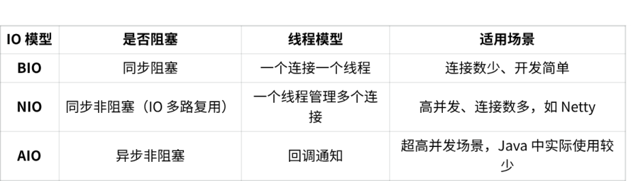

总结：

- BIO：一个连接一个线程，简单但性能低。

- NIO：一个线程管理多个连接，通过 Selector 实现 IO 多路复用，是目前 Java 高并发网络编程的主流方案。

- AIO：异步回调，由操作系统通知结果，理论性能最好，但实际应用不如 NIO 广泛。

#### 子类重写父类的方法，返回值能不能不一样

在Java中，子类重写父类的方法时，返回类型必须与父类方法的返回类型相同，或者是其返回类型的子类型

编译器会直接报错，通常会出现类似以下的错误信息：

```text
method does not override or implement a method from a supertype
```

或者：

```java
return type is incompatible with [父类名].[方法名]
```

#### 静态方法可以调用非静态属性吗

在Java中，静态方法不能直接调用非静态属性（实例变量）。原因和具体规则如下：

核心原因

1. 生命周期不同步

    - 静态方法在类加载时就初始化（不需要对象实例）

    - 非静态属性在对象实例化时才分配内存（需要`new` 关键字创建对象）

2. 访问权限冲突静态方法属于类级别，而非静态属性属于对象级别。直接访问会导致错误

<a id="module-02"></a>

## 02 Java集合

### 高频题

#### 集合

##### Java中的线程安全的集合是什么？

常见线程安全集合有：

1. 老的同步集合：`Vector` 、`Hashtable` 。

2. `Collections`  工具类包装出来的同步集合：`Collections.synchronizedList()` 、`Collections.synchronizedMap()` 、`Collections.synchronizedSet()` 。

3. JUC 包下的并发集合：`ConcurrentHashMap` 、`CopyOnWriteArrayList` 、`CopyOnWriteArraySet` 、`ConcurrentLinkedQueue` 、`BlockingQueue`  系列。

面试中重点回答 `ConcurrentHashMap`  和 `CopyOnWriteArrayList` 。

##### 集合的分类有哪些？

Java 集合主要分为两类：`Collection`  单列集合和 `Map`  双列集合。`Collection`  下面常见的有：

1. `List` ：有序、可重复，常见实现类有 `ArrayList` 、`LinkedList` 。

2. `Set` ：不允许重复，常见实现类有 `HashSet` 、`LinkedHashSet` 、`TreeSet` 。

3. `Queue` ：队列结构，常见实现类有 `ArrayDeque` 、`PriorityQueue` ，并发场景下还有各种`BlockingQueue` 。

`Map`  是双列集合，用来存储键值对，常见实现类有 `HashMap` 、`LinkedHashMap` 、`TreeMap` 、`Hashtable` 、`ConcurrentHashMap` 。

简单来说，`List`  关注顺序和重复，`Set`  关注去重，`Queue`  关注队列语义，`Map`  关注通过 key快速找到 value。

#### List

##### arraylist和linkedlist区别

1. 是否保证线程安全： `ArrayList`  和 `LinkedList`  都不是线程安全的。

2. 底层数据结构： `ArrayList`  底层是 `Object[]`  数组；`LinkedList`  底层是双向链表。

3. 随机访问： `ArrayList`  支持快速随机访问，因为可以直接通过下标访问元素，时间复杂度是O(1)。`LinkedList`  不支持高效随机访问，需要从头或尾开始遍历，时间复杂度是 O(n)。

4. 插入和删除：

    - `ArrayList`  在尾部添加元素通常是 O(1)，但是如果触发扩容，需要复制数组，成本就是O(n)。如果在指定位置插入或删除元素，需要移动后面的元素，时间复杂度也是 O(n)。

    - `LinkedList`  在头尾插入或删除元素是 O(1)，但是如果是在指定位置插入或删除，也需要先遍历到指定位置，所以整体仍然是 O(n)。

5. 内存占用： `ArrayList`  主要是数组可能预留一部分空间；`LinkedList`  每个节点除了存储数据，还要存储前驱和后继指针，所以单个元素占用空间更多。

总结：如果查询多、按下标访问多，一般用 `ArrayList` 。如果主要是在头尾增删，可以考虑`LinkedList` ，但是实际开发中 `ArrayList`  更常用。

##### 为什么 new ArrayList<>（）时建议指定初始化容量值？

因为 `ArrayList`  底层是数组，如果容量不够就会扩容。

扩容时会创建一个新数组，然后把旧数组中的元素复制到新数组中。这个过程会带来性能损耗。

如果一开始能预估集合大小，指定一个合适的初始化容量，就可以尽量减少扩容次数，从而提高性能，也能避免不必要的内存浪费。

例如：

```java
List<User> users = new ArrayList<>(1000);
```

需要注意的是，`new ArrayList<>(1000)`  只是指定容量，不代表集合中已经有 1000 个元素，此时 `size`  仍然是 0。

##### 为什么 ArrayList 默认情况下的扩容机制是扩容为原数组的1.5倍？

这是内存使用和性能之间的权衡。

如果扩容因子太大，可能申请了很多用不到的空间，造成内存浪费。

如果扩容因子太小，就会频繁扩容，每次扩容都要复制数组，造成性能浪费。

所以扩容为原数组的 1.5 倍，是一个比较折中的经验值，适合大多数场景。

##### ArrayList是线程的安全吗？

`ArrayList`  不是线程安全的。

如果 `ArrayList`  作为多线程共享数据，比如单例对象中的成员变量、静态变量等，那么多个线程并发修改时可能会出现线程安全问题。

例如：

1. 多个线程同时 `add()` ，可能导致元素覆盖。

2. 多个线程同时扩容，可能导致数据丢失。

解决方案：

1. 使用 `synchronized`  包裹对集合的操作。

2. 使用 `Collections.synchronizedList(new ArrayList<>())` 。

3. 使用 `CopyOnWriteArrayList` 。

##### CopyOnWriteArrayList 的实现原理

`CopyOnWriteArrayList`  底层也是数组。

它的核心思想是写时复制：

1. 读操作直接读取原数组，不加锁。

2. 写操作会先加锁。

3. 写入时不会直接修改原数组，而是复制一个新数组。

4. 在新数组上完成添加、删除、修改操作。

5. 操作完成后，再把数组引用指向新数组。

优点：

`CopyOnWriteArrayList`  读操作不加锁，写操作也不会阻塞读操作，所以读性能比较好，适合读多写少的场景。

缺点：

每次写操作都要复制数组，占用更多内存，而且读取到的数据可能不是最新的，所以不适合写多或者实时性要求很高的场景。

##### list和set的区别

`List`  和 `Set`  都属于 `Collection`  单列集合。

区别：

1. `List`  有序，可以重复；`Set`  不允许重复。

2. `List`  可以通过下标访问元素；普通 `Set`  不能通过下标访问。

3. `List`  常见实现类有 `ArrayList` 、`LinkedList` ；`Set`  常见实现类有 `HashSet` 、`LinkedHashSet` 、`TreeSet` 。

4. `HashSet`  通常无序，`LinkedHashSet`  可以保持插入顺序，`TreeSet`  可以按照规则排序。

使用场景：

如果需要按顺序保存并且允许重复，用 `List` 。如果需要去重，用 `Set` 。

##### 如果要进行大量的增加和删除使用arraylist好还是linkedlist好？

不能简单地说大量增加和删除就一定用 `LinkedList` 。

如果是在头尾进行增删，`LinkedList`  不需要移动元素，效率比较高。

如果是在指定位置增删，`LinkedList`  也需要先遍历到指定位置，这一步是 O(n)，所以不一定比`ArrayList`  快。

`ArrayList`  指定位置增删需要移动元素，但是它的数组结构缓存友好，实际开发中很多场景性能反而不差。

所以一般回答：头尾增删可以考虑 `LinkedList` ，普通业务列表优先考虑 `ArrayList` 。

#### Map

##### hashset和hashmap的区别

`HashSet`  底层就是基于 `HashMap`  实现的。

`HashSet`  添加元素时，本质上是把元素作为 `HashMap`  的 key 存进去，value 使用一个固定的占位对象。

所以 `HashSet`  不允许元素重复，本质原因是 `HashMap`  的 key 不允许重复。

`HashSet`  判断元素是否重复时，依赖元素的 `hashCode()`  和 `equals()`  方法。

##### equals 和 hashCode 为什么要一起重写？

在 `HashMap` 、`HashSet`  这类哈希结构中，会先通过 `hashCode()`  计算元素应该落在哪个桶里，然后再通过 `equals()`  判断元素是否真的相等。

规则：

1. 如果两个对象 `equals()`  返回 `true` ，那么这两个对象的 `hashCode()`  必须相等。

2. 如果两个对象的 `hashCode()`  相等，这两个对象不一定相等，因为可能发生哈希冲突。

如果只重写 `equals()` ，没有重写 `hashCode()` ，可能会导致两个逻辑上相等的对象落到不同桶中，最终导致 `HashMap`  查找失败，或者 `HashSet`  去重失败。

##### HashMap 底层数据结构是什么？

JDK1.7 中 `HashMap`  的底层结构是数组 + 链表。

JDK1.8 中 `HashMap`  的底层结构是数组 + 链表 + 红黑树。

数组中的每一个位置可以理解为一个桶。当多个 key 经过 hash 计算后落到同一个桶中，就产生了哈希冲突。

JDK1.8 之前主要通过链表解决冲突，JDK1.8 以后，如果链表过长，会把链表转成红黑树，提高查询效率。

##### HashMap的添加元素流程

调用 `map.put(key, value)`  时，大致流程如下：

1. 先计算 key 的 hash 值。

2. 通过 `(`数组长度 `- 1) & hash`  计算元素应该存放的数组下标。

3. 如果该位置为 `null` ，直接创建节点放进去。

4. 如果该位置不为 `null` ，说明发生哈希冲突，需要遍历链表或者红黑树。

5. 遍历过程中，如果发现 key 相同，就覆盖原来的 value。

6. 如果没有找到相同 key，就把新节点插入链表或红黑树中。JDK1.7 是头插法，JDK1.8 是尾插法。

7. JDK1.8 以后，如果链表长度大于等于 8，并且数组长度大于等于 64，会把链表转成红黑树。

8. 插入完成后，如果元素数量超过扩容阈值，就进行扩容。

##### hashmap为什么容量是2的幂次方

因为 `HashMap`  计算数组下标时使用的是：

```text
(n - 1) & hash
```

当数组长度 `n`  是 2 的幂时，`n - 1`  的二进制低位全是 1。

这样 `(n - 1) & hash`  的效果就和 `hash % n`  类似，但是位运算效率更高。

同时，数组长度是 2 的幂时，可以让 hash 分布更加均匀，减少某些位置永远无法命中的情况，从而降低哈希冲突的概率。

##### HashMap扩容加载因子为什么是0.75？

`HashMap`  默认负载因子是 `0.75` 。

也就是说，当元素数量达到数组长度的 `0.75`  倍时，就会触发扩容。

为什么是 0.75？

1. 如果负载因子太小，扩容会更频繁，空间利用率低，浪费内存。

2. 如果负载因子太大，虽然空间利用率高，但是哈希冲突会增多，查询性能会下降。

3. `0.75`  是在时间和空间之间取得的一个折中值，可以在减少哈希冲突和控制内存占用之间达到比较好的平衡。

##### hashmap扩容机制

`HashMap`  默认初始容量是 16，默认负载因子是 0.75，所以默认第一次扩容阈值是 12。

当 `HashMap`  中的元素数量超过阈值时，就会进行扩容。

扩容时，新数组容量会变成原来的 2 倍。

JDK1.8 中扩容时，元素的新位置只有两种情况：

1. 仍然在原来的位置。

2. 移动到 原位置 `+` 旧数组容量 的位置。

这样做的原因是数组长度每次都扩容为 2 倍，可以通过 hash 的某一位来判断元素扩容后的新位置，不需要重新完整取模。

##### HashMap为什么是线程不安全的

`HashMap`  不是线程安全的。

如果 `HashMap`  作为多线程共享数据，多个线程并发修改时可能会出现问题。

常见问题：

1. JDK1.7 中，多线程扩容时可能造成环形链表或数据丢失。

2. JDK1.8 中，多个线程同时往同一个空桶插入元素，可能出现数据覆盖。

3. 并发 put、resize 时，也可能出现数据丢失、读到异常数据等问题。

解决方案：

1. 使用 `synchronized`  包裹操作。

2. 使用 `Collections.synchronizedMap()` 。

3. 使用 `ConcurrentHashMap` 。

##### Hashtable与HashMap的区别

`Hashtable`  是实现 `Map`  接口的双列集合，底层基于数组 + 链表实现，key 和 value 都不允许为`null` ，并且它是线程安全的，主要通过 `synchronized`  实现。

区别：

1. 线程安全： `HashMap`  线程不安全，`Hashtable`  线程安全。

2. 效率： `HashMap`  效率更高，`Hashtable`  因为方法上大多加了 `synchronized` ，效率较低。

3. null 值： `HashMap`  允许一个 `null`  key 和多个 `null`  value；`Hashtable`  的 key 和 value都不能为 `null` 。

4. 初始容量： `HashMap`  默认初始容量是 16；`Hashtable`  默认初始容量是 11。

5. 扩容方式： `HashMap`  每次扩容为原来的 2 倍；`Hashtable`  每次扩容为 `2n + 1` 。

6. 底层结构： JDK1.8 以后 `HashMap`  是数组 + 链表 + 红黑树；`Hashtable`  没有红黑树机制。

现在 `Hashtable`  基本已经被淘汰，如果需要线程安全的 Map，一般使用`ConcurrentHashMap` 。

#### ConcurrentHashMap

##### ConcurrentHashMap是悲观锁还是乐观锁?

既有乐观锁，也有悲观锁。

在 JDK1.8 的 `ConcurrentHashMap`  中：

1. 使用 CAS 初始化数组或者插入空桶头节点，这属于乐观锁思想。

2. 当桶不为空时，会使用 `synchronized`  锁住桶的头节点，再对链表或红黑树进行修改，这属于悲观锁。

为什么不全部用 CAS？

因为遍历链表、比较 key、插入节点、判断是否树化这些操作耗时更长，如果一直用 CAS 自旋，会浪费 CPU。

为什么不全部用 `synchronized` ？

因为初始化数组、空桶插入这类操作很短，用 CAS 成本更低。

所以 `ConcurrentHashMap`  是根据不同操作选择不同的并发控制方式。

##### currentHashMap如何保证线程安全的？

`ConcurrentHashMap`  是 JUC 包下的线程安全 Map。

JDK1.7 和 JDK1.8 的实现差别很大。

###### JDK1.7中的ConcurrentHashMap

JDK1.7 中 `ConcurrentHashMap`  使用的是分段锁。

底层结构是 `Segment`  数组 + `HashEntry`  数组 + 链表。

`Segment`  继承了 `ReentrantLock` ，每个 `Segment`  就是一把锁。不同线程如果操作的是不同的 `Segment` ，就可以并发执行，从而降低锁竞争。

简单来说，`Hashtable`  是锁整张表，而 JDK1.7 的 `ConcurrentHashMap`  是把表分成多个段，每个段单独加锁。

###### JDK1.8中的ConcurrentHashMap

JDK1.8 中 `ConcurrentHashMap`  的底层结构变成了 `Node`  数组 + 链表 + 红黑树。

它不再使用分段锁作为核心实现，而是使用 CAS + `synchronized` 。

put 流程大致如下：

1. 判断 key 和 value 是否为 `null` ，如果是就抛异常。

2. 如果数组还没有初始化，就使用 CAS 初始化数组。

3. 根据 key 的 hash 值定位桶位置。

4. 如果桶为空，就使用 CAS 插入头节点。

5. 如果桶不为空，并且当前位置有其他线程正在扩容，当前线程会参与协助扩容。

6. 如果桶不为空且没有在扩容，就使用 `synchronized`  锁住桶的头节点，然后遍历链表或红黑树。

7. 如果找到相同 key，就替换 value；如果没有找到，就新增节点。

8. 新增后判断是否需要树化或者扩容。

JDK1.8 的锁粒度更细，是锁住桶的头节点，而不是锁住整张表或整个段，所以并发性能更好。

##### ConcurrentHashMap为什么key和value不能为null？

因为会产生二义性问题。

如果 `get(key)`  返回 `null` ，可能表示两种情况：

1. 这个 key 不存在。

2. 这个 key 存在，但是对应的 value 就是 `null` 。

在 `HashMap`  中，可以再调用 `containsKey()`  判断。

但是在 `ConcurrentHashMap`  中，`get()`  和 `containsKey()`  之间可能有其他线程修改数据，所以不能保证判断结果准确。

为了避免这种二义性，`ConcurrentHashMap`  不允许 key 和 value 为 `null` 。

#### 其他

##### 迭代器的实现原理是什么？

集合的遍历方式有迭代器遍历、增强 for 遍历、Lambda 表达式遍历等。

增强 for 遍历集合时，底层也是调用迭代器。

迭代器的好处是提供了一种统一的方式来遍历不同类型的集合，而不需要暴露底层数据结构。

如果没有迭代器，不同的数据结构就需要使用不同的遍历方式。有了迭代器之后，只需要掌握统一的`hasNext()` 、`next()` 、`remove()`  方法。

核心接口：

```java
public interface Iterator<E> {
    boolean hasNext();
    E next();
    void remove();
}
```

不同集合的迭代器实现不同：

1. `ArrayList`  通过数组下标实现迭代。

2. `LinkedList`  通过双向链表指针实现迭代。

3. `HashMap`  会按照桶数组和链表/红黑树结构进行遍历。

##### fail-fast是什么？

`fail-fast`  是集合遍历时的快速失败机制。

以 `ArrayList`  为例，集合内部有一个 `modCount` ，迭代器中有一个 `expectedModCount` 。

如果在迭代过程中，使用集合自己的 `add()` 、`remove()`  等方法修改了集合结构，就可能导致`modCount`  和 `expectedModCount`  不一致，然后抛出`ConcurrentModificationException` 。

正确删除方式是使用迭代器自己的 `remove()` ：

```java
Iterator<String> iterator = list.iterator();
while (iterator.hasNext()) {
    String item = iterator.next();
    if ("a".equals(item)) {
        iterator.remove();
    }
}
```

或者使用 `removeIf()` 。

##### 泛型是什么？使用泛型的好处？

Java 泛型是 JDK5 引入的特性，允许在定义类、接口或方法时使用类型参数，使用时再传入具体类型。

使用泛型的好处：

1. 类型安全：编译期就能检查类型，减少运行时 `ClassCastException` 。

2. 减少强制类型转换：从集合中取出元素时，不需要手动强转。

3. 提高代码复用性：同一套代码可以适配多种类型。

例如：

```java
List<String> list = new ArrayList<>();
list.add("abc");
String value = list.get(0);
```

### 扩展题

#### List

##### ArrayList扩容源码

`ArrayList`  底层是数组。

无参构造创建出来时，底层通常是一个空数组。第一次添加元素时，会扩容到默认容量 10。

后续扩容时，一般会扩容为原容量的 1.5 倍。

扩容公式可以简单理解为：

```text
newCapacity = oldCapacity + (oldCapacity >> 1);
```

扩容底层会调用类似 `Arrays.copyOf()`  的逻辑，创建新数组并复制旧数组元素。

所以如果能提前预估元素数量，最好在创建 `ArrayList`  时指定初始化容量，减少扩容次数。

##### ArrayList删除元素有哪些坑？

不要在增强 for 中直接调用集合自己的 `remove()`  方法。

错误示例：

```java
for (String item : list) {
    if ("a".equals(item)) {
        list.remove(item);
    }
}
```

因为增强 for 底层是迭代器，遍历过程中直接修改集合结构，可能会触发 `fail-fast`  机制，抛出`ConcurrentModificationException` 。

正确方式：

```java
Iterator<String> iterator = list.iterator();
while (iterator.hasNext()) {
    if ("a".equals(iterator.next())) {
        iterator.remove();
    }
}
```

也可以使用：

```text
list.removeIf(item -> "a".equals(item));
```

##### LinkedList为什么很多场景不推荐？

`LinkedList`  是双向链表，理论上增删节点只需要修改指针。

但是实际场景中，如果是指定位置增删，需要先遍历到指定位置，这一步是 O(n)。

而且 `LinkedList`  每个节点都要额外保存前驱和后继指针，占用内存更多。

链表节点在内存中也不是连续存储，缓存局部性不如数组。

所以普通业务场景中，`ArrayList`  往往比 `LinkedList`  更常用。

如果是栈或队列场景，很多时候可以优先考虑 `ArrayDeque` 。

#### Map

##### HashMap的hash扰动函数有什么用？

`HashMap`  不会直接拿 key 的 `hashCode()`  去计算下标，而是会对 hash 值做扰动。

JDK1.8 中大致是：

```text
h ^ (h >>> 16)
```

原因是 `HashMap`  通过 `(n - 1) & hash`  计算桶下标。

数组长度通常不会特别大，所以真正参与下标计算的主要是 hash 的低位。

如果只使用低位，可能会导致冲突比较严重。

扰动函数可以让高位信息也参与到低位计算中，从而让元素分布更均匀，减少哈希冲突。

##### HashMap为什么链表长度到8才树化？

链表转红黑树是为了提高查询效率。

链表查询的时间复杂度是 O(n)，红黑树查询的时间复杂度是 O(log n)。

但是红黑树维护起来比链表复杂，也会占用更多空间。

所以节点数量比较少时，使用链表反而更合适。

当链表长度达到 8 时，说明哈希冲突比较严重，这时才考虑转成红黑树。

并且不是链表长度达到 8 就一定树化，还要求数组长度至少达到 64。

如果数组长度小于 64，说明当前更可能是数组太小导致冲突多，这时优先扩容，而不是树化。

##### HashMap为什么红黑树节点小于6会退化成链表？

因为节点数量比较少时，链表遍历成本并不高。

红黑树需要维护颜色、父子节点、旋转等逻辑，结构更复杂。

所以当红黑树节点数量变少时，会退化回链表，减少维护红黑树的成本。

树化阈值是 8，退化阈值是 6，中间留了一个缓冲区，避免节点数量在 7、8 附近反复树化和退化。

##### HashMap JDK1.7和JDK1.8有什么区别？

1. 底层结构不同：

    - JDK1.7 是数组 + 链表。

    - JDK1.8 是数组 + 链表 + 红黑树。

2. 插入方式不同：

    - JDK1.7 链表使用头插法。

    - JDK1.8 链表使用尾插法。

3. 并发问题表现不同：

    - JDK1.7 在并发扩容时，头插法可能导致链表成环。

    - JDK1.8 仍然不是线程安全的，并发 put 时可能出现数据覆盖。

4. 冲突严重时处理不同：

    - JDK1.7 链表过长时查询会退化为 O(n)。

    - JDK1.8 链表过长且数组长度达到要求时，会转成红黑树，查询效率更高。

##### HashMap扩容后元素位置怎么变化？

JDK1.8 中，`HashMap`  扩容后容量变成原来的 2 倍。

因为容量是 2 的幂，所以每个元素扩容后的新位置只有两种：

1. 位置不变。

2. 位置变成 原下标 `+` 旧容量。

判断方式可以理解为：

```text
(hash & oldCapacity) == 0
```

如果结果为 0，就还在原来的位置。

如果结果不为 0，就移动到 原下标 `+` 旧容量。

这也是为什么 `HashMap`  要保持容量为 2 的幂。

##### HashMap可以用可变对象做key吗？

不推荐。

因为 `HashMap`  定位 key 时依赖 `hashCode()`  和 `equals()` 。

如果一个对象作为 key 放进 `HashMap`  之后，又修改了参与 `hashCode()`  或 `equals()`  计算的字段，那么这个对象的 hash 值可能发生变化。

此时再用这个对象去查询，可能会定位到错误的桶，导致查不到数据。

所以作为 `HashMap`  key 的对象，最好是不可变对象，例如 `String` 、包装类型，或者字段不可变的对象。

##### HashMap的时间复杂度是多少？

正常情况下，`HashMap`  的 `put()`  和 `get()`  平均时间复杂度都是 O(1)。

如果哈希冲突严重：

1. JDK1.7 中链表很长时，查询会退化成 O(n)。

2. JDK1.8 中链表转成红黑树后，查询复杂度可以降到 O(log n)。

但是这只是平均意义上的复杂度，实际性能还和 hash 分布、初始容量、负载因子、扩容次数有关。

##### LinkedHashMap有什么用？

`LinkedHashMap`  继承自 `HashMap` 。

它在 `HashMap`  的基础上维护了一条双向链表。

所以 `LinkedHashMap`  既可以像 `HashMap`  一样快速查询，又可以维护顺序。

它可以维护两种顺序：

1. 插入顺序。

2. 访问顺序。

如果开启访问顺序，可以用来实现简单的 LRU 缓存。

示例：

```java
Map<String, String> lru = new LinkedHashMap<>(16, 0.75f, true) {
    @Override
    protected boolean removeEldestEntry(Map.Entry<String, String> eldest) {
        return size() > 100;
    }
};
```

##### TreeMap和TreeSet底层是什么？

`TreeMap`  底层是红黑树。

它会根据 key 的自然顺序或者传入的 `Comparator`  对 key 进行排序。

`TreeSet`  底层是基于 `TreeMap`  实现的，元素作为 `TreeMap`  的 key，value 是一个固定占位对象。

特点：

1. 元素有序。

2. 增删查的时间复杂度通常是 O(log n)。

3. 元素需要具备比较能力，也就是实现 `Comparable` ，或者创建集合时传入 `Comparator` 。

适用场景：

需要排序、范围查询时，可以使用 `TreeMap`  或 `TreeSet` 。

#### ConcurrentHashMap

##### ConcurrentHashMap JDK1.8 put流程细节

JDK1.8 中 `ConcurrentHashMap`  的 put 流程：

1. 判断 key 和 value 是否为 `null` ，如果是就抛异常。

2. 如果数组还没有初始化，就使用 CAS 初始化数组。

3. 根据 hash 值计算桶位置。

4. 如果桶位置为空，就使用 CAS 插入头节点。

5. 如果桶位置不为空，先判断当前桶是否正在扩容，如果正在扩容，当前线程会协助扩容。

6. 如果没有在扩容，就使用 `synchronized`  锁住桶的头节点。

7. 如果桶中是链表，就遍历链表，key 相同则替换 value，key 不同则新增节点。

8. 如果桶中是红黑树，就按照红黑树规则进行插入或替换。

9. 新增节点后判断是否需要树化。

10. 最后更新元素数量，并判断是否需要扩容。

##### ConcurrentHashMap get为什么通常不加锁？

`ConcurrentHashMap`  的 `get()`  通常不需要加锁。

原因是 `get()`  操作不修改集合结构，只是根据 hash 定位桶，然后遍历链表或红黑树查找数据。

同时，`ConcurrentHashMap`  内部通过 `volatile`  等机制保证关键字段的可见性。

所以读操作可以做到高并发。

需要注意的是，它并不是提供整张表的强一致快照，而是保证单次操作在并发环境下的线程安全和可见性。

##### ConcurrentHashMap扩容为什么可以多线程协助？

扩容迁移数据的成本比较高。

如果只有一个线程负责扩容，其他线程都等待，效率会比较低。

JDK1.8 中 `ConcurrentHashMap`  支持多个线程协助扩容。

当线程发现当前桶正在扩容时，可以参与数据迁移，把不同区间的数据迁移到新数组中。

这样可以提高扩容效率，减少单个线程扩容带来的阻塞时间。

##### ConcurrentHashMap为什么比Hashtable快？

`Hashtable`  主要是通过 `synchronized`  锁住整个方法来保证线程安全，锁粒度比较粗。

也就是说，多线程访问时，很容易出现大量锁竞争。

`ConcurrentHashMap`  的锁粒度更细：

1. JDK1.7 中使用分段锁，不同段可以并发操作。

2. JDK1.8 中使用 CAS + `synchronized` ，锁住的是桶的头节点。

3. 读操作通常不加锁。

所以 `ConcurrentHashMap`  的并发性能比 `Hashtable`  好很多。

##### Collections.synchronizedMap和ConcurrentHashMap区别

`Collections.synchronizedMap()`  是对普通 Map 做同步包装。

它的实现方式比较简单，很多操作都是通过同一把锁来保证线程安全，所以锁粒度比较粗。

`ConcurrentHashMap`  是专门为并发场景设计的 Map。

区别：

1. `synchronizedMap`  通常锁整个 Map；`ConcurrentHashMap`  锁粒度更细。

2. `synchronizedMap`  并发性能较低；`ConcurrentHashMap`  并发性能更好。

3. `synchronizedMap`  迭代时通常还需要手动加锁；`ConcurrentHashMap`  的迭代器是弱一致的。

4. 如果底层是 `HashMap` ，`synchronizedMap`  可以允许 `null`  key/value；`ConcurrentHashMap`  不允许 key 和 value 为 `null` 。

#### queue

##### PriorityQueue底层是什么？

`PriorityQueue`  底层是堆，默认是小顶堆。

它不是普通的先进先出队列。

每次调用 `poll()` ，取出的是优先级最高的元素，默认情况下也就是最小的元素。

特点：

1. 获取堆顶元素是 O(1)。

2. 插入元素和删除堆顶元素通常是 O(log n)。

3. 不是线程安全的。

如果并发场景需要优先级阻塞队列，可以使用 `PriorityBlockingQueue` 。

##### BlockingQueue常见实现有哪些？

`BlockingQueue`  是阻塞队列，常用于生产者消费者模型和线程池。

常见实现：

1. `ArrayBlockingQueue` ：基于数组的有界阻塞队列，FIFO。

2. `LinkedBlockingQueue` ：基于链表的阻塞队列，可以指定容量，如果不指定容量，容量接近`Integer.MAX_VALUE` 。

3. `SynchronousQueue` ：不存储元素，生产者放入任务必须等待消费者接收。

4. `PriorityBlockingQueue` ：支持优先级的无界阻塞队列。

5. `DelayQueue` ：延迟队列，元素到期后才能被取出。

线程池中经常会问工作队列：

`ArrayBlockingQueue`  有界，可以避免任务无限堆积。

`LinkedBlockingQueue`  如果不指定容量，可能造成任务大量堆积，带来内存风险。

`SynchronousQueue`  不缓存任务，适合任务直接移交。

#### 其他

##### fail-fast和fail-safe有什么区别？

`fail-fast`  是快速失败。

在遍历集合时，如果发现集合结构被非迭代器自身的方法修改，就会抛出`ConcurrentModificationException` 。

常见于 `ArrayList` 、`HashMap`  这类非并发集合。

`fail-safe`  可以理解为安全失败。

它在遍历时不会直接因为集合被修改就抛异常。

例如：

1. `CopyOnWriteArrayList`  遍历的是数组快照。

2. `ConcurrentHashMap`  的迭代器是弱一致的。

需要注意的是，`ConcurrentModificationException`  不能用来做并发控制，它只是集合发现异常修改时的一种检测机制。

##### Iterator、Iterable、增强for的关系

`Iterable`  表示一个对象可以被迭代，核心方法是 `iterator()` 。

`Iterator`  表示具体的迭代器，核心方法是 `hasNext()` 、`next()` 、`remove()` 。

增强 for 遍历集合时，底层就是调用 `Iterable`  的 `iterator()`  方法拿到迭代器，然后通过迭代器遍历。

所以只要一个类实现了 `Iterable`  接口，就可以使用增强 for 遍历。

##### 泛型类型擦除会带来哪些影响？

Java 泛型在编译期做类型检查，运行期大部分泛型信息会被擦除。

影响：

1. 不能直接 `new T()` 。

2. 不能直接创建泛型数组，例如 `new List<String>[10]` 。

3. `List<String>`  和 `List<Integer>`  在运行期都是 `List` 。

4. 泛型不能直接使用基本类型，只能使用包装类型，例如 `List<Integer>` 。

类型擦除的根本原因是兼容性。

Java 在 JDK5 才引入泛型，为了兼容之前没有泛型的代码和 JVM，所以采用了类型擦除的方式。

##### TreeSet去重和HashSet去重有什么区别？

`HashSet`  去重依赖 `hashCode()`  和 `equals()` 。

`TreeSet`  去重依赖比较规则。

如果使用自然排序，就依赖元素的 `compareTo()` 。

如果传入了比较器，就依赖 `Comparator`  的 `compare()` 。

当比较结果为 0 时，`TreeSet`  会认为两个元素相同。

所以使用 `TreeSet`  时，需要保证比较规则和业务上的相等规则一致，否则可能出现元素被错误去重的问题。

#### 面试中容易混淆的点

1. `LinkedList`  不是所有增删都快，指定位置增删仍然要先遍历。

2. `HashMap`  链表长度达到 8 不一定树化，还要看数组长度是否达到 64。

3. JDK1.8 的 `ConcurrentHashMap`  不是继续使用分段锁作为核心实现，而是 CAS +`synchronized` 。

4. `ConcurrentHashMap`  不能存 `null`  key 和 `null`  value。

5. `CopyOnWriteArrayList`  只适合读多写少，不适合写多场景。

6. `Collections.synchronizedXXX`  的复合操作和迭代操作通常还需要额外加锁。

7. `HashSet`  去重失败，通常是 `equals()`  和 `hashCode()`  没有一起正确重写。

8. `TreeSet`  是否重复，看的是比较结果是不是 0，不只是看 `equals()` 。

9. 增强 for 底层是迭代器，遍历时不要直接用集合自己的 `remove()` 。

10. 可变对象不适合作为 `HashMap`  的 key。

### 后端面经与场景补充

<!-- 原PDF第478页；面经原题号 11 -->

#### java当中的集合说几个并且要说一下底层

原文未附答案。

<a id="module-03"></a>

## 03 JVM

### 高频题

#### JVM内存模型

##### 讲一下JVM

JVM 是 Java 平台的核心组成部分，它是一个运行 Java 字节码的虚拟机。

Java 源代码会先通过 `javac`  编译成 `.class`  字节码文件，然后由 JVM 加载并执行。

JVM 主要提供了以下能力：

1. 跨平台能力： Java 程序编译成字节码后，不直接依赖具体操作系统，由不同平台的 JVM 去解释或编译执行。

2. 类加载： JVM 负责把 class 字节码加载到内存中。

3. 内存管理： JVM 管理运行时数据区，比如堆、方法区、虚拟机栈等。

4. 垃圾回收： JVM 自动回收无用对象，减轻程序员手动管理内存的负担。

5. 执行引擎： JVM 通过解释器和 JIT 编译器执行字节码。

回答这个问题时可以按照：类加载、内存结构、垃圾回收、执行引擎、调优这几个方向展开。

JVM的内存结构/运行时数据区了解吗？

JVM 运行时数据区主要分为：程序计数器、虚拟机栈、本地方法栈、堆、方法区。

线程私有的区域：

1. 程序计数器。

2. Java 虚拟机栈。

3. 本地方法栈。

线程共享的区域：

1. Java 堆。

2. 方法区。

另外还有直接内存，直接内存不属于 JVM 运行时数据区的一部分，但是在 NIO 中经常会用到，也可能导致 OOM。

##### 程序计数器有什么作用？

程序计数器是线程私有的。

它记录当前线程正在执行的字节码指令地址。

因为 Java 多线程是通过线程切换轮流执行的，一个线程被切换出去后，再切换回来时，需要知道接着执行哪条指令，所以每个线程都需要一个独立的程序计数器。

程序计数器是 JVM 运行时数据区中唯一一个不会发生 OOM 的区域。

##### Java虚拟机栈有什么作用？

Java 虚拟机栈也是线程私有的。

每个线程运行时都会有自己的虚拟机栈。

每一次方法调用都会创建一个栈帧，方法执行完成后栈帧出栈。

栈帧中主要存储：

1. 局部变量表。

2. 操作数栈。

3. 动态链接。

4. 方法返回地址。

方法内的局部变量，包括基本类型变量和对象引用，一般都存放在栈帧的局部变量表中。

如果方法递归太深，可能会导致 `StackOverflowError` 。

如果线程创建过多，导致无法为新线程分配栈空间，可能会导致 `OutOfMemoryError` 。

##### 本地方法栈有什么作用？

本地方法栈也是线程私有的。

它主要为 JVM 调用 native 方法服务。

native 方法不是用 Java 实现的，通常是 C/C++ 实现的。Java 有时需要通过 native 方法调用操作系统底层能力。

本地方法栈和虚拟机栈类似，也可能出现 `StackOverflowError`  或 `OutOfMemoryError` 。

##### Java堆有什么作用？

Java 堆是线程共享的区域，也是垃圾回收的主要区域。

堆中主要存放对象实例和数组。

一般我们说的 GC，大多数情况下就是针对堆进行垃圾回收。

从逻辑上看，堆通常可以分为年轻代和老年代。

年轻代又可以分为 Eden 区和两个 Survivor 区。

大多数对象会先在 Eden 区分配，经过 Young GC 后仍然存活的对象，会进入 Survivor 区，年龄达到一定阈值后进入老年代。

##### 方法区有什么作用？

方法区是线程共享的区域。

它主要存储类信息、运行时常量池、静态变量、即时编译后的代码等数据。

方法区是 JVM 规范中的概念，不同 JDK 版本有不同实现：

1. JDK7 及之前，方法区主要通过永久代实现。

2. JDK8 以后，方法区主要通过元空间实现。

##### 元空间和方法区有什么区别？

方法区是 JVM 规范中的一块逻辑区域。

元空间是 JDK8 以后对方法区的一种实现。

区别：

1. 方法区是规范，元空间是实现。

2. JDK7 方法区的实现是永久代，永久代使用的是 JVM 堆内存。

3. JDK8 以后方法区的实现是元空间，元空间使用的是本地内存。

为什么要改成元空间？

因为方法区中存放类元信息，随着动态代理、反射、CGLIB、热部署等技术使用越来越多，类元信息大小变得不太好预估。

永久代大小固定，容易出现 `PermGen space` 。

元空间使用本地内存，空间相对更灵活，减少了方法区对堆 GC 的影响。

##### 变量存在堆还是栈的条件？方法内局部变量存放位置。

1. 方法内的局部变量一般存放在虚拟机栈的栈帧中。

2. 基本类型局部变量，值直接存放在栈帧的局部变量表中。

3. 对象引用变量，引用本身存放在栈中，真正的对象通常存放在堆中。

4. 对象实例、数组通常存放在堆中。

5. 类信息、静态变量、常量池等和类相关的数据放在方法区中，JDK8 以后方法区实现为元空间。

#### 对象创建与垃圾回收

##### 对象的创建过程

对象创建过程大致分为以下几步：

1. 类加载检查

虚拟机遇到 `new`  指令时，会先检查这个类是否已经被加载、解析、初始化过。

如果没有，就先执行类加载过程。

2. 分配内存

类加载检查通过后，JVM 会为对象分配内存。

内存分配方式主要有两种：

a. 指针碰撞： 如果堆内存是规整的，只需要移动指针即可完成分配。

b. 空闲列表： 如果堆内存不规整，JVM 需要维护一张可用内存列表，从中找到合适的内存块进行分配。

3. 初始化零值

JVM 会把分配到的内存空间初始化为零值。

这样对象的实例字段即使没有手动赋值，也能有默认值。

4. 设置对象头

JVM 会设置对象头信息。

对象头中会存储对象所属类的信息、对象哈希码、GC 分代年龄、锁状态等内容。

5. 执行 init 方法

最后执行构造方法，也就是 `<init>`  方法。

执行完构造方法后，一个真正可用的对象才算创建完成。

##### 创建对象一定分配在堆里吗？

不一定。

正常情况下，对象一般分配在堆中。

但是 JVM 会进行逃逸分析。

如果 JVM 判断一个对象没有逃逸出当前方法，也就是只在方法内部使用，不会被其他方法或线程访问，那么它可能会被优化为栈上分配。

这样对象会随着方法调用结束而销毁，不需要进入堆，也就减少了 GC 压力。

另外，在线程创建对象时，如果本线程的 TLAB 区域还有空间，也会优先在 TLAB 中分配。

TLAB 是 Eden 区中每个线程私有的一小块分配区域，用来减少多线程分配对象时的锁竞争，提高对象分配效率。

##### 一个对象什么时候会进入老年代？

对象进入老年代主要有以下几种情况：

1. 年龄阈值达标： 对象在新生代经历多次 GC 后仍然存活，年龄达到阈值，就会晋升到老年代。默认最大年龄常见说法是 15。

2. 大对象直接进入老年代： 一些大对象，比如大数组，可能直接分配到老年代，避免在新生代频繁复制。

3. 动态年龄判断： Survivor 区中相同年龄对象大小总和超过 Survivor 空间的一半，那么年龄大于等于该年龄的对象会直接进入老年代。

4. 空间分配担保： Young GC 后如果 Survivor 放不下存活对象，对象也可能直接进入老年代。

##### 什么是垃圾回收？

垃圾回收就是 JVM 自动识别不再使用的对象，并释放它们占用的内存。

Java 不需要程序员手动释放对象内存，主要依赖 GC 来管理堆内存。

GC 主要解决两个问题：

1. 怎么判断对象是不是垃圾。

2. 怎么把垃圾对象占用的内存回收掉。

##### 怎么样去识别垃圾？

主要回答可达性分析。

早期有引用计数法，也就是给对象维护一个引用计数器，被引用一次计数加一，引用失效计数减一，计数为 0 就认为可以回收。

但是引用计数法解决不了循环引用问题。

所以现在 JVM 主流使用可达性分析算法。

可达性分析的思路：

从一系列 GC Roots 对象作为起点，沿着引用链向下搜索。

如果一个对象能够从 GC Roots 直接或间接到达，就说明这个对象仍然存活。

如果一个对象到 GC Roots 没有任何引用链相连，就说明它是不可达对象，可以被回收。

##### 哪些对象可以作为GC Roots？

常见可以作为 GC Roots 的对象有：

1. 虚拟机栈中引用的对象，比如方法参数、局部变量引用的对象。

2. 本地方法栈中 JNI 引用的对象。

3. 方法区中类静态属性引用的对象。

4. 方法区中常量引用的对象。

5. 被同步锁 `synchronized`  持有的对象。

6. JVM 内部引用的对象，比如系统类加载器、基本数据类型对应的 Class 对象等。

##### 为什么要用分代收集呢？

因为不同对象的生命周期不同。

大多数对象都是朝生夕死的，创建后很快就可以被回收。

少部分对象存活时间很长。

所以 JVM 把堆分成年轻代和老年代，针对不同区域使用不同的回收策略。

年轻代中对象存活率低，每次 GC 会有大量对象死亡，所以适合使用复制算法。

老年代中对象存活率高，如果使用复制算法成本比较大，所以一般使用标记-清除或标记-整理算法。

分代收集的核心思想就是：根据对象生命周期不同，分区管理，使用不同的垃圾回收算法。

##### 垃圾回收算法有哪些？

常见垃圾回收算法有三种：标记清除、标记整理、复制算法。

标记清除算法

先标记出需要回收的对象，然后清除这些对象。

优点是速度相对快。

缺点是会产生内存碎片。

标记整理算法

先标记出存活对象，然后把存活对象向一端移动，最后清理边界外的内存。

优点是不会产生内存碎片。

缺点是需要移动对象，成本比较高。

复制算法

把内存分成两块，每次只使用其中一块。GC 时把存活对象复制到另一块，然后清空原来的区域。

优点是效率高，也不会产生内存碎片。

缺点是需要额外空间，内存利用率较低。

年轻代通常使用复制算法，老年代通常使用标记清除或标记整理算法。

##### 请你介绍一下Java的GC垃圾回收

可以按照这几个点回答：

1. 首先，什么是垃圾。JVM 主要通过可达性分析判断对象是否还存活。

2. 然后，垃圾回收算法主要有标记清除、标记整理、复制算法。

3. 接着，JVM 会进行分代回收，把堆分成年轻代和老年代。年轻代对象生命周期短，通常使用复制算法；老年代对象存活时间长，通常使用标记清除或标记整理算法。

4. 最后，具体垃圾回收器有 CMS、G1、ZGC 等。CMS 追求低停顿，G1 支持可预测暂停时间，ZGC追求超低延迟。

回答时可以从“判断垃圾、回收算法、分代回收、垃圾回收器、调优”这条线展开。

##### 可以详细介绍一下CMS吗？

CMS 是针对老年代的垃圾回收器，目标是响应时间优先，减少 STW 时间。

CMS 使用的是标记清除算法。

CMS 回收过程：

1. 初始标记： 需要 STW，只标记 GC Roots 能直接关联到的对象，速度比较快。

2. 并发标记： 和用户线程并发执行，从初始标记的对象开始遍历整个对象图。

3. 重新标记： 需要 STW，修正并发标记期间因为用户线程继续运行导致的标记变动。

4. 并发清理： 和用户线程并发执行，清理不可达对象。

CMS 为什么 STW 时间短？

因为并发标记和并发清理阶段，垃圾回收线程可以和用户线程一起执行。

CMS 的缺点：

1. 使用标记清除算法，会产生内存碎片。

2. 并发阶段用户线程还在运行，会产生浮动垃圾。

3. 如果浮动垃圾过多或老年代空间不足，可能导致并发失败，触发 Full GC。

4. Full GC 时可能退化为 Serial Old，导致较长时间 STW。

##### 可以详细介绍一下G1吗？

G1 是一个面向整堆的垃圾回收器。

它把整个堆划分为多个大小相等的 Region。

这些 Region 可以动态地作为 Eden、Survivor、Old、Humongous 区使用。

G1 的核心特点是可以设置暂停时间目标，例如通过 `-XX:MaxGCPauseMillis`  设置一次 GC 暂停时间尽量不超过某个值。

G1 为什么能控制暂停时间？

因为 G1 会统计每个 Region 的垃圾回收价值，优先回收垃圾最多、收益最高的 Region。

这样它不一定每次都回收整个堆，而是在有限时间内尽可能回收更多垃圾。

G1 回收过程：

1. 初始标记： 需要 STW，标记 GC Roots 直接关联对象。

2. 并发标记： 和用户线程并发执行，遍历对象图。

3. 最终标记： 需要 STW，处理并发标记期间变化的引用关系。

4. 筛选回收/混合回收： 选择部分 Region 进行回收，把存活对象复制到新的 Region，然后清空旧Region。

G1 适合大内存、多核、需要可预测暂停时间的系统。

##### 什么是STW？

STW 全称是 Stop The World。

意思是 JVM 在进行某些操作时，会暂停所有用户线程，只让 JVM 相关线程执行。

GC 中很多阶段都可能发生 STW。

STW 会影响接口响应时间，所以低延迟系统会特别关注 GC 暂停时间。

例如某个请求本来只需要 10ms，但是执行过程中发生了一次 50ms 的 Young GC，那么这次请求整体耗时就可能变成 60ms。

#### 类加载

##### 讲讲JVM的类加载过程

类加载过程可以分为：加载、链接、初始化。

其中链接又可以分为：验证、准备、解析。

所以完整过程一般说成：

加载、验证、准备、解析、初始化。

1. 加载： 通过类的全限定名获取二进制字节流，把字节码加载到内存中，并在堆中生成一个`Class`  对象作为访问入口。

2. 验证： 校验字节码是否合法，防止恶意或错误字节码破坏 JVM。

3. 准备： 为类变量分配内存，并设置默认初始值。比如 `static int a = 10` ，准备阶段 a 是0，真正赋值为 10 在初始化阶段。

4. 解析： 把常量池中的符号引用替换为直接引用。

5. 初始化： 执行类构造器 `<clinit>()`  方法，完成静态变量赋值和静态代码块执行。

##### 了解类加载器吗？类加载器的类型有哪些？

类加载器的作用是通过类的全限定名获取该类的二进制字节流，并把类加载到 JVM 中。

常见类加载器：

1. 启动类加载器 Bootstrap ClassLoader： 用来加载 Java 核心类库，由 C/C++ 实现，Java 程序中无法直接引用。

2. 扩展类加载器 Extension ClassLoader： 用来加载 Java 扩展库。

3. 应用程序类加载器 Application ClassLoader： 用来加载 classpath 下的类，也是我们平时应用代码默认使用的类加载器。

4. 自定义类加载器： 通过继承 `ClassLoader`  实现，可以自定义类加载规则。

##### 讲讲双亲委派模型

双亲委派指的是：当一个类加载器收到类加载请求时，它不会先自己加载，而是先把请求委派给父类加载器。

每一层类加载器都会这样向上委派，最终请求会传到启动类加载器。

只有当父类加载器无法加载这个类时，子类加载器才会尝试自己加载。

执行流程：

1. 先判断类是否已经加载过，加载过就直接返回。

2. 如果没加载过，先委派给父类加载器。

3. 父类加载器加载失败后，子类加载器调用自己的 `findClass()`  尝试加载。

4. 如果仍然加载失败，就抛出 `ClassNotFoundException` 。

需要注意的是，类加载器之间的父子关系不是继承关系，而是组合关系。

##### 双亲委派机制好处（或作用）

1. 避免类重复加载： 父类加载器已经加载过的类，子类加载器不需要重复加载。

2. 保证核心类安全： 比如 `java.lang.String`  由启动类加载器加载，用户自定义同名类不能随便替换核心类。

3. 保证类的唯一性： JVM 判断两个类是否相同，不仅看类的全限定名，还要看加载它们的类加载器是否相同。

如果同一个 class 文件被不同类加载器加载，JVM 也会认为它们是不同的类。

##### OOM发生的区域

OOM 可能发生在多个区域。

1. Java堆

最常见。

典型错误：

```text
java.lang.OutOfMemoryError: Java heap space
```

常见原因：

a. 堆空间设置过小。

b. 突然创建大量对象。

c. 内存泄漏，比如静态集合一直添加对象不清理。

d. 缓存没有设置上限。

2. 虚拟机栈

递归太深可能导致：

```text
StackOverflowError
```

线程过多、无法创建新的线程栈时，可能导致 OOM。

3. 方法区/元空间

JDK7 之前可能出现：

```text
OutOfMemoryError: PermGen space
```

JDK8 以后可能出现：

```text
OutOfMemoryError: Metaspace
```

常见原因是动态生成大量类，或者类加载器没有正确卸载。

4. 直接内存

NIO、Netty 等场景中大量使用直接内存，如果直接内存不足，也可能 OOM。

##### 栈溢出会对其他进程造成影响吗？

一般不会影响其他进程。

因为进程之间的地址空间是隔离的，一个进程的栈溢出不会直接破坏另一个进程的内存。

但是如果问的是线程崩溃会不会导致进程崩溃，则需要具体看情况。

Java 中普通线程抛出未捕获异常，通常只会导致该线程结束，不一定导致整个 JVM 进程退出。

但是如果是 JVM 自身崩溃、native 代码崩溃、调用 `Runtime.getRuntime().halt()`  等情况，就可能导致整个进程退出。

### 扩展题

#### JVM内存模型

##### 为什么区分堆和栈？

堆和栈是 JVM 中两个不同的区域。

堆主要用来存储对象实例，是线程共享的，由垃圾回收器管理。

栈是线程私有的，主要用于方法调用、局部变量、方法返回等。

区分堆和栈的好处：

1. 存储内容不同，可以分开管理： 堆上的对象由 GC 管理，栈上的栈帧随着方法调用自动入栈出栈。

2. 减少互相影响： 堆内存溢出和栈溢出是不同问题，方便隔离和定位。

3. 数据隔离： 栈是线程私有的，适合保存局部变量；堆是线程共享的，适合保存对象实例。

4. 提升性能： 栈上分配和释放成本低，堆上分配和回收更复杂，分开后可以针对不同区域优化。

##### 直接内存是什么？

直接内存不是 JVM 运行时数据区的一部分，而是操作系统内存。

Java 中常见于 NIO 操作，例如 `DirectByteBuffer` 。

直接内存的特点：

1. 不在 Java 堆中。

2. 可以减少 Java 堆和 native 内存之间的数据拷贝。

3. 分配和回收成本较高。

4. 如果使用不当，也可能导致 OOM。

Netty 这类网络框架中经常会用直接内存来提升 IO 性能。

##### TLAB是什么？

TLAB 全称是 Thread Local Allocation Buffer。

它是 JVM 在 Eden 区中给每个线程划分的一小块私有空间。

为什么需要 TLAB？

多线程同时创建对象时，如果都在堆上的同一块区域分配内存，就需要加锁保证不会重复分配。

加锁会降低对象分配速度。

引入 TLAB 后，每个线程优先在自己的 TLAB 中分配对象，不需要和其他线程竞争，从而提高对象分配效率。

需要注意：

TLAB 只保证对象分配过程更高效，不代表对象本身是线程安全的。

##### 逃逸分析是什么？

逃逸分析是 JVM 的一种优化技术。

它会分析对象的动态作用域，判断对象是否会逃逸出当前方法或当前线程。

常见情况：

1. 未逃逸： 对象只在方法内部使用。

2. 方法逃逸： 对象作为返回值返回，或者作为参数传给其他方法。

3. 线程逃逸： 对象可能被其他线程访问，比如赋值给静态变量、实例变量等。

如果对象没有逃逸，JVM 可能会进行栈上分配、标量替换、锁消除等优化，从而减少堆分配和 GC 压力。

#### 类加载与卸载

##### 对象分配内存的方式有哪些？

对象分配内存主要有两种方式：指针碰撞和空闲列表。

指针碰撞

如果堆内存是规整的，用过的内存在一边，空闲内存在另一边，中间有一个指针。

分配对象时，只需要移动这个指针即可。

这种方式分配速度快。

适用于带压缩整理能力、堆内存规整的垃圾收集器。

空闲列表

如果堆内存不规整，JVM 需要维护一个列表，记录哪些内存块是空闲的。

分配对象时，从空闲列表中找一块足够大的空间分配给对象。

CMS 使用标记清除算法，容易产生碎片，所以更适合空闲列表这种方式。

##### 类的生命周期是什么？

类的生命周期包括：加载、链接、初始化、使用、卸载。

其中链接又分为：验证、准备、解析。

完整过程：

1. 加载。

2. 验证。

3. 准备。

4. 解析。

5. 初始化。

6. 使用。

7. 卸载。

##### 类加载过程详细说一下

加载

通过类的全限定名获取字节码文件，把字节码读入内存。

JVM 会在方法区生成类的运行时数据结构，并在堆中创建一个 `java.lang.Class`  对象作为访问入口。

验证

验证字节码是否符合 JVM 规范，防止恶意字节码破坏虚拟机。

例如文件格式验证、元数据验证、字节码验证、符号引用验证等。

准备

为类变量分配内存并设置默认零值。

例如：

```java
static int value = 42;
```

在准备阶段，`value`  是 0，不是 42。

真正赋值为 42 是初始化阶段。

如果是 `static final int VALUE = 42`  这类编译期常量，准备阶段可能直接赋值为 42。

解析

把常量池中的符号引用替换为直接引用。

比如把类、字段、方法的符号名称，替换成可以直接定位到内存结构的引用。

初始化

执行类构造器 `<clinit>()`  方法。

这个方法由编译器自动生成，主要执行静态变量赋值和静态代码块。

JVM 会保证 `<clinit>()`  的线程安全，多线程环境下一个类只会被初始化一次。

##### 哪些情况会触发类初始化？

常见主动使用会触发类初始化：

1. 使用 `new`  创建对象。

2. 读取或设置类的静态字段，编译期常量除外。

3. 调用类的静态方法。

4. 使用反射调用 `Class.forName()` 。

5. 初始化一个类的子类时，会先初始化父类。

6. JVM 启动时包含 `main()`  方法的主类会被初始化。

不会触发子类初始化的常见情况：

1. 通过子类引用父类静态字段，只会初始化父类。

2. 创建某个类的数组，不会触发该类初始化。

3. 访问编译期常量，不会触发类初始化。

##### 类什么时候会被卸载？

类卸载需要同时满足以下条件：

1. 该类所有实例对象都已经被回收。

2. 该类对应的 `Class`  对象没有被任何地方引用。

3. 加载该类的 `ClassLoader`  已经被回收。

所以普通应用中的类一般不容易卸载。

类卸载更多出现在自定义类加载器、热部署、插件化这类场景。

如果自定义类加载器被缓存住，可能导致类无法卸载，从而引发元空间内存泄漏。

##### ClassNotFoundException和NoClassDefFoundError区别

`ClassNotFoundException`  是检查型异常。

通常发生在动态加载类时找不到，比如 `Class.forName()`  传入了错误的类名，或者类路径中没有对应 class。

`NoClassDefFoundError`  是 Error。

通常表示编译期这个类存在，但是运行时找不到，比如 jar 包缺失、类文件被删除、类加载失败等。

简单说：

1. `ClassNotFoundException`  偏主动加载找不到。

2. `NoClassDefFoundError`  偏运行时原本应该存在的类找不到。

##### 怎么破坏双亲委派？

双亲委派的核心逻辑在 `ClassLoader`  的 `loadClass()`  方法中。

默认逻辑是：

1. 先检查类是否已经被加载过。

2. 没有加载过就委派给父类加载器。

3. 父类加载失败后，再调用自己的 `findClass()` 。

如果要破坏双亲委派，可以自定义类加载器并重写 `loadClass()`  方法，让它不按照先委派父加载器的规则执行。

只重写 `findClass()`  通常不算破坏双亲委派，因为 `loadClass()`  仍然会先走父加载器。

##### Tomcat为什么要破坏双亲委派？

因为一个 Tomcat 可以部署多个 Web 应用。

不同 Web 应用可能依赖同一个类库的不同版本。

如果完全按照双亲委派，父加载器加载过某个全限定名的类后，子应用就不能再加载自己版本的同名类了。

这样会导致不同应用之间类库版本冲突。

Tomcat 的做法是：

1. 每个 Web 应用有自己的 `WebappClassLoader` 。

2. Web 应用自己的类优先由自己的类加载器加载，实现应用之间类隔离。

3. 公共类库可以由共享类加载器加载，多个应用共享，避免重复加载。

需要注意：

即使两个类全限定名一样，只要加载它们的类加载器不同，JVM 就认为它们是不同的类。

#### 垃圾回收

##### 三色标记法是什么？

三色标记法是垃圾回收中进行对象遍历和标记的一种算法。

它是可达性分析的实现手段之一。

三种颜色：

1. 白色： 对象还没有被标记过。标记结束后仍然是白色，说明对象不可达，可以回收。

2. 灰色： 对象已经被标记过，但是它引用的对象还没有全部扫描完。

3. 黑色： 对象已经被标记过，并且它引用的对象也都扫描完成。

大致流程：

1. 初始标记阶段，遍历 GC Roots，把根对象和直接引用对象标记为灰色，这个阶段通常需要 STW。

2. 并发标记阶段，从灰色对象开始扫描，把它引用的白色对象变成灰色，自己扫描完成后变成黑色。

3. 重新标记阶段，处理并发标记期间用户线程修改引用关系造成的变化，这个阶段通常也需要 STW。

三色标记的价值是允许并发标记，减少 STW 时间。

##### 三色标记的漏标问题是什么？

并发标记时，用户线程还在运行，对象之间的引用关系可能发生变化。

如果满足以下两个条件，就可能出现漏标：

1. 黑色对象新增了对白色对象的引用。

2. 灰色对象到这个白色对象的引用路径被切断。

这样这个白色对象明明还被黑色对象引用着，但因为黑色对象已经扫描完成，不会再扫描它，最终白色对象可能被误判为垃圾。

解决思路：

1. CMS 使用增量更新。并发标记期间，如果黑色对象新增对白色对象的引用，就记录下来，重新标记阶段再处理。

2. G1 使用原始快照。并发标记期间，如果删除了灰色对象到白色对象的引用，就记录下来，最终标记阶段再处理。

##### 三色标记的多标问题是什么？

多标指的是对象本来已经可以回收，但是在并发标记过程中被标记成了存活。

例如某个对象原本被引用，所以已经标成黑色；后来用户线程删除了它的引用，但它已经被标成存活了。

这种对象叫浮动垃圾。

浮动垃圾一般不需要特别处理，本次 GC 不回收，等下一次 GC 再回收即可。

##### 强引用、软引用、弱引用、虚引用有什么区别？

强引用

最常见的引用。

只要强引用还存在，对象就不会被 GC 回收。

软引用

内存充足时不会回收，内存不足时可能被回收。

常用于缓存场景。

弱引用

只要发生 GC，不管内存是否充足，弱引用关联的对象都会被回收。

`ThreadLocalMap`  中的 key 就是弱引用。

虚引用

最弱的一种引用。

无法通过虚引用获取对象，主要用于跟踪对象被回收的状态，通常需要配合引用队列使用。

#### JVM调优

##### JVM为什么需要调优？

大多数情况下，默认 JVM 参数已经能满足普通应用，不需要随便调优。

但是在低延迟、高并发、大内存场景下，GC 的次数和耗时会直接影响接口响应。

例如某个接口正常处理只需要 10ms，但是执行过程中发生 Young GC，GC 暂停 50ms，那么这次请求就可能变成 60ms。

所以 JVM 调优的目标通常是：

1. 减少 GC 次数。

2. 降低 GC 停顿时间。

3. 避免 Full GC。

4. 避免 OOM。

5. 让内存分配和回收更符合业务流量特点。

##### JVM可以调哪些参数？

常见可以调整：

1. 堆内存初始大小和最大大小，例如 `-Xms` 、`-Xmx` 。

2. 年轻代大小，例如 `-Xmn` 。

3. 年轻代和老年代比例。

4. Eden 和 Survivor 比例，例如默认常见是 8:1:1。

5. 元空间大小，例如 `-XX:MetaspaceSize` 、`-XX:MaxMetaspaceSize` 。

6. 垃圾回收器，比如 CMS、G1、ZGC。

7. G1 的暂停时间目标，例如 `-XX:MaxGCPauseMillis` 。

调优时不要只看参数，要结合 GC 日志、监控指标和业务延迟表现一起分析。

##### Eden区大小会怎么影响程序？

Eden 区太小，会导致对象很快把 Eden 占满，从而频繁触发 Young GC。

Young GC 是全程 STW 的，频繁 Young GC 会影响接口响应时间。

Eden 区太大，Young GC 的频率会降低，但是单次 Young GC 可能耗时更久。

所以 Eden 区大小要结合对象创建速度、对象存活率和业务延迟要求调整。

##### Survivor区大小会怎么影响程序？

Young GC 后，存活对象会被复制到 Survivor 区。

如果 Survivor 区太小，存活对象放不下，就会提前晋升到老年代。

不该晋升的对象过早进入老年代，会增加老年代压力，最终可能导致 Old GC 或 Full GC。

如果 Survivor 区太大，由于两个 Survivor 区同一时间通常只有一个可用，也会浪费一定内存。

所以 Survivor 区也需要根据对象存活情况调整。

##### Old GC和Full GC有什么区别？

Old GC 通常指针对老年代的垃圾回收。

Full GC 通常指对整个堆进行回收，可能包括年轻代、老年代、方法区/元空间等。

在 CMS 中，Old GC 是 CMS 针对老年代的回收。

如果 CMS 回收失败、老年代碎片严重、元空间不足等，可能触发 Full GC。

Full GC 通常 STW 时间更长，对线上服务影响更大。

##### 你有调优过JVM吗？

如果没有实际主导过调优，可以回答自己深入了解过调优思路和案例，或者辅助排查过相关问题。

回答思路：

1. 首先说明默认 JVM 参数大多数场景不需要调整。

2. 然后说明线上需要建立监控，例如 GC 次数、GC 耗时、Full GC 次数、堆使用率、老年代使用率、元空间使用率等。

3. 当发现 GC 次数过多、耗时过长、Full GC 频繁、接口耗时抖动时，再结合 GC 日志和堆 dump 分析。

4. 最后结合具体案例说明怎么调整。

##### JVM调优案例：CMS内存碎片导致FullGC

服务环境：ParNew + CMS + JDK8。

问题现象：

C 端核心业务对接口耗时要求比较高，高峰期发生 Full GC，Full GC 甚至达到 1s，导致部分请求超时。

原因分析：

CMS 老年代使用的是标记清除算法。

标记清除不会整理内存，长期运行后老年代会产生内存碎片。

虽然老年代总剩余空间可能足够，但是没有连续空间分配大对象，最终触发 Full GC。

优化策略：

在业务低峰期显式触发 Full GC，让 CMS 退化到 Serial Old，用标记整理算法整理老年代碎片。

这样可以降低业务高峰期发生 Full GC 的概率。

需要注意：

线上是否主动调用 `System.gc()`  要非常谨慎，一般需要结合业务低峰期、JVM 参数和稳定性要求，不是通用做法。

##### JVM调优案例：年轻代过小导致YoungGC和OldGC频繁

服务环境：ParNew + CMS + JDK8。

问题现象：

Young GC 和 Old GC 都比较频繁，例如 YGC 每分钟很多次，Old GC 几分钟一次。

原因分析：

服务为了低延迟，把年轻代设置得比较小。

年轻代太小会导致 Young GC 频繁。

Young GC 后存活对象也更容易提前晋升到老年代，从而导致 Old GC 也频繁。

优化策略：

适当扩大年轻代内存。

优化效果：

单次 YGC 耗时可能略微增加，但是 YGC 频率明显下降，Old GC 频率也会下降。

原因是 Young GC 的主要成本在复制存活对象，大部分对象本来就会死亡，所以年轻代扩大不代表单次 YGC 耗时等比例增加。

##### JVM调优案例：G1暂停时间目标设置过小

服务环境：G1 + JDK8。

问题现象：

服务 Young GC 频繁。

原因分析：

`-XX:MaxGCPauseMillis`  设置得太小。

G1 为了尽量满足很小的暂停时间目标，可能会自动降低年轻代 Region 数量。

年轻代变小后，就更容易频繁发生 Young GC。

优化策略：

1. 适当调大 `-XX:MaxGCPauseMillis` 。

2. 或者将年轻代 Region 大小设置为更合适的固定值。

##### 如何选择垃圾回收器？

选择垃圾回收器主要看机器配置、JDK 版本、堆大小、业务更关注吞吐量还是停顿时间。

常见选择：

1. 单核机器、小内存应用，可以考虑 Serial GC。

2. 批处理、后台任务，更关注吞吐量，可以考虑 Parallel GC。

3. 低延迟应用，JDK8 中可以考虑 CMS。

4. 大内存、多核、希望可预测暂停时间，可以考虑 G1。

5. 超大堆、极低延迟，较新 JDK 可以考虑 ZGC 或 Shenandoah。

一般来说，G1、ZGC 更适合较大的堆内存，比如 4G、8G、16G 以上效果更明显，但也要结合 JDK 版本和业务场景。

#### 其它

##### Java是编译型语言还是解释型语言？

不能简单地把 Java 归为纯编译型或纯解释型。

Java 同时有编译和解释的过程。

1. 首先，Java 源代码会通过 `javac`  编译成 `.class`  字节码文件。

2. 字节码不是机器码，不能被操作系统直接执行，需要 JVM 解释执行。

3. JVM 运行过程中，如果发现某些方法或代码块执行非常频繁，会认为它们是热点代码。

4. JIT 编译器会把热点代码编译成本地机器码，后续可以直接执行机器码，提高性能。

所以 Java 可以认为既有编译执行，也有解释执行。

普通代码先解释执行，热点代码通过 JIT 编译后执行。

##### JIT编译器是什么？

JIT 全称是 Just-In-Time，也就是即时编译器。

它是 JVM 中的一部分。

JIT 的作用是：在 Java 程序运行时，把热点字节码编译成本地机器码，从而提高执行效率。

执行过程：

1. Java 类被加载到 JVM 中，以字节码形式存在。

2. JVM 先通过解释器解释执行字节码。

3. JVM 通过统计信息发现热点代码。

4. JIT 把热点代码编译成本地机器码并缓存起来。

5. 后续再执行这段代码时，直接执行机器码，不再重复解释。

JIT 常见优化：

1. 方法内联。

2. 循环优化。

3. 死代码消除。

4. 常量折叠。

5. 逃逸分析。

缺点：

1. 首次执行热点代码前，仍然需要解释执行，启动阶段可能较慢。

2. 编译后的机器码需要占用额外内存。

##### 内存泄漏的排查思路？

内存泄漏指的是对象因为引用没有释放，导致无法被 GC 回收。

堆内存泄漏最终可能导致：

```text
OutOfMemoryError: Java heap space
```

排查步骤：

1. 先看监控，确认堆使用率是否持续上升，Full GC 后是否仍然降不下来。

2. 获取堆内存快照 dump。

3. 使用 VisualVM、MAT 等工具分析 dump 文件。

4. 查看哪些对象占用内存最多。

5. 分析这些对象的 GC Roots 引用链，找到是谁一直引用着它们。

6. 根据引用链定位代码问题，比如静态集合、缓存未清理、监听器未注销、ThreadLocal 未 remove等。

获取 dump 的方式：

如果程序还在运行，可以使用：

```bash
jmap -dump:format=b,file=heap.hprof PID
```

也可以配置 JVM 参数，在 OOM 时自动生成 dump：

```text
-XX:+HeapDumpOnOutOfMemoryError
-XX:HeapDumpPath=/home/app/dumps
```

##### 常见JVM线上排查命令有哪些？

常见命令：

1. `jps` ：查看 Java 进程。

2. `jstat` ：查看 JVM GC、类加载、内存等统计信息。

3. `jmap` ：查看堆信息，生成堆 dump。

4. `jstack` ：查看线程栈，排查死锁、线程阻塞、CPU 飙高等问题。

5. `jcmd` ：综合诊断命令，可以查看 VM 参数、生成 dump、执行诊断操作。

CPU 飙高常见排查流程：

1. `top`  找到 CPU 高的 Java 进程 PID。

2. `top -Hp PID`  找到 CPU 高的线程 ID。

3. 把线程 ID 转成 16 进制。

4. 使用 `jstack PID | grep 16`进制线程`ID`  找到对应线程栈。

5. 根据堆栈定位具体代码。

##### ThreadLocal为什么可能导致内存泄漏？

`ThreadLocalMap`  中的 key 是 `ThreadLocal`  的弱引用，value 是强引用。

如果 `ThreadLocal`  没有外部强引用，GC 时 key 会被回收，变成 `null` 。

但是 value 仍然被 `ThreadLocalMap`  强引用着。

如果线程长期不结束，比如线程池中的线程一直复用，那么这个 value 可能一直无法释放，造成内存泄漏。

解决方法：

使用完 `ThreadLocal`  后，一定要调用 `remove()` 。

##### JVM扩展中容易混淆的点

1. 方法区是规范，永久代和元空间是实现。

2. JDK8 以后元空间在本地内存中，不在堆中。

3. 对象通常分配在堆，但逃逸分析后可能栈上分配。

4. TLAB 优化的是对象分配，不保证对象线程安全。

5. Young GC 通常会 STW。

6. CMS 低停顿，但会产生内存碎片和浮动垃圾。

7. G1 不是简单按年轻代、老年代整体回收，而是基于 Region 选择回收收益高的区域。

8. `ClassNotFoundException`  是异常，`NoClassDefFoundError`  是错误。

9. 只重写 `findClass()`  通常不算破坏双亲委派，破坏双亲委派一般要重写 `loadClass()` 。

10. Full GC 不只是老年代 GC，通常影响范围更大，停顿也更明显。

### 后端面经与场景补充

<!-- 原PDF第484页；面经原题号 23 -->

#### 组内的gc排查思路

原文未附答案。

<!-- 原PDF第484页；面经原题号 24 -->

#### gc发生很正常，这里为什么想着减少full gc的次数

原文未附答案。

<!-- 原PDF第488页；面经原题号 36 -->

#### 线上排查gc的思路是什么？

这里讲的是简历部分

<!-- 原PDF第488页；面经原题号 37 -->

#### 还熟悉别的垃圾回收器么

讲了下g1，包括g1会不会有碎片问题，优点在哪里

<!-- 原PDF第488页；面经原题号 38 -->

#### 在full gc的时候和用户线程是串行执行的还是并行？

串行

<!-- 原PDF第493页；面经原题号 53 -->

#### java的gc是怎么做的

原文未附答案。

### GC 问题排查案例

#### gc问题排查真实场景

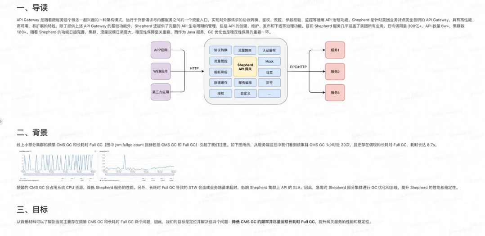

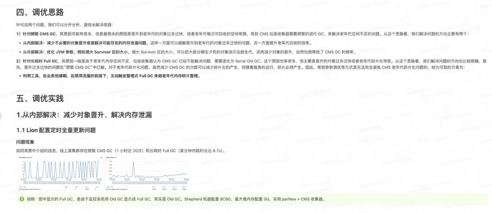

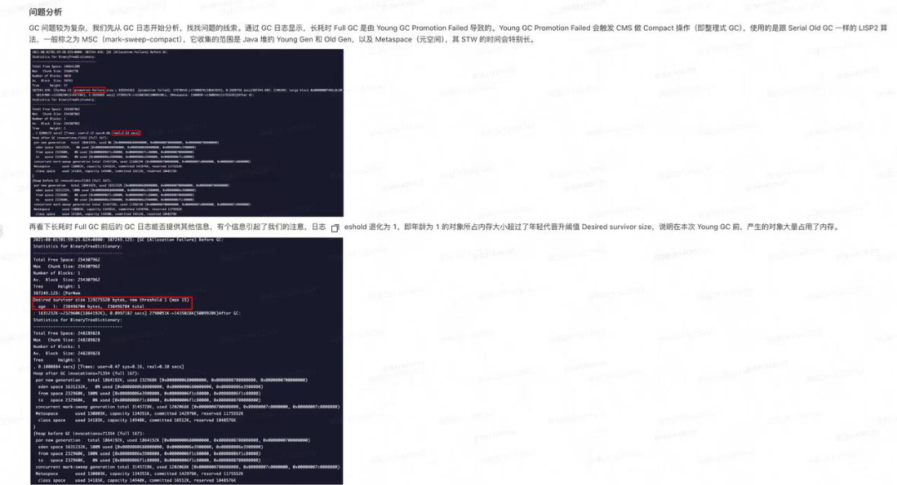

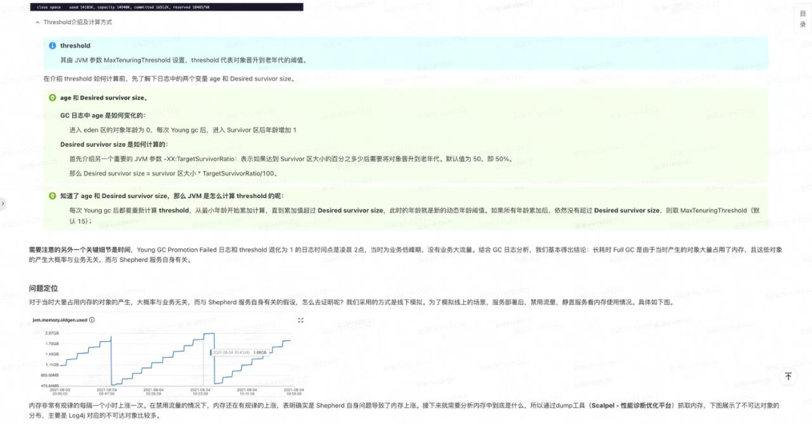

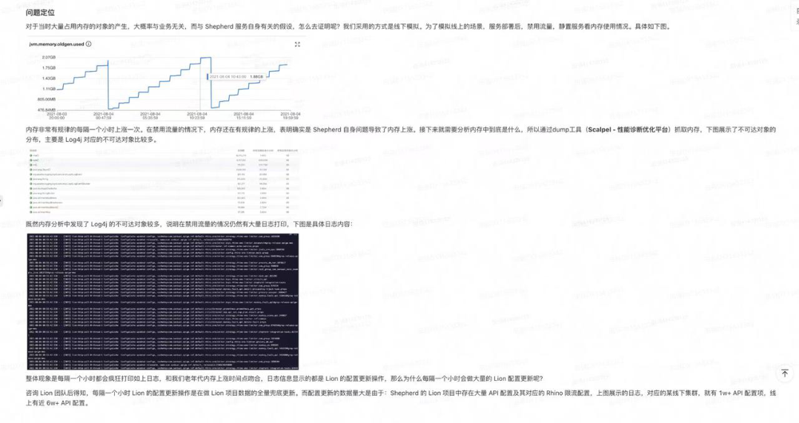

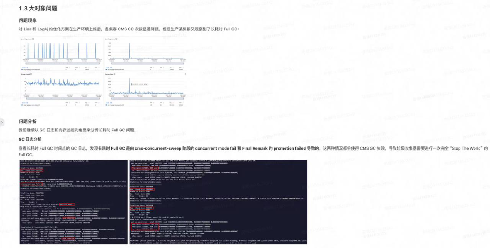

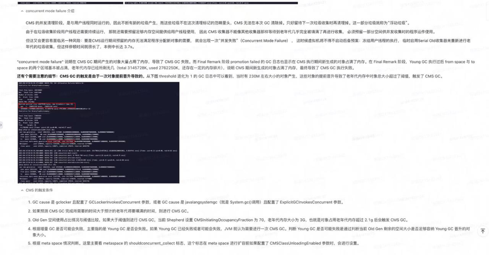


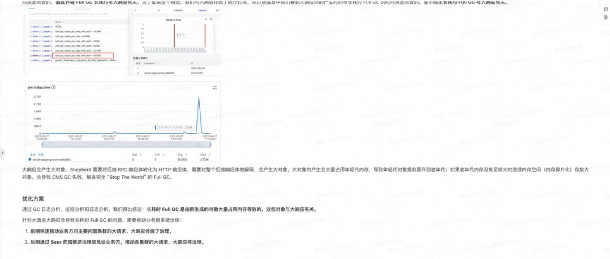

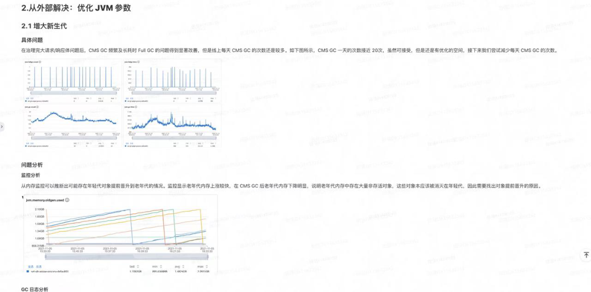

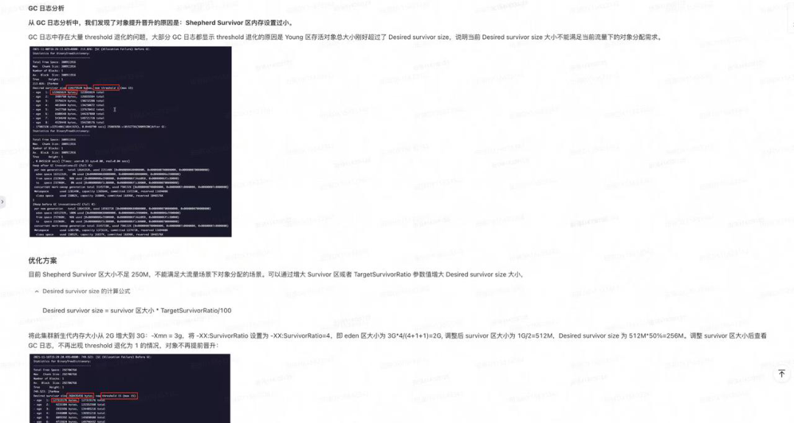

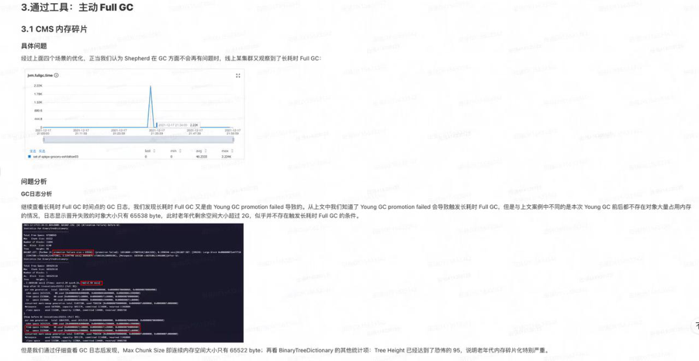

```java
我现在的配置是：/usr/local/java8/bin/java -server -Dfile.encoding=UTF-8 -Dsun.jnu.encoding=UTF-8 -Djava.io.tmpdir=/tmp -Djava.net.preferIPv6Addresses=false -Xmx13g -Xms13g -Xmn7g -XX:SurvivorRatio=8-XX:MetaspaceSize=640m -XX:MaxMetaspaceSize=640m -XX:+HeapDumpOnOutOfMemoryError -XX:ReservedCodeCacheSize=240m -XX:InitialCodeCacheSize=240m -XX:+PrintGCDetails -XX:+PrintHeapAtGC -
XX:+PrintTenuringDistribution -XX:+UseConcMarkSweepGC -XX:+PrintGCTimeStamps -XX:+PrintGCDateStamps -XX:CMSFullGCsBeforeCompaction=0 -XX:+UseCMSCompactAtFullCollection -XX:CMSInitiatingOccupancyFraction=80 -Xloggc:/opt/meituan/logs/tsp_rocks_scene_feed-server/tsp_rocks_scene_feed-server.gc.log -XX:ErrorFile=/opt/meituan/logs/tsp_rocks_scene_feed-server/tsp_rocks_scene_feed-server.vmerr.log -XX:HeapDumpPath=/opt/meituan/logs/tsp_rocks_scene_feed-server/tsp_rocks_scene_feed-server.heaperr.log -Dspring.profiles.active=production -Dapp.key=com.sankuai.bizintegration.homeapi -Djetty.appkey=com.sankuai.bizintegration.homeapi -Dserver.name=tsp_rocks_scene_feed-server org.springframework.boot.loader.JarLauncher 。
触发fullgcGC情况，下述指标情况：
jvm.fullgc.count：1
jvm.fullgc.time：703
jvm.memory.oldgen.used：3GB
jvm.memory.oldgen.used.percent：49.98%
jvm.younggc.count：5
jvm.thread.count：583
补充信息：
1、fullgc后，jvm.memory.oldgen.used为750MB。
2、单机日常100 qps
3、现在服务为JDK8
4、这个服务为核心接口，接口的返回body大小近200KB。
5、现在机器的配置是，16核/16G/100G。
GC日志：
{Heap before GC invocations=5950 (full 2):
 par new generation   total 6606080K, used 6089912K [0x0000000498800000,0x0000000658800000, 0x0000000658800000)
  eden space 5872128K, 100% used [0x0000000498800000, 0x00000005fee80000,0x00000005fee80000)
  from space 733952K,  29% used [0x000000062bb40000, 0x0000000638fee210,0x0000000658800000)
  to   space 733952K,   0% used [0x00000005fee80000, 0x00000005fee80000,0x000000062bb40000)
 concurrent mark-sweep generation total 6291456K, used 1032702K[0x0000000658800000, 0x00000007d8800000, 0x00000007d8800000)
 Metaspace       used 411703K, capacity 423010K, committed 427520K, reserved 1433600K
  class space    used 41982K, capacity 43517K, committed 44288K, reserved 1048576K
2025-06-20T17:38:54.177+0800: 72959.917: [GC (Allocation Failure) 2025-06-20T17:38:54.177+0800: 72959.918: [ParNew
Desired survivor size 375783424 bytes, new threshold 15 (max 15)
- age   1:   43963408 bytes,   43963408 total
- age   2:   15112440 bytes,   59075848 total
- age   3:   23772688 bytes,   82848536 total
- age   4:   12057984 bytes,   94906520 total
- age   5:   18789272 bytes,  113695792 total
- age   6:   11534416 bytes,  125230208 total
- age   7:      41384 bytes,  125271592 total
- age   8:     930880 bytes,  126202472 total
- age   9:    2604288 bytes,  128806760 total
- age  10:    3347528 bytes,  132154288 total
- age  11:      10696 bytes,  132164984 total
- age  12:      28976 bytes,  132193960 total
- age  13:    1040864 bytes,  133234824 total
- age  14:     949928 bytes,  134184752 total
- age  15:      20200 bytes,  134204952 total
: 6089912K->183053K(6606080K), 0.0195327 secs] 7122614K->1215760K(12897536K),0.0198449 secs] [Times: user=0.23 sys=0.01, real=0.02 secs]
Heap after GC invocations=5951 (full 2):
 par new generation   total 6606080K, used 183053K [0x0000000498800000,0x0000000658800000, 0x0000000658800000)
  eden space 5872128K,   0% used [0x0000000498800000, 0x0000000498800000,0x00000005fee80000)
  from space 733952K,  24% used [0x00000005fee80000, 0x000000060a1435c8,0x000000062bb40000)
  to   space 733952K,   0% used [0x000000062bb40000, 0x000000062bb40000,0x0000000658800000)
 concurrent mark-sweep generation total 6291456K, used 1032707K[0x0000000658800000, 0x00000007d8800000, 0x00000007d8800000)
 Metaspace       used 411703K, capacity 423010K, committed 427520K, reserved 1433600K
  class space    used 41982K, capacity 43517K, committed 44288K, reserved 1048576K
}
```

<a id="module-04"></a>

## 04 Java并发

### 高频题

#### 并发编程的三大特性

并发编程的三大特性是：原子性、可见性、有序性。

###### 原子性

原子性指一个操作或者一段代码执行时不可被分割，要么全部执行成功，要么全部不执行。

例如 `i++`  看起来只有一行代码，但它不是原子操作。

它底层大致包含读取、加一、写回等多个步骤。多线程并发执行时，可能出现多个线程读到同一个旧值，最终导致结果错误。

解决原子性问题可以使用：

1. `synchronized` 。

2. `Lock` 。

3. 原子类，例如 `AtomicInteger` 。

###### 可见性

可见性指一个线程对共享变量的修改，其他线程能够及时看到。

如果线程修改共享变量后只更新到自己的工作内存，没有及时刷新到主内存，其他线程就可能一直读到旧值。

解决可见性问题可以使用：

1. `volatile` 。

2. `synchronized` 。

3. `Lock` 。

###### 有序性

有序性指程序执行顺序符合预期。

编译器和 CPU 可能会为了优化性能进行指令重排序。

在单线程下，只要不影响最终结果，重排序通常没问题。

但是在多线程下，重排序可能导致线程安全问题。

解决有序性问题可以使用：

1. `volatile`  禁止特定指令重排序。

2. `synchronized`  或 `Lock`  通过加锁保证临界区执行顺序。

#### Java内存模型JMM是什么？

JMM 全称是 Java Memory Model，也就是 Java 内存模型。

JMM 是一套规范，主要解决多线程读写共享变量时的原子性、可见性、有序性问题。

JMM 中有主内存和工作内存的概念：

1. 主内存： 线程共享的内存区域，保存共享变量。

2. 工作内存： 每个线程私有的内存区域，保存该线程使用到的共享变量副本。

线程操作共享变量时，不是直接操作主内存，而是先把变量从主内存拷贝到自己的工作内存中，修改后再刷新回主内存。

所以多线程之间就可能出现可见性问题。

JMM 对上层提供了 `volatile` 、`synchronized` 、`final`  等关键字来保证并发安全。

#### volatile关键字的作用和原理

`volatile`  主要有两个作用：

1. 保证可见性。

2. 禁止指令重排序。

`volatile`  不能保证复合操作的原子性。

例如：

```java
public static volatile int i = 0;

public static void increase() {
    i++;
}
```

这里的 `i++`  仍然不是线程安全的，因为它包含读取、计算、写回多个步骤。

`volatile`  的原理可以理解为内存屏障。

被 `volatile`  修饰的变量进行写操作时，会强制把修改刷新到主内存，并让其他 CPU 中对应缓存行失效。

其他线程再读取这个变量时，就需要重新从主内存读取最新值。

同时，`volatile`  会通过内存屏障禁止指令重排序。

#### volatile适合什么场景？

`volatile`  适合一写多读，或者状态标记这类场景。

例如：

```java
private volatile boolean running = true;
```

一个线程修改 `running = false` ，其他线程能及时看到这个变化。

但是如果是 `count++`  这种复合操作，不能只依赖 `volatile` 。

这种场景应该使用 `AtomicInteger` 、`synchronized`  或 `Lock` 。

#### synchronized的底层原理

`synchronized`  是 Java 中的同步关键字，主要用来保证同一时刻只有一个线程执行同步代码块或同步方法。

`synchronized`  可以保证原子性、可见性和有序性。

底层原理：

1. `synchronized`  修饰代码块时，字节码层面会生成 `monitorenter`  和 `monitorexit`  指令。

2. `monitorenter`  表示进入同步代码块，尝试获取对象关联的 Monitor 锁。

3. `monitorexit`  表示退出同步代码块，释放 Monitor 锁。

4. 每个 Java 对象都可以作为锁对象，因为每个对象都可以关联一个 Monitor。

5. Monitor 中有 Owner、EntryList、WaitSet 等结构，用来管理持锁线程、阻塞线程和等待线程。

如果 `synchronized`  修饰的是方法，则不会直接生成 `monitorenter`  和 `monitorexit` ，而是通过方法的 `ACC_SYNCHRONIZED`  标识来实现同步。

#### synchronize的上锁粒度（对象/类），如果上在方法上呢？

`synchronized`  的锁粒度主要有两种：对象锁和类锁。

1. 修饰普通代码块：

```java
synchronized (this) {
}
```

锁的是当前实例对象。

2. 修饰普通方法：

```java
public synchronized void method() {
}
```

锁的也是当前实例对象，相当于 `synchronized(this)` 。

3. 修饰静态方法：

```java
public synchronized static void method() {
}
```

锁的是当前类的 Class 对象。

4. 修饰类：

```java
synchronized (Demo.class) {
}
```

锁的是这个类对应的 Class 对象。

对象锁只影响同一个对象实例，类锁会影响这个类的所有对象。

#### Synchronized的锁升级过程

`synchronized`  锁升级过程大致是：

无锁 -> 偏向锁 -> 轻量级锁 -> 重量级锁。

###### 偏向锁

偏向锁主要优化同一个线程多次获取同一把锁的场景。

第一次获取锁时，JVM 会在对象头 Mark Word 中记录线程 ID。

之后同一个线程再次进入同步块时，只需要判断线程 ID 是否是自己，如果是，就直接进入，不需要CAS。

###### 轻量级锁

当其他线程也来竞争这把锁时，偏向锁会被撤销，升级为轻量级锁。

轻量级锁主要通过 CAS 自旋来竞争锁。

如果竞争不激烈，线程自旋一会儿就能拿到锁，就避免了线程阻塞和唤醒的开销。

###### 重量级锁

如果竞争激烈，自旋一直失败，锁会膨胀为重量级锁。

重量级锁依赖操作系统互斥量，竞争失败的线程会进入阻塞状态，不再消耗 CPU。

总结：

锁升级的设计是为了适配不同竞争强度的场景。竞争很少时用偏向锁，竞争较轻时用轻量级锁，竞争激烈时升级为重量级锁。

#### 什么是轻量级锁、重量级锁？

###### 轻量级锁

轻量级锁是 JDK1.6 后对 `synchronized`  的优化。

它主要通过 CAS 和自旋在用户态完成加锁和解锁，不需要立即进入操作系统内核态，所以开销较小。

适合锁竞争不激烈、同步代码块执行很快的场景。

###### 重量级锁

重量级锁依赖操作系统的互斥量 mutex。

竞争失败的线程会被阻塞挂起，后续需要操作系统唤醒。

这会涉及用户态和内核态切换，以及线程上下文切换，所以开销较大。

适合竞争激烈、临界区执行时间较长的场景。

#### 乐观锁是怎样实现的？

乐观锁一般通过版本号机制或者 CAS 实现。

###### 版本号机制

在数据表中增加一个版本号字段 `version` 。

更新数据前先读取当前版本号，更新时判断版本号是否还是之前读取的值。

如果一致，说明期间没有其他线程修改，可以更新，并把版本号加一。

如果不一致，说明数据已经被别人修改，本次更新失败或重试。

SQL 大致是：

```sql
UPDATE table
SET value = new_value, version = version + 1
WHERE id = 1 AND version = current_version;
```

###### CAS

CAS 全称是 Compare And Swap，比较并交换。

CAS 会比较内存中的当前值和预期值是否相等。

如果相等，就把当前值更新为新值。

如果不相等，说明数据被其他线程修改过，当前线程更新失败，可以自旋重试。

#### CAS是什么？

CAS 涉及三个操作数：

1. V：要更新的变量值。

2. E：预期值。

3. N：要写入的新值。

只有当 V 的值等于 E 时，才会把 V 更新为 N。

如果 V 不等于 E，说明这个变量已经被其他线程修改过，本次 CAS 失败。

CAS 是一个原子操作，底层依赖 CPU 原子指令。

在 Java 中，很多 CAS 操作是通过 `Unsafe`  类的 native 方法完成的。

#### CAS会有什么问题？

CAS 常见问题：

1. ABA 问题： 一个变量从 A 变成 B，又变回 A。另一个线程 CAS 时发现还是 A，就误以为没有变化。

2. 自旋开销： 如果竞争激烈，CAS 一直失败，线程会不断自旋重试，浪费 CPU。

3. 只能保证单个变量原子操作： 普通 CAS 更适合单个共享变量，多个变量的一致性处理起来更复杂。

ABA 问题可以通过版本号或 `AtomicStampedReference`  解决。

#### 乐观锁和悲观锁及其适用场景

###### 悲观锁

悲观锁总是假设共享资源每次访问都会有冲突。

所以在访问共享资源前先加锁，其他线程必须等待锁释放后才能访问。

Java 中 `synchronized` 、`ReentrantLock`  就是悲观锁思想的实现。

悲观锁适合写多读少、竞争激烈、数据一致性要求高的场景。

缺点是线程阻塞、上下文切换开销较大，也可能出现死锁。

###### 乐观锁

乐观锁假设冲突概率比较低，不会一开始就加锁。

它在提交更新时再检查数据是否被其他线程修改过。

Java 中的原子类，比如 `AtomicInteger` ，底层就大量使用 CAS。

乐观锁适合读多写少、冲突概率低的场景。

缺点是冲突频繁时会不断失败重试，导致 CPU 开销升高。

#### cas的底层原理

CAS 并发原语在 Java 中主要通过 `Unsafe`  类的 native 方法实现。

调用 `Unsafe`  中的 CAS 方法时，JVM 会帮我们执行底层 CPU 的原子指令。

CAS 是一种系统原语，执行过程不能被中断，所以可以保证比较和交换这个过程的原子性。

JUC 包中的原子类、AQS、ConcurrentHashMap 等底层都大量使用 CAS。

#### threadlocal 原理

`ThreadLocal`  是实现线程局部变量的类。

它会为每个使用该变量的线程创建独立副本，不同线程之间互不影响。

`ThreadLocal`  主要用于线程隔离，而不是线程共享。

`ThreadLocal`  和 `synchronized`  的区别：

1. `synchronized`  是通过加锁保证多个线程访问共享资源时的安全。

2. `ThreadLocal`  是给每个线程一份自己的变量副本，让线程之间不共享数据。

ThreadLocal 的实现：

1. 每个 `Thread`  对象中都有一个 `ThreadLocalMap` 。

2. `ThreadLocalMap`  中有一个 Entry 数组。

3. Entry 的 key 是 `ThreadLocal`  对象，value 是存入的数据。

4. `ThreadLocal.set()`  时，会获取当前线程的 `ThreadLocalMap` ，然后用当前`ThreadLocal`  作为 key，把 value 存进去。

5. `ThreadLocal.get()`  时，也是先获取当前线程的 `ThreadLocalMap` ，再通过当前`ThreadLocal`  取出 value。

#### ThreadLocal内存泄漏

`ThreadLocalMap`  中 Entry 的 key 是 `ThreadLocal`  的弱引用，value 是强引用。

如果 `ThreadLocal`  没有外部强引用，GC 时 key 会被回收，变成 `null` 。

但是 value 仍然被 `ThreadLocalMap`  强引用着。

如果是普通线程，线程执行结束后，整个 `Thread`  和 `ThreadLocalMap`  都会被回收，问题不大。

但是在线程池中，核心线程会被反复复用，线程不会结束，`ThreadLocalMap`  也不会被回收。

这时 key 为 `null`  的 Entry 中，value 可能一直无法释放，造成内存泄漏。

解决方案：

使用完 `ThreadLocal`  后，在 `finally`  中调用 `remove()` 。

#### AQS 原理、构建了哪些锁

AQS 全称是 AbstractQueuedSynchronizer。

它是阻塞式锁和同步器工具的基础框架。

AQS 主要由两部分组成：

1. `state`  状态变量。

2. FIFO 双向等待队列。

`state`  用来表示共享资源的状态。

例如：

1. 在 `ReentrantLock`  中，`state = 0`  表示没有加锁，`state > 0`  表示加锁次数，也表示可重入次数。

2. 在 `CountDownLatch`  中，`state`  表示剩余计数。

如果线程获取资源失败，就会被封装成 Node 节点，加入 FIFO 等待队列。

资源释放后，会唤醒队列中的后继节点。

基于 AQS 实现的组件有：

1. `ReentrantLock` 。

2. `CountDownLatch` 。

3. `Semaphore` 。

4. `ReentrantReadWriteLock` 。

#### ReentrantLock是什么，和synchronized相比有什么区别？

`ReentrantLock`  是 JUC 包下的可重入锁，底层基于 AQS 实现。

它和 `synchronized`  都是可重入锁。

区别：

1. `synchronized`  是 Java 关键字，JVM 层面实现；`ReentrantLock`  是 JDK 提供的类，代码层面实现。

2. `synchronized`  自动加锁和释放锁；`ReentrantLock`  需要手动调用 `lock()`  和`unlock()` 。

3. `ReentrantLock`  支持公平锁和非公平锁，默认非公平锁；`synchronized`  一般是非公平锁。

4. `ReentrantLock`  支持可中断、可超时获取锁，使用更灵活。

5. 简单同步场景用 `synchronized`  更方便；复杂锁控制场景可以用 `ReentrantLock` 。

使用 `ReentrantLock`  时，必须在 `finally`  中释放锁：

```text
lock.lock();
try {
    // 业务代码
} finally {
    lock.unlock();
}
```

#### 死锁的必要条件有哪些？

死锁产生的四个必要条件：

1. 互斥条件： 资源同一时间只能被一个线程占用。

2. 请求和保持条件： 线程已经持有一个资源，同时又请求新的资源。

3. 不可剥夺条件： 线程已经获得的资源，在使用完之前不能被强制剥夺。

4. 循环等待条件： 多个线程之间形成头尾相接的资源等待关系。

只要破坏其中任意一个条件，就可以避免死锁。

#### 如何避免死锁？

避免死锁可以从破坏死锁四个必要条件入手。

常见方式：

1. 固定加锁顺序，避免循环等待。

2. 尽量缩小锁粒度和锁持有时间。

3. 避免在持有锁时继续申请其他锁。

4. 使用 `tryLock()`  设置超时时间，获取不到锁就释放已有资源并重试。

5. 使用并发工具类代替手写复杂锁逻辑。

线上排查死锁时，可以使用 `jstack`  查看线程堆栈。

#### 线程池的好处？

线程池的主要作用是资源管理和线程复用。

好处：

1. 避免频繁创建和销毁线程带来的性能开销。

2. 提高响应速度，任务来了可以直接复用已有线程。

3. 统一管理线程数量，避免无限制创建线程导致资源耗尽。

4. 可以通过队列、拒绝策略等机制控制任务提交速度。

#### 线程池的参数都有哪些？

`ThreadPoolExecutor`  的核心参数有 7 个：

1. corePoolSize： 核心线程数。

2. maximumPoolSize： 最大线程数。

3. keepAliveTime： 非核心线程空闲存活时间。

4. unit： 存活时间单位。

5. workQueue： 任务阻塞队列。

6. threadFactory： 线程工厂，用来创建线程，可以设置线程名、是否守护线程等。

7. handler： 拒绝策略。

常见工作队列：

1. `ArrayBlockingQueue` ：基于数组的有界阻塞队列。

2. `LinkedBlockingQueue` ：基于链表的阻塞队列，不指定容量时接近无界。

3. `SynchronousQueue` ：不存储任务，任务必须直接交给工作线程。

4. `PriorityBlockingQueue` ：优先级阻塞队列。

#### 线程池提交任务的流程

线程池提交任务流程：

1. 提交任务后，先判断当前线程数是否小于核心线程数。

2. 如果小于核心线程数，就创建核心线程执行任务。

3. 如果核心线程数已满，就把任务放入阻塞队列。

4. 如果阻塞队列也满了，就创建非核心线程执行任务。

5. 如果当前线程数已经达到最大线程数，就触发拒绝策略。

所以，如果核心线程数已满，新任务不是直接创建新线程，而是先进入队列。

只有核心线程数满了并且队列也满了，才会创建非核心线程。

#### 线程池拒绝策略有哪些？

JDK 提供了四种常见拒绝策略：

1. AbortPolicy： 默认策略，直接抛出 `RejectedExecutionException` 。

2. CallerRunsPolicy： 由提交任务的线程自己执行任务，可以降低任务提交速度。

3. DiscardPolicy： 直接丢弃任务，不抛异常。

4. DiscardOldestPolicy： 丢弃队列中最早的任务，然后尝试提交当前任务。

如果任务很重要，不能随便丢弃，一般不建议使用静默丢弃策略。

#### 创建线程的几种方式

常见创建线程方式：

1. 继承 `Thread`  类。

2. 实现 `Runnable`  接口。

3. 实现 `Callable`  接口，结合 `FutureTask`  使用。

4. 使用 `ExecutorService`  线程池。

实际开发中一般不建议频繁手动创建线程，而是优先使用线程池统一管理线程资源。

#### Runnable和Callable的区别

区别主要有三个：

1. 返回值不同： `Runnable`  的 `run()`  没有返回值；`Callable`  的 `call()`  可以有返回值。

2. 异常处理不同： `Runnable`  不能直接抛出受检异常；`Callable`  可以抛出受检异常。

3. 执行方式不同： `Runnable`  可以直接交给 `Thread`  执行，也可以提交线程池；`Callable`  通常提交给线程池，返回 `Future`  获取结果。

`Callable`  适合需要获取异步执行结果的任务。

#### execute和submit的区别

`execute()`  和 `submit()`  都可以向线程池提交任务。

区别：

1. `execute()`  只能提交 `Runnable` ，没有返回值。

2. `submit()`  可以提交 `Runnable`  或 `Callable` ，会返回 `Future` 。

3. `execute()`  中任务异常通常会直接抛出到线程的异常处理器。

4. `submit()`  中任务异常会被封装在 `Future`  中，调用 `Future.get()`  时才会抛出。

如果需要拿到任务结果或异常，使用 `submit()` 。

如果只是执行一个无返回值任务，可以使用 `execute()` 。

#### countdownlatch和cyclicbarrier的区别

###### CountDownLatch

`CountDownLatch`  是倒计时器。

它用一个计数器初始化。

调用 `await()`  的线程会等待，直到其他线程调用 `countDown()`  把计数器减到 0。

计数器减到 0 后，等待的线程继续执行。

`CountDownLatch`  是一次性的，不能重置。

使用场景：

主线程等待多个子任务执行完成后，再继续汇总结果。

###### CyclicBarrier

`CyclicBarrier`  是循环屏障。

它允许一组线程互相等待，直到所有线程都到达同一个屏障点，大家再一起继续执行。

`CyclicBarrier`  可以重复使用。

使用场景：

多个线程互相等待，比如多个运动员都准备好后，裁判才说开始。

###### 区别

1. `CountDownLatch`  是一个或多个线程等待其他线程完成。

2. `CyclicBarrier`  是多个线程互相等待。

3. `CountDownLatch`  不能重置，`CyclicBarrier`  可以重复使用。

#### Java并发容器

并发容器重点回答 `ConcurrentHashMap`  和 `CopyOnWriteArrayList` 。

###### ConcurrentHashMap

`HashMap`  不是线程安全的。

如果简单使用 `Collections.synchronizedMap()` ，相当于使用全局锁，性能较差。

`ConcurrentHashMap`  是线程安全的 Map。

JDK1.7 中使用分段锁，底层是 `Segment`  数组 + `HashEntry`  数组 + 链表。

JDK1.8 中改为 `Node`  数组 + 链表 + 红黑树，并发控制主要使用 CAS + `synchronized` 。

###### CopyOnWriteArrayList

`CopyOnWriteArrayList`  是线程安全的 List。

它的核心是写时复制。

读操作不加锁，写操作加锁，写入时复制一个新数组，在新数组上修改，最后把引用指向新数组。

适合读多写少的场景。

缺点是写操作成本高、占用更多内存，并且读到的数据可能不是最新的。

#### 线程的状态有哪些？

Java 线程状态有六种：

1. `NEW` ：新建状态，线程对象创建后还没有调用 `start()` 。

2. `RUNNABLE` ：可运行状态，调用 `start()`  后进入该状态。Java 中就绪和运行都属于`RUNNABLE` 。

3. `BLOCKED` ：阻塞状态，通常是等待获取 `synchronized`  锁。

4. `WAITING` ：无限等待状态，例如调用 `wait()` 、`join()` 。

5. `TIMED_WAITING` ：计时等待状态，例如调用 `sleep(time)` 、`wait(time)` 、`join(time)` 。

6. `TERMINATED` ：终止状态，线程执行完成。

### 扩展题

#### MM如何保证原子性、可见性、有序性？

###### 原子性

原子性问题典型例子是 `i++` 。

`i++`  看起来是一行代码，但是字节码层面大致包含读取、加一、写回多个步骤。

多线程交叉执行时，可能导致最终结果小于预期。

解决方式：

1. 使用 `synchronized` 。

2. 使用 `Lock` 。

3. 使用原子类，例如 `AtomicInteger` 。

###### 可见性

可见性问题指一个线程修改共享变量后，其他线程不能及时看到。

原因是线程可能只修改了工作内存中的副本，没有及时刷新到主内存。

解决方式：

1. 使用 `volatile` 。

2. 使用 `synchronized` 。

3. 使用 `Lock` 。

`volatile`  写会把变量刷新到主内存，并让其他线程缓存失效。

###### 有序性

有序性问题指编译器或 CPU 可能对指令进行重排序。

单线程下重排序不影响最终结果，但多线程下可能出问题。

解决方式：

1. 使用 `volatile`  禁止特定重排序。

2. 使用 `synchronized`  或 `Lock`  保证临界区执行顺序。

#### volatile的内存屏障

`volatile`  通过插入内存屏障来保证可见性和有序性。

可以简单理解为：

1. `volatile`  写之前，前面的普通写不能重排序到它后面。

2. `volatile`  写之后，后面的读写不能重排序到它前面。

3. `volatile`  读之后，后面的普通读写不能重排序到它前面。

常见屏障：

1. `StoreStore`  屏障。

2. `StoreLoad`  屏障。

3. `LoadLoad`  屏障。

4. `LoadStore`  屏障。

这部分一般属于扩展，不需要一上来讲太底层。面试中可以先说 `volatile`  保证可见性和禁止重排序，再补充内存屏障。

#### MESI协议和volatile有什么关系？

MESI 是 CPU 缓存一致性协议。

它的核心思想是：

当某个 CPU 修改共享变量时，如果其他 CPU 缓存中也有这个变量的副本，会通知其他 CPU 把对应缓存行置为无效。

其他 CPU 再读取这个变量时，发现自己的缓存行无效，就需要重新从主内存读取。

`volatile`  写操作会通过 lock 前缀指令和缓存一致性机制，让其他线程看到最新值。

所以可以说，`volatile`  在底层依赖内存屏障和缓存一致性协议来实现可见性。

#### happens-before是什么？

`happens-before`  是 JMM 中用来描述操作之间可见性关系的规则。

如果操作 A happens-before 操作 B，那么 A 的执行结果对 B 可见，并且 A 的执行顺序排在 B 之前。

常见规则：

1. 程序顺序规则：同一个线程内，前面的操作 happens-before 后面的操作。

2. 监视器锁规则：对一个锁的解锁 happens-before 后续对这个锁的加锁。

3. volatile 规则：对一个 volatile 变量的写 happens-before 后续对这个变量的读。

4. 线程启动规则：调用 `Thread.start()`  happens-before 线程中的动作。

5. 线程终止规则：线程中的所有操作 happens-before 其他线程检测到该线程终止。

6. 传递性：A happens-before B，B happens-before C，则 A happens-before C。

#### synchronized为什么是可重入锁？

可重入锁指同一个线程已经持有某把锁时，可以再次获取这把锁，不会被自己阻塞。

`synchronized`  是可重入锁。

底层 Monitor 中会维护锁的持有线程和重入计数。

当线程第一次获取锁时，计数加一。

同一个线程再次进入同一把锁保护的代码时，计数继续加一。

每退出一次同步代码块，计数减一。

当计数减到 0 时，锁才真正释放。

#### synchronized锁升级为什么需要这个过程？

锁升级是 JVM 为了适配不同竞争强度设计的优化。

如果一开始就使用重量级锁，会涉及线程阻塞、唤醒、用户态和内核态切换，开销很大。

所以 JDK1.6 后对 `synchronized`  做了优化：

1. 没有竞争时，使用偏向锁，优化同一个线程反复进入同步块的场景。

2. 轻微竞争时，使用轻量级锁，通过 CAS 自旋避免线程阻塞。

3. 竞争激烈时，升级为重量级锁，让竞争失败的线程阻塞，避免 CPU 空转。

所以锁升级的核心思想是：在保证线程安全的前提下，根据竞争强度选择不同成本的锁实现。

#### synchronized锁升级详细过程

###### 无锁

对象最开始处于无锁状态。

对象头 Mark Word 中会存储哈希码、GC 分代年龄、锁标志位等信息。

###### 偏向锁

当一个线程第一次进入同步代码块时，JVM 会尝试把对象头中的线程 ID 设置为当前线程 ID。

如果后续还是同一个线程进入，就直接比较线程 ID，不需要 CAS。

偏向锁适合同一个线程反复获取同一把锁的场景。

###### 偏向锁撤销

如果有其他线程来竞争这把锁，偏向锁会被撤销。

JVM 会检查原来持有偏向锁的线程是否还存活、是否还在同步块内。

如果原线程已经不再持有锁，可以把对象恢复为无锁或重新偏向。

如果原线程仍在同步块内，就升级为轻量级锁。

###### 轻量级锁

线程会在自己的栈帧中创建锁记录，把对象头 Mark Word 复制到锁记录中。

然后通过 CAS 尝试把对象头更新为指向锁记录的指针。

CAS 成功就获取轻量级锁。

CAS 失败说明发生竞争，线程会尝试自旋。

###### 重量级锁

如果自旋失败，或者竞争线程过多，轻量级锁会膨胀为重量级锁。

对象头 Mark Word 会指向 Monitor。

竞争失败的线程进入 EntryList 阻塞等待。

持锁线程释放锁后，唤醒等待线程重新竞争。

#### 锁自旋，是乐观锁发生可能性大还是悲观锁可能性大？

锁自旋更常见于乐观锁，尤其是 CAS。

CAS 的工作方式就是比较并交换，失败后可以不断重试，这个重试过程就是自旋。

乐观锁假设冲突概率低，所以短暂自旋的成本通常小于线程挂起和唤醒。

悲观锁中也可能有自旋。

例如 `synchronized`  的轻量级锁会先尝试 CAS 自旋，避免直接阻塞。

但是在悲观锁中，自旋更多是一种优化手段。

如果竞争激烈，自旋失败后仍然会进入阻塞。

#### ReentrantLock如何实现公平锁和非公平锁？

`ReentrantLock`  默认是非公平锁。

公平锁指线程严格按照请求锁的顺序获取锁。

非公平锁允许线程插队抢锁。

底层基于 AQS。

当线程没有获取到锁时，会被封装成 Node 节点加入 AQS 的 FIFO 双向队列。

公平锁实现：

线程尝试获取锁时，会先判断 AQS 队列中是否已经有线程在等待。

如果有，就排到队尾等待，不插队。

非公平锁实现：

线程来了会先尝试直接 CAS 抢锁。

如果抢不到，再加入 AQS 队列。

非公平锁吞吐量通常更高，但是可能导致某些线程等待时间较长。

#### AQS独占模式和共享模式

AQS 有两种资源获取模式：独占模式和共享模式。

###### 独占模式

同一时刻只有一个线程能获取资源。

典型实现是 `ReentrantLock` 。

在 `ReentrantLock`  中，`state`  表示锁的持有状态和重入次数。

###### 共享模式

允许多个线程同时获取资源。

典型实现是 `CountDownLatch` 、`Semaphore` 、`ReentrantReadWriteLock`  的读锁。

在 `CountDownLatch`  中，`state`  表示剩余计数。

在 `Semaphore`  中，`state`  表示剩余许可证数量。

#### Semaphore是什么？

`Semaphore`  是信号量，用来控制同时访问某个资源的线程数量。

它内部维护许可证数量。

线程访问资源前先调用 `acquire()`  获取许可证。

访问完成后调用 `release()`  归还许可证。

如果许可证数量为 0，新的线程就会阻塞等待。

使用场景：

1. 限流。

2. 控制连接池资源数量。

3. 控制同一时间访问某接口或资源的线程数。

#### CountDownLatch、CyclicBarrier、Semaphore区别

`CountDownLatch` ：

1. 倒计时器。

2. 一个或多个线程等待其他线程完成。

3. 计数器减到 0 后放行。

4. 一次性，不能重置。

`CyclicBarrier` ：

1. 循环屏障。

2. 多个线程互相等待。

3. 所有线程都到达屏障点后一起继续。

4. 可以重复使用。

`Semaphore` ：

1. 信号量。

2. 控制同一时间最多有多少线程访问资源。

3. 可以理解为许可证。

#### wait和sleep的区别

`wait()`  和 `sleep()`  都能让线程暂停执行，但是区别很大。

1. `wait()`  是 `Object`  的方法，`sleep()`  是 `Thread`  的静态方法。

2. `wait()`  必须在同步代码块或同步方法中调用，`sleep()`  不要求持有锁。

3. `wait()`  会释放锁，`sleep()`  不会释放锁。

4. `wait()`  需要通过 `notify()`  或 `notifyAll()`  唤醒，也可以设置超时时间。

5. `sleep()`  时间到了会自动进入可运行状态。

#### notify和notifyAll的区别

`notify()`  会唤醒 WaitSet 中的一个等待线程。

`notifyAll()`  会唤醒 WaitSet 中的所有等待线程。

被唤醒的线程不会立刻执行，它们还需要重新竞争锁。

一般更推荐使用 `notifyAll()` ，避免因为唤醒了不满足条件的线程而导致其他线程一直等待。

使用 `wait()`  时通常要放在 while 循环中判断条件：

```java
synchronized (lock) {
    while (!condition) {
        lock.wait();
    }
}
```

原因是线程可能被虚假唤醒，或者被唤醒后条件仍然不满足。

#### 为什么不推荐使用Executors创建线程池？

不推荐使用 `Executors`  创建线程池，主要是为了避免资源耗尽风险。

`newFixedThreadPool()`  和 `newSingleThreadExecutor()` ：

它们使用的队列长度可能是 `Integer.MAX_VALUE` ，任务堆积过多可能导致 OOM。

`newCachedThreadPool()` ：

最大线程数可能是 `Integer.MAX_VALUE` ，如果任务过多，可能创建大量线程，导致 OOM。

所以更推荐直接使用 `ThreadPoolExecutor` ，明确指定核心线程数、最大线程数、队列大小、线程工厂和拒绝策略。

#### 线程池核心线程数和最大线程数怎么设定？

常见经验：

1. CPU 密集型任务：线程数可以设置为 CPU 核数 + 1。

2. IO 密集型任务：线程数可以设置为 2 * CPU 核数。

更通用的公式：

```text
线程数 = CPU核数 * (1 + 线程等待时间 / 线程运行时间)
```

但是这些公式只是参考，不建议硬套。

因为一个应用中可能有多个线程池，也有其他业务线程。

实际应该先根据公式设置一个初始值，再通过压测、监控和业务耗时不断调整。

目标是让 CPU 利用率合理，同时任务等待时间和接口响应时间都在可接受范围内。

#### 上线后你会关注线程池的哪些指标？

上线后主要关注以下指标：

###### 运行时状态指标

1. 核心线程数。

2. 活跃线程数。

3. 最大线程数。

4. 队列大小。

如果活跃线程数长期接近最大线程数，说明线程池负载较高。

如果队列长期堆积，说明任务处理速度跟不上提交速度。

###### 任务处理效率指标

1. 任务提交速率。

2. 任务完成速率。

3. 任务平均耗时。

4. 任务等待时间。

如果完成速率长期低于提交速率，就会出现任务堆积。

###### 资源占用指标

1. CPU 使用率。

2. 内存占用。

3. 线程阻塞时间。

如果 CPU 高但吞吐低，可能存在锁竞争或计算型任务过重。

如果 CPU 低但队列堆积，可能是 IO 阻塞或线程数不足。

###### 异常指标

1. 拒绝任务数。

2. 线程创建和销毁频率。

3. 死锁检测。

拒绝任务增多时，需要检查最大线程数、核心线程数、队列容量和任务耗时。

#### 动态线程池是什么？

动态线程池指线程池的核心参数可以在线上运行时动态调整。

常见做法：

1. 把核心线程数、最大线程数、队列容量、拒绝策略等参数暴露出来。

2. 参数从代码配置迁移到配置中心。

3. 配置变更后，线程池实时生效。

4. 结合线程池监控指标判断是否需要调整。

动态线程池适合复杂业务系统。

因为线上流量会变化，一个固定参数不一定能长期适配所有场景。

#### Future和CompletableFuture是什么？

`Future`  表示异步任务的执行结果。

通过 `submit()`  提交 `Callable`  后，会返回 `Future` 。

可以通过 `Future.get()`  获取结果。

缺点是：

1. `get()`  会阻塞。

2. 不方便做任务编排。

3. 不方便处理多个异步任务之间的依赖关系。

`CompletableFuture`  是更强大的异步编程工具。

它支持：

1. 异步执行任务。

2. 任务完成后回调。

3. 多任务组合。

4. 异常处理。

5. 链式编排。

常见方法：

1. `supplyAsync()` ：异步执行有返回值任务。

2. `runAsync()` ：异步执行无返回值任务。

3. `thenApply()` ：对上一步结果进行转换。

4. `thenAccept()` ：消费结果。

5. `exceptionally()` ：处理异常。

#### 原子类为什么线程安全？

JUC 中的原子类，比如 `AtomicInteger` 、`AtomicLong` 、`AtomicReference` ，底层主要依赖 CAS + volatile。

`volatile`  保证变量的可见性。

CAS 保证更新过程的原子性。

例如 `AtomicInteger.getAndIncrement()`  内部会循环读取当前值，计算新值，然后 CAS 更新。

如果 CAS 失败，说明期间被其他线程修改了，就重新读取并重试。

原子类适合简单变量的原子操作，代码比 `synchronized`  更简洁。

但是如果是多个变量之间的一致性，单个原子类就不够了。

#### LongAdder和AtomicLong有什么区别？

`AtomicLong`  通过 CAS 更新一个变量。

低并发下性能很好。

但是高并发下，多个线程都竞争同一个变量，CAS 失败重试会很多，CPU 开销较高。

`LongAdder`  使用分段累加思想。

它把一个热点变量拆成多个 Cell，不同线程更新不同 Cell，最后求和时再把 base 和 Cell 累加。

优点是高并发写入性能更好。

缺点是读取结果不是强一致的瞬时值，适合统计计数类场景。

#### 线程上下文切换是什么？

线程上下文切换指 CPU 从执行一个线程切换到执行另一个线程。

切换时需要保存当前线程的状态，比如程序计数器、寄存器、栈指针等。

然后再恢复另一个线程的状态。

上下文切换有成本。

如果线程数过多、锁竞争严重、频繁阻塞唤醒，就会导致上下文切换增多，系统性能下降。

减少上下文切换的方法：

1. 合理设置线程池大小。

2. 减少锁竞争。

3. 缩小锁粒度。

4. 使用无锁并发或 CAS。

5. 避免线程频繁创建销毁。

#### 如何排查CPU飙高？

常见排查流程：

1. 使用 `top`  找到 CPU 占用高的 Java 进程 PID。

2. 使用 `top -Hp PID`  找到 CPU 占用高的线程 ID。

3. 把线程 ID 转成 16 进制。

4. 使用 `jstack PID | grep 16`进制线程`ID -A 30`  查看线程堆栈。

5. 根据堆栈定位具体代码。

常见原因：

1. 死循环。

2. 大量自旋。

3. 锁竞争。

4. 频繁 GC。

5. 线程池任务堆积导致大量线程竞争。

#### 如何排查死锁？

可以使用 `jstack` 。

如果 JVM 检测到 Java 层面的死锁，`jstack`  输出中通常会出现 `Found one Java-leveldeadlock` 。

排查思路：

1. 找到互相等待的线程。

2. 查看每个线程持有什么锁、等待什么锁。

3. 找到对应业务代码。

4. 调整加锁顺序或减少嵌套锁。

也可以通过 `ThreadMXBean.findDeadlockedThreads()`  在程序中检测死锁。

#### Java并发扩展中容易混淆的点

1. `volatile`  能保证可见性和有序性，但不能保证 `i++`  这类复合操作的原子性。

2. `synchronized`  锁的是对象，不是代码；静态方法锁的是 Class 对象。

3. `wait()`  会释放锁，`sleep()`  不会释放锁。

4. `notify()`  唤醒线程后，被唤醒线程还要重新竞争锁。

5. `ThreadLocal`  是线程隔离，不是解决共享变量加锁问题。

6. 线程池核心线程满了后，任务先进入队列，不是马上创建非核心线程。

7. `submit()`  的异常会封装到 `Future`  里，不调用 `get()`  可能感知不到。

8. `CountDownLatch`  不能重置，`CyclicBarrier`  可以复用。

9. `ReentrantLock`  默认是非公平锁。

10. CAS 在低冲突场景性能好，高冲突场景可能因为自旋导致 CPU 开销高。

### 后端面经与场景补充

<!-- 原PDF第482页；面经原题号 19 -->

#### 线程池的工作流程

原文未附答案。

<!-- 原PDF第482页；面经原题号 20 -->

#### 手撕阻塞队列

```java
import java.util.LinkedList;
import java.util.Queue;

public class BlockingQueue<T> {
    private Queue<T> queue = new LinkedList<>();
    private int capacity;

    public BlockingQueue(int capacity) {
        this.capacity = capacity;
    }

    public synchronized void put(T item) throws InterruptedException {
        while (queue.size() == capacity) {
            wait();
        }
        queue.add(item);
        notifyAll();
    }

    public synchronized T take() throws InterruptedException {
        while (queue.isEmpty()) {
            wait();
        }
        T item = queue.poll();
        notifyAll();
        return item;
    }

    public static void main(String[] args) {
        BlockingQueue<Integer> blockingQueue = new BlockingQueue<>(5);

        // Producer thread
        Thread producer = new Thread(() -> {
            try {
                for (int i = 0; i < 10; i++) {
                    blockingQueue.put(i);
                    System.out.println("Produced: " + i);
                }
            } catch (InterruptedException e) {
                Thread.currentThread().interrupt();
            }
        });

        // Consumer thread
        Thread consumer = new Thread(() -> {
            try {
                for (int i = 0; i < 10; i++) {
                    int item = blockingQueue.take();
                    System.out.println("Consumed: " + item);
                }
            } catch (InterruptedException e) {
                Thread.currentThread().interrupt();
            }
        });

        producer.start();
        consumer.start();
    }
}
```

<!-- 原PDF第490页；面经原题号 43 -->

#### 公平和非公平锁

公平锁 vs 非公平锁

公平锁 (Fair Lock)

定义：多个线程按照申请锁的时间顺序获取锁（FIFO 队列）

特点：

- 新请求线程必须加入等待队列末尾

- 锁释放时，总是唤醒等待时间最长的线程

- 保证所有线程都能公平获得执行机会优点：避免线程饥饿缺点：上下文切换开销大，吞吐量较低

非公平锁 (Non-fair Lock)

定义：线程获取锁的顺序与申请时间无关，允许插队

特点：

- 新请求线程可直接尝试抢锁（即使队列中有等待线程）

- 锁释放时，新线程可能比等待线程更快获得锁

- 默认实现方式（性能优化）优点：吞吐量高，减少上下文切换缺点：可能造成线程饥饿

<!-- 原PDF第491页；面经原题号 44 -->

#### synchronized和reentrantlock区别是什么

原文未附答案。

<!-- 原PDF第499页；面经原题号 64 -->

#### threadlock和hashmap当中的hash算法有什么不一样的

冲突处理：

- `ThreadLocalMap` ： 使用线性探测法。发生冲突时（计算出的索引位置已被占用），它会顺序检查下一个位置（`(i + 1) % table.length` ），直到找到空位或匹配的 key。这要求初始分布必须非常好。

- `HashMap` ： 使用拉链法。每个桶（数组元素）是一个链表（或达到阈值后转为红黑树）。发生冲突时，新的键值对会添加到对应桶的链表（或树）中。这比线性探测更能容忍一定程度的冲突。

<a id="module-05"></a>

## 05 MySQL

### 高频题

#### 事务

##### 什么是事务

事务是数据库中不可分割的最小执行单元，由一组操作组成，这组操作要么全部成功，要么全部失败，不允许只执行其中一部分。

例如转账场景中，扣款和加款必须作为同一个事务完成，不能分离执行。

##### 事务的四大特性和实现原理

事务的四大特性通常称为ACID，分别是原子性、一致性、隔离性和持久性。前三者更多是实现手段，最终目标是保证一致性。

1. 原子性（Atomicity，A）：事务是不可分割的最小执行单元，事务中的多个操作要么全部成功，要么全部失败，不能只执行其中一部分。

    - 主要依赖`Undo Log` 实现。事务执行过程中，数据库会记录修改前的数据状态。如果事务失败或主动回滚，就通过`Undo Log` 将数据恢复到事务执行前的状态。

2. 持久性（Durability，D）：事务一旦提交，对数据的修改就必须永久生效，即使数据库宕机，恢复后数据也不能丢失。

    - 实现原理：主要依赖`Redo Log` 实现。事务提交前，数据库会把修改记录写入`Redo Log` ，宕机恢复时再根据`Redo Log` 重做已提交事务的修改，保证提交后的数据不会丢失。

3. 隔离性（Isolation，I）：多个事务并发执行时，彼此之间不能互相干扰，一个事务不能随意读取到其他事务未提交的中间状态。

    - 主要依赖`MVCC` 和锁机制实现。`MVCC` 通过多版本数据控制事务之间的读写可见性，锁机制用于控制并发操作冲突，尤其是写写冲突。

4. 一致性（Consistency，C）：事务执行前后，数据必须满足业务规则和完整性约束。例如转账场景中，无论事务成功还是失败，账户总金额都应该保持正确。

    - 一致性不是单独由某一个机制直接实现，而是由原子性、隔离性和持久性共同保证。只有事务能正确回滚、并发互不干扰、提交后数据不丢失，最终才能保证数据一致。

##### 并发事务会出现什么问题

并发事务问题是指多个事务同时执行时，由于事务之间相互影响，可能导致读取到不一致或不正确的数据。为了解决这些问题，数据库引入了事务隔离级别，通过控制不同事务之间的数据可见性，降低并发执行带来的异常。

并发事务常见问题主要有三类：

1. 脏读：一个事务读取到了另一个事务尚未提交的数据。如果后者发生回滚，前者读到的就是无效数据。

2. 不可重复读：一个事务内多次读取同一条记录，但由于其他事务提交了修改，导致前后两次读到的数据不一致。重点是同一行数据内容发生变化。

3. 幻读：一个事务内多次执行相同范围查询，但由于其他事务插入或删除了符合条件的数据，导致前后两次查询结果的行数不一致。重点是结果集行数发生变化。

##### 事务隔离级别和实现原理

事务隔离级别用于解决并发事务带来的脏读、不可重复读和幻读问题。本质是通过控制事务之间的数据可见性，在一致性和并发性能之间做权衡。隔离级别越高，数据一致性越强，并发性能越低。

1. 读未提交（Read Uncommitted，RU）：一个事务还没有提交时，它对数据的修改就可以被其他事务看到。

    - 基本不做隔离控制，因此实现成本最低，但会出现脏读、不可重复读和幻读问题。

2. 读已提交（Read Committed，RC）：一个事务提交之后，它对数据的修改才能被其他事务看到。

    - 主要依赖`MVCC` 实现。每次读取都会生成新的Read View，因此只能读到其他事务已经提交的数据，但同一事务内多次读取可能结果不同，所以可能出现不可重复读和幻读。

3. 可重复读（Repeatable Read，RR）：一个事务内多次读取同一条记录，读到的数据内容保持一致。它是MySQL InnoDB的默认隔离级别。

    - 主要依赖`MVCC` 实现。事务第一次读取时生成Read View，后续读取复用同一个Read View，因此可以保证同一事务内读取结果一致。按SQL标准仍可能出现幻读，但MySQL InnoDB通过`Next-Key Lock` 和间隙锁降低或避免幻读问题。

4. 串行化（Serializable）：事务按串行方式执行，读写之间会互相阻塞，可以最大程度保证数据一致性。

    - 主要依赖加锁实现。读操作加读锁，写操作加写锁，发生读写冲突时后访问的事务必须等待前一个事务完成，因此脏读、不可重复读和幻读都不会出现。

###### (追问)RR和RC的区别

RR和RC都是InnoDB中基于`MVCC` 实现的事务隔离级别，核心区别体现在快照读、锁机制和Binlog支持三个方面。RC更强调读取已提交数据，并发性能更好，但可能出现不可重复读；RR强调同一事务内读取结果一致，是MySQL InnoDB的默认隔离级别，并通过锁机制进一步减少幻读问题。

1. 快照读

    - RC每次查询生成新的ReadView：在读已提交隔离级别下，事务中的每次快照读都会重新创建`ReadView` ，因此同一个事务中后一次查询可能读到其他事务刚提交的数据，所以可能出现不可重复读。

    - RR只在第一次查询生成ReadView：在可重复读隔离级别下，事务第一次快照读时创建`ReadView` ，后续查询复用同一个`ReadView` ，因此同一事务内多次读取同一数据结果保持一致，解决了不可重复读问题。

    - 核心区别：RC和RR的本质差异在于`ReadView` 生成时机不同，RC是每次查询生成，RR是事务内首次查询生成并复用。

2. 锁机制

    - Record Lock：记录锁，锁住具体的索引记录。

    - Gap Lock：间隙锁，锁住索引记录之间的间隙。

    - Next-Key Lock：临键锁，是`Record Lock` 和`Gap Lock` 的组合，同时锁住索引记录和记录之间的间隙，范围通常是左开右闭。

    - RC只使用Record Lock：在RC隔离级别下，通常只会对索引记录加`Record Lock` ，不会使用`Gap Lock` 和`Next-Key Lock` ，因此无法很好阻止其他事务插入符合范围条件的新数据。

    - RR支持Gap Lock和Next-Key Lock：在RR隔离级别下，为了减少或解决幻读问题，除了`Record Lock` ，还会使用`Gap Lock` 和`Next-Key Lock` ，从而限制范围内的新数据插入。

3. 主从同步

    - Binlog格式：MySQL的`Binlog` 主要有`statement` 、`row` 和`mixed` 三种格式。

    - RC要求Row格式：RC隔离级别下，只支持或更推荐使用`row` 格式的`Binlog` ，因为RC下读到的数据可能随提交变化，使用SQL原文同步容易导致主从结果不一致。

    - RR支持三种格式：RR隔离级别下可以支持`statement` 、`row` 和`mixed` 三种`Binlog` 格式，兼容性更强。

##### 为什么互联网公司选择使用RC作为隔离模式

互联网公司更常选择RC，核心原因是提升并发能力、减少锁冲突和降低死锁概率。互联网业务通常读写并发很高，相比RR更强的一致性约束，RC在很多业务场景下已经够用，同时能换来更好的数据库吞吐量。

1. 提升并发能力

    - RC隔离级别下，加锁时通常只对需要修改的记录加`Record Lock` ，不需要额外添加`GapLock` 和`Next-Key Lock` 。

    - RR隔离级别为了减少幻读问题，会引入`Gap Lock` 和`Next-Key Lock` ，锁住记录之间的间隙，导致锁范围更大。

    - 锁范围越大，事务之间越容易互相阻塞，并发性能越差。因此在高并发互联网场景中，RC通常比RR更容易获得更高吞吐量。

2. 减少死锁概率

    - RR由于会使用`Gap Lock` 和`Next-Key Lock` ，锁的粒度更大，事务之间发生等待的概率更高。

    - 当多个事务分别持有不同资源，又互相等待对方释放资源时，就会产生死锁。

    - RC锁范围更小，锁冲突更少，因此死锁概率相对更低。

3. 业务上通常可以接受

    - 很多互联网业务更关注高并发、低延迟和高吞吐，对一致性要求可以通过业务逻辑、乐观锁、唯一索引、幂等设计等方式补充。

    - 因此在一致性要求不是极端严格的场景下，选择RC可以在保证基本正确性的同时，获得更好的性能表现。

#### MVCC

##### 什么是MVCC

MVCC是多版本并发控制，核心思想是为同一条数据维护多个版本，让读操作读取符合当前事务可见性的版本，从而减少读写冲突，避免读操作被写操作阻塞。

MVCC的典型应用是MySQL InnoDB，它通过MVCC实现读已提交和可重复读隔离级别。

##### MVCC的实现原理

MVCC的实现依赖隐藏字段、Undo Log版本链和ReadView读视图。整体逻辑是：更新数据时生成新版本并保留旧版本，查询数据时通过ReadView判断版本是否可见。如果最新版本不可见，就沿着`roll_pointer` 从`Undo Log` 版本链中查找历史版本。

1. 版本链生成

InnoDB会在每行记录中维护两个关键隐藏字段：

- `trx_id` ：记录最后一次修改该行数据的事务ID

- `roll_pointer` ：指向该行数据的上一个历史版本

每次事务修改数据时，都会生成一个新的数据版本，并把旧版本写入`Undo Log` 。多个历史版本通过`roll_pointer` 连接起来，形成一条版本链。

2. ReadView创建

事务执行查询时，会创建一个`ReadView` ，用于判断当前事务可以看到哪些数据版本。

`ReadView` 主要包含四个字段：

- `m_ids` ：当前活跃事务ID列表，活跃事务指已经开始但还未提交或回滚的事务

- `min_trx_id` ：当前活跃事务中的最小事务ID

- `max_trx_id` ：下一个即将分配的事务ID

- `creator_trx_id` ：创建该`ReadView` 的当前事务ID

3. 版本可见性判断

InnoDB会先通过查询语句定位到最新版本的数据行，再根据该版本的`trx_id` 和`ReadView` 判断是否可见。

- `trx_id = creator_trx_id` ：说明当前事务正在访问自己修改过的数据，该版本可见

- `trx_id < min_trx_id` ：说明生成该版本的事务在`ReadView` 创建前已经提交，该版本可见

- `trx_id >= max_trx_id` ：说明生成该版本的事务在`ReadView` 创建后才开启，该版本不可见，需要通过`roll_pointer` 读取历史版本

- `min_trx_id <= trx_id < max_trx_id` ：说明该版本处于活跃事务范围内，需要继续判断`trx_id` 是否在`m_ids` 中

    - 如果在`m_ids` 中，说明生成该版本的事务在`ReadView` 创建时还未提交，该版本不可见，需要沿版本链继续查找

    - 如果不在`m_ids` 中，说明生成该版本的事务在`ReadView` 创建时已经提交，该版本可见

4. 隔离级别差异

读已提交和可重复读的核心区别在于ReadView生成时机不同。

- 读已提交：每次查询都会生成新的`ReadView` ，所以同一事务内可能读到其他事务新提交的数据，可能出现不可重复读

- 可重复读：事务第一次查询时生成`ReadView` ，后续查询复用同一个`ReadView` ，所以同一事务内多次读取结果保持一致

##### 为什么快照读（MVCC）无法完全防止幻读？

快照读（MVCC）通过读取事务开始时的数据快照，能够解决脏读和不可重复读，但它只能保证已存在记录的一致性，无法限制其他事务插入满足查询条件的新记录，因此 MVCC 本身无法完全解决幻读。

- 快照读读取的是历史版本：事务启动后会生成 Read View，普通 `SELECT`  都基于该快照读取数据，因此多次查询相同数据能够保持一致，不会出现不可重复读。

- 快照读不会加锁：由于不加锁，其他事务仍然可以插入满足查询条件的新记录，MVCC 无法阻止这些插入操作。

- 当前读读取的是最新数据：`UPDATE` 、`DELETE` 、`SELECT ... FOR UPDATE` 、`SELECT... LOCK IN SHARE MODE`  都属于当前读，会读取最新已提交的数据。如果其他事务已经插入了新的记录，这些操作就能够读取甚至修改这些新记录。

例如：

```sql
-- 事务A
START TRANSACTION;

SELECT * FROM t WHERE id > 5;   -- 快照读，只看到旧数据

-- 事务B
INSERT INTO t VALUES(11,...);
COMMIT;

-- 事务A
UPDATE t SET x = 1 WHERE id > 5;
```

`UPDATE`  属于当前读，因此会更新到 `id=11`  这条新插入的数据。

之后事务 A 再执行普通 `SELECT`  时，由于事务自身修改的数据始终可见，就会发现结果中多出了一条 `id=11` ，这就是面试中常说的"幻读"场景。

为什么 InnoDB 的 RR 又说解决了幻读？

这是很多人容易混淆的地方。

- MVCC（快照读）：保证一致性读，但不能阻止其他事务插入新数据。

- Next-Key Lock（当前读）：通过记录锁 + 间隙锁锁住查询范围，阻止其他事务插入满足条件的新记录。

因此，真正解决幻读的是 Next-Key Lock，而不是 MVCC。InnoDB 的 RR 隔离级别实际上是依靠"MVCC + Next-Key Lock"共同实现对幻读的防护。

#### 索引

##### B+树索引

###### 什么是B+树

B+树是一种多路平衡查找树，常用于数据库索引结构。B+树的非叶子节点只存索引，不存真实数据；叶子节点存储完整数据或数据指针；所有叶子节点通过链表连接。

B+树既能通过多路分叉降低树高、减少磁盘I/O，又能通过叶子节点链表高效支持范围查询。

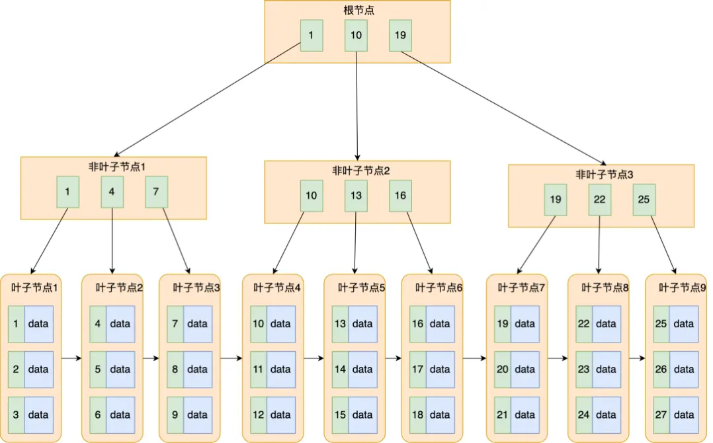

补充说明：

InnoDB每次磁盘I/O的基本单位是页，默认大小为16KB。在B+树索引中，每个节点通常对应一个页，因此一次查询需要访问多少层节点，就大致对应多少次磁盘I/O。

###### 为什么InnoDB使用B+树作为索引的数据结构

InnoDB使用B+树作为索引结构，核心原因是B+树既能降低树高、减少磁盘I/O，又能高效支持范围查询。

1. 哈希表：哈希表适合等值查询，时间复杂度接近`O(1)` ，但哈希值是无序的，不适合范围查询。遇到`>` 、`<` 、`between` 这类范围条件时，通常无法快速定位连续数据，只能退化为扫描。

2. 二叉树：二叉树每个节点最多只有两个子节点，数据量大时树的层级会很高。由于树高越高，查询时需要访问的磁盘页越多，因此二叉树会带来较多磁盘I/O，不适合作为InnoDB索引结构。

3. B树：B树是多叉平衡查找树，层级比二叉树更低。但B树的非叶子节点既存储索引数据，也存储记录数据。由于记录数据通常比索引数据大很多，而一个节点大小固定为一页16KB，所以单个节点能存放的索引项变少，分支因子变小，树高相对增加，查询时磁盘I/O也会变多。

4. B+树：B+树也是多叉平衡查找树，但非叶子节点只存储索引数据，所有记录数据都存储在叶子节点。这样非叶子节点可以容纳更多索引项，分支因子更大，树的高度更低，查询时磁盘I/O次数更少。同时，B+树的叶子节点之间通过双向链表连接，范围查询时只需要定位到起点，再沿链表顺序扫描即可，因此非常适合InnoDB索引。

###### B树和B+树的区别是什么

B树和B+树都是多路平衡查找树，区别主要在于数据存储位置、分支因子、范围查询能力和查询稳定性。

1. 数据存储不同：B树的所有节点都会存储索引和记录数据。B+树的非叶子节点只存索引，真实记录数据或数据指针只存储在叶子节点。

2. 分支因子不同：B树的非叶子节点存了记录数据，占用空间更大，所以一个节点能容纳的索引更少，分支因子较低。B+树非叶子节点只存索引，一个节点能容纳更多索引，分支因子更高，树的高度更低。

3. 范围查询能力不同：B树的叶子节点之间没有天然链表结构，范围查询效率较低。B+树的所有叶子节点通过双向链表连接，定位到范围起点后可以顺序扫描，范围查询更高效。

4. 查询稳定性不同：B树的数据可能在非叶子节点就被找到，不同数据查询路径长度可能不同。B+树的数据一定在叶子节点获取，每次查询都会走到叶子节点，查询路径更稳定。

InnoDB选择B+树，核心原因是B+树的非叶子节点只存索引，树更矮，磁盘I/O更少，并且叶子节点链表天然适合范围查询。

##### 什么是聚簇索引和非聚簇索引

聚簇索引和非聚簇索引是数据库中两种不同的数据组织方式，核心区别在于索引和数据是否存储在一起。在InnoDB中，主键索引就是聚簇索引，非主键索引就是非聚簇索引，也叫二级索引。

1. 聚簇索引

聚簇索引是将索引和数据存储在一起的索引结构。在InnoDB中，聚簇索引通常就是主键索引，它的非叶子节点存储索引值，叶子节点存储整行记录。也就是说，通过主键索引查到叶子节点后，就可以直接拿到完整数据，不需要再回表。

一个表只能有一个聚簇索引，因为表中的数据只能按照一种顺序组织存储。InnoDB默认使用主键作为聚簇索引；如果没有主键，会选择第一个非空唯一索引；如果两者都没有，会自动生成隐藏的`DB_ROW_ID` 作为聚簇索引。

2. 非聚簇索引

非聚簇索引是将索引和数据分开存储的索引结构。在InnoDB中，非聚簇索引就是非主键索引，也叫二级索引。它的非叶子节点存储索引值，叶子节点存储索引值和对应的主键值，而不是整行数据。

一个表可以有多个非聚簇索引。通过非聚簇索引查询时，会先在二级索引树中找到对应的主键值，再根据主键值回到聚簇索引树中查询整行记录，这个过程就是回表查询。

##### 数据库查询什么情况下会回表？

回表是 InnoDB 中使用二级索引查询时，由于二级索引叶子节点只保存"索引列 + 主键值"，如果需要获取其他字段，就需要根据主键再次到聚簇索引查询完整数据，这个过程称为回表。

- 查询字段未被索引覆盖：当查询的字段不在当前二级索引中时，需要先通过二级索引找到主键，再到聚簇索引获取完整数据。

```sql
CREATE INDEX idx_name ON employees(name);

SELECT salary
FROM employees
WHERE name = '张三';
```

`idx_name`  中只有 `name`  和主键，没有 `salary` ，因此需要回表获取 `salary` 。

- 使用二级索引查询 SELECT * ：虽然查询条件命中了二级索引，但由于需要返回整行数据，仍然需要回表。

```sql
SELECT *
FROM employees
WHERE name = '张三';
```

二级索引无法保存所有字段，因此需要根据主键回表查询。

- 覆盖索引不会回表：如果查询的所有字段都已经包含在二级索引中，可以直接返回结果，不需要访问聚簇索引。

```sql
CREATE INDEX idx_name_age ON employees(name, age);

SELECT name, age
FROM employees
WHERE name = '张三';
```

由于 `name` 、`age`  都在索引中，因此不会回表。

##### 什么是索引覆盖

索引覆盖是指查询所需的字段都能直接从二级索引树中获取，不需要再回到聚集索引树查询整行数据，因此可以避免回表查询。

例如：

```sql
select id, name from t_user where name = 'Tom';
```

如果`name` 是二级索引，二级索引叶子节点中存储的是`name` 和主键值`id` 。这条SQL只需要查询`id` 和`name` ，都能从`name` 索引树中拿到，不需要再回到主键索引树查询整行记录。

##### 索引失效有哪些情况

索引失效指SQL语句中虽然字段建立了索引，但由于写法不符合索引使用规则，优化器无法利用索引快速定位数据，最终可能退化为全表扫描。常见原因包括对索引列做函数或表达式计算、发生隐式类型转换、like 左模糊、联合索引不满足最左前缀法则，以及OR 条件中存在未索引字段。

1. 对索引列使用函数

如果在索引列上使用函数，MySQL无法直接使用B+树中原始字段值进行查找，可能导致索引失效。

```sql
select * from t_user where length(name) = 6;
```

如果`name` 字段有索引，这种写法也可能无法使用索引。因为索引中存储的是`name` 原始值，而不是`length(name)` 的计算结果。

2. 对索引列进行表达式计算

如果在索引列上做计算，MySQL需要逐行计算表达式结果，无法直接通过索引定位数据。

```sql
select * from t_user where id + 1 = 10;
```

更推荐改成下面这种写法：

```sql
select * from t_user where id = 9;
```

核心原则是不要让索引列参与计算，要把计算放到常量一侧。

3. 发生隐式类型转换

如果索引字段类型和查询条件类型不一致，MySQL可能会对索引列做隐式转换，导致索引失效。

```sql
select * from t_user where phone = 1300000001;
```

如果`phone` 是字符串类型，MySQL会把字符串转成数字再比较，相当于：

```sql
select * from t_user where cast(phone as signed int) = 1300000001;
```

这等价于对索引列使用函数，可能导致索引失效。正确写法是保持类型一致：

```sql
select * from t_user where phone = '1300000001';
```

4. like 以通配符开头

B+树索引依赖从左到右的有序匹配，如果`like` 以`%` 开头，无法确定查询前缀，索引可能失效。

```sql
select * from t_user where name like '%ming';
```

可以使用索引的写法是右模糊匹配：

```sql
select * from t_user where name like 'ming%';
```

因为`ming%` 有明确前缀，MySQL可以利用索引进行范围查找。

5. 联合索引不满足最左前缀法则

联合索引必须从最左列开始连续匹配。假设建立联合索引：

```sql
create index idx_abc on t_user(a, b, c);
```

可以使用联合索引的情况：

```sql
select * from t_user where a = 1;
select * from t_user where a = 1 and b = 2 and c = 3;
select * from t_user where b = 2 and a = 1;
select * from t_user where c = 3 and b = 2 and a = 1;
select * from t_user where a = 1 and c = 3;
```

`where` 条件中的书写顺序不重要，优化器会调整条件顺序。关键是查询条件中必须包含联合索引最左侧字段`a` 。

不满足最左前缀法则的情况：

```sql
select * from t_user where b = 2;
select * from t_user where c = 3;
select * from t_user where b = 2 and c = 3;
```

这些写法缺少最左侧字段`a` ，无法从联合索引树的最左列开始定位数据，因此联合索引无法被有效使用。

6. 联合索引中范围查询后的列可能失效

联合索引中如果某一列使用范围查询，那么它右侧的索引列通常无法继续用于精确匹配。

```sql
create index idx_abc on t_user(a, b, c);

select * from t_user where a = 1 and b > 2 and c = 3;
```

这里`a` 可以使用索引，`b` 可以使用索引做范围查找，但`c` 通常无法继续利用联合索引做精确定位。原因是范围查询会破坏后续字段的有序匹配能力。

7. OR 条件使用不当

`OR` 两边的条件如果一边有索引，另一边没有索引，优化器可能放弃索引，直接走全表扫描。

```sql
select * from t_user where id = 1 or age = 18;
```

如果`id` 有索引，但`age` 没有索引，整体查询仍可能无法有效使用索引。因为只要`age = 18` 需要全表扫描，整体结果就可能退化为全表扫描。

##### 最左前缀法则

最左前缀法则是指使用联合索引时，查询条件必须从联合索引的最左列开始连续匹配，才能有效使用索引。

例如有一个联合索引：

```sql
create index idx_abc on t_user(a, b, c);
```

这个索引是按照`a -> b -> c` 的顺序建立的，所以查询必须先匹配`a` 。

```sql
select * from t_user where a = 1;
select * from t_user where a = 1 and b = 2;
select * from t_user where a = 1 and b = 2 and c = 3;
```

这些SQL都能使用联合索引，因为都从最左边的`a` 开始匹配。

如果查询条件缺少`a` ：

```sql
select * from t_user where b = 2;
select * from t_user where c = 3;
select * from t_user where b = 2 and c = 3;
```

这些SQL就无法有效使用`idx_abc` ，因为联合索引树是先按`a` 排序，再按`b` 排序，最后按`c` 排序。缺少最左边的`a` ，数据库无法直接根据`b` 或`c` 在这棵索引树中定位数据。

###### (追问)最左前缀法则的原理是什么

最左前缀法则存在的原因是联合索引的底层B+树是按照索引字段的定义顺序排序的。例如联合索引`(a,b,c)` ，索引树会先按`a` 排序，在`a` 相同的情况下再按`b` 排序，最后再按`c` 排序。因此只有先确定最左侧字段`a` ，后面的`b` 、`c` 才是有序可查的。如果查询条件缺少`a` ，数据库无法直接根据`b` 或`c` 在索引树中定位数据，所以联合索引会失效。

#### 日志

MySQL常见日志主要包括`Redo Log` 、`Undo Log` 和`Binlog` 。从架构上看，MySQL分为Server层和存储引擎层，不同日志所属层级不同，作用也不同。

- Redo Log：属于存储引擎层，是InnoDB特有的日志，主要用于保证事务的持久性。

- Undo Log：属于存储引擎层，也是InnoDB特有的日志，主要用于事务回滚和MVCC。

- Binlog：属于Server层，所有存储引擎都可以使用，主要用于主从复制和数据恢复。

##### 很多冗余索引有什么缺点？

索引能够提高查询效率，但并不是越多越好。过多或冗余的索引会增加写入成本、占用存储空间，并影响优化器选择执行计划。

- 降低写性能：执行 `INSERT` 、`UPDATE` 、`DELETE`  时，不仅需要修改数据，还需要同步维护所有相关索引。索引越多，需要更新的 B+Tree 越多，写入性能越差。

- 占用更多存储空间：每个索引都会维护一棵 B+Tree，需要额外存储索引键、主键值以及页结构。冗余索引会增加磁盘占用，同时也会增加备份、恢复和缓存的成本。

- 增加优化器开销：SQL 执行前，优化器需要在多个索引中选择最优执行计划。索引过多会增加优化成本，甚至可能因为统计信息等原因选择非最优索引，导致查询性能下降。

- 增加维护成本：索引越多，重建索引、统计信息更新、数据迁移等维护操作耗时越长，也增加了数据库管理成本。

例如：

```text
INDEX idx_name(name)
INDEX idx_name_age(name, age)
```

如果业务几乎不会单独按照 `name`  查询，那么 `idx_name`  就属于冗余索引，因为联合索引`(name, age)`  已经可以利用最左前缀原则支持 `name`  的查询。

##### Redo Log

`Redo Log` 是InnoDB存储引擎用于保证事务持久性的日志，核心思想是`WAL` ，即先写日志，再写数据页。事务提交时，InnoDB先把数据页的物理修改记录到`Redo Log` 并刷盘，数据页本身可以先缓存在内存中，之后再异步刷盘。这样既减少了直接刷数据页带来的随机I/O开销，又能在数据库崩溃后通过`Redo Log` 恢复已提交的数据。

`Redo Log` 的核心机制如下：

- 解决持久性与性能的矛盾：如果每次修改都直接把数据页写入磁盘，会产生大量随机I/O，成本很高。如果只把脏页暂存在内存中并延迟刷盘，数据库崩溃时又可能丢失已提交事务的数据。因此InnoDB通过`Redo Log` 先记录修改，兼顾写入性能和事务持久性。

- 采用WAL机制：`WAL` 表示`Write-Ahead Logging` ，即事务提交前先把修改写入`Redo Log`磁盘文件，再由后台线程将脏页异步刷盘。`Redo Log` 记录的是数据页的物理修改，例如某个页的某个偏移位置被改成什么值。

- 顺序I/O提升性能：直接刷数据页通常是随机I/O，而写`Redo Log` 是顺序I/O。`Redo Log` 文件大小固定，并采用循环写入方式，不断覆盖最早的内容，因此写入效率比随机刷数据页更高。

- 崩溃恢复数据：如果事务提交后`Redo Log` 已经刷盘，但对应的数据页还没刷盘，此时数据库崩溃，重启后InnoDB可以根据`Redo Log` 重放修改，把已提交事务的数据恢复出来。

例如执行：

```sql
UPDATE accounts SET balance = balance - 100 WHERE id = 1;
```

InnoDB会先找到`id=1` 所在的数据页，在内存中把`balance` 从`500` 改为`400` ，然后生成一条`Redo Log` ，记录页号、偏移位置和修改后的值。事务提交时，`Redo Log` 先刷盘，数据页可以暂时不刷盘。如果此时数据库崩溃，重启后会通过`Redo Log` 重新应用这次修改，保证已提交事务的数据不丢失。

##### Undo Log

`Undo Log` 是InnoDB用于保证事务原子性并支持`MVCC` 的日志。它记录的是数据修改的反向操作，也就是逻辑日志。当事务需要回滚时，InnoDB可以根据`Undo Log` 撤销已经执行的修改；当事务并发读取时，InnoDB也可以通过`Undo Log` 形成的版本链读取历史版本数据。

`Undo Log` 的核心作用如下：

- 保证事务原子性：事务中的操作要么全部成功，要么全部失败。`Undo Log` 会记录每次修改对应的反向操作，如果事务执行失败或主动回滚，就根据这些反向操作把数据恢复到事务开始前的状态。例如某个字段从`100` 改成`200` ，`Undo Log` 会记录将`200` 恢复为`100` 的操作，从而撤销本次修改。

- 支持MVCC版本链：每次修改数据行时，InnoDB都会生成一条`Undo Log` 记录，保存旧版本数据，并通过`roll_pointer` 指向更早的历史版本。多个历史版本通过`roll_pointer` 串联起来，形成版本链。每个版本还会关联`trx_id` ，用于标识生成该版本的事务。

- 支持一致性读：事务读取数据时，InnoDB会根据当前事务的`ReadView` 和数据版本的`trx_id`判断该版本是否可见。如果最新版本不可见，就沿着`roll_pointer` 到`Undo Log` 版本链中查找上一个历史版本，直到找到当前事务可见的数据版本。这样就能在不加锁的情况下实现并发读写。

##### BinLog

`Binlog` 是MySQL Server层的二进制日志，用于记录数据库的表结构变更和表数据修改，例如`create` 、`alter` 、`insert` 、`update` 、`delete` 等操作。它不会记录`select` 和`show` 这类只读操作。`Binlog` 主要用于数据备份、灾难恢复和主从同步，通常在事务提交时写入。

`Binlog` 支持三种格式：

1. Statement格式：记录的是SQL语句原文。

    - 优点：日志内容少，文件体积小，写入和同步成本较低。

    - 缺点：可能导致主从数据不一致。例如使用`now()` 、`uuid()` 等函数时，主库和从库执行同一条SQL可能得到不同结果。

2. Row格式：记录的是每一行数据的具体变化，而不是SQL原文。

    - 记录内容：`insert` 会记录新插入行的字段值，`update` 会记录更新前后的字段值，`delete` 会记录删除前的字段值。

    - 优点：能更好保证主从同步的数据一致性，避免Statement格式中由于函数、触发器等导致的不确定问题。

    - 缺点：记录内容更多，尤其是批量修改或批量插入时，会产生较大的日志文件，增加磁盘I/O和主从同步的网络开销。

3. Mixed格式：由MySQL根据SQL情况在Statement和Row之间自动选择。

    - 默认策略：一般优先使用Statement格式记录SQL语句。

    - 特殊场景：遇到可能导致主从不一致的SQL时，自动切换为Row格式记录数据变化。

    - 特点：在性能和一致性之间做折中，既减少日志体积，又尽量避免主从数据不一致。

#### 执行SQL的过程与顺序

##### 执行SQL查询语句的过程是什么

- 连接器：建立连接、管理连接、校验用户身份；

- 查询缓存：查询语句如果命中查询缓存则直接返回，否则继续往下执行。MySQL 8.0 已删除该模块；

- 解析SQL：通过解析器对 SQL 查询语句进行词法分析、语法分析，然后构建语法树，方便后续模块读取表名、字段、语句类型；

- 执行SQL：执行 SQL 共有三个阶段：

    - 预处理阶段：检查表或字段是否存在；将 select * 中的 * 符号扩展为表上的所有列。

    - 优化阶段：基于查询成本的考虑，选择查询成本最小的执行计划；

    - 执行阶段：根据执行计划执行 SQL 查询语句，从存储引擎读取记录，返回给客户端；

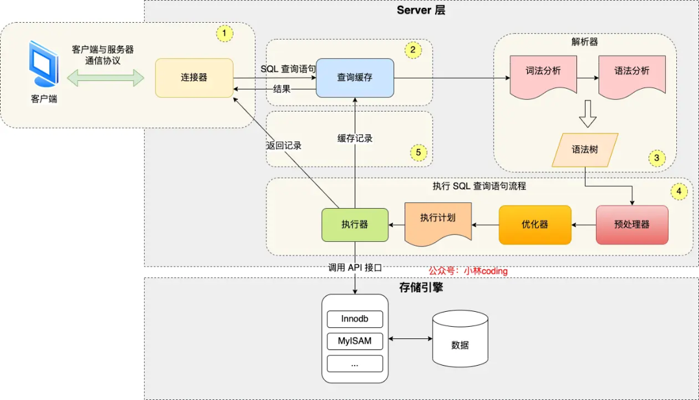

##### 执行一条 UPDATE 语句的流程是什么？

以 `UPDATE student SET age=19 WHERE name='`张三`';`  为例，一条更新语句会经过连接器→解析器→优化器→执行器→存储引擎，在真正修改数据时还会涉及 Redo Log 和 Binlog。

- 查询目标数据：执行器根据 SQL 查找满足条件的记录。若没有合适索引，会进行全表扫描；由于是更新语句，不会使用查询缓存（MySQL 8.0 已移除查询缓存）。

- 修改内存数据：找到记录后，执行器调用 InnoDB 引擎接口修改数据页。数据首先更新到 Buffer Pool，并记录 Redo Log，此时 Redo Log 处于 prepare 状态。

- 写入 Binlog：执行器收到引擎返回后，将本次更新操作写入 Binlog，用于主从复制和数据恢复。

- 提交事务：Binlog 写入成功后，通知 InnoDB 将 Redo Log 从 prepare 状态变为 commit 状态，这就是 两阶段提交（Two-Phase Commit）。

- 返回结果：事务提交成功，客户端收到更新成功的响应；数据页之后会由后台线程异步刷盘。

##### 执行SQL查询关键字的执行顺序

例如一条典型SQL：

```sql
SELECT d.name, COUNT(*) AS emp_count
FROM employee e
JOIN department d ON e.department_id = d.id
WHERE e.salary > 10000
GROUP BY d.name
HAVING COUNT(*) > 5
ORDER BY emp_count DESC
LIMIT 10;
```

逻辑执行顺序如下：

1. FROM：确定查询的数据来源，例如先找到`employee` 表。

2. ON：处理表连接条件，例如判断`e.department_id = d.id` 是否成立。

3. JOIN：根据连接条件合并`employee` 和`department` 两张表的数据。

4. WHERE：对连接后的行数据进行过滤，例如只保留`salary > 10000` 的员工记录。

5. GROUP BY：按照指定字段进行分组，例如按部门名称`d.name` 分组。

6. HAVING：对分组后的结果进行过滤，例如只保留员工数量大于`5` 的部门。

7. SELECT：选择最终要返回的字段，例如部门名称和员工数量。

8. DISTINCT：如果有`DISTINCT` ，则对结果去重。

9. ORDER BY：对结果进行排序，例如按照`emp_count` 倒序排列。

10. LIMIT：限制最终返回的行数，例如只返回前`10` 条。

PS：这只是逻辑执行顺序，实际物理执行过程可能会被数据库优化器根据索引、统计信息和查询成本进行调整。

#### SQL语句细节

##### Union 和 Union All 有什么区别？

UNION和UNION ALL都用于合并多个查询结果，核心区别在于是否去重。UNION会对合并后的结果去重，UNION ALL会保留所有数据，包括重复记录。

- 去重机制：Union 会对结果集进行去重；Union All 不会去重，直接返回所有结果，包括重复数据。

- 执行效率：Union 需要进行排序或 Hash 去重，因此性能相对较低；Union All 不需要去重，执行效率更高。

- 使用场景：当需要去除重复数据时使用 Union；如果能够确定结果不存在重复，或允许重复数据，优先使用 Union All，以获得更好的性能。

例如：

```sql
SELECT name FROM student
UNION
SELECT name FROM teacher;
```

返回合并后的唯一结果。

```sql
SELECT name FROM student
UNION ALL
SELECT name FROM teacher;
```

返回所有结果，即使存在重复数据也会保留。

##### BETWEEN 是开区间还是闭区间

闭区间

##### LEFT JOIN 和 RIGHT JOIN 有什么区别？

LEFT JOIN 和 RIGHT JOIN 都属于外连接，区别在于保留哪张表的全部数据。

- LEFT JOIN（左连接）：以左表为主，返回左表的所有记录，以及右表中满足关联条件的记录。如果右表没有匹配的数据，则右表对应字段返回 `NULL` 。

```sql
SELECT *
FROM A
LEFT JOIN B
ON A.id = B.id;
```

- 返回 A 表所有数据，没有匹配的 B 表数据用 `NULL`  填充。

- RIGHT JOIN（右连接）：以右表为主，返回右表的所有记录，以及左表中满足关联条件的记录。如果左表没有匹配的数据，则左表对应字段返回 `NULL` 。

```sql
SELECT *
FROM A
RIGHT JOIN B
ON A.id = B.id;
```

- 返回 B 表所有数据，没有匹配的 A 表数据用 `NULL`  填充。

- 两者可以相互转换：将左右两张表交换位置，`LEFT JOIN`  和 `RIGHT JOIN`  可以实现相同的查询效果，因此实际开发中通常优先使用 LEFT JOIN，SQL 可读性更高，也更符合大多数人的编写习惯。

#### 深度分页

##### 什么是深分页问题？

深分页是指使用 LIMIT offset, size  查询时，offset  非常大的场景。由于 MySQL 需要先扫描并跳过前面的大量数据，再返回目标数据，因此随着 offset  增大，查询性能会明显下降。

例如：

```sql
SELECT *
FROM users
ORDER BY id
LIMIT 1000000, 20;
```

MySQL 实际需要扫描约 1000020 条记录，只返回最后 20 条，因此性能较差。

##### 为什么深分页查询很慢？

深分页慢的根本原因是 MySQL 无法直接定位到第 offset 条数据，只能先扫描并丢弃前面的记录。

- 即使使用了索引，仍然需要遍历前 `offset`  条索引记录。

- 如果查询字段不能被索引覆盖，还会产生大量回表操作。

- `offset`  越大，扫描的数据越多，性能越差。

##### 深分页有哪些优化方案？

常见的优化方案有游标分页、延迟关联和覆盖索引。

- 游标分页（Keyset Pagination）：记录上一页最后一条记录的主键或排序字段，下一页直接从该位置继续查询，避免扫描大量无效数据。

```sql
SELECT *
FROM users
WHERE id > 1000000
ORDER BY id
LIMIT 20;
```

适用于按主键或唯一有序字段分页，是性能最好的方案。

- 延迟关联（Deferred Join）：先利用索引分页查询主键，再根据主键回表获取完整数据，减少回表次数。

```sql
SELECT u.*
FROM users u
JOIN (
    SELECT id
    FROM users
    ORDER BY create_time
    LIMIT 1000000,20
) t
ON u.id = t.id;
```

适用于查询字段较多、无法使用覆盖索引的场景。

- 覆盖索引：如果查询字段全部包含在索引中，可以直接从索引返回数据，避免回表，提高深分页性能。

##### 为什么游标分页比 LIMIT OFFSET 更快？

游标分页利用索引直接定位到上一页最后一条记录，从该位置继续扫描，而不需要扫描并丢弃前面的大量数据，因此时间复杂度接近 O(limit)，性能远高于 OFFSET 分页。

##### 游标分页有什么缺点？

游标分页不能随机跳页，只能按照上一页、下一页顺序翻页，因此更适用于滚动加载、无限下拉等场景。如果业务需要直接跳转到指定页码，则通常仍需要使用 OFFSET 分页。

#### SQL优化

##### SQL的Explain命令解析

`EXPLAIN` 用于查看SQL的执行计划，也就是一条SQL经过MySQL优化器处理后，最终准备如何执行。优化SQL时，通常先看`EXPLAIN` 结果，判断查询顺序、索引使用情况、扫描行数和额外执行开销。

`EXPLAIN` 结果通常包含12列：

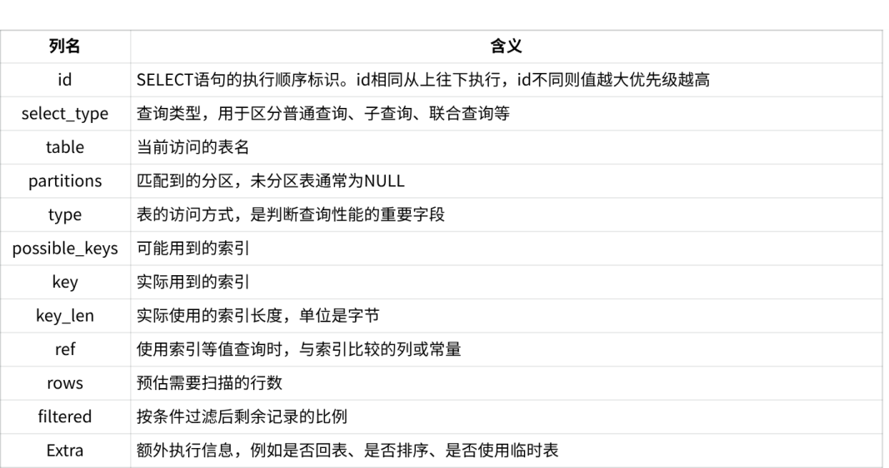

其中比较关键的字段主要是`select_type` 、`type` 和`Extra` ：

1. select_type `select_type` 表示查询类型，主要用于区分普通查询、子查询和联合查询。

- `SIMPLE` ：简单查询，不包含`UNION` 或子查询

- `PRIMARY` ：复杂查询中的最外层`SELECT`

- `SUBQUERY` ：子查询中的第一个`SELECT`

- `UNION` ：`UNION` 语句中后面的`SELECT`

- `DERIVED` ：`FROM` 中的子查询，也就是派生表

- `UNION RESULT` ：`UNION` 查询的结果

2. type

`type` 表示访问表的方式，是判断SQL性能最重要的字段之一。常见类型从好到差大致为：

```text
system > const > eq_ref > ref > range > index > ALL
```

- `system` ：表中只有一行数据，访问成本最低

- `const` ：通过主键或唯一索引命中最多一行，只查询一次

- `eq_ref` ：连表查询时，被驱动表通过主键或唯一索引匹配，每次只返回一行

- `ref` ：使用普通索引等值查询，可能匹配多行

- `range` ：使用索引进行范围查询，例如`>` 、`<` 、`between`

- `index` ：扫描整棵索引树，比全表扫描略好

- `ALL` ：全表扫描，性能最差，通常需要重点优化

3. Extra

`Extra` 表示额外执行信息，用来判断SQL是否存在额外开销。

- `Using index` ：使用覆盖索引，不需要回表，性能较好

- `Using where` ：使用`WHERE` 条件过滤数据

- `Using index condition` ：使用索引条件下推，在存储引擎层提前过滤数据

- `Using filesort` ：无法利用索引完成排序，需要额外排序，性能较差

- `Using temporary` ：需要临时表保存中间结果，常见于`GROUP BY` 和`ORDER BY`

- `Using join buffer` ：连接时被驱动表没有有效使用索引，需要借助`join buffer`

看执行计划时，重点关注`type` 是否为`ALL` 、`key` 是否为`NULL` 、`rows` 是否过大，以及`Extra` 中是否出现`Using filesort` 或`Using temporary` 。

##### 慢SQL主要是哪些原因，如何定位

慢SQL是指执行时间超过预期或超过慢查询阈值的SQL。

慢SQL常见原因：

- 数据量太大：表数据过多，查询扫描范围大，导致执行时间变长。

- 并发量太大：大量请求同时访问数据库，产生锁等待、连接等待或资源竞争。

- 索引没有使用或使用不当：字段没有建索引，索引失效，联合索引不符合最左前缀法则，都会导致查询变慢。

- SQL语句书写不当：例如`select *` 、深分页、复杂子查询、`like` 左模糊、对索引列使用函数或表达式。

- 表结构设计不当：字段类型不合理，表过宽，冗余字段过多，冷热数据没有拆分。

- 业务设计不合理：单次查询范围过大，频繁统计大表，接口直接查询明细全量数据。

- 数据库配置或硬件不足：数据库实例性能不足，CPU、内存、磁盘I/O或连接数成为瓶颈。

如何定位慢SQL：

- 开启慢查询日志：通过慢查询日志记录执行时间超过阈值的SQL，例如超过`long_query_time`的语句。

- 分析执行计划：对慢SQL执行`EXPLAIN` ，重点看`type` 、`key` 、`rows` 和`Extra` ，判断是否全表扫描、索引未命中、扫描行数过大，或出现`Using filesort` 、`Using temporary` 。

- 结合业务场景排查：确认慢SQL是在数据量增长后变慢，还是在高并发时变慢，或者是某次代码改动后出现。

##### 如何优化慢SQL

慢SQL优化要先定位原因，再对症处理。

1. 索引优化

主要优化索引没有使用或使用不当导致的慢SQL，例如字段未建索引、索引失效、联合索引顺序不合理、排序分组无法利用索引等问题。

- 控制单表索引数量，一般建议不超过`5` 个。索引过多会降低写入效率，也会增加优化器选择执行计划的成本。

- 联合索引要遵循最左前缀法则，尽量把区分度高、使用频率高的列放在左侧。

- 对`where` 、`order by` 、`group by` 中高频使用的字段建立合适索引，必要时合并成联合索引。

```sql
SELECT age, city, name
FROM user
WHERE age = 20 AND city = 'Beijing'
ORDER BY name;
```

对这种SQL，建立`(age, city, name)` 联合索引通常比单独建立`(age, city)` 和`(name)` 效果更好，因为可以同时支持过滤和排序，减少额外排序开销。

2. SQL语句优化

主要优化SQL写法不当导致的慢SQL，例如`select *` 、深分页、复杂子查询、`like` 左模糊、对索引列使用函数或表达式等问题。

- 避免使用`select *` ，只查询需要的字段，减少解析成本、网络传输和回表开销。

- 多表`join` 时，尽量使用小表驱动大表，减少匹配次数。

- 合并多表数据时，如果业务允许重复，使用`union all` 代替`union` ，避免额外去重开销。

- 避免索引失效写法，例如对索引列使用函数、表达式计算、隐式类型转换和`like '%xxx'` 左模糊查询。

3. 表结构优化

主要优化表结构设计不当导致的慢SQL，例如字段类型不合理、表过宽、大字段影响主表查询、冷热数据没有拆分等问题。

- 经常一起查询的字段可以放在同一张表中，减少多表联查。

- 可以适当反范式设计，保留必要冗余字段，避免高频`join` 。

- 优先选择满足业务需求的最小数据类型，减少存储和索引空间。

- 避免在主表中存储`TEXT` 、`BLOB` 等大字段，文件或图片建议只存地址，大字段可以拆到扩展表。

- 没有特殊需求时，字段尽量定义为`NOT NULL` ，减少额外存储和计算处理。

- 不要用字符串存储日期，优先使用`DATETIME` 、`TIMESTAMP` 或数值型时间戳。

- 单表字段不要过多，冷热字段差异明显时可以冷热分离。

4. 业务优化

主要优化业务设计不合理导致的慢SQL，例如单次查询范围过大、频繁实时统计大表、接口直接查询全量明细数据等问题。

- 避免不合理的深分页需求，例如查询第`1000` 页，可以改为游标分页或限制最大翻页深度。

- 报表类数据不要每次实时计算，`T+1` 数据可以在业务低峰期提前计算并落表。

- 接口查询要限制数据范围，避免一次性加载大量数据。

5. 架构优化

主要优化数据量太大、并发量太高、数据库实例性能不足导致的慢SQL，例如单表数据过多、热点数据访问频繁、连接等待、磁盘I/O瓶颈等问题。

- 使用读写分离，将读操作和写操作分散到不同数据库实例，提高并发处理能力。

- 使用`Redis` 等缓存中间件缓存热点数据，减少数据库访问压力。

- 数据量过大时可以考虑分库分表，降低单表数据量和索引维护成本，但要权衡复杂度。

- 高并发和大数据量场景可以考虑分布式数据库，例如`TiDB` 。

- 数据库实例性能不足时，可以提升CPU、内存、磁盘I/O和连接数配置。

##### 如果SQL已经优化到极致了，偶尔还是很慢，一般是什么原因？

如果 SQL 本身已经优化完成，但仍然偶发性变慢，通常不是 SQL 语句的问题，而是数据库运行环境、资源竞争或执行计划变化导致的。

- 锁等待：事务未及时提交，导致行锁、间隙锁或表锁竞争，SQL 需要等待锁释放后才能继续执行。

- 资源竞争：业务高峰期并发请求增加，CPU、内存、磁盘 I/O 或连接池资源不足，导致 SQL 响应时间变长。

- 磁盘 I/O 抖动：磁盘刷盘、Checkpoint、大量日志写入或底层存储性能波动，都可能导致查询偶尔变慢。

- 执行计划变化：由于统计信息变化、数据量增长或索引选择发生变化，优化器可能选择了效率较低的执行计划。

- 数据分布变化：出现数据倾斜或热点数据，导致某些 SQL 实际扫描的数据量远大于平时。

- 网络延迟：数据库与应用服务器之间网络偶发抖动，导致请求响应时间增加。

- 后台任务影响：数据库执行统计信息收集、索引维护、备份、主从同步、Checkpoint 等后台任务时，可能占用系统资源，影响 SQL 执行性能。

### 扩展题

#### MySQL引擎

##### MySQL 常见的存储引擎有哪些？各有什么特点？

MySQL 常见的存储引擎有 InnoDB、MyISAM 和 Memory，其中 InnoDB 是 MySQL 默认的存储引擎，也是生产环境最常用的。

- InnoDB：支持事务、MVCC、行级锁、外键，具有崩溃恢复能力，数据安全性高，适合高并发的增删改查场景。但相比 MyISAM，占用更多的磁盘空间，写入开销也更大。

- MyISAM：不支持事务和外键，采用表级锁，查询速度快，适合以 SELECT、INSERT 为主、对事务一致性要求不高的场景。但并发写性能较差，异常宕机后数据恢复能力较弱。

- Memory：数据存储在内存中，读写速度非常快，默认使用 Hash 索引。但服务器重启后数据会全部丢失，仅表结构保留，因此适合作为临时表、缓存表等场景。

总结：

- InnoDB：支持事务、行锁、外键，生产环境首选。

- MyISAM：查询速度快，不支持事务，适合读多写少。

- Memory：数据存内存，速度最快，但数据不持久化。

##### InnoDB 和 MyISAM 有什么区别？

InnoDB 和 MyISAM 都是 MySQL 的存储引擎，但 InnoDB 更适合高并发事务场景，也是 MySQL 默认的存储引擎；MyISAM 更适合读多写少的场景。

- 事务支持：InnoDB 支持事务，提供 ACID 特性，支持提交、回滚；MyISAM 不支持事务。

- 锁机制：InnoDB 支持行级锁，并发性能高；MyISAM 只支持表级锁，写操作会锁住整张表。

- 外键支持：InnoDB 支持外键，能够保证数据完整性；MyISAM 不支持外键。

- MVCC：InnoDB 支持 MVCC（多版本并发控制），提高并发读写能力；MyISAM 不支持。

- 索引实现：两者都使用 B+Tree，但实现方式不同。InnoDB 的聚簇索引将数据和主键索引存储在一起，主键索引叶子节点直接存储整行数据；MyISAM 的索引和数据分离，索引叶子节点存储的是数据文件地址。

- 崩溃恢复：InnoDB 支持 Redo Log 等机制，具备崩溃恢复能力；MyISAM 不支持，异常宕机可能导致数据损坏。

- 性能特点：MyISAM 查询速度通常更快，但写入并发能力较弱；InnoDB 在高并发、事务处理场景下整体性能更优，也是生产环境的首选。

##### InnoDB 的表数据是如何存储的？

InnoDB 以页为基本存储单位，默认每页 16KB，多个页组成区，多个区组成段。表中的数据和索引主要通过 B+Tree 组织，同时内部还会使用自适应 Hash 索引优化部分等值查询。

- 聚簇索引：InnoDB 的表数据存储在主键索引的 B+Tree 中，叶子节点保存完整的行数据，因此InnoDB 中“表数据本身就是聚簇索引”。

- 主键选择：如果表中存在主键，使用主键构建聚簇索引；如果没有主键，会选择第一个非空唯一索引；如果两者都没有，InnoDB 会生成一个隐藏的 6 字节 Row ID 作为聚簇索引。

- 二级索引：普通索引、唯一索引等都属于二级索引。二级索引的叶子节点保存“索引字段值 + 主键值”，查询完整数据时通常需要先获得主键，再到聚簇索引中查询，这个过程称为回表。

- 覆盖索引：如果查询字段全部包含在二级索引中，可以直接从二级索引返回结果，不需要回表。

- B+Tree 索引：InnoDB 的主键索引、普通索引、唯一索引默认都使用 B+Tree。它适合等值查询、范围查询、排序和最左前缀匹配。

- Hash 索引：InnoDB 不支持用户手动创建普通 Hash 索引，但内部存在自适应 Hash 索引（Adaptive Hash Index）。当某些 B+Tree 索引页被频繁进行等值查询时，InnoDB 会自动为热点数据建立 Hash 索引，以减少 B+Tree 查找次数。

- 自适应 Hash 索引限制：它只适合等值查询，不支持范围查询和排序，并且由 InnoDB 自动创建和维护，用户不能直接指定某个字段建立 Hash 索引。

- 全文索引：InnoDB 支持 Full-Text Index，主要用于文本内容的全文检索。

- 空间索引：InnoDB 支持 Spatial Index，底层使用 R-Tree，主要用于地理空间数据查询。

- 物理文件存储：开启独立表空间后，每张 InnoDB 表通常对应一个 `.ibd`  文件，里面保存表的数据和索引；表结构信息由 MySQL 数据字典统一管理。

##### InnoDB 的自增 ID 是怎么实现的？为什么删除数据后不会复用 ID？

InnoDB 的自增 ID 是通过 AUTO_INCREMENT 计数器实现的。当插入新记录时，InnoDB 会自动生成一个比当前计数器更大的值作为主键，并更新计数器，保证每条记录拥有唯一的自增 ID。

- 生成过程：插入数据时，InnoDB 获取当前 AUTO_INCREMENT 计数器的值，将其分配给新记录，然后将计数器递增，再完成数据写入。

- 计数器维护：MySQL 8.0 之前，自增计数器主要保存在内存中，数据库重启后会根据表中的最大自增值重新初始化；MySQL 8.0 开始，自增计数器会持久化到数据字典中，重启后不会回退。

- 并发控制：InnoDB 通过 Auto-Increment Lock（自增锁）或轻量级锁机制保证并发插入时不会产生重复的自增 ID，不同插入模式下锁的粒度也有所不同。

为什么删除一行数据后，不会继续复用该 ID？

- 保证唯一性：AUTO_INCREMENT 的设计目标是保证生成的 ID 唯一，而不是保证连续。删除记录后继续复用 ID，可能导致主键冲突或业务歧义。

- 避免并发问题：如果回收已删除的 ID，需要维护空闲 ID 列表，并发插入时需要竞争这些 ID，会增加同步开销和实现复杂度。

- 提高插入性能：自增计数器始终递增，只需要维护一个最大值即可，无需扫描或管理已删除的 ID，插入效率更高。

- 保证数据一致性：很多业务系统、缓存、日志、消息、主从复制都会引用主键。如果删除后复用ID，可能导致历史数据与新数据混淆，影响数据一致性和可追溯性。

#### MySQL数据类型

##### MySQL 有哪些数据类型？

MySQL 的数据类型主要分为数值类型、字符串类型、日期时间类型和其他类型四大类，不同类型适用于不同的数据存储场景。

- 数值类型：用于存储整数和浮点数。

    - 整数：`TINYINT` 、`SMALLINT` 、`MEDIUMINT` 、`INT` 、`BIGINT`

    - 浮点数：`FLOAT` 、`DOUBLE`

    - 定点数：`DECIMAL` ，适用于金额等需要高精度计算的场景。

- 字符串类型：用于存储字符和文本数据。

    - 定长字符串：`CHAR`

    - 变长字符串：`VARCHAR`

    - 文本类型：`TEXT` 、`MEDIUMTEXT` 、`LONGTEXT`

    - 二进制类型：`BLOB` 、`MEDIUMBLOB` 、`LONGBLOB`

- 日期时间类型：用于存储日期和时间。

    - `DATE` ：日期（年月日）

    - `TIME` ：时间（时分秒）

    - `DATETIME` ：日期和时间，与时区无关

    - `TIMESTAMP` ：时间戳，与时区相关，可自动更新

    - `YEAR` ：年份

- 其他类型：

    - `ENUM` ：枚举类型，只能取预定义值中的一个。

    - `SET` ：集合类型，可以同时取多个预定义值。

    - `JSON` ：用于存储 JSON 格式数据，支持 JSON 函数和索引（MySQL 5.7+）。

##### VARCHAR 和 TEXT 有什么区别？

VARCHAR 和 TEXT 都用于存储可变长度字符串，但两者在存储方式、长度限制、索引方式和使用场景上有所不同。

- 存储方式：VARCHAR 的数据通常与其他字段一起存储在数据页中，长度使用 1 或 2 个字节记录（长度 ≤255 字节使用 1 字节，否则使用 2 字节）；TEXT 属于大对象（LOB）类型，当数据较大时，InnoDB 会将实际内容存储到溢出页（Overflow Page），数据页中保留部分内容和指针，因此访问开销通常更大。

- 长度限制：VARCHAR 最大长度为 65535 字节，但实际可用长度受**字符集、行大小（65KB）**等限制；TEXT 最大可存储 65535 字节，此外还有 MEDIUMTEXT（16MB） 和 LONGTEXT（4GB）等类型。

- 索引支持：VARCHAR 可以建立完整索引；TEXT 可以建立索引，但必须指定前缀长度，不能直接建立完整索引。

- 使用场景：VARCHAR 适合存储姓名、手机号、邮箱、地址等长度可预估的字符串；TEXT 适合存储文章内容、评论、日志等较大的文本数据。

- 性能差异：VARCHAR 一般读写性能更好；TEXT 在数据较大时可能涉及溢出页访问，性能相对较低，因此字段长度可预估时优先使用 VARCHAR，仅在需要存储长文本时使用 TEXT。

##### VARCHAR(100) 中的100指的是什么？汉字占多少字节？

VARCHAR(100)  中的 100  表示最多可以存储 100 个字符，而不是 100 个字节。实际占用多少字节取决于字符集。

- 100 表示字符数：无论存储英文、数字还是汉字，`VARCHAR(100)`  最多只能存放 100 个字符。

- 实际存储空间由字符集决定：

    - `ascii` ：1 个字符占 1 字节。

    - `gbk` ：一个汉字通常占 2 字节。

    - `utf8` （MySQL 的 utf8）：一个汉字通常占 3 字节。

    - `utf8mb4` ：一个汉字通常占 3 字节，部分 Emoji、特殊字符占 4 字节。

- VARCHAR 还有长度字节：VARCHAR 会额外使用 1 或 2 个字节保存字符串长度。当存储长度≤255 字节时使用 1 字节，否则使用 2 字节。

例如：

```text
VARCHAR(100)
```

如果字符集为 `utf8mb4` ：

- 存储 100 个英文字符，大约占 100 + 1 = 101 字节。

- 存储 100 个普通汉字，大约占 300 + 2 = 302 字节（300 字节数据 + 2 字节长度信息，因为已超过255 字节）。

#### 索引下推

索引下推（ICP）是 MySQL 的一种查询优化技术，它将部分查询条件下推到存储引擎层，在扫描索引时就完成部分过滤，从而减少回表次数，提高查询性能。

- 未使用索引下推：存储引擎根据索引找到满足索引条件的记录后，会立即回表读取完整数据，再由Server 层判断其他查询条件是否满足。如果命中的记录较多，会产生大量无效回表。

- 使用索引下推：对于索引中能够判断的条件，存储引擎会在扫描索引时直接进行过滤，只有满足条件的记录才会回表，因此能够减少磁盘 I/O 和回表次数，提高查询效率。

例如，有联合索引：

```text
(a, b)
```

执行：

```sql
SELECT *
FROM t
WHERE a = 1 AND b > 5;
```

执行过程：

- 存储引擎先利用索引定位 `a = 1`  的记录。

- 由于 `b`  也在联合索引中，可以直接在索引中判断 `b > 5`  是否成立。

- 只有同时满足 `a = 1`  和 `b > 5`  的记录才会回表读取完整数据。

如果没有索引下推，则会先找到所有 `a = 1`  的记录，并全部回表，再由 Server 层过滤 `b > 5` ，产生更多无效回表。

#### 主从复制

##### 主从复制的流程是什么

MySQL主从复制是指将主库上的`DDL` 和`DML` 操作记录到`Binlog` 中，再同步到从库并重新执行，使从库数据和主库数据保持一致。它的本质是主库写Binlog，从库拉取Binlog并重放执行。

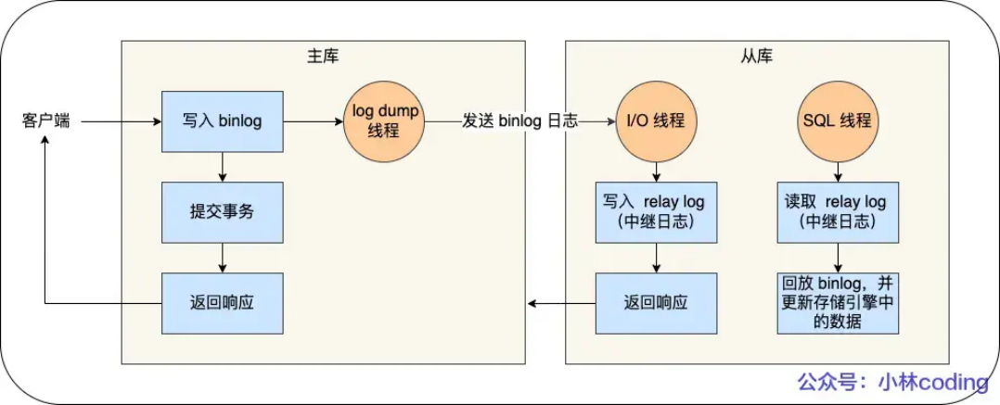

主从复制的主要流程如下：

1. 从库启动复制线程：从库开启主从复制后，会创建两个核心线程，分别是`I/O`线程和`SQL`线程。`I/O`线程负责从主库拉取日志，`SQL`线程负责在从库重放日志。

2. 建立主从连接：从库的`I/O`线程会尝试连接主库。主库会创建对应的`binlog dump`线程，专门负责和从库的`I/O`线程交互。

3. 确认同步位置：从库的`I/O`线程会告诉主库的`binlog dump`线程，自己要从哪个`Binlog` 文件、哪个位置开始同步。

4. 主库写入Binlog：主库执行数据变更时，会将`DDL` 和`DML` 操作记录到自己的`Binlog` 中。不同`Binlog` 格式下，记录内容可能是SQL原文，也可能是行数据变化。

5. 从库拉取Binlog：主库的`binlog dump`线程检测到`Binlog` 变化后，会从指定位置读取日志内容。从库的`I/O`线程以拉取方式获取这些日志，因此从库可以自行管理同步进度和延迟。

6. 写入Relay Log：从库的`I/O`线程拿到主库日志后，不会直接执行，而是先写入本地的中继日志`Relay Log` 中。

7. SQL线程重放日志：从库的`SQL`线程会不断读取`Relay Log` ，解析其中的操作并在从库执行，从而把主库的变更同步到从库表中。

##### 主从复制的方式有哪些

MySQL主从复制常见方式包括异步复制、全同步复制和半同步复制。三者的核心区别在于：主库提交事务后，是否需要等待从库确认，以及等待多少从库确认。

1. 异步复制：这是MySQL默认的复制方式。主库执行完事务后，会立即向客户端返回成功，不关心从库是否已经接收或执行该事务。它的优点是性能最好，延迟最低。缺点是主库宕机时，如果Binlog还没同步到从库，从库提升为主库后可能丢失这部分数据。

2. 全同步复制：主库执行完事务后，需要等待所有从库都完成复制，才向客户端返回成功。它的优点是数据安全性最高，主从数据一致性更强。缺点是性能很差，尤其是从库数量较多或网络较慢时，事务提交延迟会明显增加。

3. 半同步复制：介于异步复制和全同步复制之间。主库执行完事务后，不会立刻返回客户端，也不会等待所有从库完成复制，而是等待至少一个从库确认接收到日志后，再返回成功。它在性能和数据安全之间做了折中，能降低主库宕机导致数据丢失的风险。

##### MySQL的两阶段提交策略

MySQL两阶段提交主要是为了解决主从复制场景下的数据一致性问题。因为主库事务提交时会同时涉及InnoDB层的`Redo Log` 和Server层的`Binlog` ，其中`Redo Log` 用于崩溃恢复，`Binlog` 用于主从复制和数据恢复。如果两者不一致，就可能导致主库恢复后的数据和从库通过`Binlog` 同步的数据不一致。

两阶段提交的流程如下：

1. Prepare阶段：InnoDB先写入`Redo Log` ，并将`Redo Log` 标记为`prepare` 状态。此时事务的修改已经具备崩溃恢复能力，但事务还没有真正提交。

2. 写Binlog阶段：Server层将事务对应的操作写入`Binlog` 。`Binlog` 写入成功后，说明这次事务可以用于主从复制。

3. Commit阶段：InnoDB再将`Redo Log` 从`prepare` 状态改为`commit` 状态，事务正式提交完成。

两阶段提交的核心作用是保证Redo Log和Binlog的一致性。

- 如果写`Binlog` 前宕机，恢复时发现`Redo Log` 是`prepare` 状态但没有对应`Binlog` ，事务会回滚

- 如果写`Binlog` 后、`Redo Log` 提交前宕机，恢复时发现`Binlog` 已经存在，就会继续提交事务，从而保证主库数据和主从复制日志一致。

##### 为什么 MySQL 主从复制只能保证最终一致性？

MySQL 默认采用异步复制，流程是：主库提交事务并返回成功 → 写入 Binlog → 从库异步拉取并重放Binlog。

因此在主库提交成功后，到从库完成同步之间存在延迟：

- 查询主库能够读到最新数据。

- 查询从库可能仍然读到旧数据。

所以，MySQL 默认只能保证最终一致性（Eventual Consistency），而不是强一致性。如果需要更高的一致性，可以采用半同步复制、MGR 等方案，但会牺牲一定的性能或可用性。

#### CAP

##### 什么是CAP理论？

CAP 理论指出，在分布式系统中，一致性（Consistency）、可用性（Availability）、分区容错性（Partition Tolerance）三者不能同时满足，最多只能同时满足两项。

- Consistency：所有节点读到的数据保持一致。

- Availability：所有请求都能得到响应，但不保证数据一定是最新的。

- Partition Tolerance：发生网络分区后，系统仍能继续运行。

由于网络分区不可避免，因此分布式系统必须保证 P，实际只能在 CP 和 AP 之间进行取舍。

##### MySQL 属于 CP 还是 AP？

MySQL 更偏向于 CP。

- MySQL 在主从复制、MGR 等高可用架构中，更优先保证数据一致性。

- 当发生网络分区时，为避免数据不一致，可能拒绝部分请求或限制写入，从而牺牲部分可用性。

- 因此 MySQL 更符合 CP（Consistency + Partition Tolerance） 的特点。

#### 分库分表

##### 什么是分库分表

分库分表是针对高并发、数据量大场景的数据库优化方案，本质是数据分片。它按照某个维度，将原本存放在单个数据库或单张表中的数据拆分到多个数据库或多张表中，从而降低单库、单表的压力，提升系统的查询性能和写入能力。

分库分表主要可以分为四类：

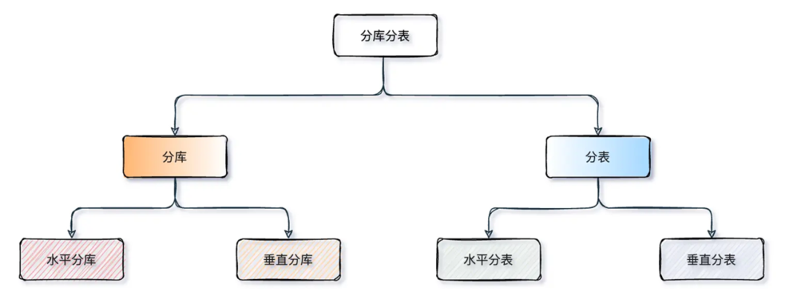

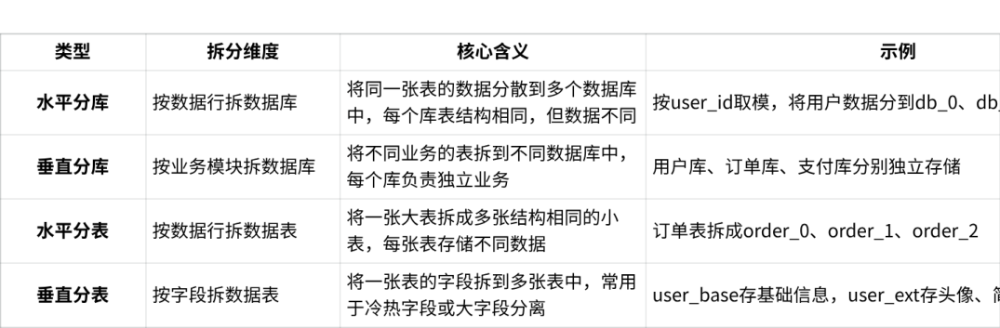

##### 什么情况下需要分库分表

是否需要分库分表，主要看两个指标：并发量是否超过单库承载能力，以及单表数据量是否已经影响查询和存储性能。分库解决的是数据库实例压力问题，分表解决的是单表数据量问题。

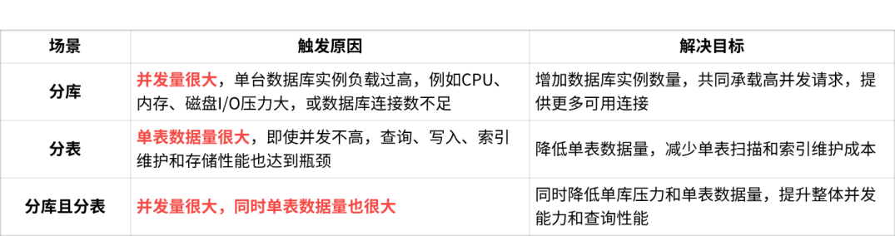

以InnoDB主键索引B+树为例，非叶子节点只存储主键ID和指针。假设主键ID是`bigint` 类型，占`8`字节，指针占`6` 字节，那么一个索引项大约是`14` 字节。InnoDB一页默认是`16KB` ，所以一个非叶子节点大约可以存储：

```text
16KB / 14B ≈ 1170
```

也就是说，一个非叶子节点大约可以指向`1170` 个子节点。B+树的数据记录都存储在叶子节点，假设一行数据大小是`1KB` ，那么一个叶子节点大约可以存储：

```text
16KB / 1KB = 16行
```

因此，一个三层B+树大约可以存储：

```text
1170 * 1170 * 16 ≈ 2190万行
```

当单表数据超过这个数量级后，B+树可能从三层变成四层，查询时磁盘I/O次数增加，查询性能会下降，此时就需要考虑分表。

而分库主要是从并发的角度，是针对并发量太大：数据库连接不足、实例负载过高

##### 如何选择分片键

分片键是分库分表时用于决定数据存储位置的字段，会结合分片算法将数据路由到对应的库或表中。选择分片键的核心是结合业务场景和数据分布，既要让高频查询能够直接定位到目标分片，又要避免数据集中到少数分片造成数据倾斜。

选择分片键主要看以下两点：

- 高频查询：分片键应尽量出现在业务最高频的查询条件中。这样查询时可以根据分片键直接定位到某个库或某张表，避免扫描所有分片。

- 数据均匀：分片键的值应尽量离散，保证数据能均匀分布到不同库表中，避免某些分片数据量特别大，造成热点和性能瓶颈。

以外卖订单表为例，候选分片键通常有商家`ID` 、用户`ID` 和订单`ID` 。需要结合业务场景和数据分布判断：

- 选择商家ID：不适合作为订单分片键。一方面，头部连锁商家订单量很大，可能把大量订单集中到同一个库或表中，造成数据倾斜。另一方面，最高频场景通常是用户查询自己的外卖订单，如果按商家ID分片，同一个用户的订单可能分散在多个库表中，需要跨分片查询，性能较差。

- 选择订单ID：数据分布通常比较均匀，但不适合订单列表查询。因为用户查询订单列表时通常按用户`ID` 查询，而不是按单个订单`ID` 查询。如果按订单ID分片，同一个用户的订单仍然可能分散到多个库表中，查询时需要扫描多个分片。

- 选择用户ID：更适合作为外卖订单的分片键。用户订单天然按用户维度查询，同一个用户的订单会被分到同一个库或表中，用户查看订单列表时可以直接定位分片。同时，单个用户产生极端海量订单的概率较低，整体数据分布更均匀。

所以在外卖订单场景中，如果最高频查询是用户查看自己的订单列表，通常更适合选择用户`ID` 作为分片键。

##### 有哪些分片算法

分片键确定后，需要通过分片算法决定数据落到哪个库或哪张表。常见方式有`Hash`取模分片、一致性`Hash`分片和范围分片。Hash取模实现简单，但扩容迁移成本高；一致性Hash适合节点动态增减；范围分片适合按时间、ID区间等有明确范围特征的数据拆分。

- Hash取模分片

Hash取模分片的思路是：先对分片键计算Hash值，再对库数量和表数量取模，从而得到目标库和目标表。

例如按`user_id` 分片，有`8` 个库，每个库`128` 张表：

```text
hash = hash(user_id)

db_index = hash % 8
table_index = hash % 128
```

查询时也使用相同规则定位数据：

```sql
select * from order_x where user_id = 10001;
```

系统会先计算`user_id` 的Hash值，再定位到具体的库和表，只查目标分片，避免扫描所有库表。

Hash取模分片的优点是实现简单、数据分布较均匀。缺点是扩容成本高，例如库数量从`8` 扩到`16`后，取模规则发生变化，大量数据的目标库表都会改变，需要进行大规模数据迁移。

- 一致性Hash分片

一致性Hash主要解决Hash取模扩容时数据大规模迁移的问题。它把整个Hash空间看成一个环，库或表作为节点分布在环上，数据根据分片键计算Hash值后，也落到这个环上，然后顺时针找到第一个节点作为存储位置。

例如如`Key 1` 和`Key 2` 会落到`Node 1` ，`Key 3` 和`Key 4` 会落到`Node 2` ，`Key 5` 会落到`Node 3` ，`Key 6` 会落到`Node 4` 。

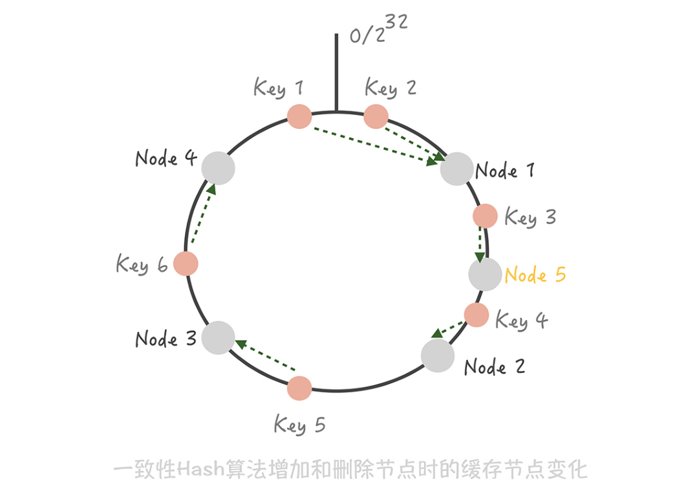

当节点发生变化时，一致性Hash只会影响局部数据。例如在`Node 1` 和`Node 2` 之间新增`Node 5`后，原本落到`Node 2` 的`Key 3` 会改为落到`Node 5` ，其他Key基本不变。如果删除`Node 3` ，也只会影响原本落到`Node 3` 的`Key 5` 。因此，一致性Hash可以减少扩容或缩容时的数据迁移量。


- 范围分片

范围分片是按照分片键的取值范围进行拆分，例如按时间范围、ID区间或金额区间划分数据。

```text
user_id 1 ~ 1000000       -> user_0
user_id 1000001 ~ 2000000 -> user_1
user_id 2000001 ~ 3000000 -> user_2
```

或者按时间拆分订单表：

```text
2024年订单 -> order_2024
2025年订单 -> order_2025
2026年订单 -> order_2026
```

范围分片的优点是规则直观，范围查询效率高，例如按时间查询历史订单时可以直接定位到对应分片。缺点是容易出现数据倾斜和热点问题，比如最新月份的数据访问量最大，可能导致某个分片压力过高。

#### MySQL为什么说单表建议不要超过2000万数据？

MySQL 并没有 2000 万数据的限制，这个数字来源于 InnoDB B+Tree 的容量估算。一般情况下，B+Tree 高度为 3 层即可支撑约 2000 万条数据，因此查询通常只需要 3 次磁盘 I/O，性能仍然较高。

- InnoDB 的最小存储单位是页（Page），默认大小为 16KB。聚簇索引采用 B+Tree 组织数据，叶子节点存储完整数据，非叶子节点存储主键值 + 子节点指针。

- 假设一条记录大小为 1KB，则一个叶子节点可以存放：

```text
16KB ÷ 1KB = 16 条记录
```

- 计算非叶子节点的分支数：

- 假设主键为 `BIGINT` （8 字节），子节点指针为 6 字节，则每个索引项大小约为：

```text
8 + 6 = 14 字节
```

- 一个非叶子节点最多可存放：

```text
16KB ÷ 14B ≈ 1170 个索引项
```

- 计算 B+Tree 容量：

- 高度为 2：

```text
1170 × 16 ≈ 1.87 万条
```

- 高度为 3：

```text
1170 × 1170 × 16 ≈ 2190 万条
```

- 因此，一棵 3 层 B+Tree 大约可以存储 2000 万条记录。

- 为什么建议控制在 2000 万左右？

- 当数据继续增长时，B+Tree 高度可能增加到 4 层。查询时需要访问更多索引页，磁盘 I/O 次数增加，查询性能会下降。因此工程实践中通常建议单表数据量控制在 千万级，超过后可考虑分库分表、分区表或冷热数据拆分。

需要注意的是，"2000 万"并不是 MySQL 的硬性限制，而是基于 B+Tree 高度为 3 的经验估算值。实际能够存储的数据量与记录大小、页大小、主键长度等因素有关。

### 后端面经与场景补充

<!-- 原PDF第477页；面经原题号 7 -->

#### Mysql索引相关的，比如给你a,b,c,d四个字段，a是唯一索引，cd是联合索引，然后问sql走没走索引，问了好几种情况

a. 现在有一个数据库表，有a,b,c,d四个字段，a是唯一索引，b没有索引，cd是c到d的联合索引。那我现在有一个select*from 表 where a=5 and c>9 这个会走索引么，走的是什么类型的索引

- 在这个查询中，`SELECT * FROM` 表 `WHERE a=5 AND c>9` ，查询条件涉及到字段`a`  和 `c` 。

- 字段 a ：由于 `a`  是唯一索引，查询条件 `a=5`  可以使用这个唯一索引。这意味着数据库会首先使用 `a`  的唯一索引来快速定位记录。

- 字段 c ：虽然 `c`  和 `d`  是联合索引，但在这个查询中，条件只涉及 `c` ，而没有涉及`d` 。对于联合索引，只有在查询条件中包含了联合索引的最左前缀（即 `c`  和 `d` ）时，才能有效利用这个联合索引。因此，`c>9`  这个条件不会单独使用 `cd`  联合索引。

综上所述，这个查询会使用 `a`  的唯一索引来查找记录，而不会使用 `cd`  的联合索引。

当遇到范围查询（如 > , < , BETWEEN ）时，对于联合索引该列之后的索引列将无法用于索引查找（即“中断”）

b. 如果是`SELECT * FROM` 表 `WHERE b=9` 这种呢

- 由于字段 `b`  没有索引，因此这个查询不会使用任何索引。数据库需要进行全表扫描来查找满足条件的记录。全表扫描意味着数据库会检查表中的每一行，以找到符合条件的记录。

c. 如果是 `SELECT * FROM` 表 `WHERE a=1 AND d=5 AND c>9` 呢

在这个查询中，`SELECT * FROM` 表 `WHERE a=1 AND d=5 AND c>9` ，查询条件涉及到字段 `a` 、`c`  和 `d` 。

i. 字段 a ：由于 `a`  是唯一索引，查询条件 `a=1`  可以使用这个唯一索引。数据库会首先使用 `a`  的唯一索引来快速定位记录。

ii. 字段 c  和 d ：虽然 `c`  和 `d`  是联合索引，但在使用联合索引时，必须从联合索引的最左前缀开始使用。在这个查询中，条件 `c>9`  和 `d=5`  并没有按照 `cd`  联合索引的顺序（即`c`  然后 `d` ）来使用，因此不能有效利用 `cd`  联合索引。

综上所述，这个查询会使用 `a`  的唯一索引来查找记录，而不会使用 `cd`  的联合索引

d. `SELECT * FROM` 表 `WHERE a=1 AND c>9 AND d=5`

在这个查询中，`SELECT * FROM` 表 `WHERE a=1 AND c>9 AND d=5` ，查询条件涉及到字段 `a` 、`c`  和 `d` 。

i. 字段 a ：由于 `a`  是唯一索引，查询条件 `a=1`  可以使用这个唯一索引。数据库会首先使用 `a`  的唯一索引来快速定位记录。

ii. 字段 c  和 d ：对于 `cd`  联合索引，查询条件 `c>9`  和 `d=5`     范围查询 `c>9` 会中断联合索引的最左匹配原则，导致 `d` 无法走索引

<!-- 原PDF第484页；面经原题号 26 -->

#### mysql为什么要用B+树，和红黑树比着有什么好处？

原文未附答案。

<!-- 原PDF第484页；面经原题号 27 -->

#### B+树的扇出很大是好事还是坏事

原文未附答案。

<!-- 原PDF第491页；面经原题号 45 -->

#### 在默认的隔离级别下（rr），mysql为什么不能解决幻读

🌟注意⚠️⚠️，这里有个点我之前没有注意：

在RR隔离级别下，普通的SELECT查询使用快照读（即读取事务开始时的数据快照）。但是，对于UPDATE、DELETE以及加锁的SELECT（如SELECT ... FOR UPDATE/SHARE），InnoDB会使用当前读（Current Read），即读取最新的已提交数据，并且会对涉及的行加锁。

快照读是数据库在 可重复读（`Repeatable Read`） 隔离级别下的默认行为：

1. 读取历史版本：事务启动时创建数据快照，后续所有读操作均基于该快照（而非实时数据）。

2. 避免脏读/不可重复读：

    - 不会读取其他事务未提交的数据（防脏读）。

    - 对已存在行的多次读取结果一致（防不可重复读）。

3. 不锁定数据：快照读本身不加锁，允许其他事务并发修改数据。

场景示例：

-- 事务A（可重复读隔离级别）

START TRANSACTION;-- 第一次查询（快照读）：返回 id>5 的所有行（假设10行）SELECT * FROM table WHERE id > 5;

-- 此时事务B插入新数据并提交：INSERT INTO table (id, ...) VALUES (11, ...);  -- 新增id=11（满足 id>5）

-- 事务A第二次查询（快照读）：仍返回10行（基于快照）SELECT * FROM table WHERE id > 5;

-- 事务A尝试更新：UPDATE table SET x=5 WHERE id > 5;  -- 会更新到id=11的新行！

-- 事务A第三次查询（快照读）：发现多出一行（id=11）！SELECT * FROM table WHERE id > 5;  -- 返回11行（幻读出现）

关键原因：

1. 快照读不感知新插入的行：

    - 快照读基于事务开始时的数据版本，无法看到其他事务后续插入的新行。

    - 因此前两次`SELECT` 结果一致（似乎无幻读）。

2. 更新操作破坏快照隔离：

    - 当执行`UPDATE/DELETE` 时，数据库会使用当前读（Current Read） 而非快照读：

        - 读取最新数据（包括其他事务已提交的新行）。

        - 对涉及的行加锁（如行锁、间隙锁）。

    - 上例中，`UPDATE` 会更新到事务B插入的`id=11` 的新行，并将其纳入当前事务的修改范围。

3. 后续查询看到“幻影行”：

    - 事务自身修改的数据（即使最初不在快照中）会对其可见。

    - 第三次`SELECT` 时，`id=11` 因被当前事务更新过，突然出现在结果集中 → 幻读发生。

<!-- 原PDF第492页；面经原题号 46 -->

#### Binlog redolog, undolog的区别

原文未附答案。

<!-- 原PDF第493页；面经原题号 50 -->

#### 如何避免mysql的并发问题

加锁

<!-- 原PDF第493页；面经原题号 51 -->

#### mysql有哪几种事务隔离级别

原文未附答案。

<!-- 原PDF第493页；面经原题号 52 -->

#### 哪种会引起幻读

原文未附答案。

<!-- 原PDF第499页；面经原题号 63 -->

#### mysql的索引用的是什么数据结构，为什么要用B+树

原文未附答案。

<!-- 原PDF第500页；面经原题号 70 -->

#### mysql的回表的概念

回表是指在使用非聚簇索引（也称二级索引或辅助索引）进行查询时，如果查询的字段不完全包含在该索引中，存储引擎需要根据二级索引中存储的主键值，再次到聚簇索引（主键索引）中查找完整行数据的过程。

为什么回表会影响性能？

- 额外的I/O操作： 回表意味着一次查询可能需要访问两次索引（先二级索引，再聚簇索引），增加了磁盘I/O或内存访问的次数。

- 随机访问： 二级索引中找到的主键值可能是分散的，导致回表时对聚簇索引的访问是随机的，而不是顺序的，这通常比顺序访问慢。

<!-- 原PDF第501页；面经原题号 73 -->

#### 联合索引(a,b,c)如果a全是一个值，select *  from t where b=1andc=1能走索引吗?

有一个联合索引 `(a, b, c)` ，其中字段 `a`  的值全部相同（比如都是 `'X'` ），然后执行如下查询：

```sql
SELECT * FROM t WHERE b = 1 AND c = 1;
```

问：这个查询能走索引吗？

能走索引，但取决于优化器是否选择使用该索引。

🔍 详细解释：

- 联合索引的结构（B+ Tree）

联合索引 `(a, b, c)`  的 B+ 树是按以下顺序组织的：

- 先按 `a`  排序

- `a`  相同的情况下，按 `b`  排序

- `a`  和 `b`  都相同的情况下，按 `c`  排序

- a 全是相同值意味着什么？

如果表中所有记录的 `a`  字段值都相同（比如 `a = 'X'` ），那么：

- 在索引中，所有记录的 a 值都一样，相当于“第一排序维度”失效。

- 实际上，索引的排序效果就退化为按 `(b, c)`  排序。

🔥 所以，索引 `(a, b, c)`  在 `a`  值全相同的情况下，逻辑上等价于 `(b, c)`  索引。

- 查询 WHERE b = 1 AND c = 1  能走索引吗？

可以走索引！

因为：

- 虽然没有用到最左的 `a`  进行过滤，但由于 `a`  的值是固定的（全相同），MySQL 优化器在执行查询时，会自动将 `a = 'X'`  作为一个隐含条件。

- 优化器可以利用索引 `(a, b, c)`  快速定位到 `b = 1 AND c = 1`  的记录，因为索引中 `b`和 `c`  是有序的。

<!-- 原PDF第506页；面经原题号 85 -->

#### 现在有一个查询sql要查询某一行数据发现执行很慢，比较耗时有哪些原因造成的

a. 未命中索引

- 现象：你以为是查主键，但实际上没走索引。

- 原因举例：

    - `WHERE`  条件字段没有索引。

    - 字段类型不匹配，如 `id`  是 `VARCHAR` ，但写成 `WHERE id = 123` （数字），触发隐式类型转换。

    - 对字段使用函数，如 `WHERE YEAR(create_time) = 2024` ，索引失效。

    - 复合索引未遵循最左前缀原则。

b. 数据未在内存中（冷查询）

- 现象：第一次查询慢，第二次很快。

- 原因：

    - InnoDB 使用 `Buffer Pool`  缓存数据页。

    - 如果目标数据页不在内存中，需要从磁盘读取（I/O 延迟），可能耗时几十毫秒。

- 特点：

    - 不是 SQL 问题，是硬件/缓存问题。

    - 重启数据库后首次查询常出现。

c. 表数据量极大 + 无有效索引

- 现象：表有千万级数据，`SELECT * FROM huge_table WHERE name = 'Alice'`很慢。

- 原因：

    - `name`  字段无索引，或索引选择性差（如大量重复值）。

    - 即使只返回一行，数据库也要扫描几百万行才能找到。

- 结果：看似“查一行”，实为“大海捞针”。

d. 系统资源瓶颈

- CPU 高：数据库负载重，SQL 解析、执行变慢。

- 磁盘 I/O 慢：数据页无法快速从磁盘加载。

- 内存不足：Buffer Pool 小，缓存命中率低。

<!-- 原PDF第511页；面经原题号 94 -->

#### 现在有一张表t，要同时频繁访问a,b 或者 b,c我该如何建立索引

原文未附答案。

<!-- 原PDF第511页；面经原题号 95 -->

#### Mysql索引相关的，比如给你a,b,c,d四个字段，a是唯一索引，cd是联合索引，然后问sql走没走索引，问了好几种情况

a. 现在有一个数据库表，有a,b,c,d四个字段，a是唯一索引，b没有索引，cd是c到d的联合索引。那我现在有一个select*from 表 where a=5 and c>9 这个会走索引么，走的是什么类型的索引

- 在这个查询中，`SELECT * FROM` 表 `WHERE a=5 AND c>9` ，查询条件涉及到字段`a`  和 `c` 。

- 字段 a ：由于 `a`  是唯一索引，查询条件 `a=5`  可以使用这个唯一索引。这意味着数据库会首先使用 `a`  的唯一索引来快速定位记录。

- 字段 c ：虽然 `c`  和 `d`  是联合索引，但在这个查询中，条件只涉及 `c` ，而没有涉及`d` 。对于联合索引，只有在查询条件中包含了联合索引的最左前缀（即 `c`  和 `d` ）时，才能有效利用这个联合索引。因此，`c>9`  这个条件不会单独使用 `cd`  联合索引。

综上所述，这个查询会使用 `a`  的唯一索引来查找记录，而不会使用 `cd`  的联合索引。

当遇到范围查询（如 > , < , BETWEEN ）时，对于联合索引该列之后的索引列将无法用于索引查找（即“中断”）

b. 如果是`SELECT * FROM` 表 `WHERE b=9` 这种呢

- 由于字段 `b`  没有索引，因此这个查询不会使用任何索引。数据库需要进行全表扫描来查找满足条件的记录。全表扫描意味着数据库会检查表中的每一行，以找到符合条件的记录。

c. 如果是 `SELECT * FROM` 表 `WHERE a=1 AND d=5 AND c>9` 呢

在这个查询中，`SELECT * FROM` 表 `WHERE a=1 AND d=5 AND c>9` ，查询条件涉及到字段 `a` 、`c`  和 `d` 。

i. 字段 a ：由于 `a`  是唯一索引，查询条件 `a=1`  可以使用这个唯一索引。数据库会首先使用 `a`  的唯一索引来快速定位记录。

ii. 字段 c  和 d ：虽然 `c`  和 `d`  是联合索引，但在使用联合索引时，必须从联合索引的最左前缀开始使用。在这个查询中，条件 `c>9`  和 `d=5`  并没有按照 `cd`  联合索引的顺序（即`c`  然后 `d` ）来使用，因此不能有效利用 `cd`  联合索引。

综上所述，这个查询会使用 `a`  的唯一索引来查找记录，而不会使用 `cd`  的联合索引

d. `SELECT * FROM` 表 `WHERE a=1 AND c>9 AND d=5`

在这个查询中，`SELECT * FROM` 表 `WHERE a=1 AND c>9 AND d=5` ，查询条件涉及到字段 `a` 、`c`  和 `d` 。

i. 字段 a ：由于 `a`  是唯一索引，查询条件 `a=1`  可以使用这个唯一索引。数据库会首先使用 `a`  的唯一索引来快速定位记录。

ii. 字段 c  和 d ：对于 `cd`  联合索引，查询条件 `c>9`  和 `d=5`     范围查询 `c>9` 会中断联合索引的最左匹配原则，导致 `d` 无法走索引

<a id="module-06"></a>

## 06 Redis

### 高频题

#### 数据类型

##### Redis有哪些数据类型

Redis九大数据类型，常用的有五种(String、Hash、List、Set、Zset)，最常问的数据类型是ZSet。

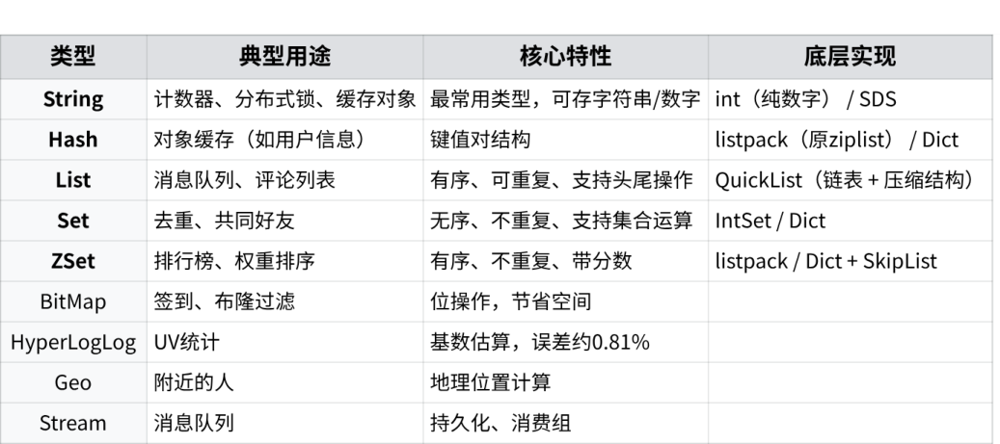

1. SDS

Redis字符串底层不是C字符串，而是SDS（简单动态字符串）

本质是一个带长度信息的结构体

2. ZipList、Listpack、Dict哈希表

- ZipList

一种连续内存空间的双端链表，因存储格式而节省空间，但由于连续内存

如果元素太多，内存不容易分配，效率低，所以当元素过多时，都会转为另外一种数据结构

且 ZipList 压缩列表存在连锁更新的问题

- Listpack(Redis 7.0)

连续内存结构，和ZipList压缩列表几乎一样，但解决了连锁更新的问题，所以是新设计出来取代ZipList压缩列表的

所有元素连续存储，节省内存，适合：元素少、字段短

- Dict哈希表

Dict 哈希表底层由两张哈希表（数组 + 链表实现）组成。

其中一张用于存储当前数据，另一张通常为空，在哈希表扩容或收缩（rehash）时使用。

当发生扩容或收缩时，需要对 key 的位置重新计算，这个过程称为 rehash。

在 rehash 过程中，如果有请求到来：

- 新增操作：直接写入 `ht[1]` （新哈希表）

- 查询、修改、删除操作：会在 `ht[1]` （新表）和 `ht[0]` （旧表）中依次查找并执行

3. Quicklist

节点之间通过双向链表连接，每个节点是一个压缩列表

4. ⭐SkipList(跳表，ZSet核心)

如果有序集合的元素个数小于128个，并且每个元素的值小于64字节时，Redis会使用压缩列表作为Zset类型的底层数据结构，

否则：利用Dict + SkipList，存储两份数据，Dict 和 SkipList 各一份

为什么要存储两份数据？因为这是它的特性需求

- 利用Dict去键值查询：根据元素查分数

- 利用SkipList范围查询 (快速跳过大量无关节点，定位范围的起始点)：

    - 获取指定分数区间的元素

    - 获取排名在指定区间的元素

Redis 7.0 引入了 listpack  取代 ZipList 压缩列表

SkipList 跳表 是一种多层链表

- 元素按照 score 分数升序排列存储

- 每个节点可能包含多个指针，不同层级的指针具有不同的跨度；普通链表遍历效率低，是因为指针跨度为 1

- 在进行范围查找时，可以利用高层指针快速跳过大量无关节点，迅速定位到目标区间的起始位置

- 通过牺牲少量内存空间（存储多层指针），换取更高效的查找性能（时间复杂度接近 O(log n)，类似于树的复杂度）

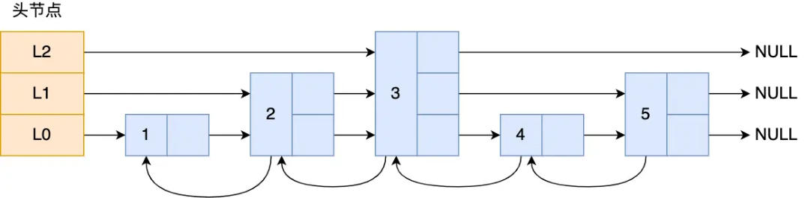

##### 跳表节点的查询过程

跳表（Skip List）查询时，会从最高层开始查找，如果当前节点的值小于目标值，就向右移动；如果大于等于目标值，就向下一层移动，直到最底层找到目标节点或确认不存在。跳表利用"多级索引"减少了查找次数，平均时间复杂度为 O(logN)。

例如，有如下跳表：

```text
Level 2：HEAD ───────────────► 30 ─────────────► NULL

Level 1：HEAD ─────► 10 ─────► 30 ─────► 50 ───► NULL

Level 0：HEAD ─► 10 ─► 20 ─► 30 ─► 40 ─► 50 ─► NULL
```

现在查找 40：

385. 从最高层（Level 2）开始，`HEAD` → `30` ，由于 30 < 40，继续向右移动。

386. Level 2 中 30 后面已经没有节点，因此下降到 Level 1。

387. 在 Level 1，当前位置仍然是 30，右边是 50，由于 50 > 40，不能继续向右，于是下降到Level 0。

388. 在 Level 0，当前位置还是 30，右边是 40，由于 40 == 目标值，查找成功。

查找路径如下：

```text
Level 2：
HEAD ─────────► 30
               │
               ▼
Level 1：
              30 ─────► 50
               │
               ▼
Level 0：
              30 ─────► 40  ✓
```

整个过程中，不需要像链表一样从头遍历，而是利用高层索引快速跳过大量节点，因此查询效率接近二分查找，平均时间复杂度为 O(logN)。

##### 为什么ZSet不用B+树而选用跳表

因为B+树是为了减少磁盘I/O读取的次数而设计的，而Redis的I/O是基于纯内存操作，读写非常快，反而显得B+树很笨重很复杂，这是主要原因。

其他原因

- 维护难度：跳表本质是多层链表，结构简单、代码量小，维护成本低；而 B+ 树涉及节点分裂与合并，实现复杂、维护成本高。

- 读写性能：B+ 树插入可能触发页分裂，导致大量数据移动和结构调整，产生性能抖动；跳表操作具有局部性，只需修改相邻节点指针，并通过随机生成层高，无需全局调整。因此在保证接近O(log n) 查询效率的同时，写入性能更稳定。

##### 用户的会话Session用什么数据类型

用户的`Session` 最适合用Redis的String类型存储。

因为一个`Session` 本质上是一份用户状态数据，通常可以序列化成`JSON` 字符串后直接存入Redis，并设置过期时间，和Session天然的有效期机制匹配。

1. 存储方式简单：将用户Session对象序列化后作为一个整体存储。

```text
SETEX session:user:1001 1800 '{"userId":1001,"username":"Tom","role":"admin"}'
```

2. 天然支持过期：Session通常有有效期，可以直接用`EXPIRE` 或`SETEX` 设置`TTL` ，到期后自动删除。

3. 读取效率高：查询Session时一般是按`sessionId` 或`userId` 整体读取，不需要频繁修改其中某个字段，String结构最直接。

如果Session内部字段需要频繁单独修改，比如只更新登录时间、权限字段，也可以考虑`Hash` 。但一般场景下，String存JSON是最常用、最简单的方案。

##### Redis的Set是否有序、是否可重复？

Set 是 Redis 提供的无序集合，元素唯一，不允许重复。

- 无序：Set 中元素没有固定顺序，每次遍历结果可能不同。

- 不可重复：相同元素只能存在一份，重复添加不会报错，也不会新增数据。

- 底层实现：底层采用 哈希表（HashTable） 或 整数集合（IntSet） 存储，因此查找、插入、删除的时间复杂度通常为 O(1)。

- 应用场景：标签去重、用户关注、共同好友、抽奖名单、集合交并差运算等。

#### 分布式锁

##### Redis如何实现分布式锁

Redis实现分布式锁主要有两种方式：基于SET NX EX 手动实现和基于Redisson 实现。

1. 基于SET NX EX 实现

使用`SET key value NX EX seconds` 加锁：

```text
SET lock:order:1001 requestId NX EX 30
```

`NX` 表示只有Key不存在时才能写入，`EX 30` 表示锁`30` 秒后自动过期，`requestId` 用于标识当前锁的持有者。

释放锁时不能直接`DEL` ，否则可能误删其他线程重新获取的锁。正确方式是先判断`requestId` 是否一致，再删除锁，一般用Lua脚本保证原子性：

```lua
if redis.call("get", KEYS[1]) == ARGV[1] then
    return redis.call("del", KEYS[1])
else
    return 0
end
```

`SET NX EX` 的问题主要有三点：

- 锁可能提前释放：如果业务执行时间超过`TTL` ，锁会自动过期，其他线程可能重新获取锁，导致多个线程并行业务逻辑。

- 不可重入：同一个线程再次获取同一把锁时，因为锁Key已经存在，会加锁失败。

- TTL不好设置：业务执行耗时不确定，`TTL` 设置太短会提前释放，设置太长又会降低锁释放效率。

2. 基于Redisson 实现

`Redisson` 封装了Redis分布式锁，使用更简单：

```text
RLock lock = redissonClient.getLock("lock:order:1001");

try {
    lock.lock();
    // 执行业务逻辑
} finally {
    lock.unlock();
}
```

`Redisson` 支持可重入锁、自动续期和安全释放锁。它通过看门狗机制自动延长锁过期时间，避免业务还没执行完锁就过期。生产环境更推荐使用`Redisson` ，减少手写锁带来的误删锁、锁过期和不可重入等问题。

- 可重入原理

`Redisson` 的锁不是简单存一个字符串，而是使用`Hash` 结构存储锁信息。Key表示锁名称，Hash中的field表示当前持有锁的线程标识，value表示重入次数。

```text
lock:order:1001
{
    threadId: 1
}
```

当同一个线程第一次加锁成功时，`Redisson` 会写入线程标识，并将重入次数设为`1` 。如果同一个线程再次加锁，会判断线程标识相同，然后将重入次数加`1` ，因此可以重复获取同一把锁。

解锁时不会立即删除锁，而是先把重入次数减`1` 。只有当重入次数减到`0` 时，才会真正删除锁Key。这样就实现了和Java中`ReentrantLock` 类似的可重入能力。

- 看门狗续期原理

`Redisson` 默认加锁时，如果没有手动指定锁过期时间，会给锁设置一个默认过期时间，通常是`30`秒。同时会启动一个看门狗机制，定期检查当前线程是否还持有锁。

如果业务还没有执行完，并且锁仍然属于当前线程，看门狗会自动延长锁的过期时间，一般每隔过期时间的三分之一进行一次续期，例如默认`30` 秒过期，则大约每`10` 秒续期一次。

这样可以避免业务执行时间超过`TTL` 导致锁提前释放，从而防止其他线程在当前业务未完成时拿到锁。

##### Redison分布式锁存在什么问题

`Redisson` 分布式锁的主要问题是主从同步延迟可能导致锁失效。

如果Redis采用主从架构，客户端在主节点加锁成功后，锁数据还没来得及同步到从节点，此时主节点宕机，从节点被提升为新主节点。由于新主节点上没有这把锁，其他线程就可能再次加锁成功，导致多个线程同时进入临界区，破坏分布式锁的互斥性。

解决方案：

- MultiLock联锁方案：向多个Redis主节点同时加锁，要求所有主节点都加锁成功才算获取锁成功。只要有一个节点加锁失败，就认为加锁失败，并释放已经加上的锁。它的一致性更强，但可用性和性能会下降。

- RedLock红锁方案：向多个互相独立的Redis主节点加锁，要求超过半数节点加锁成功才算获取锁成功，例如`5` 个主节点中至少`3` 个成功。若未达到半数成功，就释放已经获取的锁。它在一致性和可用性之间做折中。

所以，`Redisson` 单节点锁或普通主从锁不能完全避免主从切换带来的锁丢失问题。对一致性要求高的场景，需要考虑`MultiLock` 或`RedLock` ，但它们会带来更高的复杂度和性能开销。

#### 持久化策略

配置：在 Redis 的默认配置文件（redis.conf）中，RDB 是 默认开启 的，而 AOF（Append-Only File）需要手动配置开启。

##### RDB异步持久化的原理(执行命令)

`RDB` 是Redis的数据快照持久化机制，全称是`Redis Database Backup File` 。它会在某个时间点把Redis内存中的数据生成一份快照文件写入磁盘，当Redis实例故障重启后，可以通过读取`RDB`文件恢复数据。

触发命令

可以在`redis.conf` 中配置自动触发条件，例如：

```text
save 900 1         #900秒内至少1个key被修改，触发bgsave生成RDB文件
save 300 10        #300秒内至少10个key被修改，触发bgsave生成RDB文件
save 60 10000      #60秒内至少10000个key被修改，触发bgsave生成RDB文件
```

除此之外，也可以通过命令主动触发`RDB` 持久化。

- `save` ：由Redis主进程执行持久化，会阻塞所有客户端命令，线上不推荐使用。

- `bgsave` ：由Redis主进程`fork` 出子进程，子进程负责生成`RDB` 文件，主进程继续处理请求，是常用方式。

执行原理

`RDB` 异步持久化的底层原理主要是`bgsave`

1. fork子进程：执行`bgsave` 时，Redis主进程会先`fork` 出一个子进程。这个阶段会短暂阻塞主进程，因为需要复制页表给子进程。`fork` 完成后，子进程和主进程共享同一份内存数据。

2. 子进程写RDB文件：子进程读取共享内存中的数据，并将当前快照写入磁盘生成`RDB` 文件。这个过程由子进程完成，所以不会阻塞主进程处理客户端请求。

3. Copy-On-Write机制：为了避免子进程生成快照时和主进程写数据冲突，Redis依赖操作系统的`Copy-On-Write` 机制。刚`fork` 后，主子进程共享内存页，并标记为只读。当主进程需要修改某个数据页时，操作系统会先复制该页，让主进程在新副本上修改，子进程仍然读取旧数据生成快照。

`bgsave` 基本不会长时间阻塞Redis主线程，真正阻塞的是开始时的`fork` 阶段。

##### RDB有什么优缺点

优点

- 恢复速度快：`RDB` 保存的是某一时刻的完整数据快照，Redis重启时可以直接加载快照文件恢复数据，速度比较快。

- 文件体积小：`RDB` 文件是压缩后的二进制快照文件，相比日志形式的持久化文件更紧凑，更适合备份和传输。

缺点

- 可能丢失数据：`RDB` 是周期性持久化，两次快照之间写入的数据如果还没来得及保存，Redis就宕机，这部分数据会丢失。快照间隔太长会增加丢失风险，间隔太短又会带来较大性能开销。

- 生成成本较高：执行`bgsave` 时需要`fork` 子进程，`fork` 阶段会复制页表并短暂阻塞主进程。子进程写出`RDB` 文件也比较耗时，在数据量大时会带来CPU、内存和磁盘I/O压力。

##### AOF持久化的原理和刷盘策略

`AOF` 全称是`Append Only File` ，是一种追加日志式持久化机制。它会把Redis执行过的每一条写命令记录到`AOF` 文件中，Redis重启时再按顺序重新执行这些写命令，从而恢复数据。因此，`AOF`文件可以理解为Redis的写命令日志文件。

AOF 持久化的核心流程是：Redis先执行写命令并修改内存数据，然后将该写命令追加到`AOF` 缓冲区，最后按照配置的刷盘策略把缓冲区内容写入磁盘文件。

`AOF` 支持三种刷盘策略：

1. always：每执行一条写命令都同步刷盘。数据安全性最高，宕机时最多丢失极少数据，但每次写操作都要落盘，对性能影响最大。

2. everysec：每秒刷盘一次。写命令执行后先进入`AOF` 缓冲区，再由后台线程每秒将数据写入`AOF` 文件。它是Redis默认策略，在性能和数据安全之间做折中，最多可能丢失1秒数据。

3. no：由操作系统决定何时刷盘。Redis只负责把写命令写入`AOF` 缓冲区，具体落盘时机交给操作系统控制。性能最好，但宕机时可能丢失较多数据。

##### AOF命令重写的动机

`AOF` 文件重写的动机是压缩AOF文件体积，避免命令日志无限增长。因为`AOF` 记录的是写命令，同一个`key` 可能被多次修改，但恢复数据时通常只有最终状态有意义，所以可以通过重写生成一份更精简的`AOF` 文件。

例如同一个`key` 被多次修改：

```text
SET name a
SET name b
SET name c  # 最后把name设置为c，前面的修改都没有意义了
```

因此重写后只需要保留最终结果：

```text
SET name c
```

`AOF` 重写通常通过`bgrewriteaof` 触发。它会根据当前内存中的数据状态，重新生成一份最小化的命令集合，使新`AOF` 文件可以恢复出和当前数据库一致的数据。需要注意的是，重写过程会消耗CPU、内存和磁盘I/O资源。

`bgrewriteaof` 可以通过配置自动触发，主要看两个阈值：

1. 文件增长百分比：当当前`AOF` 文件相比上次重写后的文件增长超过指定比例时，触发重写。

2. 文件最小体积：只有当`AOF` 文件达到一定大小后，才允许触发重写，避免文件很小时频繁重写。

##### AOF有什么优缺点

优点

数据安全性更高，例如everysec策略，只会丢失1秒以内的数据

缺点：

- 宕机后恢复速度慢，因为AOF文件记录的是命令，需要依次执行

- 文件体积大，需要进行AOF文件重写，此时会占用大量资源

##### 混合持久化(RDB+AOF)

混合持久化是Redis4.0之后引入的持久化方式，本质上是以`AOF` 为基础，把`RDB` 恢复快和`AOF` 数据更完整的优点结合起来。它既能提升Redis重启恢复速度，又能降低大量数据丢失的风险。

开启混合持久化后，在`AOF` 重写时会生成一种特殊结构的新`AOF` 文件：

```text
[RDB数据块][AOF命令流]
```

- RDB数据块：重写开始时，Redis会先把当前内存中的全量数据以`RDB` 格式写入新`AOF` 文件开头。这样Redis重启时可以像加载`RDB` 一样快速恢复大部分数据。

- AOF命令流：在`RDB` 数据块之后，Redis会把重写期间产生的增量写命令以`AOF` 格式追加到文件末尾。这样可以保留重写过程中的最新变更，降低数据丢失风险。

混合持久化的优点是恢复速度比纯AOF快，数据安全性比纯RDB高。缺点是文件格式发生变化，老版本Redis可能无法识别，因此混合持久化不具备向下兼容性。

#### 内存淘汰策略

##### 有哪些内存淘汰策略

Redis内存淘汰策略是在内存达到`maxmemory` 限制后，用来决定删除哪些Key的规则。Redis常见有8种内存淘汰策略，可以分为三类：只淘汰设置了TTL的Key、从所有Key中淘汰，以及不淘汰直接报错。

1. 只针对设置了TTL的Key淘汰

LRU和LFU的原理和实现参考小林Coding

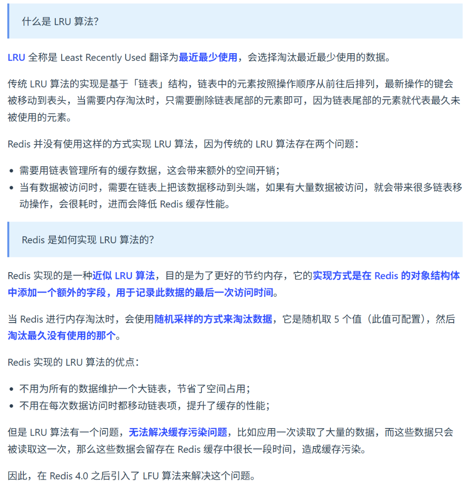

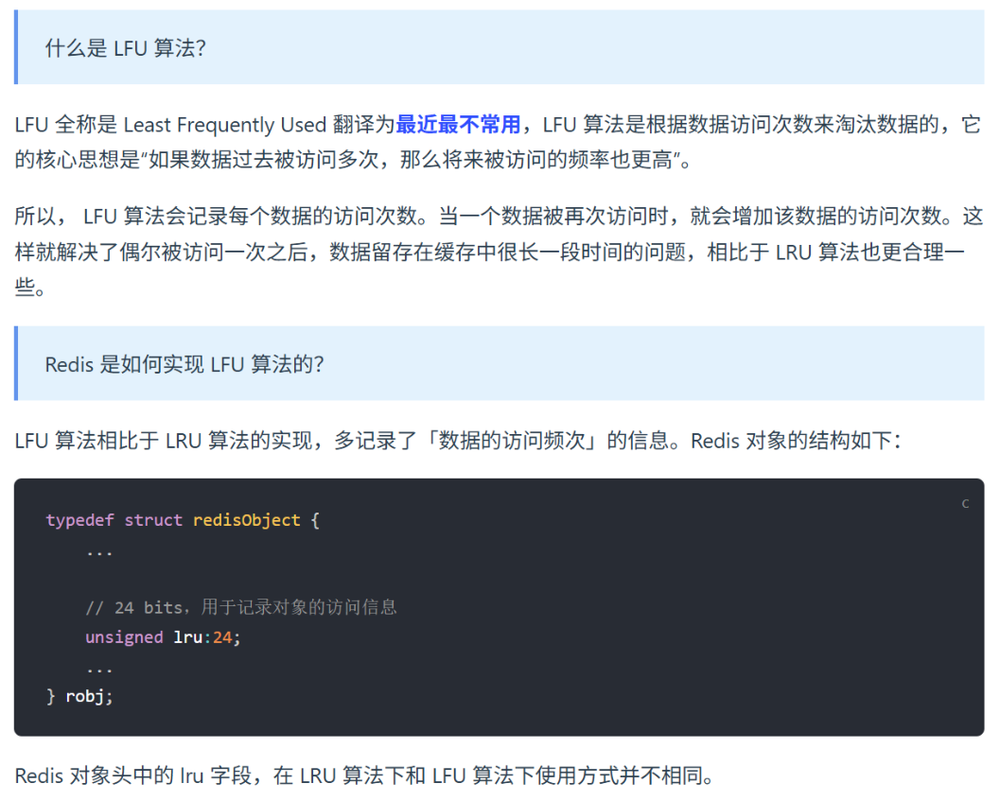

这类策略只会从设置了过期时间的Key中选择淘汰对象，没有设置TTL的Key不会被删除。

- `volatile-lru` ：从设置了过期时间的Key中，淘汰最久未使用的Key。 (高频手撕)

- `volatile-lfu` ：从设置了过期时间的Key中，淘汰访问频率最低的Key。

- `volatile-random` ：从设置了过期时间的Key中，随机选择Key删除。

- `volatile-ttl` ：从设置了过期时间的Key中，优先删除剩余过期时间最短的Key。

2. 针对所有Key淘汰

这类策略会从所有Key中选择淘汰对象，不管Key是否设置了过期时间。

- `allkeys-lru` ：从所有Key中，淘汰最久未使用的Key。

- `allkeys-lfu` ：从所有Key中，淘汰访问频率最低的Key。

- `allkeys-random` ：从所有Key中，随机选择Key删除。

3. 不淘汰策略

    - `noeviction` ：不会淘汰任何Key。当内存达到上限后，新的写入请求会直接返回错误，读请求仍可正常执行。

##### 内存淘汰策略如何选择

Redis内存淘汰策略的选择，核心看数据是否都可以被淘汰，以及是否存在必须长期保留的数据。缓存场景优先保证服务可用，关键数据场景优先保证重要Key不被删除。

1. 纯缓存场景

如果Redis主要作为缓存使用，理论上所有数据都可以被淘汰，优先选择`allkeys-lru` 或`allkeys-lfu` 。

- `allkeys-lru` ：适合访问具有明显冷热特征的数据，优先淘汰最久未使用的Key。

- `allkeys-lfu` ：适合长期热点比较稳定的场景，优先淘汰访问频率最低的Key。

这样可以避免内存写满后无法写入，保证缓存服务持续可用。

2. 存在长期保存数据的场景

如果Redis中有一部分Key没有设置过期时间，并且这些Key需要长期保存，可以选择`volatile-lru` 或`volatile-lfu` 。

这类策略只会淘汰设置了TTL的Key，不会删除未设置过期时间的关键数据。

3. 严格数据保护场景

如果业务不允许Redis自动删除任何数据，可以选择`noeviction` 。

这种策略在内存达到上限后不会淘汰Key，而是直接拒绝新的写请求。使用时必须配合监控、告警和扩容机制，否则容易影响业务写入。

##### Redis的过期数据淘汰策略

1. 惰性删除：只会在取出/查询 key 的时候才对数据进行过期检查。这种方式对 CPU 最友好，但是可能会造成太多过期 key 没有被删除。

2. 定期删除：周期性地随机从设置了过期时间的 key 中抽查一批，然后逐个检查这些 key 是否过期，过期就删除 key。相比于惰性删除，定期删除对内存更友好，对 CPU 不太友好。

3. 延迟队列：把设置过期时间的 key 放到一个延迟队列里，到期之后就删除 key。这种方式可以保证每个过期 key 都能被删除，但维护延迟队列太麻烦，队列本身也要占用资源。

4. 定时删除：每个设置了过期时间的 key 都会在设置的时间到达时立即被删除。这种方法可以确保内存中不会有过期的键，但是它对 CPU 的压力最大，因为它需要为每个键都设置一个定时器。

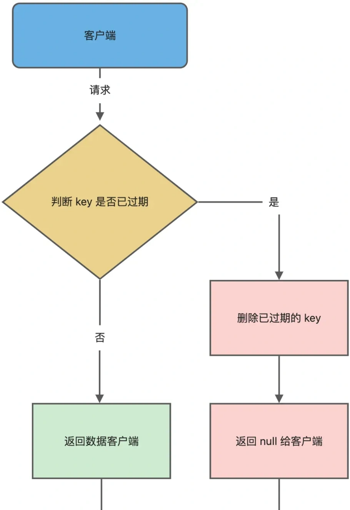


Redis 采用的是定期删除+惰性/懒汉式删除结合的策略，这也是大部分缓存框架的选择。定期删除对内存更加友好，惰性删除对 CPU 更加友好。两者各有千秋，结合起来使用既能兼顾 CPU 友好，又能兼顾内存友好。

#### 缓存击穿/穿透/雪崩

##### 缓存击穿

缓存击穿通常发生在高并发访问热点Key的场景下。当某个热点数据在缓存中过期的一瞬间，大量请求同时访问该Key，缓存无法命中，请求会直接打到数据库，导致数据库瞬时压力过大，严重时可能被打垮。

解决方案：

1. 互斥锁

思路：只允许一个线程查询数据库并重建缓存，其他线程等待，避免大量请求同时访问数据库。

具体实现：

- 线程查询Redis，发现热点Key不存在。

- 尝试获取分布式锁，获取成功的线程去查询数据库。

- 查询到数据后，将数据写回Redis，再释放锁。

- 其他线程获取锁失败后先等待，锁释放后再次查询Redis，也就是`double check` 。

- 如果此时缓存已经被重建，就直接从Redis读取数据，不再访问数据库。

这种方案可以保证数据库只被少量请求访问，但缺点是其他线程需要等待，接口响应时间可能变长。

2. 永不过期 + 逻辑过期

思路：缓存Key本身不设置`TTL` ，而是在Value中额外保存一个逻辑过期时间，例如`expireTime` 。请求命中缓存后，先判断逻辑过期时间是否过期。

具体流程：

- 如果`expireTime` 未过期，直接返回缓存数据。

- 如果`expireTime` 已过期，当前线程先返回旧数据。

- 同时开启异步线程尝试获取互斥锁。

- 获取锁成功后，异步线程查询数据库并重建缓存。

- 重建完成后更新缓存中的数据和新的`expireTime` 。

这种方案不会让请求阻塞，适合热点数据场景。缺点是短时间内可能返回旧数据，对实时性要求高的业务需要谨慎使用。

##### 缓存穿透

缓存穿透指请求查询的数据在Redis和数据库中都不存在，导致每次请求都无法命中缓存，最终全部打到数据库。它的关键在于透过去了，缓存层没有拦住请求，数据库又查不到数据，因此缓存永远不会自然建立。

解决方案：

1. 缓存空值

思路：当Redis未命中，并且数据库也查询不到数据时，仍然把这个空结果写入Redis，并设置较短`TTL` 。

例如查询`userId=999999` 不存在，可以缓存一个空值：

```text
SETEX user:999999 60 ""
```

后续相同请求再来时，可以直接命中这个空值，不再访问数据库。该方案实现简单，但可能占用额外缓存空间，因此空值的`TTL` 一般不宜设置太长。

2. 布隆过滤器

思路：在请求访问Redis之前，先通过布隆过滤器判断这个Key是否可能存在。如果布隆过滤器判断一定不存在，就直接拦截请求，不再访问Redis和数据库。

实现原理：数据写入时，通过多个哈希函数对Key计算，得到多个位置，并把对应二进制位设置为`1` 。查询时，也用同样的哈希函数计算多个位置。如果这些位置不全是`1` ，说明数据一定不存在；如果全部是`1` ，说明数据可能存在，再继续查询Redis或数据库。

布隆过滤器的特点是：可以判断一定不存在，但不能保证一定存在。因为不同Key可能映射到相同位置，所以会存在一定误判率，但可以有效拦截大量非法请求，适合防止恶意请求打穿缓存。

##### 缓存雪崩

缓存雪崩指大量Key在同一时间过期，或者Redis缓存服务宕机，导致大量请求无法命中缓存，瞬间全部打到数据库，使数据库压力骤增。

解决方案：

1. 避免大量Key同时过期

思路：不要给大量缓存设置完全相同的过期时间，可以在基础过期时间上加随机值，让Key分散过期。

例如：

```java
int ttl = 3600 + random.nextInt(600);
redis.set(key, value, ttl);
```

这样可以避免大量Key在同一时间失效，降低数据库瞬时压力。

2. 提高Redis可用性

思路：避免Redis单点故障导致缓存整体不可用。可以使用Redis主从、哨兵或集群模式，提高缓存服务可用性。

当某个节点故障时，可以通过故障转移或集群分片继续提供服务，减少请求直接打到数据库的风险。

#### 热Key问题

定义：热Key是指在短时间内被大量请求高频访问的Key。

影响：

- 导致某个Redis实例负载突然升高，出现CPU、网络带宽或连接数瓶颈，严重时可能导致Redis响应变慢甚至不可用。

- 如果热Key刚好过期，还可能引发缓存击穿，大量请求直接打到数据库。

热Key的解决方案：

a. 本地缓存

在应用层增加本地缓存，例如Java中的`Caffeine` 。高频访问的数据优先从本地内存读取，减少对Redis的访问压力。需要注意本地缓存也要设置过期时间，避免数据长期不更新导致不一致。

b. Key分片

将一个热Key拆成多个子Key，例如`hot_key_1` 、`hot_key_2` 、`hot_key_3` ，让请求分散访问不同Key。

如果Redis是集群模式，子Key可以分散到不同Redis实例上，避免单个节点被打满。

c. 读写分离

通过主从架构把读请求分发到多个从节点，主节点主要负责写入，从节点承担读流量。

这种方式适合读多写少的热Key场景，可以提升整体读取能力。

d. 监控和预防

热Key要依赖监控及时发现，例如通过Redis监控工具、慢日志、访问统计或代理层统计识别高频Key。

对于活动配置、首页数据、热门商品等明显可能成为热Key的数据，可以提前做本地缓存、分片或预热，避免问题发生后再处理。

#### 大Key问题

##### 什么是大Key

大Key是指Value体积过大的Key，例如`String` 类型超过`2MB` ，或者`Hash` 、`List` 等集合类型元素超过`5000` 个。

影响：

- 阻塞主线程：Redis命令执行主要是单线程，大Key的读取、写入、遍历或删除都可能耗时较长，导致主线程阻塞，影响其他请求响应。

- 资源消耗过高：大Key会占用更多内存和网络带宽。若使用`RDB` 持久化，生成快照时可能造成内存峰值升高，严重时可能引发`OOM` 。

解决方案：

a. 数据拆分：将一个大Key拆分成多个小Key。例如把一个超大的`Hash` 拆成多个`Hash` ，按业务ID、时间范围或分片编号进行拆分，降低单个Key的体积和操作成本。

b. 异步删除：删除大Key时不要使用`DEL` ，可以使用`UNLINK` 。`DEL` 会在主线程中同步删除，容易阻塞Redis；`UNLINK` 会把删除任务交给后台线程异步处理，减少对主线程的影响。

c. 监控与预防：通过Redis工具、扫描脚本或监控系统定期发现大Key。系统设计阶段要避免把过多数据塞进一个Key中，对集合类型设置合理上限，必要时提前拆分。

#### Redis主从架构

##### 为什么Redis需要多节点架构

1. 突破内存容量限制：Redis数据主要存储在内存中，单节点内存容量有限。当业务数据量持续增长时，单节点无法承载全部数据，需要通过多节点分片存储，扩大整体容量。

2. 提高系统可用性：单节点Redis存在宕机风险，一旦实例故障，缓存服务就会不可用。多节点架构可以通过主从、哨兵或集群实现故障转移，提高服务可用性。

3. 缓解网络带宽瓶颈：大量客户端同时访问单个Redis节点时，网络带宽可能成为瓶颈。多节点可以分散请求流量，降低单个节点的网络压力。

4. 提升并发处理能力：高并发场景下，单节点需要承受大量连接和请求，可能出现连接数过多、请求排队和响应变慢等问题。多节点可以分摊客户端连接和读写请求，提升整体吞吐能力。

##### 为什么要分主从和读写分离？

Redis的读写分离是指主服务器可以进行写操作，而从服务器一般是只读，当主服务器有写操作时，接受从主服务器同步的写命令，然后执行。

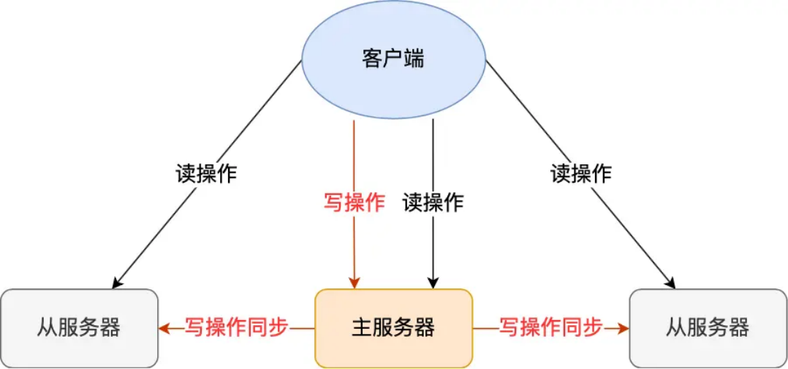

Redis常见业务场景是读多写少，Redis做主从和读写分离，是为了提升读性能、提高可用性，并降低多节点数据一致性的复杂度。

1. 性能优化

主从架构下，主节点主要处理写请求，从节点主要处理读请求。这样可以把读流量分摊到多个从节点上，避免单个Redis节点承受过多请求。

对于读多写少的场景，多个从节点可以共同承担读压力，主节点只负责写入和同步数据，整体吞吐能力更高。同时，写操作可能触发持久化或带来阻塞，如果读写都集中在一个节点上，写操作可能影响读请求的响应效率。

2. 数据一致性和同步更简单

主从架构中，写操作只发生在主节点，主节点再把数据同步给从节点。这样数据流向是单向的，模型更简单。

如果所有节点都允许读写，就需要解决多节点之间的数据冲突、同步顺序和一致性问题，复杂度会大幅增加。主从模式通过主写从读，降低了多节点数据一致性维护成本。

##### 主从同步的原理

###### 全量同步(第一次同步)

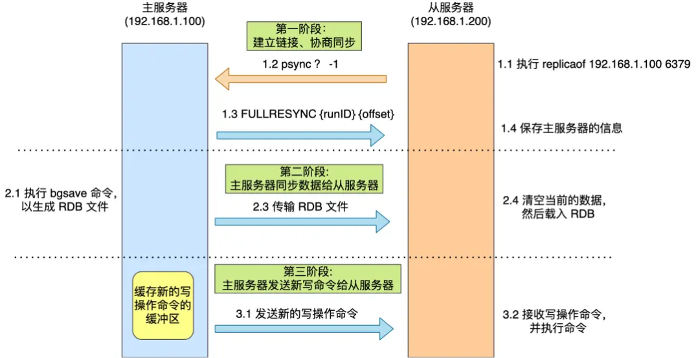

全量同步流程：

1. slave请求同步：从节点向主节点发起数据同步请求，并携带自己的`replid` 和`offset` 。主节点根据这两个信息判断是全量同步还是增量同步。

2. master返回版本信息：如果主节点判断这是第一次同步，会返回自己的`replid` 和`offset` ，从节点保存这些版本信息。`replid` 用于标识数据集，`offset` 用于标识复制进度。

3. master生成RDB文件：主节点执行`bgsave` 生成`RDB` 快照。在生成快照期间，主节点不会停止处理写请求，而是把新的写命令记录到`repl_baklog` 内存缓冲区中。

4. slave加载RDB文件：主节点将生成的`RDB` 文件发送给从节点。从节点收到后会清空本地旧数据，并加载这份`RDB` 快照。

5. master发送增量命令：从节点加载完`RDB` 后，主节点再把`repl_baklog` 中缓存的写命令发送给从节点。从节点执行这些命令后，数据就和主节点保持一致。

主节点判断是否第一次同步，主要依赖两个信息：

- Replication ID：简称`replid` ，用于标识当前数据集。每个主节点都有自己的`replid` ，从节点会继承主节点的`replid` 。如果从节点上报的`replid` 和主节点一致，说明它们属于同一个数据集，可以尝试增量同步；如果不一致，说明不是同一份数据集，通常需要全量同步。

- offset：表示复制偏移量，会随着主节点写入`repl_baklog` 的数据不断增加。从节点完成同步后也会记录自己的`offset` 。如果从节点的`offset` 小于主节点，说明从节点数据落后，需要补齐缺失命令。

从节点同步时必须向主节点声明自己的`replid` 和`offset` 。`replid` 主要判断是否属于同一份数据集，决定能不能增量同步；`offset` 主要判断同步进度，决定需要从`repl_baklog` 中补哪些数据。

主从服务器在完成第一次同步后，双方就会维护一个TCP长连接。

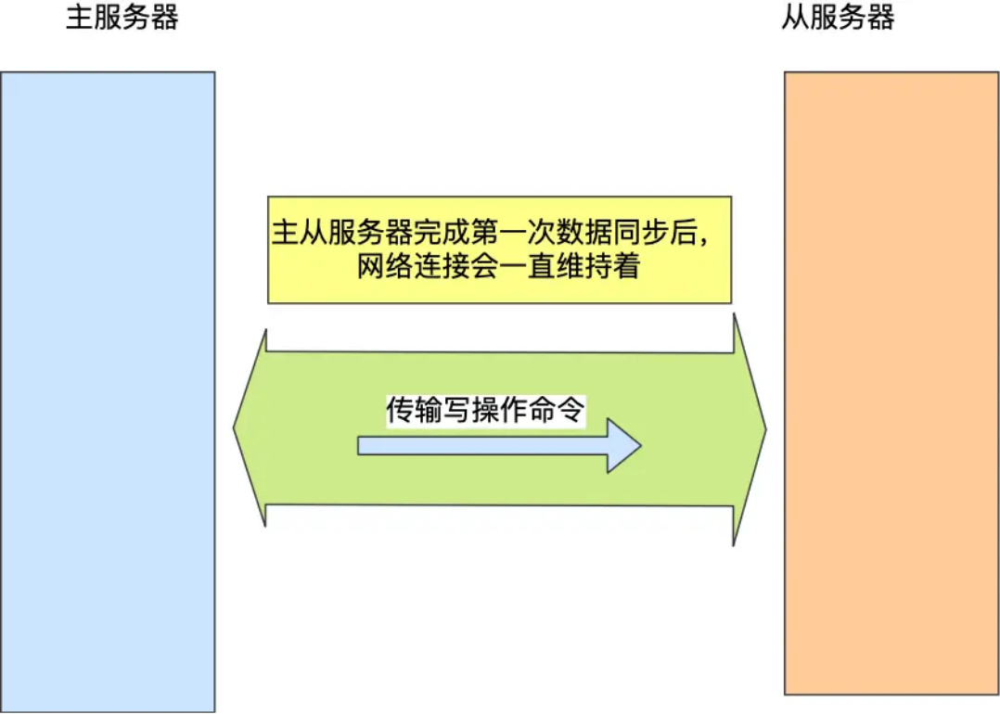

后续服务器就可以通过这个连接将写命令传播给从服务器，然后从服务器执行该命令，从而保持主从的数据库状态相同。

###### 增量同步

如果主从之间连接断开了，无法进行同步，这就会导致主从数据的不一致性，导致读到旧数据。

当断开后又恢复网络连接后，服务器就会采用增量复制的方式继续同步

增量同步流程

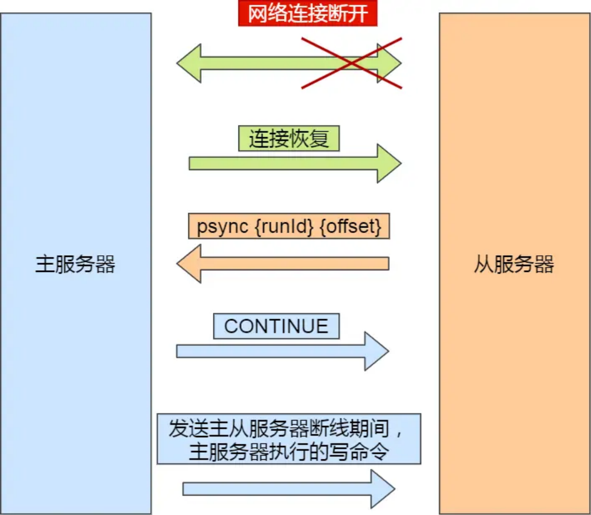

背景知识：

主服务器怎么知道要将哪些增量数据同步给从服务器，主要是维护一个`repl_backlog_buffer`和`replication offset` 。

- `repl_backlog_buffer` 是主节点维护的一个环形复制缓冲区，用于在主从短暂断连后保存主节点新增的写命令。从节点重新连接时，主节点可以根据从节点上报的复制进度，从这个缓冲区中找到缺失的数据，进行增量同步。

- `replication offset` 是主从复制的偏移量，用于标记复制进度。主节点用`master_repl_offset` 记录自己已经写到哪个位置，从节点用`slave_repl_offset` 记录自己已经同步到哪个位置。正常情况下，从节点的`slave_repl_offset` 会不断追赶主节点的`master_repl_offset` 。

1. slave请求同步：从节点向主节点发起同步请求，并携带自己的`rplid` 和`offset` ，

2. master判断可增量同步，主节点发现从节点的`replid` 和自己一致，说明两者属于同一份数据集，不是第一次同步，于是返回`continue` ，表示可以继续增量同步。

3. master发送缺失命令：主节点根据从节点的`offset` ，从`repl_baklog` 中找到从节点缺失的写命令，并发送给从节点，slave从节点收到这些增量命令后按顺序执行，使自身数据追上主节点。注意：

`repl_baklog` 是主节点内存中的环形缓冲区，大小有限。写满后会覆盖旧数据。如果从节点断连时间太长，导致它还没有同步的数据已经被覆盖，主节点就无法根据`offset` 补齐缺失命令，此时只能重新进行全量同步。

### 扩展题

#### Redis使用的业务场景

1. 缓存

DB缓存，减轻DB服务器压力

提高系统响应

2. 分布式锁

如今都是分布式的环境下java自带的单体锁已经不适用的。在 Redis 2.6.12 版本开始，string的set命令增加了一些参数：

- `EX` ：设置键的过期时间（单位为秒）

- `PX` ：设置键的过期时间（单位为毫秒）

- `XX`  ：只在键已经存在时，才对键进行设置操作。

- `NX`  ：只在键不存在时，才对键进行设置操作。 `SET key value NX`  效果等同于 `SETNXkey value`  。

3. 全局ID

int类型，incrby，利用原子性

`incrby userid 1000`

分库分表的场景，一次性拿一段

4. 计数器

int类型，incr方法

例如：文章的阅读量、微博点赞数、允许一定的延迟，先写入Redis再定时同步到数据库

计数功能应该是最适合 Redis 的使用场景之一了，因为它高频率读写的特征可以完全发挥 Redis 作为内存数据库的高效。在 Redis 的数据结构中，`string` 、`hash` 和`sorted set` 都提供了`incr`方法用于原子性的自增操作，下面举例说明一下它们各自的使用场景：

- 如果应用需要显示每天的注册用户数，便可以使用string作为计数器，设定一个名为REGISTERED_COUNT_TODAY的 key，并在初始化时给它设置一个到凌晨 0 点的过期时间，每当用户注册成功后便使用incr命令使该 key 增长 1，同时当每天凌晨 0 点后，这个计数器都会因为 key过期使值清零。

- 每条微博都有点赞数、评论数、转发数和浏览数四条属性，这时用hash进行计数会更好，将该计数器的 key 设为weibo:weibo_id，hash的 field 为like_number、comment_number、forward_number和view_number，在对应操作后通过hincrby使hash 中的 field 自增。

- 如果应用有一个发帖排行榜的功能，便选择sorted set吧，将集合的 key 设为POST_RANK。当用户发帖后，使用zincrby将该用户 id 的 score 增长 1。sorted set会重新进行排序，用户所在排行榜的位置也就会得到实时的更新。

5. 限流

int类型，incr方法.   以访问者的ip和其他信息作为key，访问一次增加一次计数，超过次数则返回false

6. 排行榜

使用`sorted set` (有序set)和一个计算热度的算法便可以轻松打造一个热度排行榜，`zrevrangebyscore` 可以得到以分数倒序排列的序列，`zrank` 可以得到一个成员在该排行榜的位置（是分数正序排列时的位置，如果要获取倒序排列时的位置需要用`zcard` - `zrank` ）。

#### Redis为什么那么快

Redis速度快主要有以下几个原因：

1. 基于内存存储(主要原因)：Redis的数据主要存储在内存中，内存访问速度远高于磁盘访问速度，这是Redis快的最主要原因。

2. 单线程执行命令：Redis执行命令时采用单线程模型，避免了多线程带来的线程切换、上下文切换和锁竞争问题，使执行过程更加高效。

3. I/O多路复用：Redis虽然命令执行是单线程，但网络I/O采用多路复用模型，可以让一个线程同时监听和处理多个客户端连接，提高并发处理能力。

4. 高效数据结构：Redis内置了多种高效数据结构，例如字符串、哈希表、列表、集合和有序集合，并针对不同场景做了底层优化，能够以较低时间复杂度完成读写操作。

#### Redis线程设置

##### Redis是单线程还是多线程

Redis不能简单说成单线程或多线程，要看讨论的是哪一部分。如果指核心命令处理，也就是数据读写操作，Redis是单线程的。如果指整个Redis系统，包括网络I/O、异步删除、持久化和集群等能力，Redis是多线程参与的。

Redis的线程模型可以按版本理解：

1. 核心命令处理是单线程

Redis执行命令、读写内存数据这一部分仍然是单线程。这样可以避免多线程带来的锁竞争、线程切换和并发安全问题，使核心执行逻辑更简单、更高效。

2. Redis4.0引入后台多线程

Redis4.0开始支持用后台线程处理一些耗时任务，例如`UNLINK` 异步删除大Key，避免`DEL` 大Key阻塞主线程。类似的后台任务还包括`bgsave` 、`bgrewriteaof` 等持久化相关操作。此时Redis的网络模型整体仍然以单线程为主，依靠I/O多路复用支撑高并发连接。

3. Redis6.0引入网络I/O多线程

Redis6.0在网络模型中引入多线程，主要用于处理网络数据的读写和协议解析，提高多核CPU利用率和网络并发能力。但需要注意，命令执行本身仍然由主线程串行完成，不是多个线程同时修改Redis数据。

总结来说：Redis核心命令执行是单线程，后台任务和网络I/O可以是多线程。这样既保留了单线程命令执行的简单高效，又能利用多线程提升耗时任务和网络处理能力。

##### Redis为什么使用单线程执行命令

Redis使用单线程执行命令，核心是因为它的主要性能瓶颈不在CPU计算，而在内存访问和网络I/O。单线程模型可以让命令执行过程更简单、更稳定，同时避免多线程带来的锁竞争和上下文切换开销。

1. 避免锁竞争

Redis的数据结构都存储在内存中，如果多线程同时执行命令，就需要对共享数据加锁，保证并发安全。加锁会增加实现复杂度，也会带来性能损耗。单线程串行执行命令，可以天然避免并发修改问题。

2. 减少线程切换开销

多线程执行时，CPU需要频繁进行线程切换和上下文切换。Redis命令通常执行很快，如果引入大量线程切换，反而可能降低性能。单线程可以减少调度开销。

3. 内存操作本身很快

Redis主要基于内存读写，单次命令执行速度非常快。对于大多数简单命令，单线程已经可以达到很高吞吐量。

4. 配合I/O多路复用

Redis虽然命令执行是单线程，但网络层使用I/O多路复用，可以让一个线程同时处理多个客户端连接。这样既能支撑高并发连接，又不需要在命令执行层引入多线程复杂度。

#### Redis 怎么保证高并发和高可用？

Redis 的高并发主要依赖内存访问、高效数据结构、单线程命令执行和 I/O 多路复用；高可用主要依赖持久化、主从复制、Sentinel 和 Redis Cluster。

高并发：

内存访问：Redis 的数据主要存储在内存中，读写不需要频繁访问磁盘，因此响应速度快，适合高并发访问。

I/O 多路复用：Redis 使用 epoll 等 I/O 多路复用机制，一个线程可以同时监听大量网络连接，减少线程创建和上下文切换开销。

单线程执行：Redis 的核心命令主要由单线程顺序执行，避免了多线程竞争、加锁和上下文切换的开销。需要注意的是，Redis 6.0 之后引入了多线程网络 I/O，但命令执行仍以单线程为主。

高效数据结构：Redis 针对不同场景提供 String、Hash、List、Set、Sorted Set 等数据结构，底层使用哈希表、跳表、压缩列表等结构，使大部分操作具有较低的时间复杂度。

高可用

持久化机制：Redis 提供 RDB 和 AOF。RDB 通过快照保存数据，恢复速度快；AOF 记录写命令，数据安全性更高。两者可以结合使用，降低宕机后的数据丢失风险。

主从复制：主节点负责写操作，从节点同步主节点数据，可以实现数据冗余和读写分离，提高读请求吞吐量。但主从复制通常是异步的，故障时可能丢失少量未同步数据。

Sentinel：Sentinel 负责监控主从节点。当主节点故障时，会通过选举将一个从节点提升为新的主节点，并通知客户端更新访问地址，实现自动故障转移。

Redis Cluster：Cluster 通过 16384 个 Hash Slot 将数据分布到多个主节点，实现水平扩容。每个主节点可以配置从节点，当主节点故障时，从节点可以自动接管，从而同时提供数据分片和高可用能力。

#### 哨兵机制

##### 什么是 Sentinel？

Sentinel（哨兵）是 Redis 官方提供的高可用解决方案，主要用于监控 Redis 主从节点的运行状态，并在主节点发生故障时自动完成故障转移，从而保证 Redis 服务能够持续对外提供服务。需要注意的是，Sentinel 并不负责数据存储，它本身是一个独立运行的进程。

Sentinel 主要具有四个功能：

- 监控（Monitoring）：Sentinel 会周期性地向 Master 和 Slave 发送 `PING`  命令，持续监控各节点是否正常工作，并实时获取主从节点的状态信息。

- 通知（Notification）：当 Redis 节点发生故障或主从关系发生变化时，Sentinel 可以通过 API 或脚本通知管理员和客户端。

- 自动故障转移（Failover）：当 Master 被判定为故障后，Sentinel 会从所有 Slave 中选举一个新的 Master，并让其他 Slave 重新复制新的 Master，整个过程无需人工干预。

- 配置中心（Configuration Provider）：客户端可以通过 Sentinel 获取当前 Master 的地址。当发生主从切换后，Sentinel 会向客户端返回新的 Master 地址，避免客户端仍然连接已经失效的节点。

##### Sentinel 如何判断 Master 宕机？

Sentinel 采用主观下线（SDOWN）和客观下线（ODOWN）两阶段机制判断主节点是否故障。

- 主观下线（SDOWN）：单个 Sentinel 在一定时间内无法与 Master 通信，就认为该节点主观下线。

- 客观下线（ODOWN）：多个 Sentinel 达成一致后，确认 Master 已故障，进入客观下线状态，并开始故障转移。

##### Sentinel 如何完成故障转移？

当 Sentinel 判定 Master 已经客观下线（ODOWN）后，会自动发起故障转移流程，整个过程主要包括 Leader 选举、新 Master 选举、主从切换以及通知客户端四个步骤。

- Leader 选举：多个 Sentinel 会先通过 Raft 风格的投票机制选举出一个 Leader Sentinel，由Leader 负责后续所有故障转移操作，避免多个 Sentinel 同时进行切换。

- 选择新的 Master：Leader 会从所有 Slave 中选择最合适的节点提升为新的 Master。通常会优先考虑 `slave-priority` 、复制偏移量（Offset）、与原 Master 的断开时间等因素，保证选择的数据最完整。

- 完成主从切换：Leader 将选中的 Slave 执行 `SLAVEOF NO ONE` ，使其成为新的 Master，然后通知其他 Slave 去复制新的 Master，重新建立主从关系。

- 通知客户端：故障转移完成后，Sentinel 会更新整个集群的主从信息，并向客户端返回新的Master 地址，客户端后续的写请求都会发送到新的 Master。

整个过程通常只需要几秒钟即可完成，因此能够保证 Redis 服务具备较高的可用性。

##### Sentinel 是如何选举新的 Master 的？

当 Master 被判定为客观下线（ODOWN）后，Leader Sentinel 会从所有 Slave 中选择一个最合适的节点提升为新的 Master。选举过程并不是随机的，而是综合多个因素进行排序，以保证新 Master 的数据尽可能完整、稳定。

Sentinel 主要按照以下规则进行选择：

- 优先级（slave-priority）：Redis 可以为每个 Slave 配置 `slave-priority` ，数值越小优先级越高。如果设置为 `0` ，表示该 Slave 永远不会被选举为 Master。

- 复制偏移量（Replication Offset）：如果优先级相同，则比较复制偏移量（Offset）。Offset 越大，说明同步的数据越多，与原 Master 的数据越接近，因此优先成为新的 Master。

- 断线时间：如果 Offset 相同，则优先选择与原 Master 断开时间最短的 Slave。长时间离线的节点可能存在较多数据缺失，不适合作为新的 Master。

- 运行 ID（Run ID）：如果以上条件都相同，则按照 Redis 节点的 Run ID 进行排序，选择 Run ID较小的节点作为新的 Master。

选举完成后，Sentinel 会将该 Slave 提升为 Master，并通知其他 Slave 重新复制新的 Master，同时向客户端发布新的主节点地址，整个故障转移过程通常只需要几秒钟即可完成。

##### 什么是 Sentinel 脑裂？如何避免？

脑裂（Split Brain）是指由于网络分区等原因，Redis 集群中同时存在两个 Master，对外同时提供写服务，导致数据出现不一致的现象。

例如：

- 原 Master 因网络故障与 Sentinel 失去联系。

- Sentinel 误认为 Master 已经宕机，将某个 Slave 提升为新的 Master。

- 实际上原 Master 并没有真正宕机，只是网络隔离，它仍然继续接收客户端写请求。

- 此时集群中同时存在旧 Master和新 Master，两个节点的数据分别发生变化，这就是脑裂。

为了避免脑裂，通常采用以下措施：

- 合理配置 down-after-milliseconds ：适当增加故障判定时间，避免因网络瞬时抖动导致误判 Master 下线。

- 配置 min-replicas-to-write  和 min-replicas-max-lag ：要求 Master 必须有足够数量的 Slave 保持同步，否则拒绝写请求。这样即使发生网络分区，孤立的旧 Master 也会停止提供写服务，从而减少脑裂导致的数据丢失。

- 部署多个 Sentinel：生产环境通常部署至少 3 个 Sentinel，通过多数派投票确认 Master 是否真正故障，避免单个 Sentinel 因网络异常产生误判。

- 客户端及时切换：客户端应通过 Sentinel 获取最新的 Master 地址，而不是固定连接某一个节点，确保故障转移后能够及时切换到新的 Master。

需要注意的是，Sentinel 无法从根本上消除脑裂，只能通过多数派机制和写保护策略降低脑裂发生的概率以及减少数据不一致带来的影响。

#### Redis Cluster(集群)

##### 什么是 Redis Cluster？

Redis Cluster 是 Redis 官方提供的分布式集群方案，主要通过数据分片、主从复制和自动故障转移，解决单机 Redis 在存储容量、并发能力和高可用方面的限制。

普通的 Redis 主从模式或 Sentinel 模式中，所有节点通常保存同一份完整数据，主要解决的是高可用问题，并不能突破单个 Master 的内存和写入性能上限。Redis Cluster 则会把数据分散存储在多个Master 节点上，每个 Master 只负责其中一部分数据，从而实现水平扩展。

数据分片：Redis Cluster 将整个 Key 空间划分为16384个 Hash Slot，并将这些槽分配给不同的Master。Key 根据哈希计算定位到某个槽，再通过槽找到负责该数据的 Master。

主从复制：每个 Master 可以配置一个或多个 Replica。Replica 会异步复制对应 Master 的数据，本身通常不负责处理普通写请求，主要用于数据备份和故障切换。

自动故障转移：当某个 Master 被集群判定为故障后，它的 Replica 会参与选举，其中一个 Replica 晋升为新的 Master，并接管原 Master 负责的 Hash Slot。

去中心化架构：Redis Cluster 没有统一的中心节点。各节点通过 Cluster Bus 和 Gossip 协议交换节点状态、槽位分配和故障信息，任何节点都可以接收客户端请求。

客户端路由：客户端可以连接集群中的任意节点。如果请求的 Key 不属于当前节点，节点会返回`MOVED`  或 `ASK`  重定向信息，由支持 Cluster 的客户端把请求发送到正确节点。

因此，Redis Cluster既可以通过增加 Master 节点扩大存储容量和处理能力，也可以通过为 Master 配置 Replica 实现故障转移。不过，Redis Cluster 使用异步复制，并不保证强一致性，故障切换时仍可能丢失尚未同步到 Replica 的数据。

##### Redis Cluster 为什么使用16384个槽？

Redis Cluster 将所有 Key 映射到0～16383范围内的16384个 Hash Slot中。集群真正分配和迁移的单位不是单个 Key，也不是某台固定服务器，而是 Hash Slot。

普通 Key 的槽位计算公式为：

```text
slot = CRC16(key) % 16384
```

由于16384等于2¹⁴，Redis实现中也可以通过取CRC16结果的低14位得到槽位编号。官方规范明确规定，Redis Cluster的Key空间被划分为16384个槽。

例如：

```text
Master A：负责0～5000号槽
Master B：负责5001～10000号槽
Master C：负责10001～16383号槽
```

当执行：

```text
SET user:1001 "Tom"
```

Redis会计算`user:1001` 对应的槽位，然后将请求路由到负责该槽位的Master。

之所以选择16384，而不是65536，主要是在集群规模、数据均衡和通信开销之间做平衡。

- 槽位数量足够多：16384个槽可以比较均匀地分配给不同Master。即使集群中存在数百个节点，每个节点也能负责一定数量的槽，便于实现数据均衡。

- 节点状态信息较小：Redis Cluster节点之间会通过Gossip消息交换集群状态，其中需要使用位图记录节点负责的槽。16384个位只占用2048字节；如果使用65536个槽，位图会扩大到8192字节，增加节点间通信和状态维护开销。

- 扩容迁移更灵活：增加新Master时，不需要重新计算所有Key的位置，只需要把部分槽及槽内的数据从旧节点迁移到新节点。Redis也提供了围绕槽位迁移和重新分片的相关机制。

- 没有必要设置得过大：Redis Cluster一般不会部署到上万个Master。官方规范虽然从槽位角度允许最多16384个Master，但建议的节点规模远小于这一上限，因此16384个槽已经足够满足实际的数据分布需求。

此外，Redis Cluster还支持Hash Tag。Key中如果包含`{}` ，Redis只使用花括号内的内容计算槽位。例如：

```text
user:{1001}:name
user:{1001}:order
```

两个Key都会根据`1001` 计算槽位，因此能够被放到同一个Hash Slot中，方便执行多Key命令、事务或Lua脚本。

##### Redis Cluster 如何实现高可用？

Redis Cluster 主要通过主从复制、故障检测、自动故障转移和客户端路由更新四个机制实现高可用。当某个 Master 故障时，对应的 Replica 能够自动晋升为新的 Master，继续对外提供服务，从而保证集群的可用性。

- 主从复制：每个 Master 都会配置一个或多个 Replica，Replica 会异步复制 Master 的数据，平时作为数据备份，当 Master 故障时可以接替其工作。

- 故障检测：Cluster 节点之间通过 Gossip 协议交换节点状态，并定期发送 `PING` 、`PONG`  消息检测彼此是否存活。当多数 Master 都认为某个 Master 已经故障时，就会触发故障转移。

- 自动故障转移：故障 Master 的 Replica 会发起选举，获得多数 Master 投票后，其中一个 Replica晋升为新的 Master，并接管原 Master 负责的全部 Hash Slot，其他节点也会同步最新的集群拓扑。

- 客户端路由更新：客户端通常会缓存 Hash Slot 与节点的映射关系。当故障转移完成后，如果客户端访问了旧节点，Redis 会返回 `MOVED`  重定向信息，客户端据此更新路由，将请求发送到新的Master。

需要注意的是，Redis Cluster 的主从复制采用异步方式，因此故障切换时仍可能丢失少量尚未同步到Replica 的数据，所以它提供的是高可用和最终一致性，而不是严格的强一致性。

##### Redis Cluster 有哪些限制？

Redis Cluster通过Hash Slot实现数据分片，因此涉及多个Key的操作会受到槽位限制。同时，由于主从复制采用异步方式，它也不能保证严格的强一致性。

- 多Key操作受限：`MGET` 、`MSET` 等涉及多个Key的命令，要求所有Key位于同一个Hash Slot，否则会出现`CROSSSLOT` 错误。可以通过Hash Tag让相关Key分配到同一个槽。

- 事务受限：Redis Cluster支持事务，但事务中涉及的Key必须位于同一个槽，不支持跨节点的分布式事务。

- Lua脚本受限：Lua脚本可以执行，但脚本访问的多个Key必须属于同一个Hash Slot，不能跨节点操作数据。

- 存在数据丢失风险：Redis Cluster采用异步主从复制，Master宕机时，尚未同步到Replica的数据可能在故障转移后丢失，因此不能保证强一致性。

- 运维复杂度较高：扩容和缩容时需要迁移Hash Slot和对应数据，客户端也必须支持`MOVED` 、`ASK` 重定向以及集群拓扑更新。

因此，Redis Cluster适合需要高并发、数据分片和水平扩展的场景，但对于跨Key事务、强一致性要求较高的业务，需要在业务层进行额外设计。

#### 限流算法

##### 有哪几种限流算法

限流算法经典的有四种，分别是：固定窗口、滑动窗口、漏桶、令牌桶

参考资料：

动画学Redis分布式限流算法

Javaguide限流算法详解

- 固定窗口：将时间划分为固定窗口，在每个窗口内统计请求次数。实现简单，但窗口边界可能出现瞬时流量突刺。

- 滑动窗口：将固定窗口拆成更小的时间片，统计最近一段时间内的请求数。比固定窗口更平滑，但实现更复杂。

- 漏桶算法：请求先进入队列，再按固定速率流出。可以稳定处理速率，但对突发流量不友好。

- 令牌桶算法：系统按固定速率生成令牌，请求拿到令牌才能通过。可以限制平均速率，也能允许一定突发流量，是实际项目中常用方案。

##### Redis如何实现限流算法？

Redis实现限流可以分为单机限流和分布式限流。

- 单机限流适合单体应用，常用本地限流组件完成。

- 分布式限流适合多实例服务，需要借助Redis集中维护限流状态，通常配合`Lua` 脚本保证原子性。

1. 单机限流

单机限流只对当前应用实例生效，适合单体服务或不要求全局限流的场景。Java中常用`GuavaRateLimiter` ，它基于令牌桶算法实现。

示例代码：

```java
import com.google.common.util.concurrent.RateLimiter;

public class LocalRateLimitDemo {
    private static final RateLimiter limiter = RateLimiter.create(5.0);

    public static boolean allowRequest() {
        return limiter.tryAcquire();
    }
}
```

这里表示每秒生成`5` 个令牌，请求只有获取到令牌才允许通过。

2. 分布式限流

    - Lua实现

分布式限流适合多个服务实例共同对外提供服务的场景。由于单机限流只能限制单个实例，无法控制全局QPS，因此需要用Redis集中记录请求次数或令牌状态。基于Redis实现时建议使用Lua 脚本，因为`Lua` 可以减少多次网络交互，并且脚本在Redis中按单条命令原子执行，避免并发下计数不一致。

固定窗口限流示例：

```lua
local key = KEYS[1]
local limit = tonumber(ARGV[1])
local window = tonumber(ARGV[2])

local current = redis.call("INCR", key)

if current == 1 then
    redis.call("EXPIRE", key, window)
end

if current > limit then
    return 0
else
    return 1
end
```

调用含义：

```text
KEYS[1] = rate_limit:user:1001
ARGV[1] = 100
ARGV[2] = 60
```

表示用户`1001` 在`60` 秒内最多允许访问`100` 次。

- Redisson实现

如果不想自己写`Lua` 脚本，可以使用`Redisson` 的`RRateLimiter` 。它底层基于`Lua` 和令牌桶算法实现，支持全局限流和单客户端限流。`RRateLimiter` 可以通过`RateType.OVERALL`实现全局限流。

示例代码：

```java
RRateLimiter rateLimiter =redissonClient.getRateLimiter("api:order:limiter");

rateLimiter.trySetRate(
    RateType.OVERALL,
    100,
    1,
    RateIntervalUnit.SECONDS
);

boolean allowed = rateLimiter.tryAcquire();

if (!allowed) {
    throw new RuntimeException("请求过于频繁");
}
```

这里表示接口整体每秒最多允许`100` 个请求通过。

Redis实现限流的原理(以滑动窗口限流为例)

Redis实现滑动窗口限流，通常使用`ZSet` 。核心思路是把每次请求的时间戳作为分数写入`ZSet` ，每次请求到来时，只统计当前时间窗口内的请求数量。如果数量超过阈值，就拒绝请求，否则放行并记录本次请求。

调用时一般需要传递限流Key、当前时间戳、窗口大小、限流阈值和请求唯一ID。

`key` ：限流Key，例如`rate:user:1001` 、`rate:ip:192.168.1.1` 、`rate:api:/order/create`

`now` ：当前时间戳，通常用毫秒级时间戳

`window` ：滑动窗口大小，例如`60000` 表示`60` 秒

`limit` ：窗口内允许的最大请求次数

`requestId` ：本次请求的唯一标识，避免同一时间戳下成员重复

限流的维度取决于限流`Key` 的设计，可以按用户、IP、接口等维度限流。例如按用户限流可以使用`rate:user:1001` ，按IP限流可以使用`rate:ip:192.168.1.1` ，按接口限流可以使用`rate:api:/order/create` 。

滑动窗口限流流程如下：

a. 删除窗口外的数据：每次请求进来时，先删除`ZSet` 中过期的请求记录，只保留当前时间窗口内的数据。

```text
ZREMRANGEBYSCORE rate:user:1001 0 当前时间戳 - 窗口大小
```

b. 统计窗口内请求数：查询当前`ZSet` 中剩余元素数量，也就是当前窗口内已经发生的请求次数。

```text
ZCARD rate:user:1001
```

c. 判断是否超过阈值：如果当前请求数已经达到限流阈值，则拒绝请求。如果没有达到阈值，就放行。

d. 记录本次请求：放行后，把当前请求写入`ZSet` ，分数使用当前时间戳，成员值可以使用时间戳加随机数，避免重复。

```text
ZADD rate:user:1001 当前时间戳 请求唯一ID
```

e. 设置过期时间：给限流`Key` 设置过期时间，避免长期占用内存。

```text
EXPIRE rate:user:1001 窗口大小
```

实际使用时，这几个操作需要通过Lua 脚本一次性执行，保证原子性，避免并发请求下出现统计和写入不一致的问题。

```lua
local key = KEYS[1]
local now = tonumber(ARGV[1])
local window = tonumber(ARGV[2])
local limit = tonumber(ARGV[3])
local requestId = ARGV[4]

redis.call("ZREMRANGEBYSCORE", key, 0, now - window)

local count = redis.call("ZCARD", key)

if count >= limit then
    return 0
end

redis.call("ZADD", key, now, requestId)
redis.call("EXPIRE", key, math.ceil(window / 1000))

return 1
```

### 后端面经与场景补充

<!-- 原PDF第476页；面经原题号 6 -->

#### zset插入数据的过程

查找一个跳表节点的过程时，跳表会从头节点的最高层开始，逐一遍历每一层。在遍历某一层的跳表节点时，会用跳表节点中的 SDS 类型的元素和元素的权重来进行判断，共有两个判断条件：

- 如果当前节点的权重「小于」要查找的权重时，跳表就会访问该层上的下一个节点。

- 如果当前节点的权重「等于」要查找的权重时，并且当前节点的 SDS 类型数据「小于」要查找的数据时，跳表就会访问该层上的下一个节点。

如果上面两个条件都不满足，或者下一个节点为空时，跳表就会使用目前遍历到的节点的 level 数组里的下一层指针，然后沿着下一层指针继续查找，这就相当于跳到了下一层接着查找。

举个例子，下图有个 3 层级的跳表。

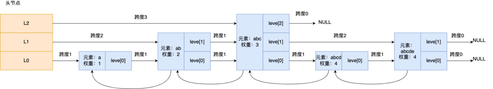

如果要查找「元素：abcd，权重：4」的节点，查找的过程是这样的：

- 先从头节点的最高层开始，L2 指向了「元素：abc，权重：3」节点，这个节点的权重比要查找节点的小，所以要访问该层上的下一个节点；

- 但是该层的下一个节点是空节点（ leve[2]指向的是空节点），于是就会跳到「元素：abc，权重：3」节点的下一层去找，也就是 leve[1];

- 「元素：abc，权重：3」节点的 leve[1] 的下一个指针指向了「元素：abcde，权重：4」的节点，然后将其和要查找的节点比较。虽然「元素：abcde，权重：4」的节点的权重和要查找的权重相同，但是当前节点的 SDS 类型数据「大于」要查找的数据，所以会继续跳到「元素：abc，权重：3」节点的下一层去找，也就是 leve[0]；

- 「元素：abc，权重：3」节点的 leve[0] 的下一个指针指向了「元素：abcd，权重：4」的节点，该节点正是要查找的节点，查询结束。

<!-- 原PDF第480页；面经原题号 17 -->

#### redis做缓存，如果数据量很大，比如5亿数据，二十万的qps，该怎么设计缓存

⛱️从三个方面进行回答，读操作、写操作以及并发控制

1. 读操作策略：确保数据最新

Cache-Aside（旁路缓存）

- 流程：

    i. 读请求优先查询缓存，命中则直接返回。

    ii. 未命中时查询数据库，回填缓存后返回数据。

- 优点：简单易实现，缓存不承载数据加载逻辑。

- 风险：

    - 缓存穿透：恶意请求不存在的Key，压垮数据库。

        - 解决方案：布隆过滤器拦截非法Key，或缓存空值（TTL缩短）。

    - 缓存击穿：热点Key过期瞬间高并发请求涌入数据库。

        - 解决方案：互斥锁（Redis `SETNX` ）或永不过期+异步刷新。

Read-Through（读穿透）

- 流程：缓存内置数据加载逻辑，对应用透明。

- 优点：业务代码简洁，适合标准化查询场景。

- 缺点：灵活性较低，难以处理复杂回填逻辑。

2. 写操作策略：同步或异步更新

Write-Through（写穿透）

流程：先更新数据库，再同步更新缓存。

- 优点：强一致性，缓存与数据库实时一致。

- 缺点：写入延迟高，吞吐量受限于数据库。

Write-Behind（异步批量写）

- 流程：先更新缓存，异步批量提交数据库。

    - 通过消息队列（如Kafka）缓冲写操作，合并后批量执行。

- 优点：高吞吐，适合写入密集型场景（如点击计数）。

- 缺点：数据丢失风险（队列未持久化时宕机），需结合WAL日志。

Delete-Then-Update（延迟双删）

- 流程：

    1. 先删除缓存 → 更新数据库 → 延迟数百毫秒 → 再次删除缓存。

    2. 第二次删除应对并发读导致的脏数据回填。

- 优点：降低脏数据时间窗口。

- 缺点：依赖延迟时间估算，需结合业务调整。

3. 并发控制：解决竞态条件

分布式锁

- 场景：防止多个线程同时回填同一Key的缓存。

- 缺点：锁粒度需精细，避免性能瓶颈。

版本号控制

- 流程：

    i. 数据写入时附带版本号（如时间戳或CAS值）。

    ii. 读缓存时校验版本，若落后则触发更新。

    - 优点：无锁化，适合高并发场景。

- 实现：Redis Hash结构存储数据和版本号。

消息队列顺序消费

- 场景：确保数据库与缓存的更新顺序一致。

    - 如使用RocketMQ的顺序消息，按Key Hash到同一队列。

- 案例：订单状态变更需严格按序更新缓存。

<!-- 原PDF第481页；面经原题号 18 -->

#### lfu和fifo的缓存淘汰策略适用的场景

a. LFU

LFU策略会淘汰使用频率最低的数据。适用于以下场景：

i. 访问频率稳定：数据访问频率相对稳定，某些数据被频繁访问，而其他数据很少被访问。

ii. 热点数据：存在明显的热点数据，某些数据被频繁访问，而其他数据访问频率较低。

iii. 长时间缓存：数据的访问模式不会频繁变化，适合长时间缓存热点数据。

示例场景：

- 推荐系统：推荐系统中某些热门商品或内容被频繁访问，可以使用LFU策略来缓存这些热门数据。

- 数据库查询缓存：某些查询结果被频繁访问，可以使用LFU策略来缓存这些查询结果，提高查询性能。

b. FIFO

FIFO策略会淘汰最早进入缓存的数据。适用于以下场景：

i. 访问模式不稳定：数据访问模式变化较快，无法预测哪些数据会被频繁访问。

ii. 短时间缓存：数据的生命周期较短，适合短时间缓存数据。

iii. 简单实现：需要简单易实现的缓存策略，不需要复杂的访问频率统计。

示例场景：

- 任务队列：任务队列中任务按照进入的顺序处理，可以使用FIFO策略来缓存任务。

- 日志缓存：日志数据按照时间顺序记录，可以使用FIFO策略来缓存最近的日志数据。

总结

- LFU适用于访问频率稳定、存在热点数据的场景，适合长时间缓存热点数据。

- FIFO适用于访问模式不稳定、数据生命周期较短的场景，适合短时间缓存数据。

<!-- 原PDF第484页；面经原题号 28 -->

#### redis的跳表

原文未附答案。

<!-- 原PDF第493页；面经原题号 49 -->

#### 实习中的问题，如果不要redis只要mysql会有什么问题

假如用MySQL实现任务领取，可能会遇到：

超卖问题：两个用户同时查询到同一任务未被领取，然后同时更新领取状态，导致同一任务被多个人领取。

- 需要加事务和行锁，但高并发下会有锁竞争和性能瓶颈。

性能瓶颈：高QPS下数据库压力大，容易造成响应慢甚至宕机。

死锁与阻塞：复杂SQL和事务下容易出现死锁，影响整体可用性。

<!-- 原PDF第500页；面经原题号 65 -->

#### 在任务领取的时候不用redis只用mysql不可以吗

原文未附答案。

<!-- 原PDF第500页；面经原题号 67 -->

#### redis当中跳表的数据结构，时间复杂度

原文未附答案。

<!-- 原PDF第511页；面经原题号 93 -->

#### 使用redis实现全局唯一id，如果宕机了怎么办

原文未附答案。

<a id="module-07"></a>

## 07 Spring

### 高频题

#### 解释一下IOC和AOP？

###### IOC

IOC 即控制反转。

它指的是把对象的创建权和依赖关系的管理权交给 Spring 容器。

传统开发中，业务类自己 `new`  依赖对象，对象之间耦合比较强。

使用 Spring IOC 后，对象由 Spring 容器创建和管理，业务类只需要使用容器注入进来的对象。

好处：

1. 降低类之间的耦合。

2. 对象创建和对象使用解耦。

3. Bean 默认单例，可以避免重复创建对象造成内存浪费。

4. 方便统一管理 Bean 的生命周期。

###### AOP

AOP 即面向切面编程。

它主要用于无侵入式的代码增强。

也就是把日志、权限校验、事务、接口限流、接口幂等等横切逻辑，从核心业务代码中抽取出来。

使用 AOP 后，业务方法只关注核心业务，公共逻辑通过切面统一增强。

Spring AOP 的底层主要是动态代理。

如果目标类实现了接口，默认使用 JDK 动态代理。

如果目标类没有实现接口，则使用 CGLIB 动态代理。

#### IOC的好处是什么？

IOC 的核心好处是降低耦合。

没有 IOC 时，对象创建和依赖管理写死在业务代码里。

例如某个 `OrderService`  直接依赖 `AlipayProcessor` ，如果要换成微信支付，就需要修改业务代码。

使用 IOC 后，业务类依赖接口，具体实现类由 Spring 容器注入。

如果要更换实现类，只需要改配置或替换 Bean 即可，不需要改业务逻辑。

另外，Spring 容器中的 Bean 默认是单例的，可以复用对象，减少频繁创建对象的成本。

#### 依赖注入是什么，注入有哪些方式？

依赖注入就是 DI，Dependency Injection。

它是 IOC 的具体实现方式。

Spring 容器负责创建 Bean，并把 Bean 依赖的对象注入进去。

常见注入方式：

1. 构造函数注入。

2. Setter 方法注入。

3. 字段注入。

4. 接口注入。

实际开发中更推荐构造函数注入。

原因是依赖关系更明确，可以保证对象创建时依赖就已经准备好，也更方便单元测试。

字段注入写起来简单，但是隐藏了依赖关系，也不利于测试。

#### AOP的应用场景？实现原理？

AOP 常见应用场景：

1. 日志记录。

2. 权限校验。

3. Spring 事务。

4. 接口限流。

5. 接口幂等。

6. 统一异常处理或监控埋点。

AOP 的实现原理主要是动态代理。

Spring AOP 会为目标对象创建代理对象。

调用目标方法时，实际上是先调用代理对象的方法。

代理对象在目标方法执行前后加入增强逻辑，比如开启事务、提交事务、回滚事务、记录日志等。

Spring AOP 代理选择：

1. 如果目标对象实现了接口，使用 JDK 动态代理。

2. 如果目标对象没有实现接口，使用 CGLIB 动态代理。

#### JDK动态代理和CGLIB动态代理的区别？

###### JDK动态代理

JDK 动态代理基于接口生成代理类。

要求目标类必须实现接口。

代理对象实现同样的接口，方法调用时通过 `InvocationHandler`  拦截，然后通过反射调用目标方法。

###### CGLIB动态代理

CGLIB 动态代理基于继承生成代理类。

它会在运行时生成目标类的子类，通过重写父类方法实现增强。

如果目标类或目标方法被 `final`  修饰，则不能使用 CGLIB 代理。

###### 区别

1. JDK 动态代理基于接口，CGLIB 基于继承。

2. JDK 动态代理要求目标类实现接口，CGLIB 不要求目标类实现接口。

3. CGLIB 不能代理 `final`  类或 `final`  方法。

4. Spring AOP 会根据目标对象是否实现接口选择代理方式。

#### Spring事务的实现原理？

Spring 事务主要分为编程式事务和声明式事务。

###### 编程式事务

编程式事务需要手动控制事务开启、提交、回滚。

常见 API 有 `PlatformTransactionManager` 、`TransactionTemplate`  等。

优点是控制粒度更细。

缺点是代码侵入性强，业务代码里会混入事务控制逻辑。

###### 声明式事务

声明式事务主要通过 `@Transactional`  注解实现。

它底层基于 AOP。

Spring 会为加了 `@Transactional`  的 Bean 创建代理对象。

调用事务方法时，会先进入代理对象：

1. 方法执行前开启事务。

2. 方法执行成功后提交事务。

3. 方法抛出异常时根据规则回滚事务。

声明式事务的优点是对业务代码侵入小，方法中只需要写业务逻辑。

#### Spring中的事务隔离级别有哪些？

Spring 事务隔离级别主要对应数据库事务隔离级别。

常见隔离级别：

1. `DEFAULT` ：使用数据库默认隔离级别。

2. `READ_UNCOMMITTED` ：读未提交，可能发生脏读、不可重复读、幻读。

3. `READ_COMMITTED` ：读已提交，可以避免脏读，但可能发生不可重复读、幻读。

4. `REPEATABLE_READ` ：可重复读，可以避免脏读、不可重复读，但仍可能存在幻读问题，具体要看数据库实现。

5. `SERIALIZABLE` ：串行化，隔离级别最高，性能最低。

MySQL InnoDB 默认隔离级别是 `REPEATABLE_READ` 。

Spring 的 `DEFAULT`  表示使用底层数据库默认隔离级别。

#### Spring事务传播行为有哪些？

事务传播行为描述的是：一个事务方法调用另一个事务方法时，事务应该如何传播。

常见传播行为：

1. `REQUIRED` ：默认传播行为。如果当前有事务，就加入当前事务；如果没有事务，就新建事务。

2. `REQUIRES_NEW` ：总是新建一个事务。如果当前有事务，就把当前事务挂起。

3. `SUPPORTS` ：如果当前有事务，就加入事务；如果没有事务，就以非事务方式执行。

4. `NOT_SUPPORTED` ：以非事务方式执行。如果当前有事务，就挂起当前事务。

5. `MANDATORY` ：必须在事务中执行。如果当前没有事务，就抛异常。

6. `NEVER` ：必须以非事务方式执行。如果当前有事务，就抛异常。

7. `NESTED` ：如果当前有事务，就在嵌套事务中执行；如果没有事务，就新建事务。

最常用的是 `REQUIRED`  和 `REQUIRES_NEW` 。

#### Spring事务失效的场景

`@Transactional`  是基于 AOP 动态代理实现的，所以很多事务失效都和代理有关。

常见失效场景：

1. `@Transactional`  标注在非 `public`  方法上。

2. 同一个类中方法自调用，调用没有经过代理对象。

3. 方法被 `final`  或 `static`  修饰，代理无法增强。

4. 异常被 `try-catch`  捕获，没有抛出到代理层。

5. 抛出的是检查异常，但是没有设置 `rollbackFor = Exception.class` 。

6. 数据库本身不支持事务，例如 MyISAM。

7. 多线程中使用事务，新线程拿不到原线程的事务上下文。

8. 类没有被 Spring 容器管理。

解决思路：

1. 事务方法使用 `public` 。

2. 避免同类自调用，必要时通过代理对象调用。

3. 异常要抛出，不要吞掉。

4. 明确设置 `rollbackFor = Exception.class` 。

#### Spring常见注解有哪些？

###### Spring常见注解

1. `@Component` ：通用组件注解。

2. `@Controller` ：标识控制层组件。

3. `@Service` ：标识业务层组件。

4. `@Repository` ：标识持久层组件。

5. `@Autowired` ：按类型自动注入。

6. `@Qualifier` ：配合 `@Autowired`  按名称注入。

7. `@Scope` ：指定 Bean 作用域。

8. `@Configuration` ：声明配置类。

9. `@Bean` ：把方法返回值注册到 Spring 容器中。

10. `@ComponentScan` ：指定组件扫描路径。

11. `@Import` ：导入配置类或组件。

###### Spring MVC常见注解

1. `@RequestMapping` ：映射请求路径。

2. `@GetMapping` 、`@PostMapping` ：映射 GET/POST 请求。

3. `@RequestBody` ：接收请求体 JSON，并转换为 Java 对象。

4. `@ResponseBody` ：把方法返回对象转换为 JSON 响应。

5. `@RestController` ：等于 `@Controller + @ResponseBody` 。

6. `@RequestParam` ：获取请求参数。

7. `@PathVariable` ：获取路径参数。

8. `@RequestHeader` ：获取请求头。

###### SpringBoot常见注解

1. `@SpringBootApplication` ：Spring Boot 启动类核心注解。

2. `@SpringBootConfiguration` ：Spring Boot 配置类。

3. `@EnableAutoConfiguration` ：开启自动装配。

4. `@ConditionalOnClass` ：条件装配，类存在时才生效。

#### Spring Bean的作用域有哪些？

理论上常见作用域主要有两种：

1. `singleton` ：单例作用域。每次从容器获取同一个 Bean，默认作用域。

2. `prototype` ：原型作用域。每次从容器获取都会创建一个新的 Bean。

Web 环境下还有：

1. `request` ：每次 HTTP 请求创建一个新的 Bean。

2. `session` ：同一个 Session 共享一个 Bean。

3. `application` ：整个 Web 应用共享一个 Bean。

使用场景：

1. 无状态 Bean，比如 Service、DAO、工具类，通常用 `singleton` 。

2. 有状态 Bean，需要隔离状态时，可以考虑 `prototype` 。

#### Bean的生命周期

Spring Bean 的生命周期可以简化为：实例化、属性注入、初始化、使用、销毁。

主要过程：

1. 实例化： Spring 根据 BeanDefinition 创建 Bean 实例，可以通过构造函数或工厂方法创建。

2. 属性注入： Spring 给 Bean 注入依赖属性。

3. Aware 回调： 如果 Bean 实现了相关 Aware 接口，会回调注入容器相关对象。

4. BeanPostProcessor 前置处理： 调用 `postProcessBeforeInitialization()` 。

5. 初始化： 执行 `@PostConstruct` 、`InitializingBean.afterPropertiesSet()`  或自定义 `init-method` 。

6. BeanPostProcessor 后置处理： 调用 `postProcessAfterInitialization()` ，AOP 代理通常在这里生成。

7. 使用： Bean 初始化完成，可以被业务使用。

8. 销毁： 容器关闭时，执行 `@PreDestroy` 、`DisposableBean.destroy()`  或自定义`destroy-method` 。

简单回答可以说：实例化、属性设置、初始化、使用、销毁。

#### SpringBoot自动装配原理？

Spring Boot 自动装配的核心注解是 `@EnableAutoConfiguration` 。

`@SpringBootApplication`  中包含了 `@EnableAutoConfiguration` 。

自动装配大致流程：

1. 启动类上标注 `@SpringBootApplication` 。

2. 其中的 `@EnableAutoConfiguration`  开启自动装配。

3. `@EnableAutoConfiguration`  通过 `@Import`  导入`AutoConfigurationImportSelector` 。

4. `AutoConfigurationImportSelector`  会读取 jar 包中的自动配置文件。

5. 根据文件中记录的自动配置类全限定名，加载对应配置类。

6. 自动配置类中会定义很多 Bean。

7. 这些 Bean 通常会配合条件注解，比如 `@ConditionalOnClass` 、`@ConditionalOnMissingBean`  等。

8. 条件满足时，Bean 才会被注册到 Spring 容器中。

简单说：

Spring Boot 自动装配就是根据当前项目引入的依赖和已有 Bean，自动判断哪些配置类应该生效，然后把需要的 Bean 加入 Spring 容器。

#### Springboot自动装配用哪个注解？

核心注解是 `@EnableAutoConfiguration` 。

它在 `@SpringBootApplication`  里面。

`@SpringBootApplication`  主要由三个注解组合而成：

1. `@SpringBootConfiguration` 。

2. `@EnableAutoConfiguration` 。

3. `@ComponentScan` 。

所以平时启动类上只需要写 `@SpringBootApplication` 。

#### Spring MVC的执行流程？

Spring MVC 执行流程：

1. 用户请求先到前端控制器 `DispatcherServlet` 。

2. `DispatcherServlet`  调用 `HandlerMapping` 。

3. `HandlerMapping`  根据请求路径找到具体处理器，返回处理器执行链，里面包含 Handler 和拦截器。

4. `DispatcherServlet`  调用 `HandlerAdapter` 。

5. `HandlerAdapter`  适配并调用具体 Handler，也就是 Controller 中的方法。

6. Controller 方法执行业务逻辑，返回结果。

7. 如果使用 `@ResponseBody`  或 `@RestController` ，会通过 `HttpMessageConverter`  把返回对象转换为 JSON 响应。

8. 最终 `DispatcherServlet`  把响应返回给客户端。

简单记：

请求 -> `DispatcherServlet`  -> `HandlerMapping`  -> `HandlerAdapter`  ->`Controller`  -> 返回响应。

#### 取一个自己设置好的变量用哪个注解？

使用 `@Value` 。

例如：

```java
@Value("${server.port}")
private Integer port;
```

`@Value`  可以读取配置文件中的值，也可以注入简单常量。

如果是结构化配置，更推荐使用 `@ConfigurationProperties` 。

### 扩展题

#### Spring IOC容器的创建过程

Spring IOC 容器创建过程可以从 `ApplicationContext`  的 `refresh()`  方法展开。

大致流程：

1. 创建 Spring 容器对象。

2. 准备容器环境，比如设置启动时间、环境变量等。

3. 创建或获取 `BeanFactory` 。

4. 加载 BeanDefinition，也就是解析配置类、XML、注解扫描出来的 Bean 定义信息。

5. 调用 `BeanFactoryPostProcessor` ，允许在 Bean 实例化前修改 BeanDefinition。

6. 注册 `BeanPostProcessor` ，它可以在 Bean 初始化前后进行增强。

7. 初始化消息源、事件广播器等容器基础组件。

8. 实例化非懒加载的单例 Bean。

9. 发布容器刷新完成事件。

总结：

IOC 容器创建的核心就是加载 BeanDefinition，然后根据 BeanDefinition 创建 Bean，并管理 Bean的生命周期。

#### BeanFactory和ApplicationContext有什么区别？

`BeanFactory`  是 Spring 最基础的 IOC 容器接口。

它提供了 Bean 的创建、获取和管理能力。

`ApplicationContext`  是 `BeanFactory`  的子接口，功能更强。

区别：

1. `BeanFactory`  是基础容器，功能较简单。

2. `ApplicationContext`  在 `BeanFactory`  基础上增加了国际化、事件发布、资源加载、环境变量等功能。

3. `BeanFactory`  通常按需创建 Bean。

4. `ApplicationContext`  启动时默认会实例化非懒加载的单例 Bean。

实际开发中一般使用 `ApplicationContext` 。

#### BeanDefinition是什么？

`BeanDefinition`  可以理解为 Bean 的定义信息。

Spring 创建 Bean 之前，会先把 XML、注解、配置类等信息解析成 `BeanDefinition` 。

`BeanDefinition`  中包含：

1. Bean 的 class 类型。

2. Bean 的作用域。

3. 是否懒加载。

4. 构造方法参数。

5. 属性依赖。

6. 初始化方法。

7. 销毁方法。

Spring 后续就是根据 `BeanDefinition`  来创建和管理 Bean。

#### BeanPostProcessor是什么？

`BeanPostProcessor`  是 Bean 后置处理器。

它可以在 Bean 初始化前后对 Bean 进行扩展。

常见两个方法：

1. `postProcessBeforeInitialization()` ：初始化前执行。

2. `postProcessAfterInitialization()` ：初始化后执行。

AOP 代理对象通常就是在 `postProcessAfterInitialization()`  阶段生成的。

所以 BeanPostProcessor 是 Spring 扩展机制中非常重要的一环。

#### FactoryBean和BeanFactory的区别？

`BeanFactory`  是 Spring 容器，是用来创建和管理 Bean 的工厂。

`FactoryBean`  是一个特殊的 Bean，它本身也是 Bean，但是它可以自定义创建对象的逻辑。

区别：

1. `BeanFactory`  是容器。

2. `FactoryBean`  是一个 Bean。

3. 从容器中获取普通 Bean，返回的是 Bean 本身。

4. 从容器中获取 `FactoryBean`  的名字，默认返回的是它 `getObject()`  创建出来的对象。

5. 如果想获取 `FactoryBean`  本身，需要在 Bean 名称前加 `&` 。

典型场景：

MyBatis 中的 Mapper 代理对象就可以通过 FactoryBean 思路创建。

#### 循环依赖问题是什么？

循环依赖指两个或多个 Bean 之间互相依赖，形成循环引用。

例如：

1. A 依赖 B。

2. B 又依赖 A。

如果不处理，Spring 创建 A 时需要 B，创建 B 时又需要 A，就会陷入循环，导致容器启动失败。

Spring 可以解决部分循环依赖问题。

限制：

1. 必须是单例 Bean。

2. 不能全是构造函数注入。

3. 主要解决的是 setter 注入或字段注入形成的循环依赖。

#### 三级缓存是什么？

Spring 解决循环依赖主要依赖三级缓存。

三级缓存：

1. 一级缓存 singletonObjects： 存放完全初始化好的单例 Bean。

2. 二级缓存 earlySingletonObjects： 存放提前暴露的早期 Bean 引用。

3. 三级缓存 singletonFactories： 存放可以创建早期 Bean 引用的 `ObjectFactory` 。

为什么需要三级缓存？

因为 Bean 的创建可以分为实例化和初始化两步。

实例化只是调用构造方法创建对象，此时对象还没有完成属性注入和初始化，可以理解为半成品对象。

Spring 会把半成品对象提前暴露出去，让其他 Bean 能先引用它，从而打破循环依赖。

三级缓存中的 `ObjectFactory`  还可以在需要时生成早期代理对象，解决 AOP 代理场景下的循环依赖问题。

#### 三级缓存怎么解决循环依赖问题？

以 A 依赖 B，B 依赖 A 为例。

流程：

1. 创建 A，先实例化 A。

2. A 实例化后，还没属性注入，把 A 的 `ObjectFactory`  放入三级缓存。

3. 给 A 填充属性时发现需要 B，于是开始创建 B。

4. 创建 B，先实例化 B，并把 B 的 `ObjectFactory`  放入三级缓存。

5. 给 B 填充属性时发现需要 A。

6. 此时 Spring 从三级缓存中拿到 A 的 `ObjectFactory` ，生成 A 的早期引用，并放入二级缓存。

7. B 拿到 A 的早期引用后完成属性注入和初始化，放入一级缓存。

8. A 再拿到已经创建好的 B，完成自己的属性注入和初始化，最后放入一级缓存。

这样 A 和 B 都能完成创建。

#### 为什么构造器注入不能解决循环依赖？

构造器注入要求对象创建时必须先准备好构造参数。

如果 A 的构造方法需要 B，B 的构造方法又需要 A，那么 A 和 B 都无法先实例化出来。

而 Spring 解决循环依赖的关键是：先实例化半成品对象，再提前暴露。

构造器循环依赖连半成品对象都创建不出来，所以无法通过三级缓存解决。

#### @Autowired和@Resource的区别

`@Autowired`  和 `@Resource`  都可以实现依赖注入。

区别：

1. `@Autowired`  是 Spring 提供的注解。

2. `@Resource`  是 JDK/Jakarta 标准注解。

3. `@Autowired`  默认先按类型 byType 注入，如果找到多个，再按名称 byName 匹配。

4. `@Resource`  默认先按名称 byName 注入，如果找不到，再按类型 byType 匹配。

5. `@Autowired`  可以用在构造器、字段、Setter 方法上。

6. `@Resource`  一般用在字段和 Setter 方法上，不支持构造器注入。

如果同一个接口有多个实现：

1. `@Autowired`  可以配合 `@Qualifier`  指定 Bean 名称。

2. `@Resource`  可以直接通过 `name`  或 `type`  指定。

#### @Component、@Controller、@Service、@Repository区别

这几个注解本质上都是把类注册成 Spring Bean。

区别主要是语义不同：

1. `@Component` ：通用组件。

2. `@Controller` ：控制层组件。

3. `@Service` ：业务层组件。

4. `@Repository` ：持久层组件。

`@Repository`  还可能和持久层异常转换有关。

实际开发中按分层语义使用即可。

#### @Configuration和@Component有什么区别？

`@Configuration`  本质上也是一个组件注解，配置类也会被 Spring 注册为 Bean。

区别：

1. `@Configuration`  表示这是一个配置类。

2. 配置类中通常会使用 `@Bean`  方法注册 Bean。

3. 完整模式下，`@Configuration`  类会被 CGLIB 代理，保证同一个 `@Bean`  方法多次调用返回同一个单例 Bean。

4. 普通 `@Component`  不会对 `@Bean`  方法做这种特殊代理增强。

如果配置类中存在 `@Bean`  方法之间互相调用，一般应该使用 `@Configuration` 。

#### Spring事务为什么基于ThreadLocal？

Spring 事务需要在同一个线程中保存事务上下文，例如数据库连接、事务状态等。

Spring 会把事务上下文绑定到当前线程。

底层常用 `ThreadLocal`  保存这些信息。

这样同一个线程内不同方法调用时，都可以获取到当前事务资源。

这也解释了为什么事务中开启新线程会导致事务失效。

因为 `ThreadLocal`  是线程隔离的，新线程拿不到原线程的事务上下文。

#### 事务失效的原因有哪些？

`@Transactional`  定义的声明式事务在以下场景可能失效：

1. 注解加在非 `public`  方法上。

2. 同类内部方法自调用。

3. 方法被 `final`  修饰。

4. 方法被 `static`  修饰。

5. 异常被 catch 捕获，没有继续抛出。

6. 抛出检查异常，但没有配置 `rollbackFor = Exception.class` 。

7. 开启了新线程执行数据库操作。

8. Bean 没有交给 Spring 管理。

9. 数据库或存储引擎不支持事务。

10. 事务传播行为配置不符合预期。

核心原因通常是：没有走到代理对象，或者异常没有被事务拦截器感知。

#### 声明式事务有什么局限？

声明式事务虽然使用方便，但也有局限。

1. 最小粒度通常是方法级别。

2. 事务边界不够直观，开发者可能忽略某个方法已经处在事务中。

3. 如果事务方法中包含 RPC 调用、消息发送、缓存更新、文件写入等不可回滚操作，可能导致数据不一致。

4. 如果事务中包含远程调用，会拉长事务时间，占用数据库连接。

5. 被代理机制限制，存在自调用、非 public 方法、异常被捕获等失效场景。

所以复杂事务场景下，可以考虑编程式事务，让事务边界更明确。

#### SpringBoot的启动流程？

Spring Boot 启动入口是主类的 `main()`  方法。

核心代码：

```java
SpringApplication.run(Application.class, args);
```

启动流程：

1. 执行 `main()`  方法，调用 `SpringApplication.run()` 。

2. 加载 `spring.factories`  中配置的初始化器和监听器。

3. 创建应用程序上下文 `ApplicationContext` 。

4. 准备环境信息，例如配置文件、环境变量、启动参数等。

5. 调用 `refresh()`  刷新容器。

6. 注册并执行 `BeanFactoryPostProcessor` 。

7. 注册 `BeanPostProcessor` 。

8. 扫描并实例化 Bean。

9. 创建内嵌 Web 服务器，例如 Tomcat。

10. 发布容器刷新完成事件。

11. 启动完成后发布 `ApplicationReadyEvent` 。

简单说：

Spring Boot 启动就是创建 SpringApplication，准备环境，创建并刷新 IOC 容器，启动内嵌 Web 服务器，最后发布启动完成事件。

#### Spring中用到了哪些设计模式？

Spring 中常见设计模式：

1. 单例模式： Spring IOC 容器中默认 Bean 是单例的。

2. 工厂模式： Spring IOC 容器本身就是工厂，通过 `getBean()`  获取对象。

3. 代理模式： Spring AOP 基于动态代理实现增强。

4. 责任链模式： Spring MVC 中处理器执行链和多个拦截器体现了责任链思想。

5. 模板方法模式： `JdbcTemplate` 、`RestTemplate`  等模板类封装固定流程，把变化点交给回调。

6. 观察者模式： Spring 事件发布和监听机制。

7. 适配器模式： Spring MVC 中 `HandlerAdapter`  适配不同类型的 Handler。

#### Spring MVC中拦截器和过滤器的区别？

过滤器 Filter 是 Servlet 规范中的组件。

拦截器 Interceptor 是 Spring MVC 提供的组件。

区别：

1. Filter 依赖 Servlet 容器，Interceptor 依赖 Spring MVC。

2. Filter 作用范围更大，可以过滤几乎所有请求。

3. Interceptor 主要拦截进入 Controller 的请求。

4. Filter 执行时机更早，Interceptor 在 Spring MVC 找到 Handler 后执行。

5. Interceptor 可以更方便地访问 Spring 容器中的 Bean。

常见顺序：

请求先经过 Filter，再进入 `DispatcherServlet` ，然后经过 Interceptor，最后到 Controller。

#### Spring MVC为什么需要HandlerAdapter？

不同 Controller 或 Handler 的调用方式可能不同。

如果 `DispatcherServlet`  直接调用具体 Handler，就会和各种 Handler 实现强耦合。

`HandlerAdapter`  的作用就是适配不同类型的 Handler。

`DispatcherServlet`  不关心具体 Handler 怎么执行，只需要找到合适的 `HandlerAdapter` ，让它去调用目标 Handler。

这体现了适配器模式。

#### SpringBoot如何优雅停机？

优雅停机指应用关闭时，不是立刻强制中断，而是停止接收新请求，并等待正在处理的请求完成。

Spring Boot 2.3 开始内置了优雅停机能力。

常见配置：

```text
server:
  shutdown: graceful

spring:
  lifecycle:
    timeout-per-shutdown-phase: 2m
```

开启后，服务关闭时会先停止接收新请求，然后等待已有请求处理完成，超过指定时间后再结束。

好处：

1. 避免请求处理中断。

2. 避免数据不一致。

3. 释放资源更平滑。

#### Spring6.0新特性了解吗？

Spring 6 和 Spring Boot 3 开始更强调云原生和原生镜像能力。

其中比较重要的是 AOT。

AOT 全称 Ahead Of Time，也就是提前编译。

它和 JIT 不同，JIT 是运行时即时编译，AOT 是程序运行前就做一些编译和分析。

AOT 的好处：

1. 减少运行时反射和动态处理开销。

2. 提升启动速度。

3. 降低内存占用。

4. 更适合 GraalVM Native Image。

Spring Native 或 Native Image 可以把 Spring 应用编译成原生可执行文件。

优点是启动快、内存占用低。

缺点是构建时间更长，对反射、动态代理等能力有更多限制。

#### Spring扩展中容易混淆的点

1. IOC 是思想，DI 是 IOC 的具体实现方式。

2. AOP 是无侵入式增强，Spring AOP 主要基于动态代理。

3. JDK 动态代理要求目标类实现接口，CGLIB 基于继承。

4. `@Transactional`  失效多数和代理没生效或异常没抛出有关。

5. Spring 只能解决部分循环依赖，构造器循环依赖不能解决。

6. 三级缓存不仅是为了提前暴露对象，也和 AOP 早期代理对象有关。

7. `@Autowired`  默认先 byType，`@Resource`  默认先 byName。

8. `BeanFactory`  是基础容器，`ApplicationContext`  功能更完整。

9. `FactoryBean`  是 Bean，`BeanFactory`  是容器。

10. Spring Boot 自动装配不是无条件装配，而是通过条件注解按需装配。

### 后端面经与场景补充

<!-- 原PDF第489页；面经原题号 41 -->

#### spring相互依赖会报错吗

Spring 框架对单例作用域且使用属性注入或Setter 注入 的 Bean 之间的循环依赖，默认情况下已经解决了，不会报错。这是 Spring 框架通过其三级缓存机制实现的。

解决思路：

Spring 框架解决单例作用域 Bean 通过 Setter 方法或字段注入造成的循环依赖，其核心在于一个精妙的 "三级缓存" 机制和 "提前暴露半成品对象" 的策略

- 允许创建不完整的对象 (半成品)： Spring 在创建 Bean 时，将其生命周期分为两个关键阶段：

    - 实例化 (Instantiation)： 调用构造器 ( `new` )，在堆内存中创建一个原始对象。此时对象内部的依赖属性 (被 `@Autowired`  标注的字段或 Setter 方法需要注入的属性) 都是 `null`或默认值。这个对象是不完整的，称为"早期引用" (Early Reference) 或 "半成品 Bean"。

    - 属性填充/注入 (Population)： 将依赖的其他 Bean 设置到这个原始对象中。

- 提前暴露半成品： Spring 在完成 Bean 的实例化后（构造器执行完），立刻将这个不完整的原始对象（早期引用）暴露出来，放入一个特殊的缓存中，供其他正在创建的 Bean 引用。

- 先有鸡还是先有蛋？ 解决： 当 Bean A 依赖 Bean B，而 Bean B 又依赖 Bean A 时：

    - Spring 开始创建 A。

    - 实例化 A（调用 A 的构造器），得到一个半成品 A。

    - 关键一步： Spring 立即将这个半成品 A 放入 "三级缓存" (通常是`singletonFactories` ，一个能生产早期引用的工厂缓存)。

    - Spring 开始给 A 的属性注入依赖。发现 A 依赖 B。

    - Spring 去容器中查找 B。发现 B 不存在，于是开始创建 B。

    - 实例化 B（调用 B 的构造器），得到一个半成品 B。

    - 同样关键： Spring 立即将这个半成品 B 放入 "三级缓存"。

    - Spring 开始给 B 的属性注入依赖。发现 B 依赖 A。

    - Spring 去容器中查找 A。此时：

        - 它不会找到完全初始化好的 A（因为 A 还在创建中）。

        - 但它会从 "三级缓存" 中找到 A 的早期引用 (那个半成品 A 对象)!

    - Spring 将这个半成品 A 注入到 B 中。此时 B 的属性注入完成，B 成为一个完整的 Bean。

    - Spring 将完成初始化的 B 放入一级缓存 ( `singletonObjects` ，存放完全可用的单例Bean)。

    - 控制权回到 A 的创建流程。现在 Spring 需要给 A 注入 B。它去容器中查找 B。

    - 这次它从一级缓存 ( `singletonObjects` ) 中找到了已经初始化好的 B！

    - Spring 将完整的 B 注入到 A 中。此时 A 的属性注入完成，A 成为一个完整的 Bean。

    - Spring 将完成初始化的 A 放入一级缓存 ( `singletonObjects` )。

<!-- 原PDF第490页；面经原题号 42 -->

#### spring的ioc和aop讲一下

AOP（Aspect Oriented Programming）即面向切面编程，AOP 是 OOP（面向对象编程）的一种延续，二者互补，并不对立。

AOP 的目的是将横切关注点（如日志记录、事务管理、权限控制、接口限流、接口幂等等）从核心业务逻辑中分离出来，通过动态代理、字节码操作等技术，实现代码的复用和解耦，提高代码的可维护性和可扩展性。OOP 的目的是将业务逻辑按照对象的属性和行为进行封装，通过类、对象、继承、多态等概念，实现代码的模块化和层次化（也能实现代码的复用），提高代码的可读性和可维护性

AOP 可以将横切关注点（如日志记录、事务管理、权限控制、接口限流、接口幂等等）从 核心业务逻辑（core concerns，核心关注点） 中分离出来，实现关注点的分离。 以日志记录为例进行介绍，假如我们需要对某些方法进行统一格式的日志记录，没有使用 AOP 技术之前，我们需要挨个写日志记录的逻辑代码，全是重复的的逻辑。

使用 AOP 技术之后，我们可以将日志记录的逻辑封装成一个切面，然后通过切入点和通知来指定在哪些方法需要执行日志记录的操作。

AOP 的常见实现方式有动态代理、字节码操作等方式。Spring AOP 就是基于动态代理的，如果要代理的对象，实现了某个接口，那么 Spring AOP 会使用JDK Proxy，去创建代理对象，而对于没有实现接口的对象，就无法使用 JDK Proxy 去进行代理了，这时候 Spring AOP 会使用Cglib生成一个被代理对象的子类来作为代理

IOC

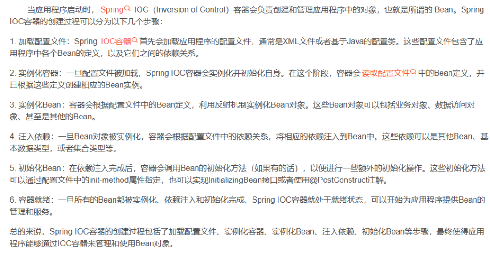

<!-- 原PDF第510页；面经原题号 89 -->

#### mybatis的模板引擎

原文未附答案。

<a id="module-08"></a>

## 08 计算机网络

### 高频题

#### HTTP

##### http和https的区别

HTTP 和 HTTPS 的主要区别：

1. 端口不同： HTTP 默认端口是 80，HTTPS 默认端口是 443。

2. URL 前缀不同： HTTP 是 `http://` ，HTTPS 是 `https://` 。

3. 安全性不同： HTTP 明文传输，数据容易被窃听、篡改；HTTPS 在 HTTP 和 TCP 之间加入SSL/TLS，传输内容会加密。

4. 身份认证不同： HTTP 无法验证通信双方身份；HTTPS 通过数字证书验证服务器身份。

5. 资源消耗不同： HTTPS 需要加解密和证书校验，比 HTTP 更消耗服务器资源。

6. SEO 影响： 搜索引擎通常更倾向 HTTPS 网站，因为安全性更高。

简单来说：

HTTP 是明文传输，不安全。

HTTPS = HTTP + SSL/TLS，解决了加密传输、身份认证和数据完整性问题。

##### https怎样加密？

HTTPS 同时使用了非对称加密和对称加密。

大致过程：

1. 客户端向服务器发起 HTTPS 请求。

2. 服务器返回数字证书，证书中包含服务器公钥。

3. 客户端验证证书是否合法，比如是否由可信 CA 签发、是否过期、域名是否匹配。

4. 客户端生成一个随机密钥，并用服务器公钥加密后发给服务器。

5. 服务器用自己的私钥解密，得到这个随机密钥。

6. 之后客户端和服务器使用这个密钥进行对称加密通信。

为什么要这样设计？

非对称加密安全，但是性能差。

对称加密性能好，但是密钥传输不安全。

所以 HTTPS 用非对称加密来安全交换密钥，后续数据传输使用对称加密。

##### HTTP工作在哪一层？TCP呢？

HTTP 工作在应用层。

TCP 工作在传输层。

常见协议所在层：

1. 应用层：HTTP、HTTPS、DNS、FTP、SMTP。

2. 传输层：TCP、UDP。

3. 网络层：IP、ICMP、ARP。

4. 数据链路层：以太网协议。

5. 物理层：网线、光纤、电信号等。

##### HTTP常见的状态码

1. 1xx

提示信息，表示协议处理中间状态，实际用得比较少。

2. 2xx

表示成功。

a. `200 OK` ：请求成功，最常见。

b. `204 No Content` ：请求成功，但没有响应体。

c. `206 Partial Content` ：部分内容，常用于断点续传或分块下载。

3. 3xx

表示重定向。

a. `301 Moved Permanently` ：永久重定向。

b. `302 Found` ：临时重定向。

c. `304 Not Modified` ：资源未修改，可以使用缓存。

4. 4xx

表示客户端错误。

a. `400 Bad Request` ：请求报文有错误。

b. `401 Unauthorized` ：未认证。

c. `403 Forbidden` ：服务器拒绝访问。

d. `404 Not Found` ：资源不存在。

5. 5xx

表示服务端错误。

a. `500 Internal Server Error` ：服务器内部错误。

b. `502 Bad Gateway` ：网关或代理访问后端服务失败。

c. `503 Service Unavailable` ：服务暂时不可用。

##### GET和POST区别

GET 的语义是获取资源。

POST 的语义是提交数据，让服务器根据请求体进行处理。

区别：

1. GET 参数通常放在 URL 中，POST 参数通常放在请求体中。

2. GET 是安全的，不应该修改服务器资源；POST 可能会修改服务器资源。

3. GET 是幂等的，多次请求结果应该一致；POST 通常不是幂等的。

4. GET 可以被缓存，POST 大多数实现下不缓存。

5. GET 请求长度受浏览器和服务器限制，POST 理论上更适合提交较大数据。

注意：

安全和幂等是语义上的约定，不是技术上强制。

##### 输入url到界面渲染的过程

大致流程：

1. 浏览器解析 URL，确定协议、域名、端口、资源路径。

2. 浏览器先查询缓存，如果缓存可用，可能直接使用缓存。

3. 如果需要访问服务器，浏览器通过 DNS 查询域名对应的 IP 地址。

4. 浏览器根据 IP 和端口，和服务器建立 TCP 连接。

5. 如果是 HTTPS，还需要进行 TLS 握手，完成证书校验和密钥协商。

6. 浏览器在 TCP 连接上发送 HTTP 请求报文。

7. 服务器接收请求，处理业务逻辑，返回 HTTP 响应报文。

8. 浏览器接收响应，解析 HTML。

9. 浏览器继续请求 HTML 中引用的 CSS、JS、图片等资源。

10. 浏览器构建 DOM 树、CSSOM 树，生成渲染树，进行布局和绘制。

11. 页面加载完成后，如果不再通信，可以关闭 TCP 连接，也可以保持长连接复用。

##### DNS解析流程是什么？

DNS 的作用是把域名解析成 IP 地址。

完整流程：

1. 浏览器先查浏览器缓存。

2. 浏览器缓存没有，再查操作系统缓存。

3. 本地没有命中，就请求本地 DNS 服务器。

4. 本地 DNS 服务器如果没有缓存，会向根域名服务器查询。

5. 根域名服务器返回顶级域名服务器地址，比如 `.com` 。

6. 本地 DNS 服务器再向顶级域名服务器查询。

7. 顶级域名服务器返回权威域名服务器地址。

8. 本地 DNS 服务器向权威域名服务器查询，拿到最终 IP。

9. 本地 DNS 服务器把结果返回客户端，并缓存结果。

10. 客户端也会缓存结果，后续相同域名可以直接使用。

#### TCP/UDP

##### osi七层模型及其作用

OSI 七层模型：

a. 物理层： 负责比特流传输，解决 0 和 1 如何在物理介质上传输。

b. 数据链路层： 负责相邻节点之间的数据帧传输，处理 MAC 地址、封帧、差错检测等。

c. 网络层： 负责 IP 地址、路由选择、分组转发。

d. 传输层： 负责端到端通信，比如 TCP、UDP。

e. 会话层： 负责建立、管理和终止会话。

f. 表示层： 负责数据格式转换、编码、压缩、加密等。

g. 应用层： 直接面向应用程序，比如 HTTP、DNS、FTP。

实际学习和面试中，经常会把会话层、表示层、应用层合并为应用层，形成五层模型：

a. 应用层。

b. 传输层。

c. 网络层。

d. 数据链路层。

e. 物理层。

##### TCP和UDP的区别

1. 是否面向连接： TCP 面向连接，传输前需要三次握手；UDP 无连接，直接发送。

2. 是否可靠： TCP 可靠传输，保证数据不丢失、不重复、按序到达；UDP 不保证可靠性。

3. 是否有状态： TCP 需要维护连接状态；UDP 无状态。

4. 传输效率： TCP 有连接、确认、重传、拥塞控制等机制，开销较大；UDP 更轻量，效率更高。

5. 传输形式： TCP 面向字节流；UDP 面向报文。

6. 首部开销： TCP 首部 20 到 60 字节；UDP 首部 8 字节。

7. 通信方式： TCP 只支持点对点；UDP 支持一对一、一对多、多对一、多对多。

使用场景：

1. TCP：HTTP、HTTPS、FTP、SSH、邮件等需要可靠传输的场景。

2. UDP：DNS、直播、视频通话、游戏、QUIC 等更关注实时性的场景。

##### TCP 三次握手和四次挥手

1. 三次握手

建立 TCP 连接需要三次握手。

a. 第一次握手：客户端发送 SYN 报文给服务端，表示想建立连接，客户端进入 `SYN_SENT`  状态。

b. 第二次握手：服务端收到 SYN 后，回复 SYN + ACK 报文，服务端进入 `SYN_RECV`  状态。

c. 第三次握手：客户端收到 SYN + ACK 后，回复 ACK 报文，客户端和服务端都进入`ESTABLISHED`  状态。

三次握手的目的：

确认双方的发送能力和接收能力都正常。

第一次握手后，服务端确认客户端发送正常、自己接收正常。

第二次握手后，客户端确认自己发送接收正常、服务端发送接收正常。

第三次握手后，服务端确认自己发送正常、客户端接收正常。

2. 四次挥手

断开 TCP 连接需要四次挥手。

a. 第一次挥手：主动关闭方发送 FIN，表示自己不再发送数据。

b. 第二次挥手：被动关闭方收到 FIN 后，回复 ACK，表示收到关闭请求。

c. 第三次挥手：被动关闭方数据发送完后，也发送 FIN，表示自己也准备关闭。

d. 第四次挥手：主动关闭方收到 FIN 后，回复 ACK，然后进入 `TIME_WAIT`  状态，等待 2MSL后关闭。

口诀：

三次握手：SYN、SYN + ACK、ACK。

四次挥手：FIN、ACK、FIN、ACK。

##### 为什么握手是三次，不是两次？

主要有两个原因：

1. 防止历史连接。

2. 确保双方初始序列号能够可靠同步。

如果只有两次握手，服务端收到一个网络中滞留的历史 SYN 报文后，就可能直接建立连接，浪费服务端资源。

另外，两次握手时，服务端无法确认客户端是否收到了自己的 SYN + ACK，也就无法确认自己的发送能力和客户端的接收能力是否正常。

所以三次握手是为了保证双方收发能力都被确认，同时避免历史连接造成资源浪费。

##### 为什么挥手需要四次，而握手只需三次？

核心原因是 TCP 是全双工通信。

双方各自都有发送通道和接收通道。

建立连接时，服务端可以把 SYN 和 ACK 合并在一个报文中，所以三次就够。

断开连接时，主动方发送 FIN 只表示自己不再发送数据了，但还可以接收数据。

被动方收到 FIN 后，可能还有数据没发完，所以只能先回复 ACK。

等被动方数据发送完毕后，再单独发送 FIN。

所以通常需要四次挥手。

如果被动方收到 FIN 时没有数据要发送，也可能把 ACK 和 FIN 合并，四次挥手退化成三次。

##### TIME_WAIT是什么？为什么要等待2MSL？

`TIME_WAIT`  是主动关闭连接的一方在四次挥手最后进入的状态。

客户端发送最后一个 ACK 后，不会立刻关闭，而是等待 2MSL。

原因：

1. 防止最后一个 ACK 丢失。

如果最后一个 ACK 丢失，服务端会重发 FIN。

客户端在 `TIME_WAIT`  状态下还能收到重发的 FIN，并重新发送 ACK。

2. 让旧连接中的历史报文在网络中自然消失。

等待 2MSL 后，可以避免旧连接的延迟报文影响新连接。

MSL 是 Maximum Segment Lifetime，表示报文在网络中的最大生存时间。

2MSL 可以理解为一个报文发送和一个回复所需的最大时间。

##### 服务器上很多TIME_WAIT是什么意思？会带来什么后果？怎么解决？

大量 `TIME_WAIT`  通常出现在高并发短连接场景。

原因：

1. 短连接频繁建立和关闭。

2. 服务器主动关闭连接。

3. 高并发下连接数量太多。

后果：

1. 占用端口资源。

2. 占用一定 fd、内存和 CPU。

3. 极端情况下端口耗尽，无法建立新连接。

解决方案：

1. 改短连接为长连接，减少连接频繁关闭。

2. 使用 HTTP/1.1 Keep-Alive 或 HTTP/2。

3. 尽量让客户端主动关闭连接，把 `TIME_WAIT`  分散到客户端。

4. 合理调整系统内核参数，例如开启端口复用等。

##### TCP保证可靠性的原理

TCP 可靠性主要由以下机制保证：

1. 三次握手和四次挥手： 保证连接可靠建立和释放。

2. 序列号机制： 每个字节都有序列号，接收方可以按序重组数据。

3. 确认应答机制： 接收方收到数据后返回 ACK。

4. 超时重传： 数据包丢失或 ACK 丢失时，发送方超时后重传。

5. 快速重传： 连续收到重复 ACK 时，不等超时，直接重传丢失数据。

6. 流量控制： 根据接收方接收窗口控制发送速率，避免接收方缓冲区溢出。

7. 拥塞控制： 根据网络拥塞情况控制发送速率，避免把网络打爆。

##### TCP的流量控制是由发送方和接收方哪一方来控制的，同问TCP的拥塞控制

流量控制和拥塞控制最终都是由发送方控制发送速率。

1. 流量控制

流量控制关注的是接收方能不能接收得过来。

接收方会通过 TCP 头部的接收窗口字段告诉发送方：自己还能接收多少数据。

发送方根据接收窗口大小调整发送速率，避免接收方缓冲区溢出。

2. 拥塞控制

拥塞控制关注的是网络能不能承受当前发送速度。

发送方根据网络拥塞情况动态调整拥塞窗口。

常见算法：

a. 慢启动。

b. 拥塞避免。

c. 快速重传。

d. 快速恢复。

##### 介绍一下慢启动（拥塞控制算法）

慢启动是 TCP 拥塞控制的一部分。

刚开始建立连接时，发送方不会一上来就发送大量数据，而是从较小的拥塞窗口开始。

每经过一个 RTT，如果没有发生拥塞，拥塞窗口会指数增长。

当拥塞窗口达到慢启动阈值后，就进入拥塞避免阶段。

拥塞避免阶段不再指数增长，而是线性增长。

如果发生丢包：

1. 如果是超时重传，说明网络拥塞比较严重，会把拥塞窗口降到 1，重新慢启动。

2. 如果收到 3 个重复 ACK，会触发快速重传和快速恢复，拥塞窗口通常减半，然后线性增长。

##### TCP粘包问题详解和解决方案

TCP 是面向字节流的协议，没有消息边界。

所以应用层发送的多条消息，接收方可能一次读到多条，也可能一条消息被拆成多次读到。

这就是粘包和拆包问题。

产生原因：

a. TCP 本身只保证字节流顺序，不知道上层消息边界。

b. 发送端可能把多个小包放到缓冲区合并发送。

c. 接收端可能一次从缓冲区读取多个包。

d. 数据包太大时，也可能被拆成多个包。

解决方案：

a. 固定消息长度。

b. 使用特殊分隔符，例如换行符。

c. 消息头中携带消息长度，接收方先读长度，再按长度读消息体。

d. 使用标准应用层协议，例如 HTTP、WebSocket、Protobuf 等。

注意：

UDP 是面向数据报的，有消息边界，一般没有 TCP 这种粘包拆包问题。

##### 有哪些协议是基于TCP的？

常见基于 TCP 的协议：

1. HTTP。

2. HTTPS。

3. FTP。

4. SMTP。

5. POP3。

6. IMAP。

7. SSH。

这些协议通常需要可靠传输，所以选择 TCP。

##### TCP和UDP可以使用同一个端口吗？

可以。

因为端口是否冲突，不只看端口号，还要看协议类型。

一个网络连接或监听通常由 IP、端口、协议共同确定。

TCP 80 和 UDP 80 是不同的协议空间，所以可以同时存在。

典型例子是 DNS。

DNS 通常使用 UDP 53 端口进行查询，但响应数据过大或需要可靠传输时，也可能使用 TCP 53 端口。

### 扩展题

#### HTTP

##### HTTP是什么？

HTTP 是超文本传输协议。

它是应用层协议，主要用于客户端和服务端之间传输超文本数据。

HTTP 是请求-响应模型。

客户端发送 HTTP 请求，服务端处理后返回 HTTP 响应。

HTTP 本身是无状态的。

也就是说，协议本身不会保存客户端和服务端之间的历史状态。

如果需要保存登录状态，通常需要 Cookie、Session、Token 等机制。

##### HTTP/1.0、HTTP/1.1、HTTP/2、HTTP/3演进

1. HTTP/1.0

HTTP/1.0 默认短连接。

每次请求都要建立 TCP 连接，请求完成后关闭连接。

缺点是频繁建立和关闭连接，开销大。

2. HTTP/1.1

HTTP/1.1 默认支持长连接，也就是 Keep-Alive。

多个请求可以复用同一个 TCP 连接。

同时支持管道化请求，但响应仍然需要按顺序返回，所以仍然有队头阻塞问题。

3. HTTP/2

HTTP/2 基于 TCP。

主要优化：

a. 二进制帧。

b. 头部压缩，使用 HPACK。

c. 多路复用，一个 TCP 连接上可以并发多个 Stream。

d. 服务器推送。

HTTP/2 解决了 HTTP 应用层队头阻塞。

但是因为它仍然基于 TCP，如果 TCP 层发生丢包，所有 Stream 都会被阻塞，所以仍然有 TCP 层队头阻塞。

4. HTTP/3

HTTP/3 基于 QUIC，QUIC 基于 UDP。

主要优化：

a. 减少队头阻塞。

b. 连接建立更快，可以 1-RTT，甚至会话恢复时 0-RTT。

c. 支持连接迁移。

d. 集成 TLS 加密。

##### Http1.1和2.0的区别

HTTP/2 相比 HTTP/1.1 主要有以下改进：

1. 多路复用： HTTP/2 在同一个 TCP 连接上可以同时传输多个请求和响应，不同请求通过 Stream 区分。

2. 二进制帧： HTTP/1.1 使用文本格式，HTTP/2 使用二进制帧，解析更高效。

3. 头部压缩： HTTP/2 使用 HPACK 压缩头部，减少重复 Header 传输。

4. 服务器推送： 服务端可以主动推送客户端可能需要的资源。

HTTP/1.1 虽然支持长连接，但同一个连接上的请求和响应仍有顺序限制。

如果前面的请求响应慢，后面的请求可能被阻塞。

HTTP/2 通过多路复用改善了这个问题。

##### HTTP/2有什么缺陷？

HTTP/2 解决了 HTTP 应用层队头阻塞，但没有解决 TCP 层队头阻塞。

HTTP/2 多个 Stream 复用同一个 TCP 连接。

TCP 是可靠字节流，要求数据按序交付。

如果某个 TCP 包丢失，后面已经到达的数据也不能交给应用层，必须等丢失的包重传回来。

这样一个包丢失，就会阻塞这个 TCP 连接上的所有 HTTP/2 Stream。

所以 HTTP/2 的队头阻塞发生在 TCP 层。

##### HTTP/3做了哪些优化？

HTTP/3 把底层传输从 TCP 换成了基于 UDP 的 QUIC。

QUIC 主要特点：

1. 无队头阻塞： QUIC 中不同 Stream 相互独立，某个流丢包只影响该流，不影响其他流。

2. 连接建立更快： QUIC 集成 TLS 1.3，新连接通常 1-RTT，恢复连接可以 0-RTT。

3. 连接迁移： QUIC 用连接 ID 标识连接，不依赖 TCP 四元组。网络从 Wi-Fi 切到 4G，只要连接 ID 不变，就可以继续复用连接。

4. 应用层实现可靠传输： QUIC 基于 UDP，但自己实现了重传、拥塞控制、流量控制等能力。简单说：

QUIC 是基于 UDP 的伪 TCP + TLS + HTTP/2 多路复用协议。

##### QUIC为什么基于UDP？

QUIC 基于 UDP 的原因：

1. UDP 在操作系统内核中实现简单，不像 TCP 那样被固定协议栈限制。

2. 在 UDP 之上，QUIC 可以在应用层实现可靠传输、拥塞控制、流量控制和多路复用。

3. 协议升级更灵活，不需要等待操作系统内核升级。

4. 可以绕开 TCP 队头阻塞问题。

但是 QUIC 也有问题。

因为很多网络设备只认识 TCP/UDP，不认识 QUIC。

部分网络设备可能会限制或丢弃 UDP 包，影响 QUIC 的普及。

##### HTTPS完整握手过程

HTTPS 加密过程可以分为以下阶段：

1. 客户端发起 HTTPS 请求，发送支持的 TLS 版本、支持的加密算法、客户端随机数。

2. 服务端返回选择的 TLS 版本、加密算法、服务端随机数和数字证书。

3. 客户端校验证书，检查证书是否由可信 CA 签发、是否过期、域名是否匹配。

4. 客户端生成预主密钥，并使用服务器证书中的公钥加密后发送给服务端。

5. 服务端使用自己的私钥解密，得到预主密钥。

6. 双方基于客户端随机数、服务端随机数、预主密钥生成会话密钥。

7. 后续通信使用会话密钥进行对称加密。

注意：

非对称加密主要用于安全交换密钥。

对称加密主要用于后续大量数据传输。

##### HTTP是无状态的，怎么保持登录状态？

HTTP 本身无状态。

保持登录状态通常有几种方式：

1. Cookie + Session。

2. Token。

3. JWT。

Cookie + Session：

服务端保存 Session，客户端保存 SessionId。

Token：

服务端签发 Token，客户端请求时携带 Token，服务端校验。

JWT：

Token 中包含用户信息和签名，服务端可以通过签名校验是否被篡改。

##### Cookie、Session、Token区别

1. Cookie

Cookie 是浏览器保存的一小段数据。

服务端可以通过响应头 `Set-Cookie`  让浏览器保存 Cookie。

后续请求同域名时，浏览器会自动带上 Cookie。

Cookie 常用于保存会话标识。

2. Session

Session 是服务端保存的会话数据。

服务端会为用户生成一个 SessionId，并通过 Cookie 返回给浏览器。

浏览器后续请求带上 SessionId，服务端根据 SessionId 找到对应 Session 数据。

缺点是服务端需要保存状态，分布式场景下需要解决 Session 共享问题。

3. Token

Token 通常是服务端签发的一段令牌，客户端保存后，每次请求放在 Header 中。

服务端验证 Token 合法性。

JWT 是常见 Token 形式。

Token 更适合前后端分离和分布式系统。

##### WebSocket是什么？

WebSocket 是一种全双工通信协议。

它允许客户端和服务端在一条连接上进行双向实时通信。

HTTP 通常是请求-响应模型，客户端请求一次，服务端响应一次。

WebSocket 建立连接后，服务端也可以主动向客户端推送消息。

使用场景：

1. 即时聊天。

2. 在线游戏。

3. 实时行情。

4. 消息通知。

5. 协同编辑。

WebSocket 连接建立时会先通过 HTTP 发起升级请求，然后切换为 WebSocket 协议。

#### TCP/UDP

##### TCP拥塞控制详细说一下

TCP 拥塞控制主要有四个阶段：慢启动、拥塞避免、快速重传、快速恢复。

1. 慢启动

初始拥塞窗口比较小。

每经过一个 RTT，如果没有丢包，拥塞窗口指数增长。

2. 拥塞避免

当拥塞窗口达到慢启动阈值后，进入拥塞避免阶段。

此时拥塞窗口不再指数增长，而是线性增长。

3. 快速重传

如果发送方连续收到三个重复 ACK，说明有数据包可能丢失。

发送方不等超时，直接重传丢失的数据包。

4. 快速恢复

发生快速重传后，说明网络可能只是轻微拥塞。

此时一般把拥塞窗口减半，然后进入线性增长，而不是直接回到 1。

如果是超时重传，则说明拥塞更严重，会把拥塞窗口降到 1，重新慢启动。

##### TCP流量控制和拥塞控制区别

流量控制关注的是接收方。

它防止发送方发送太快，导致接收方缓冲区溢出。

实现方式是接收窗口 `rwnd` 。

拥塞控制关注的是网络。

它防止发送方发送太快，导致网络拥塞、丢包、延迟升高。

实现方式是拥塞窗口 `cwnd` 。

发送方实际可发送的数据量通常受两者共同限制：

```text
发送窗口 = min(rwnd, cwnd)
```

##### TCP为什么是面向字节流的？

TCP 不关心应用层消息边界。

应用层写入的数据会被 TCP 当成一串连续的字节流处理。

TCP 只负责可靠、有序地把这些字节交给对端。

所以接收方读到的数据，可能是一条应用消息的一部分，也可能是多条应用消息合并后的结果。

这就是粘包和拆包问题的根源。

如果应用层需要消息边界，就必须自己设计协议。

##### TCP Nagle算法

Nagle 算法用于减少网络中小包数量。

它的思想是：

如果有未确认的数据包，后续小数据先放在缓冲区里，不立刻发送。

等收到 ACK，或者积累到足够多的数据后，再一起发送。

好处：

减少小包数量，提高网络利用率。

缺点：

可能增加延迟。

对于低延迟场景，比如实时通信、游戏、RPC，有时会关闭 Nagle 算法，也就是设置`TCP_NODELAY` 。

##### 四次挥手会退化成三次吗？

会。

常见两种情况：

1. 双方同时关闭连接。

双方几乎同时发送 FIN。

收到对方 FIN 后，双方直接回复 ACK，交互次数可能少于标准四次。

2. 被动关闭方没有数据要发送。

被动关闭方收到 FIN 后，如果没有待发送数据，可以把 ACK 和自己的 FIN 合并成一个 FIN + ACK 报文。

这样四次挥手就变成：

FIN -> FIN + ACK -> ACK。

##### CLOSE_WAIT过多是什么原因？

`CLOSE_WAIT`  出现在被动关闭连接的一方。

当服务端收到客户端 FIN 后，会回复 ACK，然后进入 `CLOSE_WAIT` 。

正常情况下，应用程序应该调用 close 关闭连接，随后发送 FIN。

如果服务器上出现大量 `CLOSE_WAIT` ，通常说明应用程序没有及时关闭 socket。

常见原因：

1. 代码没有正确关闭连接。

2. 连接池资源没有释放。

3. 业务线程阻塞，导致迟迟无法 close。

4. 程序异常导致关闭逻辑没有执行。

解决思路：

检查代码中连接关闭逻辑，确保在 `finally`  中释放连接。

##### ARP协议是什么？

ARP 全称 Address Resolution Protocol，地址解析协议。

它的作用是把 IP 地址解析成 MAC 地址。

在局域网中发送数据时，最终需要知道下一跳设备的 MAC 地址。

流程：

1. 主机知道目标 IP，但不知道目标 MAC。

2. 主机在局域网中广播 ARP 请求，询问谁拥有这个 IP。

3. 目标主机收到后，返回自己的 MAC 地址。

4. 发送方把 IP 和 MAC 的映射缓存起来，后续直接使用。

##### IP报文和MAC帧分别解决什么问题？

IP 解决的是跨网络的寻址和路由问题。

也就是数据应该发到哪个目标 IP，以及经过哪些路由器转发。

MAC 解决的是局域网内相邻节点之间的传输问题。

也就是数据在当前链路上应该交给哪个网卡。

简单说：

IP 负责远程定位。

MAC 负责下一跳传输。

##### Socket是什么？

Socket 可以理解为网络通信的端点。

它通常由 IP、端口、协议组成。

两个进程如果想通过网络通信，就可以通过 Socket 建立连接或发送数据。

常见 Socket 通信方式：

1. 基于 TCP 的 Socket。

2. 基于 UDP 的 Socket。

3. 本地进程间通信 Socket。

在 Java 中，可以使用 `Socket` 、`ServerSocket` 、`DatagramSocket`  等类进行网络编程。

##### select、poll、epoll有什么区别？

select、poll、epoll 都是 IO 多路复用机制。

1. select

select 使用固定大小的位图保存文件描述符集合。

每次调用都需要把 fd 集合从用户态拷贝到内核态。

内核需要遍历 fd 集合查找就绪事件。

缺点是 fd 数量有限，且每次都要遍历。

2. poll

poll 使用链表或数组结构保存 fd，没有 select 固定大小限制。

但是 poll 仍然需要每次把 fd 集合拷贝到内核，并遍历查找就绪事件。

3. epoll

epoll 在内核中维护红黑树保存关注的 fd。

同时维护就绪事件链表。

新增、删除、修改 fd 通过 `epoll_ctl()` 。

等待事件通过 `epoll_wait()` 。

当有事件发生时，内核把就绪 fd 放入就绪链表，用户态直接获取就绪事件，不需要每次遍历全部 fd。

所以 epoll 更适合高并发连接场景，是解决 C10K 问题的重要机制。

##### epoll的LT和ET模式区别

LT 是水平触发。

只要 fd 上还有数据没读完，`epoll_wait()`  就会一直通知。

优点是编程简单，不容易漏事件。

ET 是边缘触发。

只有 fd 状态发生变化时才通知一次。

如果收到通知后没有一次性把数据读完，后续可能不会再次通知。

所以 ET 模式下通常需要配合非阻塞 IO，并循环读到 `EAGAIN` 。

ET 性能更高，但编程复杂度更高。

##### CDN是什么？

CDN 全称是 Content Delivery Network，内容分发网络。

它把静态资源分发到离用户更近的边缘节点。

用户访问资源时，会就近访问 CDN 节点，而不是直接访问源站。

好处：

1. 降低访问延迟。

2. 减轻源站压力。

3. 提升静态资源下载速度。

4. 提高可用性。

常见适合 CDN 的资源：

图片、视频、CSS、JS、安装包等静态资源。

#### 网络扩展中容易混淆的点

1. HTTP 是应用层协议，TCP 是传输层协议。

2. HTTPS 不是新协议，本质是 HTTP + SSL/TLS。

3. HTTPS 数据传输主要用对称加密，非对称加密主要用于交换密钥。

4. TCP 是面向字节流，UDP 是面向报文。

5. TCP 粘包不是 TCP 的缺陷，而是应用层没有处理消息边界。

6. 流量控制看接收方能力，拥塞控制看网络拥塞情况。

7. 主动关闭连接的一方进入 TIME_WAIT。

8. CLOSE_WAIT 多通常是应用程序没有正确关闭连接。

9. HTTP/2 解决了 HTTP 层队头阻塞，但仍有 TCP 层队头阻塞。

10. HTTP/3 基于 QUIC，QUIC 基于 UDP，但自己实现了可靠传输。

### 后端面经与场景补充

<!-- 原PDF第474页；面经原题号 5 -->

#### io多路复用的边界问题

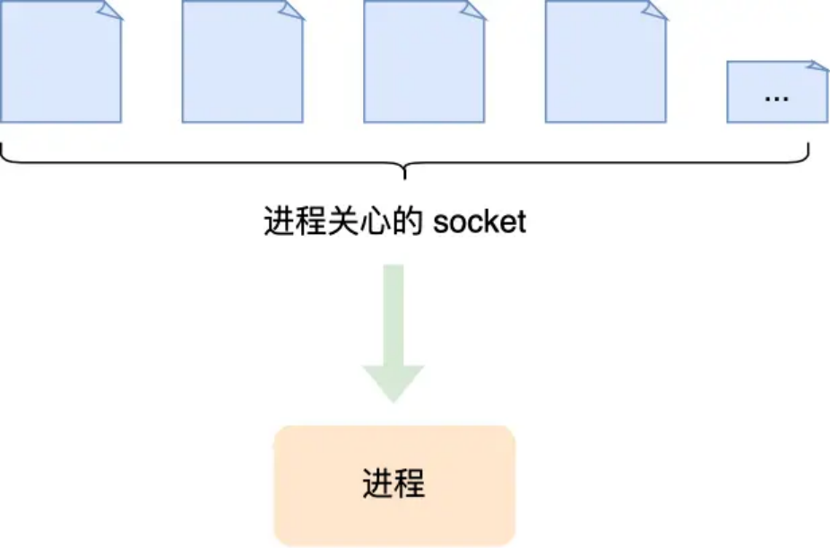

一个进程虽然任一时刻只能处理一个请求，但是处理每个请求的事件时，耗时控制在 1 毫秒以内，这样 1 秒内就可以处理上千个请求，把时间拉长来看，多个请求复用了一个进程，这就是多路复用，这种思想很类似一个 CPU 并发多个进程，所以也叫做时分多路复用。

我们熟悉的 select/poll/epoll 内核提供给用户态的多路复用系统调用，进程可以通过一个系统调用函数从内核中获取多个事件。

select/poll/epoll 是如何获取网络事件的呢？在获取事件时，先把所有连接（文件描述符）传给内核，再由内核返回产生了事件的连接，然后在用户态中再处理这些连接对应的请求即可。

select/poll

select 实现多路复用的方式是，将已连接的 Socket 都放到一个文件描述符集合, 然后调用 select 函数将文件描述符集合拷贝到内核里，让内核来检查是否有网络事件产生，检查的方式很粗暴，就是通过遍历文件描述符集合的方式，当检查到有事件产生后，将此 Socket 标记为可读或可写， 接着再把整个文件描述符集合拷贝回用户态里，然后用户态还需要再通过遍历的方法找到可读或可写的 Socket，然后再对其处理。

所以，对于 select 这种方式，需要进行 2 次「遍历」文件描述符集合，一次是在内核态里，一个次是在用户态里 ，而且还会发生 2 次「拷贝」文件描述符集合，先从用户空间传入内核空间，由内核修改后，再传出到用户空间中。

select 使用固定长度的 BitsMap，表示文件描述符集合，而且所支持的文件描述符的个数是有限制的，在 Linux 系统中，由内核中的 FD_SETSIZE 限制， 默认最大值为 `1024` ，只能监听 0~1023 的文件描述符。

poll 不再用 BitsMap 来存储所关注的文件描述符，取而代之用动态数组，以链表形式来组织，突破了select 的文件描述符个数限制，当然还会受到系统文件描述符限制。

但是 poll 和 select 并没有太大的本质区别，都是使用「线性结构」存储进程关注的 Socket 集合，因此都需要遍历文件描述符集合来找到可读或可写的 Socket，时间复杂度为 O(n)，而且也需要在用户态与内核态之间拷贝文件描述符集合，这种方式随着并发数上来，性能的损耗会呈指数级增长。

Epoll

epoll 通过两个方面，很好解决了 select/poll 的问题。

第一点，epoll 在内核里使用红黑树来跟踪进程所有待检测的文件描述字，把需要监控的 socket 通过`epoll_ctl()`  函数加入内核中的红黑树里，红黑树是个高效的数据结构，增删改一般时间复杂度是 `O(logn)` 。而 select/poll 内核里没有类似 epoll 红黑树这种保存所有待检测的 socket 的数据结构，所以 select/poll 每次操作时都传入整个 socket 集合给内核，而 epoll 因为在内核维护了红黑树，可以保存所有待检测的 socket ，所以只需要传入一个待检测的 socket，减少了内核和用户空间大量的数据拷贝和内存分配。

第二点， epoll 使用事件驱动的机制，内核里维护了一个链表来记录就绪事件，当某个 socket 有事件发生时，通过回调函数内核会将其加入到这个就绪事件列表中，当用户调用 `epoll_wait()`  函数时，只会返回有事件发生的文件描述符的个数，不需要像 select/poll 那样轮询扫描整个 socket 集合，大大提高了检测的效率。

从下图可以看到 epoll 相关的接口作用：

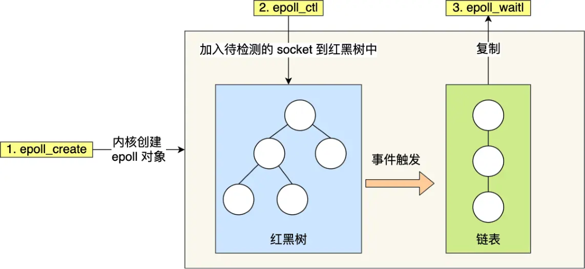

epoll 的方式即使监听的 Socket 数量越多的时候，效率不会大幅度降低，能够同时监听的 Socket 的数目也非常的多了，上限就为系统定义的进程打开的最大文件描述符个数。因而，epoll 被称为解决C10K 问题的利器。

边缘触发和水平触发（换个问法，io多路复用的边界条件）

epoll 支持两种事件触发模式，分别是边缘触发（edge-triggered，ET）和水平触发（level-triggered，LT）。

- 使用边缘触发模式时，当被监控的 Socket 描述符上有可读事件发生时，服务器端只会从epoll_wait 中苏醒一次，即使进程没有调用 read 函数从内核读取数据，也依然只苏醒一次，因此我们程序要保证一次性将内核缓冲区的数据读取完；

- 使用水平触发模式时，当被监控的 Socket 上有可读事件发生时，服务器端不断地从 epoll_wait 中苏醒，直到内核缓冲区数据被 read 函数读完才结束，目的是告诉我们有数据需要读取；

举个例子，你的快递被放到了一个快递箱里，如果快递箱只会通过短信通知你一次，即使你一直没有去取，它也不会再发送第二条短信提醒你，这个方式就是边缘触发；如果快递箱发现你的快递没有被取出，它就会不停地发短信通知你，直到你取出了快递，它才消停，这个就是水平触发的方式。

这就是两者的区别，水平触发的意思是只要满足事件的条件，比如内核中有数据需要读，就一直不断地把这个事件传递给用户；而边缘触发的意思是只有第一次满足条件的时候才触发，之后就不会再传递同样的事件了。

如果使用水平触发模式，当内核通知文件描述符可读写时，接下来还可以继续去检测它的状态，看它是否依然可读或可写。所以在收到通知后，没必要一次执行尽可能多的读写操作。

如果使用边缘触发模式，I/O 事件发生时只会通知一次，而且我们不知道到底能读写多少数据，所以在收到通知后应尽可能地读写数据，以免错失读写的机会。因此，我们会循环从文件描述符读写数据，那么如果文件描述符是阻塞的，没有数据可读写时，进程会阻塞在读写函数那里，程序就没办法继续往下执行。所以，边缘触发模式一般和非阻塞 I/O 搭配使用，程序会一直执行 I/O 操作，直到系统调用（如 `read`  和 `write` ）返回错误，错误类型为 `EAGAIN`  或 `EWOULDBLOCK` 。

一般来说，边缘触发的效率比水平触发的效率要高，因为边缘触发可以减少 epoll_wait 的系统调用次数，系统调用也是有一定的开销的的，毕竟也存在上下文的切换。

select/poll 只有水平触发模式，epoll 默认的触发模式是水平触发，但是可以根据应用场景设置为边缘触发模式。

<!-- 原PDF第484页；面经原题号 29 -->

#### tcp为什么是三次握手，四次挥手

原文未附答案。

<!-- 原PDF第484页；面经原题号 30 -->

#### 我现在把三次改为两次会有什么问题

a. 连接可靠性降低：三次握手的第三次确认是确保双方都接收到对方的连接请求和确认。如果取消这个步骤，可能会导致双方对连接状态的不同步，从而影响连接的可靠性。

b. 防止旧连接请求：三次握手有助于防止旧的重复连接请求干扰新的连接。如果改为两次握手，可能无法有效区分旧的连接请求，从而导致数据错乱或连接错误。

i. SYN请求：客户端发送一个SYN（同步序列号）请求，表示希望建立连接，并包含一个初始序列号。

ii. SYN-ACK响应：服务器收到SYN请求后，发送一个SYN-ACK（同步序列号-确认序列号）响应，表示接受连接请求，并包含自己的初始序列号和对客户端SYN的确认。

iii. ACK确认：客户端收到SYN-ACK响应后，发送一个ACK（确认序列号）确认，表示已收到服务器的SYN-ACK响应，并确认序列号。

如果网络中存在旧的SYN请求，这些请求可能会被服务器误认为是新的连接请求，导致服务器发送SYN-ACK响应。这时，客户端可能无法正确区分新的SYN-ACK响应和旧的SYN-ACK响应，导致连接状态混乱。

c. 安全性问题：三次握手有助于抵御某些类型的网络攻击，如SYN洪水攻击。减少握手次数可能会使系统更容易受到攻击。

- SYN洪水攻击是一种拒绝服务攻击（DoS攻击）的变种。在这种攻击中，攻击者发送大量的SYN请求，但不完成后续的握手过程（即不发送ACK确认），企图耗尽服务器的资源。

- 在正常的三次握手过程中，服务器在收到SYN请求之后，会分配资源以保持连接的状态，同时发送一个SYN-ACK响应等待客户端的ACK确认。

- 由于攻击者不发送ACK确认，服务器会保持这些半开放状态的连接一段时间，直到超时，耗尽资源并影响其他合法用户的连接请求。

<!-- 原PDF第484页；面经原题号 31 -->

#### io多路复用模型讲一下，如果我现在有一台服务器比如60000个端口最多建立多少个tcp连接？

a. IP地址和端口组合：

- TCP连接标识是由源IP地址、源端口、目的IP地址和目的端口组合成的四元组。因此，一个服务器上的一个单一目的端口可以与多个不同的源IP地址和源端口组合形成多个唯一的TCP连接。

b. 源端口：

- 客户端发起连接时，会使用一个临时端口作为源端口。通常，这些端口在1到65535的范围内。

- 实际上，客户端端口的使用范围从1024到65535（除去保留的0到1023端口）。

c. 资源限制：

- 除了端口限制，服务器本身的资源，如内存和处理能力，也会影响其能处理的并发连接数量。

- 操作系统的配置和网络堆栈的限制也影响最大并发连接数。

假设服务器能够处理的资源和操作系统配置没有限制，理论上单个端口可以通过不同的源IP和源端口组合建立数百万个连接。例如：如果有很多不同的客户端IP地址和每个客户端可以使用多个源端口，那么，理论上服务器可以支持的同时连接数是这些组合的乘积。

<!-- 原PDF第488页；面经原题号 40 -->

#### 在http链接当中，如果现在线上没有流量了怎么排查

原文未附答案。

<!-- 原PDF第493页；面经原题号 54 -->

#### 边缘触发和水平触发的区别

epoll 支持两种事件触发模式，分别是边缘触发（edge-triggered，ET）和水平触发（level-triggered，LT）。

- 使用边缘触发模式时，当被监控的 Socket 描述符上有可读事件发生时，服务器端只会从epoll_wait 中苏醒一次，即使进程没有调用 read 函数从内核读取数据，也依然只苏醒一次，因此我们程序要保证一次性将内核缓冲区的数据读取完；

- 使用水平触发模式时，当被监控的 Socket 上有可读事件发生时，服务器端不断地从epoll_wait 中苏醒，直到内核缓冲区数据被 read 函数读完才结束，目的是告诉我们有数据需要读取；

<!-- 原PDF第493页；面经原题号 55 -->

#### 还熟悉别的io多路复用比较先进的模型么

原文未附答案。

<!-- 原PDF第493页；面经原题号 56 -->

#### 当一个tcp端口的某一个服务正常结束的时候为什么在短时间内另一个服务想用tcp监听这个端口是不可以监听的

当一个TCP端口上的服务正常结束后，短时间内另一个服务如果尝试绑定（监听）同一个端口，会发现端口“暂时不可用”，通常会收到“Address already in use”（地址已被占用）的错误。这是因为TCP协议的TIME_WAIT状态导致的。

<!-- 原PDF第493页；面经原题号 57 -->

#### linux内核当中有哪些命令可以立马复用对应的端口

在 Linux 系统中，“立马复用端口”其实是通过设置 socket 选项来实现的，不是通过普通的 shell命令直接完成。主要涉及到以下两个 socket 选项：

SO_REUSEADDR

- 作用：允许在端口处于 TIME_WAIT 状态时，新的进程可以立即绑定并复用该端口。

- 使用场景：服务重启时，避免因 TIME_WAIT 导致“Address already in use”错误。

- 设置方法（在代码中）：

```text
1int yes = 1;2setsockopt(sock, SOL_SOCKET, SO_REUSEADDR, &yes, sizeof(yes));3
```

SO_REUSEPORT（Linux 3.9及以上内核支持）

- 作用：允许多个进程/线程同时监听同一个端口，实现负载均衡和高可用。

- 使用场景：多进程服务器（如 Nginx、Redis cluster）并发监听同一端口。

- 设置方法（在代码中）：

```text
1c 2int yes = 1;3setsockopt(sock, SOL_SOCKET, SO_REUSEPORT, &yes, sizeof(yes));
```

<!-- 原PDF第496页；面经原题号 60 -->

#### 发1MB的文件大小给客户端要一次性发完并且要用尽可能少的io次数并且时间要快这种用tcp还是udp

TCP 与 UDP 的基本区别

- TCP

    - 面向连接，可靠传输（丢包重传、顺序保证、无重复）

    - 支持流式传输，可以一次`send` 写入大块数据，底层自动分片、重组

    - 会有一定的握手/挥手、流控、拥塞控制等开销

- UDP

    - 面向无连接，不保证可靠性（可能丢包、乱序、重复）

    - 每次`sendto` 最大只能发一个UDP包（通常最大64KB，实际受MTU限制，通常不超过1500字节）

    - 程序需要自己处理分片、重组、丢包重传等机制

1）一次性发完、IO次数少

- TCP：可以一次`send`  1MB，操作系统底层会自动分片并通过多次底层IO（不可见）发送，应用层只需一次系统调用。

- UDP：理论上单个UDP包最大64KB，实际受限于网络MTU（一般不超过1500字节）。1MB需要分成很多小包，应用层要做多次`sendto` ，IO次数多。

2）时间要快

- TCP：虽然有握手、流控，但一次`send` 大文件时，通常速度更快且可靠。

- UDP：单包发很快，但大文件需要拆包多次，且丢包重传会拖慢整体速度。

3）可靠性

- TCP：天然可靠，保证数据完整到达且顺序正确。

- UDP：不保证可靠性，丢包、乱序都可能发生，1MB大文件基本不适合用UDP裸发。应该选择TCP。

- 只需一次`send` 调用，操作系统自动分片，客户端可以一次性完整、可靠地收到1MB文件。

- UDP不适用于大文件的可靠、高效传输，除非你自己实现复杂的分片、重传、校验等机制（这实际上就是TCP的功能）。

<!-- 原PDF第496页；面经原题号 61 -->

#### nginx使用多进程模型，会监听同一个端口，多进程监听同一个端口的时候数据包是怎么分配的，不同的进程会分配到同一个数据包么

Nginx 采用主进程+多个工作进程（worker）的多进程模型。所有 worker 进程都监听同一个端口（比如 80 或 443），以实现高并发和负载均衡。

所有 worker 进程都会继承主进程创建并绑定好的监听 socket（文件描述符）。

在 Linux 下，常见的做法是主进程先`bind()` 端口，然后 fork 出 worker，worker 继承监听socket。

现代 Linux（3.9+）还可以通过 `SO_REUSEPORT`  让每个进程自己 bind 同一个端口（Nginx

1. 9.1+ 支持）。

数据包的分配机制

不使用 SO_REUSEPORT（传统模式）

- 所有 worker 进程共享同一个监听 socket。

- 当有新的连接到达时，内核只会把同一个连接请求交给其中一个 worker 进程，不会多个进程同时处理同一个连接。

- 内核采用“惊群（thundering herd）”唤醒机制：所有进程都被唤醒尝试`accept()` ，但只有一个进程能成功，其余进程`accept()` 返回失败（EAGAIN），再继续等待。

- 同一个数据包（连接）绝不会被多个进程同时处理。

使用 SO_REUSEPORT（现代高性能模式）

- 每个 worker 进程都有独立的监听 socket，但都绑定同一个端口。

- 内核会根据负载等策略（如轮询、哈希等）将新连接分配给某一个 worker 进程的 socket。

- 同一个连接只会被一个进程处理，不会被多个进程重复处理。

总结

- 多进程监听同一个端口时，单个数据包/连接只会被分配给一个进程，不会被多个进程同时处理。

- 传统模式下，所有进程共享一个监听 socket，靠内核同步保证不会重复处理。

- SO_REUSEPORT 模式下，内核直接负责分配，效率更高，避免“惊群”问题。

<!-- 原PDF第500页；面经原题号 71 -->

#### TCP当中服务端出现大量的close wait状态怎么解决

大量 CLOSE_WAIT  的根本原因是：服务端程序在收到客户端的关闭请求（FIN）后，未能及时调用close()  关闭套接字。

解决方法：

解决的核心是找到并修复服务端代码中未能正确关闭连接的地方。

- 检查代码逻辑，确保资源释放：

    - 查找 `accept()`  对应的 `close()` ： 确保每一个通过 `accept()`  创建的客户端连接套接字（socket），在处理完请求或发生异常后，都必须被 `close()` 。

    - 检查异常处理路径： 这是最常见的问题所在。当处理请求过程中发生异常（如网络错误、数据库超时、空指针、业务逻辑异常等）时，代码可能会跳过正常的 `close()`  调用。确保在`try-catch-finally`  块的 `finally`  部分，或者使用 `try-with-resources`（Java）等自动资源管理机制，来保证 `close()`  一定会被执行。

    - 检查循环和长连接处理： 如果服务端需要维持长连接或在一个循环中处理多个请求，要确保在连接真正需要关闭时（比如收到特定的结束消息、超时、心跳失败等），会明确地调用`close()` 。

    - 检查线程安全： 如果连接由多个线程共享或处理，要确保关闭操作是线程安全的，并且不会被遗漏。

- 引入连接超时机制：

    - 空闲超时 (Idle Timeout)： 为连接设置一个最大空闲时间。如果在该时间内没有数据传输，服务端主动关闭连接。这可以防止因客户端异常退出而未发送 `FIN` ，或者服务端忘记关闭的“僵尸”连接长时间占用资源。

    - 读/写超时 (Read/Write Timeout)： 在 `read()`  或 `write()`  操作上设置超时。如果长时间没有读到数据或写操作阻塞，可以认为连接异常，主动关闭。

    - 总生命周期超时： 限制一个连接从建立到关闭的最长时间。

- 使用连接池或管理器：

    - 使用成熟的连接池框架（如数据库连接池、HTTP连接池）或自己实现连接管理器，可以集中管理连接的创建、使用和销毁，更容易保证连接的正确回收。

<!-- 原PDF第501页；面经原题号 72 -->

#### 在TCP四次挥手的过程当中timewait的值是多少

`TIME_WAIT`  状态的持续时间是 2MSL。一个MSL通常为30秒或60秒。

<!-- 原PDF第511页；面经原题号 91 -->

#### 什么是零拷贝

原文参考：[什么是零拷贝](https://xiaolincoding.com/os/8_network_system/zero_copy.html)

<a id="module-09"></a>

## 09 消息队列

### 高频题

#### 消息队列的作用？

使用消息队列主要记住三个关键词：解耦、异步、削峰填谷。

###### 解耦

在复杂系统中，不同模块之间如果直接互相调用，会导致强耦合。

使用消息队列后，生产者只负责把消息发送到 MQ，不需要关心具体哪个服务来处理。

消费者独立订阅消息并处理，实现调用方和处理方解耦。

###### 异步

有些操作比较耗时，比如发送短信、发送邮件、生成报表、写日志等。

如果同步执行，会阻塞主流程。

使用消息队列后，可以把耗时操作封装成消息丢到队列中，由消费者异步处理，提高主流程响应速度。

###### 削峰填谷

在秒杀、大促等高并发场景，瞬时流量可能远超系统处理能力。

消息队列可以作为缓冲区，把瞬时请求先放进队列中，消费者按照自己的处理能力慢慢消费。

这样可以把瞬时高峰压力平摊到后续一段时间内，提高系统稳定性。

#### 使用消息队列会带来哪些问题？

消息队列虽然能解耦、异步、削峰，但也会引入新的复杂度。

常见问题：

1. 消息丢失。

2. 消息重复消费。

3. 消息顺序性问题。

4. 消息堆积。

5. 系统可用性依赖 MQ。

6. 分布式事务和数据一致性问题。

所以使用 MQ 时，要同时考虑可靠性、幂等性、监控告警、重试机制和降级方案。

#### RabbitMQ如何保证消息不丢失？

RabbitMQ 要保证消息不丢失，主要从生产者、Broker、消费者三个阶段考虑。

###### 生产者阶段

开启生产者确认机制。

生产者发送消息后，RabbitMQ 会返回 confirm。

如果发送失败，可以记录日志、落库或者重试，后续再补偿。

###### Broker阶段

开启持久化功能。

需要保证：

1. 交换机持久化。

2. 队列持久化。

3. 消息持久化。

这样消息在未消费之前，即使 RabbitMQ 重启，也尽量不会丢失。

###### 消费者阶段

开启消费者确认机制。

消费者处理完消息后再 ack。

如果消费者处理过程中宕机，消息没有 ack，RabbitMQ 会重新投递消息。

在 Spring 中可以让 Spring 确认消息处理成功后再完成 ack，同时设置一定的重试次数。

#### RabbitMQ消息的重复消费问题如何解决？

RabbitMQ 出现重复消费的常见原因：

消费者处理完业务后，还没来得及 ack，服务就宕机了。

服务重启后，RabbitMQ 发现消息没有确认，就会重新投递，导致消息被消费两次。

解决方案核心是消费者端做幂等。

常见做法：

1. 使用业务唯一标识，例如订单号、支付流水号、消息 ID。

2. 消费前先查询数据库，判断这条业务是否已经处理过。

3. 如果没处理过，就正常处理并记录处理结果。

4. 如果已经处理过，就直接跳过，不再重复执行。

例如支付场景中，可以用订单号或支付流水号作为唯一标识。

只要数据库中已经有该支付记录，就说明消息已经处理过，不需要再次消费。

#### RabbitMQ中死信交换机是什么？

死信是指无法被正常消费的消息。

消息变成死信的常见原因：

1. 消息被拒绝，例如 `basic.reject`  或 `basic.nack` ，并且设置不重新入队。

2. 消息 TTL 过期。

3. 队列达到最大长度，消息被丢弃。

RabbitMQ 中可以给队列绑定死信交换机。

当消息变成死信后，会被投递到死信交换机，再路由到死信队列，最后由特殊消费者处理。

流程：

生产者 -> 原始队列 -> 消息成为死信 -> 死信交换机 -> 死信队列 -> 特殊消费者处理。

应用场景：

1. 超时订单取消。

2. 消息失败重试。

3. 异常消息统一处理。

#### RabbitMQ延迟队列有了解过嘛？

RabbitMQ 可以通过 TTL + 死信交换机实现延迟队列。

实现思路：

1. 生产者发送消息到普通队列，并设置消息 TTL。

2. 消息在普通队列中没有被消费，等 TTL 到期后变成死信。

3. 死信进入死信交换机。

4. 死信交换机把消息路由到死信队列。

5. 消费者监听死信队列，等消息到达死信队列时再处理业务。

典型场景：

订单 30 分钟未支付自动取消。

#### 如果有100万消息堆积在MQ，如何解决？

消息堆积本质上是生产速度大于消费速度。

解决思路：

1. 提高单个消费者消费能力，比如优化业务代码、减少慢 SQL、批量处理、异步处理。

2. 增加消费者数量，提高整体消费速度。

3. 如果是 Kafka，要注意消费者数量不要超过 Partition 数量，否则多出来的消费者会空闲。

4. 扩大队列容量，提高堆积上限。

5. RabbitMQ 可以使用惰性队列，把消息更多存到磁盘，支持更大量消息堆积。

6. 对生产者做限流，避免生产速度继续压垮系统。

7. 如果消息积压严重，可以临时扩容消费者集群，快速追平积压。

注意：

不要只盲目加消费者，还要看队列分区数、消费者处理耗时、数据库压力、下游服务能力。

#### RabbitMQ的高可用机制有了解过嘛？

RabbitMQ 常见模式有三种：

1. 单机模式。

2. 普通集群模式。

3. 镜像集群模式。

###### 普通集群模式

多个机器启动多个 RabbitMQ 实例。

队列只存在于某一个实例上，其他实例同步的是队列元数据。

如果消费者连接到其他实例，可能需要从队列所在实例拉取数据。

这种方式并不是真正的高可用。

###### 镜像集群模式

队列的元数据和消息会同步到多个节点上。

写入队列时，会把消息同步到多个实例。

优点：

某个机器宕机后，其他机器仍然可以提供服务。

缺点：

1. 消息同步开销大。

2. 网络带宽压力大。

3. 扩展性一般，无法对单个高负载队列线性扩容。

#### Kafka核心概念有哪些？

Kafka 常见核心概念：

1. Producer： 生产者，负责发送消息到 Kafka。

2. Broker： Kafka 服务节点，负责接收消息、持久化消息、对外提供读写服务。

3. Consumer： 消费者，负责从 Kafka 拉取并消费消息。

4. Topic： 主题，逻辑概念，可以理解为消息类别。

5. Partition： 分区，一个 Topic 可以分成多个 Partition，Partition 是 Kafka 的最小存储单位。

6. Replica： 副本，一个 Partition 可以有多个副本，用来保证高可用。

7. Leader： 分区主副本，负责读写。

8. Follower： 分区从副本，负责从 Leader 同步数据。

9. Offset： 消息在分区中的偏移量，用来定位消息和记录消费进度。

10. Consumer Group： 消费者组，同组内多个消费者共同消费一个 Topic。

#### Kafka是如何保证消息不丢失？

Kafka 保证消息不丢失，也要从生产者、Broker、消费者三个阶段考虑。

###### 生产者阶段

1. 使用带回调的发送 API。

2. 如果发送失败，在回调中记录失败消息并重试。

3. 设置 `acks=all`  或 `acks=-1` 。

4. 设置合理的重试次数 `retries` 。

`acks=all`  表示 Leader 收到消息后，还要等待 ISR 中副本同步完成，才返回成功。

###### Broker阶段

1. 设置分区副本数大于 1。

2. Leader 宕机后，可以从 Follower 中选举新的 Leader。

3. 配合 ISR 机制保证新 Leader 尽量拥有完整数据。

###### 消费者阶段

1. 关闭自动提交 offset。

2. 消费者处理完业务逻辑后，再手动提交 offset。

如果自动提交 offset，可能出现业务还没处理完，offset 已经提交，服务宕机后消息就丢了。

#### Kafka中消息的重复消费问题如何解决？

Kafka 出现重复消费的常见原因：

1. 消费者消费完消息，但是提交 offset 失败。

2. 消费者处理完业务后宕机，还没来得及提交 offset。

3. 消费者组发生 Rebalance。

4. 生产者重试导致重复发送。

解决方案：

1. 生产者开启幂等性，设置 `enable.idempotence=true` 。

2. 消费者关闭自动提交 offset，业务处理成功后手动提交。

3. 消费者业务侧做幂等处理。

4. 使用消息唯一 ID、业务主键、订单号等做去重。

5. 数据库层面可以使用唯一索引防止重复写入。

需要注意：

MQ 很难天然保证绝对不重复。

实际业务中通常采用“至少一次投递 + 消费端幂等”来保证最终结果正确。

#### Kafka是如何保证消费的顺序性？

Kafka 只能保证单个 Partition 内消息有序，不能保证多个 Partition 之间全局有序。

如果要保证某类业务消息顺序消费，需要：

1. 让需要保证顺序的消息进入同一个 Topic 的同一个 Partition。

2. 发送消息时指定分区号。

3. 或者使用相同业务 key，让 Kafka 根据 key hash 到同一个 Partition。

4. 保证一个 Partition 同一时间只被同一个消费者消费。

5. 消费者单线程处理该 Partition 的消息。

例如订单状态变更消息，可以使用订单 ID 作为 key。

同一个订单的消息会进入同一个 Partition，从而保证单个订单维度的顺序。

#### Kafka的高可用机制有了解过嘛？

Kafka 高可用主要靠集群和副本机制。

###### 集群

Kafka 集群由多个 Broker 组成。

即使某个 Broker 宕机，其他 Broker 仍然可以对外提供服务。

###### 副本机制

一个 Topic 有多个 Partition。

每个 Partition 可以有多个 Replica。

Replica 分散存储在不同 Broker 上。

每个 Partition 有一个 Leader，其余是 Follower。

生产者和消费者主要和 Leader 交互。

Follower 从 Leader 同步数据。

如果 Leader 宕机，会从 Follower 中选举新的 Leader，继续提供服务。

#### 解释一下复制机制中的ISR

ISR 全称是 In-Sync Replicas。

它表示和 Leader 保持同步的 Follower 副本集合。

一个分区有多个副本，但不是所有 Follower 都一定跟得上 Leader。

Kafka 会把落后时间在允许范围内的 Follower 放入 ISR 集合。

如果某个 Follower 落后太多，就会被移出 ISR。

如果它后续追上 Leader，又会重新加入 ISR。

当 Leader 宕机时，Kafka 会优先从 ISR 集合中选择新的 Leader。

原因是 ISR 中的副本数据更完整，更适合故障切换。

如果生产者设置 `acks=all` ，Leader 需要等待 ISR 中副本都确认后，才认为消息写入成功。

#### Kafka数据清理机制了解过嘛？

Kafka 的数据存储在 Topic 的 Partition 上。

Partition 底层会分段存储为多个 Segment 文件。

每个 Segment 通常包含：

1. `.log`  日志文件。

2. `.index`  索引文件。

分段的好处：

1. 单个文件不会太大，查找和管理更方便。

2. 方便 Kafka 做日志清理。

Kafka 常见清理策略：

1. 按时间清理。消息保存时间超过指定时间后清理，默认常见是 7 天。

2. 按大小清理。当 Topic 日志总大小超过阈值时，删除较旧的数据。

这些策略可以通过 Kafka broker 配置调整。

#### Kafka中实现高性能的设计有了解过嘛？

Kafka 高性能不是单点原因，而是多方面协同的结果。

主要设计：

1. 分区机制： Topic 拆分为多个 Partition，可以分布在多个 Broker 上，提高并发读写能力。

2. 顺序读写： Partition 日志文件采用追加写，磁盘顺序写性能很高。

3. 页缓存： 利用操作系统 Page Cache，把磁盘访问变成内存访问。

4. 零拷贝： 使用 `sendfile`  减少数据拷贝和上下文切换。

5. 批量发送： Producer 批量发送消息，减少网络请求次数。

6. 消息压缩： 减少网络 IO 和磁盘 IO。

7. 消费者拉取模型： Consumer 按自己的能力从 Broker 拉取消息。

#### Kafka当中的零拷贝技术

零拷贝是减少数据在内核态和用户态之间拷贝次数的技术。

传统文件传输大致流程：

1. 磁盘 -> 内核缓冲区。

2. 内核缓冲区 -> 用户缓冲区。

3. 用户缓冲区 -> Socket 缓冲区。

4. Socket 缓冲区 -> 网卡。

中间有多次数据拷贝和上下文切换。

Kafka 使用 `sendfile`  系统调用实现零拷贝。

数据从磁盘读取到内核缓冲区后，可以直接在内核空间传输到 Socket 缓冲区，再发送到网卡。

这样避免了数据拷贝到用户空间再拷贝回内核空间，减少 CPU 拷贝和上下文切换，提高吞吐量。

#### 消息队列中如何保证幂等？

消息队列无法完全避免重复投递，所以消费者必须做幂等。

常见方案：

1. 使用业务唯一键，比如订单号、支付流水号。

2. 数据库唯一索引，重复插入直接失败。

3. 消费记录表，记录已经处理过的消息 ID。

4. Redis `SETNX`  去重。

5. 状态机控制，例如订单已支付就不能再次支付。

6. Token 机制，保证同一次业务操作只处理一次。

核心思想：

同一条消息被消费多次，最终业务结果必须和消费一次一致。

### 扩展题

#### 对比和技术选型

常见消息队列有 RabbitMQ、RocketMQ、Kafka。

###### RabbitMQ

RabbitMQ 功能比较丰富，支持路由、死信队列、延迟队列等。

它更偏传统消息队列场景，适合业务解耦、可靠消息、普通异步任务。

优点：

1. 功能丰富。

2. 路由模型灵活。

3. 延迟、死信等机制成熟。

缺点：

吞吐量相比 Kafka 不占优势。

###### RocketMQ

RocketMQ 是 Java 生态中常见的 MQ。

它支持事务消息、延迟消息、顺序消息等能力。

适合电商、交易、订单等业务消息场景。

###### Kafka

Kafka 更偏高吞吐日志流和大数据场景。

适合海量消息、日志采集、实时计算、埋点数据、数据管道。

优点：

1. 高吞吐。

2. 分区扩展能力强。

3. 顺序写磁盘性能好。

4. 适合发布订阅和流式处理。

选型参考：

1. 如果要求高吞吐、大数据日志流，优先 Kafka。

2. 如果是业务消息、延迟消息、事务消息，可以考虑 RocketMQ。

3. 如果需要传统 AMQP、灵活路由、死信延迟机制，可以考虑 RabbitMQ。

#### Kafka体系结构是什么？

Kafka 包含 Producer、Broker、Consumer，以及用于元数据管理的组件。

常见架构：

1. `Producer` ：生产者，负责发送消息。

2. `Broker` ：Kafka 节点，负责接收消息、持久化消息、提供消费。

3. `Consumer` ：消费者，负责订阅并消费消息。

4. `Topic` ：主题，逻辑概念，表示一类消息。

5. `Partition` ：分区，是 Topic 的物理存储单元。

6. `Replica` ：副本，用于高可用。

7. `Consumer Group` ：消费者组，组内多个消费者共同消费 Topic。

早期 Kafka 使用 Zookeeper 管理元数据和控制器选举。

后续 Kafka 逐步通过 KRaft 去掉对 Zookeeper 的依赖。

#### Kafka中的Topic和Partition是什么？

Topic 是逻辑概念，可以理解为消息分类。

Producer 发送消息时，需要指定 Topic。

Consumer 订阅 Topic 后消费消息。

Partition 是 Topic 的分区。

一个 Topic 可以拆分成多个 Partition。

每个 Partition 对应一个追加写的 log 文件。

Partition 的作用：

1. 提高并发写入能力。

2. 提高并发消费能力。

3. 让一个 Topic 的数据分布到多个 Broker 上。

4. 提高容错能力。

一个 Topic 的所有 Partition 数据合起来，才是这个 Topic 的完整数据。

#### Kafka为什么要有副本Replica？

Partition 是 Kafka 的最小存储单元。

如果某个 Partition 只存一份，所在 Broker 宕机后，这部分消息就不可用了。

所以 Kafka 给 Partition 做副本。

一个 Partition 可以有多个 Replica。

这些副本会分散在不同 Broker 上。

其中一个是 Leader，其余是 Follower。

Leader 负责读写，Follower 从 Leader 同步数据。

如果 Leader 宕机，可以从 Follower 中选举新的 Leader。

这样可以提高 Kafka 的容错能力和高可用能力。

#### Kafka的offset是什么？

Offset 是消息在 Partition 中的位置。

每条消息写入 Partition 时，都会被分配一个递增的 offset。

Offset 的特点：

1. 从 0 开始。

2. 单调递增。

3. 在同一个 Partition 内唯一。

4. 消息删除后 offset 不会重用。

Offset 的作用：

1. 定位消息。

2. 记录消费者消费进度。

消费者消费完消息后，需要提交 offset。

如果消费者重启，就可以根据已提交的 offset 继续消费。

#### Kafka的offset存在哪里？

早期 Kafka 把 offset 存储在 Zookeeper 中。

Kafka 0.9 之后，offset 主要存储在 Kafka 内置 Topic 中：

```text
__consumer_offsets
```

这个 Topic 会保存 Consumer Group 的 offset 信息。

这样做的原因：

1. Zookeeper 不适合大量频繁写入。

2. offset 提交是高频操作，放在 Kafka 自己的 Topic 中性能更好。

3. 也方便 Kafka 自己管理消费进度。

#### Kafka自动提交offset有什么问题？

Kafka 默认可以自动提交 offset。

参数：

```text
enable.auto.commit=true
```

自动提交会在后台定期提交当前消费位置，默认常见间隔是 5 秒。

问题：

业务线程可能还没真正处理完消息，后台定时任务就已经提交了 offset。

如果此时服务宕机，重启后会从已提交 offset 后面继续消费，导致前面消息实际没处理却被跳过。

这就是消息丢失。

所以重要业务一般关闭自动提交：

```text
enable.auto.commit=false
```

然后在业务处理成功后手动提交 offset。

#### Kafka手动提交offset有什么问题？

手动提交 offset 更可靠，但也不是没有问题。

如果业务处理成功后，提交 offset 失败，服务重启后会重新消费这条消息，导致重复消费。

所以手动提交 offset 通常可以避免消息丢失，但不能完全避免重复消费。

因此消费者仍然需要做幂等。

常见做法：

1. 先执行业务。

2. 业务成功后提交 offset。

3. 如果重复消费，由业务唯一键或消费记录表去重。

#### Kafka消费者组是什么？

多个消费者只要指定相同的 `group.id` ，就属于同一个消费者组。

同一个消费者组内的消费者共同消费一个 Topic。

规则：

1. 同一个 Partition 同一时刻只能被同一个消费者组内的一个消费者消费。

2. 如果消费者数量大于 Partition 数量，多出来的消费者会空闲。

3. 如果消费者数量等于 Partition 数量，通常每个消费者消费一个 Partition。

4. 如果消费者数量小于 Partition 数量，有些消费者会消费多个 Partition。

不同消费者组可以消费同一个 Topic 的同一条消息。

这就实现了广播效果。

同一消费者组内是竞争消费。

不同消费者组之间是发布订阅。

#### Kafka是推模式还是拉模式？

Kafka 是拉模式。

消费者主动向 Broker 拉取消息。

消费者通过 `poll()`  方法定期轮询 Broker。

拉模式的好处：

1. 消费者可以按自己的处理能力拉取数据。

2. 消费者可以控制批量大小和拉取频率。

3. Broker 不需要感知每个消费者的实时处理能力。

缺点：

如果轮询间隔不合理，可能出现延迟或空拉取。

#### Kafka Rebalance是什么？

Rebalance 叫做再均衡。

它是 Kafka 消费者组内重新分配 Partition 的过程。

触发 Rebalance 的常见情况：

1. 消费者组中新增消费者。

2. 消费者组中某个消费者下线。

3. Topic 的 Partition 数量发生变化。

4. 消费者组订阅的 Topic 发生变化。

Rebalance 的影响：

Rebalance 期间，消费者组内的消费者会协调分区分配。

这个过程中，消费者可能暂停消费，直到 Rebalance 完成。

如果 Rebalance 频繁，会影响消费吞吐，也可能增加重复消费概率。

#### Kafka消息不丢失的语义有哪些？

常见消息投递语义：

1. At most once： 最多一次。消息可能丢失，但不会重复。

2. At least once： 至少一次。消息不丢失，但可能重复。

3. Exactly once： 恰好一次。消息既不丢失，也不重复。

实际业务中最常见的是 At least once。

也就是通过生产者确认、Broker 副本、消费者手动提交 offset 来尽量保证消息不丢。

然后通过消费者幂等解决重复消费问题。

#### Kafka的acks参数是什么？

`acks`  用来控制生产者发送消息后的确认级别。

常见取值：

1. `acks=0` ：生产者不等待 Broker 确认，发出去就认为成功。性能高，但最容易丢消息。

2. `acks=1` ：Leader 写入成功后就返回确认。Leader 宕机且 Follower 没同步到时，可能丢消息。

3. `acks=all`  或 `acks=-1` ：Leader 等待 ISR 中副本确认后再返回成功。可靠性最高，性能相对低。

如果追求消息可靠性，一般使用 `acks=all` ，并配合副本数和 `min.insync.replicas` 。

#### ISR机制是什么？

ISR 是 Kafka 保证数据一致性和高可用的核心机制。

ISR 集合中保存的是和 Leader 保持同步的 Follower 副本。

Follower 如果落后 Leader 太久，会被移出 ISR。

Follower 追上后，又可以重新加入 ISR。

Leader 宕机时，Kafka 会优先从 ISR 中选举新的 Leader。

因为 ISR 中的副本数据更完整。

配合 `acks=all`  时，Leader 需要等待 ISR 中副本都确认消息写入，才返回生产者成功。

这样可以尽量保证数据不丢失。

#### RabbitMQ普通集群和镜像集群区别

###### 普通集群

普通集群中，队列只实际存在于某一个节点。

其他节点同步队列元数据。

如果消费者连接到了其他节点，这个节点需要从队列所在节点拉取消息。

缺点：

1. 数据实际不分布式。

2. 队列所在节点可能成为瓶颈。

3. 队列所在节点宕机后，队列数据不可用。

###### 镜像集群

镜像集群会把队列和消息同步到多个节点。

某个节点宕机后，其他节点可以继续提供服务。

缺点：

1. 消息同步开销大。

2. 网络带宽压力大。

3. 单个队列无法通过加机器线性扩展。

#### Kafka实现延时队列

Kafka 本身不原生支持延迟消息。

常见实现方式：

###### 多延迟Topic

创建多个延迟 Topic。

例如：

1. `delay-5s` 。

2. `delay-10s` 。

3. `delay-30s` 。

生产者根据延迟时间发送到不同 Topic。

消费者监听这些延迟 Topic，等待对应时间后再转发到真正业务 Topic。

优点是简单。

缺点是延迟级别多时 Topic 管理复杂。

###### 定时任务+数据库

生产者先把消息和目标执行时间存到 MySQL 或 Redis。

定时任务轮询，到时间后再投递到 Kafka。

优点是灵活。

缺点是需要额外存储和定时扫描。

#### RocketMQ如何实现延时队列？

RocketMQ 原生支持延迟消息。

实现过程：

1. 生产者发送延迟消息，并指定延迟级别。

2. Broker 不会立刻把消息投递到目标 Topic 的普通队列。

3. RocketMQ 会把延迟消息存储到内部延时队列中。

4. Broker 定时扫描延时队列。

5. 当消息到达投递时间后，再把消息转发到目标 Topic 的普通队列。

6. 消费者从普通队列中消费这条消息。

RocketMQ 延迟消息通常是固定延迟级别，例如 1s、5s、10s、30s、1m、1h 等。

#### RocketMQ延迟消息适合什么场景？

典型场景：

1. 订单超时未支付自动取消。

2. 延迟检查任务状态。

3. 定时重试。

4. 预约通知。

例如订单创建后发送一条 30 分钟延迟消息。

30 分钟后消费者收到消息，查询订单状态。

如果订单还未支付，就取消订单并释放库存。

#### 消息堆积应该怎么解决？

消息堆积要先定位原因。

可能原因：

1. 消费者处理慢。

2. 消费者数量太少。

3. Partition 数量太少。

4. 下游数据库或接口变慢。

5. 消费者异常，offset 没有正常提交。

6. 生产者流量突增。

解决方案：

1. 优化消费者业务逻辑。

2. 批量消费、批量写库。

3. 增加消费者数量。

4. Kafka 中增加 Partition 数量，提高并行消费能力。

5. 对生产者限流。

6. 临时扩容消费者集群。

7. 检查 offset 是否提交异常，避免消费停滞。

8. 如果队列承载能力不足，扩容 Broker 或调整队列存储策略。

#### 什么时候不适合用消息队列？

不是所有场景都适合 MQ。

不适合的情况：

1. 业务必须强同步返回结果。

2. 数据必须强一致，不能接受最终一致。

3. 业务链路很简单，引入 MQ 会增加不必要复杂度。

4. 团队没有 MQ 运维和排障能力。

5. 消息丢失或重复消费无法通过业务幂等兜底。

6. 低流量场景没有削峰需求。

使用 MQ 前，要评估收益是否大于引入复杂度。

#### MQ和本地异步线程有什么区别？

本地异步线程只是把任务放到当前应用进程内执行。

如果应用宕机，内存中的任务可能丢失。

MQ 是独立中间件，消息可以持久化。

区别：

1. MQ 可以跨服务通信，本地线程只能在当前进程内。

2. MQ 支持持久化，本地线程任务一般不可靠。

3. MQ 支持削峰，本地线程池承载能力有限。

4. MQ 支持消费者水平扩展，本地线程依赖当前应用实例。

5. MQ 引入网络和中间件运维成本，本地线程更简单。

如果只是简单异步且可靠性要求不高，可以用本地线程池。

如果需要跨服务解耦、可靠投递、削峰，就更适合 MQ。

#### 消息队列扩展中容易混淆的点

1. MQ 能提高主流程响应速度，但不是让任务消失，只是异步后移。

2. MQ 可以削峰，但如果消费者长期处理不过来，最终还是会堆积。

3. 消息不丢失和消息不重复通常不能只靠 MQ，要配合业务幂等。

4. Kafka 默认只保证单 Partition 内有序，不保证全局有序。

5. Kafka 消费者数量超过 Partition 数量时，多出来的消费者会空闲。

6. Kafka 自动提交 offset 可能导致消息丢失。

7. 手动提交 offset 可以减少丢失，但可能带来重复消费。

8. RabbitMQ 死信队列常用于延迟队列和失败消息处理。

9. Kafka 高性能核心是分区、顺序写、页缓存、零拷贝、批量和压缩。

10. ISR 不是所有副本，而是与 Leader 保持同步的副本集合。

### 后端面经与场景补充

<!-- 原PDF第474页；面经原题号 4 -->

#### kafka当中consumer和分区的关系

- 在一个消费者组中，每个分区只能被一个消费者消费。这意味着一个分区中的消息不会被同一个消费者组中的多个消费者重复消费

- 如果消费者组中的消费者数量少于分区数量，则一些消费者会消费多个分区。

- 如果消费者组中的消费者数量多于分区数量，则一些消费者将处于空闲状态，因为没有足够的分区供它们消费。

<!-- 原PDF第479页；面经原题号 15 -->

#### kafka如何实现消息有序性

原文未附答案。

<!-- 原PDF第479页；面经原题号 16 -->

#### kafka如何实现消息的全局有效性

a. 单分区策略：

- 将所有消息发送到同一个分区。由于Kafka在单个分区内保证消息的顺序，因此可以实现全局有序性。

- 缺点是这会导致吞吐量的瓶颈，因为所有消息都集中在一个分区上，无法利用Kafka的分布式特性。

b. 全局排序服务：

- 在Kafka之上构建一个全局排序服务，负责从多个分区中读取消息并进行排序，然后将排序后的消息写入一个新的Kafka主题。

- 这种方法可以利用Kafka的分布式特性，但需要额外的开发和维护工作。

c. 使用全局唯一的键：

- 通过某种方式为每条消息生成一个全局唯一的键，并使用这个键来决定消息的分区。

- 这样可以确保具有相同键的消息被发送到同一个分区，从而在该分区内保持顺序。

- 这种方法适用于某些特定场景，但不能保证所有消息的全局顺序。

d. 时间戳排序：

- 在消费端对消息进行时间戳排序。每条消息附带一个时间戳，消费者在处理消息时根据时间戳进行排序。

- 这种方法适用于对实时性要求不高的场景，因为需要在消费端进行额外的排序处理。

<!-- 原PDF第509页；面经原题号 88 -->

#### kafka能保证cap理论当中的哪些

Kafka 在 CAP 定理（一致性 Consistency、可用性 Availability、分区容错性 Partition Tolerance）中，主要保证的是 P（分区容错性） 和 A（可用性），在大多数情况下也能提供较强的 最终一致性（Eventual Consistency），但并非强一致性。

a. P - 分区容错性

- 保证 ✅

- Kafka 设计之初就面向分布式环境，能够容忍网络分区（即节点之间网络中断）。

- 数据被分片（Partition）存储在多个 Broker 上，即使部分节点或网络出现故障，系统仍能继续运行。

b. A - 可用性

- 保证 ✅（在合理配置下）

- Kafka 的每个 Partition 可以配置多个副本（Replicas），包括一个 Leader 和多个Follower。

- 当 Leader 崩溃时，Kafka 会通过 ZooKeeper 或 KRaft 协议快速选举新的 Leader，继续对外提供服务。

- 因此，即使部分节点不可用，Kafka 依然可以接收和消费消息，具有高可用性。

c. C - 一致性

- 不完全保证 ⚠️

- Kafka 提供的是 最终一致性，而不是强一致性。

- 在默认配置下，生产者发送消息只要写入 Leader 就成功返回（acks=1），此时 Follower还未同步，存在数据不一致的窗口期。

- 如果配置 `acks=all` （或 `acks=-1` ），则要求消息被所有 ISR（In-Sync Replicas）副本确认，这大大增强了持久性和一致性，但仍可能在网络分区时面临一致性挑战。

- 在发生 Leader 切换时，如果旧 Leader 崩溃且未完全同步数据，可能会导致少量数据丢失或重复（取决于配置），因此不是严格意义上的强一致性。

<!-- 原PDF第510页；面经原题号 90 -->

#### kafka怎么实现的高吞吐量

Kafka 能够实现高吞吐量，是其作为主流消息系统的核心优势之一。它通过一系列精巧的设计和优化手段，在磁盘 I/O、网络传输、并发处理等方面极大提升了性能。以下是 Kafka 实现高吞吐量的关键技术原理：

a. 顺序读写磁盘

- 核心思想：放弃随机访问，拥抱顺序访问

- Kafka 将消息追加（append-only）到日志文件的末尾，只做顺序写入。

- 现代操作系统对顺序磁盘读写进行了高度优化，其速度接近内存读写。

- 相比于数据库的随机写（涉及大量寻道时间），顺序写快得多。

b. 零拷贝技术

- 传统数据传输路径（如从磁盘发送到网络）需要多次上下文切换和数据复制：

```text
1磁盘 → 内核缓冲区 → 用户缓冲区 → Socket 缓冲区 → NIC 发送
```

- Kafka 使用 `sendfile()`  系统调用实现零拷贝：

    - 数据直接在内核空间从文件系统缓存传输到网络接口卡（NIC），无需进入用户态。

    - 减少了 CPU 拷贝和上下文切换次数。

c. 批量处理

- 生产者端：

    - 消息不是一条条单独发送，而是批量打包成一个批次（Batch）后一次性发送。

    - 支持压缩（如 Snappy、GZIP、LZ4、ZSTD），减少网络开销。

- 消费者端：

    - 一次拉取多条消息（`fetch.min.bytes` , `fetch.max.wait.ms`  控制），减少网络往返。

d. 分区机制

- Topic 被分为多个 Partition，分布在不同的 Broker 上。

- 每个 Partition 可独立读写，实现并行处理。

- 吞吐量理论上可以随 Partition 数量线性扩展。

<a id="module-10"></a>

## 10 Linux与操作系统

### 基础与常见问题

#### 讲一讲你用过的 Linux 命令

Linux 基础知识总结 | JavaGuide

#### 怎么查看 CPU 使用率、内存使用率

##### 查看 CPU 使用率

1. top 命令

```bash
[root@sss ~]# top
top - 16:54:38 up 7 days,  5:13,  3 users,  load average: 0.00, 0.01, 0.05
Tasks:  77 total,   2 running,  75 sleeping,   0 stopped,   0 zombie
%Cpu(s):  0.7 us,  0.3 sy,  0.0 ni, 99.0 id,  0.0 wa,  0.0 hi,  0.0 si,  0.0 st
KiB Mem :  1882232 total,   813020 free,   330164 used,   739048 buff/cache
KiB Swap:        0 total,        0 free,        0 used.  1386608 avail Mem

  PID USER      PR  NI    VIRT    RES    SHR S %CPU %MEM     TIME+ COMMAND
17215 root       0 -20  127504  12176   9560 S  0.7  0.6  21:46.45 AliYunDun
 2770 root      20   0  573932  17232   6088 S  0.3  0.9   1:11.38 tuned
    1 root      20   0   43548   3844   2588 S  0.0  0.2   0:06.54 systemd
    2 root      20   0       0      0      0 S  0.0  0.0   0:00.00 kthreadd
    3 root      20   0       0      0      0 S  0.0  0.0   0:08.75 ksoftirqd/0
    5 root       0 -20       0      0      0 S  0.0  0.0   0:00.00 kworker/0:0H
... ...
```

top命令可以看到总体的系统运行状态和CPU的使用率 。

```text
%us：表示用户空间程序的CPU使用率（没有通过nice调度）
%sy：表示系统空间的CPU使用率，主要是内核程序。
%ni：表示用户空间且通过nice调度过的程序的CPU使用率。
%id：空闲CPU
%wa：CPU运行时在等待io的时间
%hi：CPU处理硬中断的数量
%si：CPU处理软中断的数量
%st：被虚拟机偷走的CPU
注：99.0 id，表示空闲CPU，即CPU未使用率，100%-99.0%=1%，即系统的CPU使用率为1%。
```

2. vmstat

vmstat命令参数及其介绍_vmstat cs参数-CSDN博客

##### 查看内存使用率

1. top命令

2. free命令

free命令可以显示Linux系统中空闲的、已用的物理内存及swap内存,及被内核使用的buffer。在Linux系统监控的工具中，free命令是最经常使用的命令之一。

#### 怎么查看某个进程使用的端口

可以使用以下六种方法查看端口信息。

- `ss` ：可以用于转储套接字统计信息。

- `netstat` ：可以显示打开的套接字列表。

- `lsof` ：可以列出打开的文件。

###### 使用 ss 命令

通过进程名或 PID 过滤

```bash
ss -tulnp | grep <进程名或 PID>
```

比如查询MySQL的端口号

```bash
ss -tulnp | grep MySQL
```

###### 使用 netstat  命令

```bash
netstat -tulnp | grep <进程名或 PID>
```

查找 PID 为 `5678`  的进程

```bash
netstat -tulnp | grep 5678
```

###### 使用 lsof  命令

通过进程名查找端口

```bash
lsof -i -n -P | grep <进程名>
```

查找 `nginx`  进程使用的端口

```bash
lsof -i -n -P | grep nginx
```

通过端口号查找端口

```bash
lsof -i -n -P -p <PID>
```

查找 PID 为 `1234`  的进程使用的端口

```bash
lsof -i -n -P -p 1234
```

**命令说明 ** `grep`

它用来在文件中搜索符合特定模式的行。

举个很简单的例子，也是我最近用的最频繁的命令，因为在实际开发当中需要看main.log日志排查问题，所以我一般是用下面这个命令

```bash
tail -f main.log | grep  "数据发现"
```

(因为main的日志很多，所以我一般打日志的话就会在日志前面加上标识，比如加数据发现，这样就只打印这次写的日志了)

一般的用法：

查找 `example.txt`  文件中包含 "error" 的行。

```bash
grep "error" example.txt
```

#### 怎么搜索出某个目录下所有包含某个字符串的所有文件

查找当前目录下，包含“Hello”字符串的所有文件

【方式1】（其中，r 表示递归， n 表示查询结果显示行号）：

```bash
grep -rn "Hello" ./
```

【方式2 】

如果不知道文件所在的大致目录，知道文件的类型（例如文本类型 txt），可以在root根目录 / 下根据特定字符串进行查找：

```text
find / -type f -name "*.txt" | xargs grep "Hello"
```

#### 怎么对比两个文件的差异

比较文件差异的话使用`diff` 命令，`diff`  命令用于比较两个文件的内容差异，显示添加、删除和修改的部分

比较两个文件

```text
diff file1.txt file2.txt
```

忽略空格和制表符的变化，仅比较实际内容。

简要比较

```text
diff --brief file1.txt file2.txt
```

#### Linux 里，如果我要统计一个日志文件的error 数量用什么命令

```bash
grep -i "error" your_log_file.log | wc -l
```

`-i` 选项表示忽略大小写

`wc -l` ：`wc` 命令用于统计字数、行数等。`-l` 选项表示统计行数。

#### Linux 中，假设输入指令 ls，Linux 底层发生了什么（要熟悉了解）

##### 终端输入与 Shell 解析

- 用户输入：用户在终端输入`ls` 并按下回车键。

- 终端处理：终端将输入传递给Shell（如Bash、Zsh等）。

- Shell解析：

    - 分词：Shell将输入拆分为命令（`ls` ）和可能的参数（如`-l` ）。

    - 检查别名：若用户定义了`ls` 的别名（如`alias ls='ls --color=auto'` ），Shell会先替换别名。

    - 判断是否为内置命令：若`ls` 是Shell内置命令（如`cd` ），直接执行；否则进入外部命令流程。

##### 查找可执行文件

- PATH环境变量：Shell通过`PATH` 变量指定的目录列表（如`/usr/bin:/bin` ）搜索`ls` 的可执行文件。

```text
# 示例PATH变量
echo $PATH  # 输出：/usr/local/sbin:/usr/local/bin:/usr/sbin:/usr/bin
```

- 查找过程：

    - 依次检查`/usr/local/sbin/ls` 、`/usr/local/bin/ls` 等目录。

    - 找到`ls` 的实际路径（通常为`/usr/bin/ls` ）。

##### 创建子进程

- fork()系统调用：Shell通过`fork()` 创建一个子进程，复制父进程（Shell）的内存、文件描述符等。

    - 子进程与父进程几乎完全相同，但PID（进程ID）不同。

- execve()系统调用：子进程调用`execve()` 加载并执行`/usr/bin/ls` 程序。

    - 替换子进程的代码段和数据段为`ls` 的代码。

    - 继承父进程的环境变量和文件描述符（如标准输入、输出、错误流）。

##### 执行 ls  程序

- 内核加载程序：内核将`ls` 的可执行文件从磁盘加载到内存。

- 动态链接：若`ls` 依赖共享库（如`libc.so` ），动态链接器（`ld-Linux.so` ）会加载这些库。

- 程序初始化：`ls` 初始化运行环境（如解析命令行参数）。

##### 文件系统交互

- 打开当前目录：`ls` 通过`open()` 系统调用打开当前工作目录（如`.` ）。

- 读取目录条目：使用`getdents()` （或`readdir()` 库函数）读取目录内容。

    - 内核返回目录中的文件/子目录元数据（如文件名、inode号、类型等）。

- 权限检查：内核验证进程是否有权限读取目录内容（依赖文件系统的ACL或Unix权限）。

##### 格式化输出

- 排序与过滤：`ls` 按需对条目排序（默认按名称）并过滤隐藏文件（如忽略以`.` 开头的文件）。

- 格式化显示：根据参数（如`-l` 、`-h` ）格式化输出（如长格式、人类可读大小）。

- 写入标准输出：通过`write()` 系统调用将结果输出到终端（文件描述符`STDOUT_FILENO=1` ）。

##### 进程终止

- 退出状态：`ls` 执行完毕后，调用`exit()` 系统调用返回退出码（成功为0，失败为非零）。

- 父进程回收：Shell（父进程）通过`waitpid()` 回收子进程资源，获取退出状态。

- 提示符就绪：Shell打印新的提示符，等待下一个命令。

### 后端面经与场景补充

<!-- 原PDF第494页；面经原题号 58 -->

#### 多进程模型和多线程模型之间的区别

- 多进程（Multi-Process）模型一个应用通过创建多个进程（Process）来并发执行，每个进程拥有独立的内存空间和资源。进程间通常通过IPC（进程间通信，如管道、消息队列、共享内存等）协作。

- 多线程（Multi-Thread）模型一个进程内部创建多个线程（Thread），多个线程共享进程的内存和资源，但每个线程有自己的栈和寄存器。线程间通信和资源共享非常方便。

多进程模型

优点：

- 稳定性高，单个进程崩溃不会影响整个系统。

- 适合多核CPU，天然支持并行。

- 进程间数据隔离，安全性好。

缺点：

- 进程切换、创建、销毁开销大。

- 进程间通信复杂，效率低。

- 占用系统资源较多。

多线程模型

优点：

- 线程切换、创建、销毁开销小。

- 线程间通信效率高，数据共享方便。

- 适合高并发、IO密集型场景。

缺点：

- 一个线程崩溃可能导致整个进程崩溃。

- 需处理好同步、互斥，易出现死锁、竞态等并发bug。

- 数据隔离性差，安全性略低。

应用：

- 多进程：Nginx、Apache（prefork模式）、MySQL、Chrome浏览器（每标签页一个进程）

- 多线程：Java应用服务器、Tomcat、C++线程池、Python多线程爬虫

总结

多进程适合高隔离、稳定性要求高、CPU密集型的场景。

多线程适合高并发、资源共享、IO密集型的场景。

注意⚠️

多进程模型中，一个进程崩溃不会影响其他进程，是因为操作系统对进程的资源和内存做了严格的隔离和保护。

- 每个进程在操作系统中都有自己独立的虚拟内存空间，一个进程的代码、数据、堆栈等都不会与其他进程共享（除非显式使用共享内存）。这样，即使一个进程崩溃（如非法访问内存、段错误），只会影响自己的内存空间，不会污染其他进程的空间。

- 每个进程有自己的文件描述符、句柄、网络连接等资源。一个进程释放或损坏自己的资源，不会影响其他进程的资源。

- 操作系统为每个进程分配独立的资源和权限，并通过内存管理单元（MMU）进行隔离保护。

- 当一个进程崩溃时，操作系统会销毁该进程的资源，但不会影响同一父进程下的其他子进程或者同级的其他进程。

<!-- 原PDF第495页；面经原题号 59 -->

#### 什么是段错误

段错误是指程序在运行时访问了操作系统未分配给它的内存区域，导致操作系统强制终止该进程的一种错误。

操作系统会把进程的内存空间划分为若干“段”（如代码段、数据段、堆、栈等）。

程序只能访问属于自己的内存空间，不能越界访问或访问非法地址。

当程序试图访问未分配、受保护或不存在的内存区域时，操作系统就会检测到，并向程序发送SIGSEGV信号，程序因此被终止，这就是“段错误”。

<a id="module-11"></a>

## 11 设计模式

### 基础与常见问题

#### 单例模式

##### 什么是单例模式

单例模式是指在内存中只会创建且仅创建一次对象的设计模式。在程序中多次使用同一个对象且作用相同时，为了防止频繁地创建对象使得内存飙升，单例模式可以让程序仅在内存中创建一个对象，让所有需要调用的地方都共享这一单例对象。

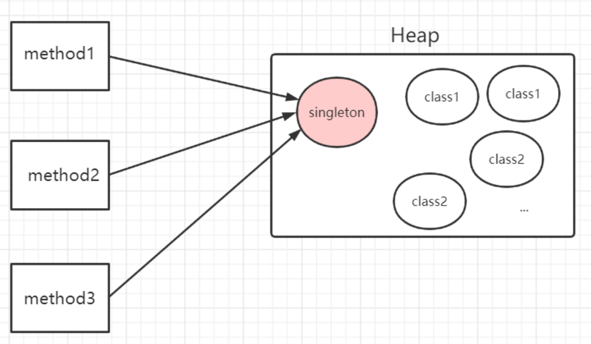

##### 单例模式的类型

单例模式有两种类型：

- 懒汉式：在真正需要使用对象时才去创建该单例类对象

- 饿汉式：在类加载时已经创建好该单例对象，等待被程序使用

懒汉式创建单例对象

懒汉式创建对象的方法是在程序使用对象前，先判断该对象是否已经实例化（判空），若已实例化直接返回该类对象。，否则则先执行实例化操作。

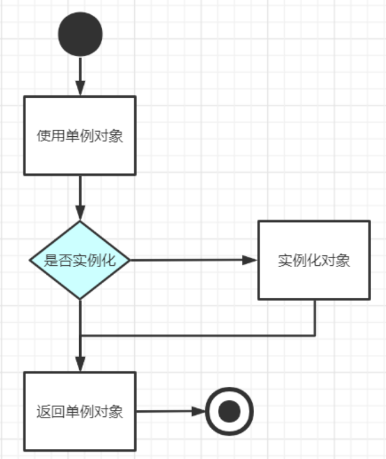

对应代码：

```java
public class Singleton {
    private static Singleton singleton;
    private Singleton(){}
    public static Singleton getInstance() {
        if (singleton == null) {
            singleton = new Singleton();
        }
        return singleton;
    }
}
```

饿汉式创建单例对象

饿汉式在类加载时已经创建好该对象，在程序调用时直接返回该单例对象即可，即我们在编码时就已经指明了要马上创建这个对象，不需要等到被调用时再去创建。

关于类加载，涉及到JVM的内容，我们目前可以简单认为在程序启动时，这个单例对象就已经创建好了

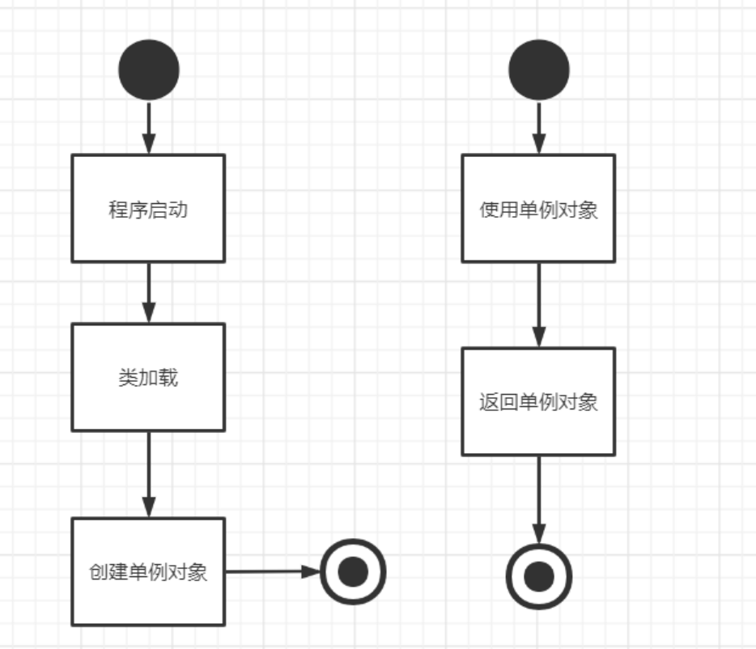

```java
public class Singleton{

    private static final Singleton singleton = new Singleton();
    private Singleton(){}
    public static Singleton getInstance() {
        return singleton;
    }
}
```

注意上面的代码在第3行已经实例化好了一个Singleton对象在内存中，不会有多个Singleton对象实例存在

类在加载时会在堆内存中创建一个Singleton对象，当类被卸载时，Singleton对象也随之消亡了。

##### 懒汉式如何保证只创建一个对象

我们再来回顾懒汉式的核心方法

```java
public static Singleton getInstance() {
```

```java
    if (singleton == null) {
        singleton = new Singleton();
    }
    return singleton;
}
```

这个方法其实是存在问题的，试想一下，如果两个线程同时判断singleton为空，那么它们都会去实例化一个Singleton对象，这就变成双例了。所以，我们要解决的是线程安全问题。

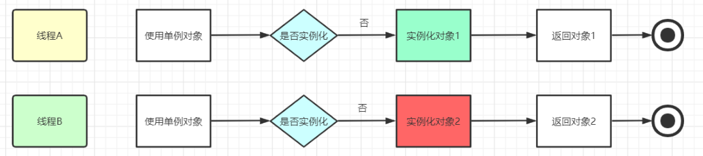

最容易想到的解决方法就是在方法上加锁，或者是对类对象加锁，程序就会变成下面这个样子

```java
public static synchronized Singleton getInstance() {
    if (singleton == null) {
        singleton = new Singleton();
    }
    return singleton;
}
// 或者
public static Singleton getInstance() {
    synchronized(Singleton.class) {

        if (singleton == null) {
            singleton = new Singleton();
        }
    }
    return singleton;
}
```

这样就规避了两个线程同时创建`Singleton` 对象的风险，但是引来另外一个问题：每次去获取对象都需要先获取锁，并发性能非常地差，极端情况下，可能会出现卡顿现象。

接下来要做的就是**优化性能，目标是：**如果没有实例化对象则加锁创建，如果已经实例化了，则不需要加锁，直接获取实例

所以直接在方法上加锁的方式就被废掉了，因为这种方式无论如何都需要先获取锁

```java
public static Singleton getInstance() {
    if (singleton == null) {  // 线程A和线程B同时看到singleton = null，如果不为null，则直接返回singleton
        synchronized(Singleton.class) { // 线程A或线程B获得该锁进行初始化
            if (singleton == null) { // 其中一个线程进入该分支，另外一个线程则不会进入该分支
                singleton = new Singleton();
            }
        }
    }
    return singleton;
}
```

上面的代码已经完美地解决了并发安全+性能低效问题：

- 第2行代码，如果singleton不为空，则直接返回对象，不需要获取锁；而如果多个线程发现singleton为空，则进入分支；

- 第3行代码，多个线程尝试争抢同一个锁，只有一个线程争抢成功，第一个获取到锁的线程会再次判断singleton是否为空，因为singleton有可能已经被之前的线程实例化

- 其它之后获取到锁的线程在执行到第4行校验代码，发现singleton已经不为空了，则不会再new一个对象，直接返回对象即可

- 之后所有进入该方法的线程都不会去获取锁，在第一次判断singleton对象时已经不为空了

因为需要两次判空，且对类对象加锁，该懒汉式写法也被称为：Double Check（双重校验） + Lock（加锁）

完整的代码如下所示：

```java
public class Singleton {
    private static Singleton singleton;
    private Singleton(){}
    public static Singleton getInstance() {
        if (singleton == null) {  // 线程A和线程B同时看到singleton = null，如果不为null，则直接返回singleton
            synchronized(Singleton.class) { // 线程A或线程B获得该锁进行初始化
                if (singleton == null) { // 其中一个线程进入该分支，另外一个线程则不会进入该分支
                    singleton = new Singleton();
                }
            }
        }
        return singleton;
    }
}
```

上面这段代码已经近似完美了，但是还存在最后一个问题：指令重排

##### 使用volatile防止指令重排

创建一个对象，在JVM中会经过三步：

1. 为singleton分配内存空间

2. 初始化singleton对象

3. 将singleton指向分配好的内存空间

指令重排序是指：JVM在保证最终结果正确的情况下，可以不按照程序编码的顺序执行语句，尽可能提高程序的性能

在这三步中，第2、3步有可能会发生指令重排现象，创建对象的顺序变为1-3-2，会导致多个线程获取对象时，有可能线程A创建对象的过程中，执行了1、3步骤，线程B判断singleton已经不为空，获取到未初始化的singleton对象，就会报NPE异常。文字较为晦涩，可以看流程图：

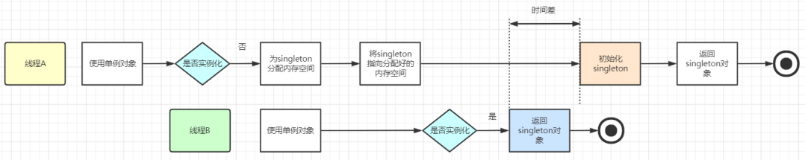

使用volatile关键字可以**防止指令重排序，**其原理较为复杂，可以这样理解：使用volatile关键字修饰的变量，可以保证其指令执行的顺序与程序指明的顺序一致，不会发生顺序变换，这样在多线程环境下就不会发生NPE异常了。

volatile还有第二个作用：使用volatile关键字修饰的变量，可以保证其内存可见性，即每一时刻线程读取到该变量的值都是内存中最新的那个值，线程每次操作该变量都需要先读取该变量。

最终的代码如下所示：

```java
public class Singleton {

    private static volatile Singleton singleton;
    private Singleton(){}
    public static Singleton getInstance() {
        if (singleton == null) {  // 线程A和线程B同时看到singleton = null，如果不为null，则直接返回singleton
            synchronized(Singleton.class) { // 线程A或线程B获得该锁进行初始化
                if (singleton == null) { // 其中一个线程进入该分支，另外一个线程则不会进入该分支
                    singleton = new Singleton();
                }
            }
        }
        return singleton;
    }
}
```

##### 破坏懒汉式单例与饿汉式单例

无论是完美的懒汉式还是饿汉式，终究敌不过反射和序列化，它们俩都可以把单例对象破坏掉（产生多个对象）。

- 演示利用反射破坏单例模式

```java
public static void main(String[] args) {
    // 获取类的显式构造器
    Constructor<Singleton> construct =Singleton.class.getDeclaredConstructor();
    // 可访问私有构造器
    construct.setAccessible(true);
    // 利用反射构造新对象
    Singleton obj1 = construct.newInstance();
    // 通过正常方式获取单例对象
    Singleton obj2 = Singleton.getInstance();
    System.out.println(obj1 == obj2); // false
}
```

- 利用序列化与反序列化破坏单例模式

```java
public static void main(String[] args) {
    // 创建输出流
    ObjectOutputStream oos = new ObjectOutputStream(new FileOutputStream("Singleton.file"));
    // 将单例对象写到文件中
    oos.writeObject(Singleton.getInstance());
    // 从文件中读取单例对象
    File file = new File("Singleton.file");
    ObjectInputStream ois =  new ObjectInputStream(new FileInputStream(file));
    Singleton newInstance = (Singleton) ois.readObject();
    // 判断是否是同一个对象
    System.out.println(newInstance == Singleton.getInstance()); // false
}
```

##### 总结

1. 单例模式常见的写法有两种：懒汉式、饿汉式

2. 懒汉式：在需要用到对象时才实例化对象，正确的实现方式是：Double Check + Lock，解决了并发安全和性能低下问题

3. 饿汉式：在类加载时已经创建好该单例对象，在获取单例对象时直接返回对象即可，不会存在并发安全和性能问题。

4. 在开发中如果对内存要求非常高，那么使用懒汉式写法，可以在特定时候才创建该对象；

5. 如果对内存要求不高使用饿汉式写法，因为简单不易出错，且没有任何并发安全和性能问题

6. 为了防止多线程环境下，因为指令重排序导致变量报NPE，需要在单例对象上添加volatile关键字防止指令重排序

7. 最优雅的实现方式是使用枚举，其代码精简，没有线程安全问题，且 Enum 类内部防止反射和反序列化时破坏单例。

##### 扩展问题

- 为什么使用private修饰构造器？

构造器被声明为`private` 的核心目的是禁止外部通过`new` 关键字直接创建实例。单例模式的核心约束是全局唯一实例，若构造器公开，任何类都可以随意实例化，破坏单例性。通过私有化构造器，强制所有实例创建必须通过`getInstance()` 方法集中控制，从而保证唯一性。

- 除了private，还有哪些修饰符？

1. public：允许任何类实例化，破坏单例，不可用。

2. protected：允许子类或同包类实例化，同样破坏单例。

3. 默认（包级私有）：允许同包内实例化，也不满足需求。因此，只有`private` 能实现严格单例。

- 为什么getInstance()方法要写成static的？不写成static的会怎样？

`static` 方法属于类级别，而非实例级别。单例模式要求在实例不存在时创建对象，若`getInstance()` 非静态，则调用该方法必须先有实例（`newSingleton().getInstance()` ），导致逻辑矛盾——即必须通过实例方法获取实例，而实例尚未存在。因此，必须通过静态方法直接通过类名访问，绕过实例依赖。

- synchronized关键字为什么修饰方法？还能怎么用？有什么区别？

1. 为何使用`synchronized` 块而非方法？代码中的`synchronized` 锁定的是`Singleton.class` 对象，而非整个方法。这种细粒度锁的优点是：

    - 性能优化：仅当第一次创建实例时同步，后续调用直接返回实例，避免每次调用都加锁。

    - 锁范围控制：同步块仅包裹实例化逻辑，减少锁竞争范围。若直接修饰方法（`public static synchronized SingletongetInstance()` ），则所有线程访问该方法时都会串行化，即使实例已存在，导致不必要的性能损耗。

#### 工厂模式详解

在面向对象编程中，创建对象实例最常用的方式就是通过 new 操作符构造一个对象实例，但在某些情况下，new 操作符直接生成对象会存在一些问题。举例来说，对象的创建需要一系列的步骤：可能需要计算或取得对象的初始位置、选择生成哪个子对象实例、或在生成之前必须先生成一些辅助对象。在这些情况，新对象的建立就是一个 “过程”，而不仅仅是一个操作，就像一部大机器中的一个齿轮传动。

针对上面这种情况，我们如何轻松方便地构造对象实例，而不必关心构造对象实例的细节和复杂过程？解决方案就是使用一个工厂类来创建对象。

##### 什么是工厂模式

工厂模式将目的将创建对象的具体过程屏蔽隔离起来，从而达到更高的灵活性，工厂模式可以分为三类：

- 简单工厂模式（Simple Factory）

- 工厂方法模式（Factory Method）

- 抽象工厂模式（Abstract Factory）

这三种模式从上到下逐步抽象，并且更具一般性。《设计模式》一书中将工厂模式分为两类：工厂方法模式与抽象工厂模式。将简单工厂模式看为工厂方法模式的一种特例，两者归为一类。 我们先从以下案例对工厂模式做个初步的了解

1. 在没有工厂的时代，如果客户需要一款宝马车，那么就需要客户去创建一款宝马车，然后拿来用。

2. 简单工厂模式：后来出现了工厂，用户不再需要去创建宝马车，由工厂进行创建，想要什么车，直接通过工厂创建就可以了。

3. 工厂方法模式：为了满足客户，宝马车系列越来越多，一个工厂无法创建所有的宝马系列，于是又单独分出来多个具体的工厂，每个具体工厂创建一种系列，即具体工厂类只能创建一个具体产品。但是宝马工厂还是个抽象，你需要指定某个具体的工厂才能生产车出来。

4. 抽象工厂模式：随着客户要求越来越高，宝马车必须配置空调，于是这个工厂开始生产宝马车和需要的空调。最终是客户只要对宝马的销售员说：我要523i空调车，销售员就直接给他523i空调车了。而不用自己去创建523i空调车宝马车。

##### 简单工厂模式

简单工厂模式的核心是定义一个创建对象的接口，将对象的创建和本身的业务逻辑分离，降低系统的耦合度，使得两个修改起来相对容易些，当以后实现改变时，只需要修改工厂类即可。

如果不使用工厂，用户将自己创建宝马车，具体UML图和代码如下：

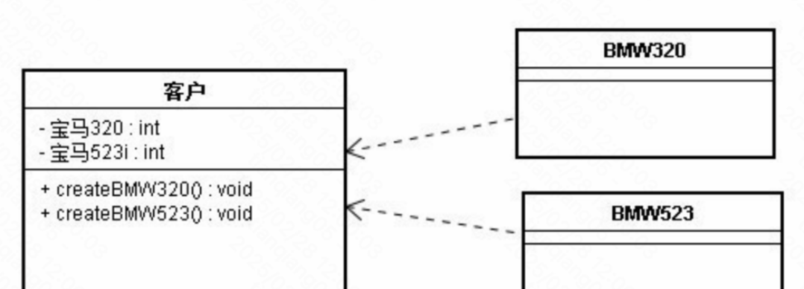

```java
public class BMW320 {
        public BMW320(){
                System.out.println("制造-->BMW320");
        }
}

public class BMW523 {
        public BMW523(){
                System.out.println("制造-->BMW523");
        }
}

public class Customer {
        public static void main(String[] args) {
                BMW320 bmw320 = new BMW320();
                BMW523 bmw523 = new BMW523();
        }
}
```

用户需要知道怎么创建一款车，这样子客户和车就紧密耦合在一起了，为了降低耦合，就出现了简单工厂模式，把创建宝马的操作细节都放到了工厂里，而客户直接使用工厂的创建方法，传入想要的宝马车型号就行了，而不必去知道创建的细节。

简单工厂模式的UML图:

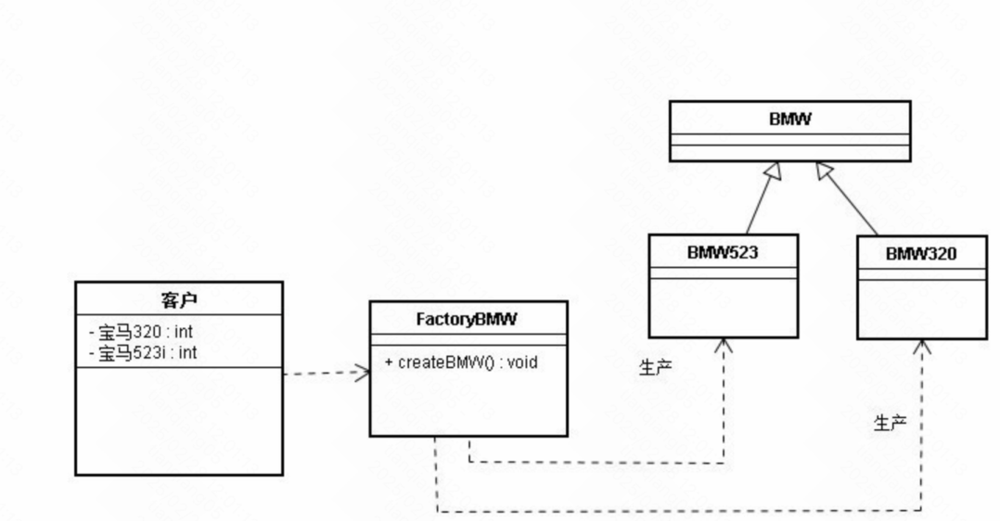

- 工厂类角色： 该模式的核心，用来创建产品，含有一定的商业逻辑和判断逻辑

- 抽象产品角色：它一般是具体产品继承的父类或者实现的接口。

- 具体产品角色：工厂类所创建的对象就是此角色的实例。在java中由一个具体类实现。

代码实现：

产品类：

```java
abstract class BMW {
        public BMW(){}
}

public class BMW320 extends BMW {
        public BMW320() {
                System.out.println("制造-->BMW320");
        }
}
public class BMW523 extends BMW{
        public BMW523(){
                System.out.println("制造-->BMW523");
        }
}
```

工厂类：

```java
public class Factory {
        public BMW createBMW(int type) {
                switch (type) {

                case 320:
                        return new BMW320();
                case 523:
                        return new BMW523();
                default:
                        break;
                }
                return null;
        }
}
```

用户类：

```java
public class Customer {
        public static void main(String[] args) {
                Factory factory = new Factory();
                BMW bmw320 = factory.createBMW(320);
                BMW bmw523 = factory.createBMW(523);
        }
}
```

简单工厂模式的优缺点：

简单工厂模式提供专门的工厂类用于创建对象，实现了对象创建和使用的职责分离，客户端不需知道所创建的具体产品类的类名以及创建过程，只需知道具体产品类所对应的参数即可，通过引入配置文件，可以在不修改任何客户端代码的情况下更换和增加新的具体产品类，在一定程度上提高了系统的灵活性。

但缺点在于不符合“开闭原则”，每次添加新产品就需要修改工厂类。在产品类型较多时，有可能造成工厂逻辑过于复杂，不利于系统的扩展维护，并且工厂类集中了所有产品创建逻辑，一旦不能正常工作，整个系统都要受到影响。

##### 工厂方法模式

工厂方法模式将工厂抽象化，并定义一个创建对象的接口。每增加新产品，只需增加该产品以及对应的具体实现工厂类，由具体工厂类决定要实例化的产品是哪个，将对象的创建与实例化延迟到子类，这样工厂的设计就符合“开闭原则”了，扩展时不必去修改原来的代码。在使用时，用于只需知道产品对应的具体工厂，关注具体的创建过程，甚至不需要知道具体产品类的类名，当我们选择哪个具体工厂时，就已经决定了实际创建的产品是哪个了。

但缺点在于，每增加一个产品都需要增加一个具体产品类和实现工厂类，使得系统中类的个数成倍增加，在一定程度上增加了系统的复杂度，同时也增加了系统具体类的依赖。

工厂方法的 UML 结构图如下：

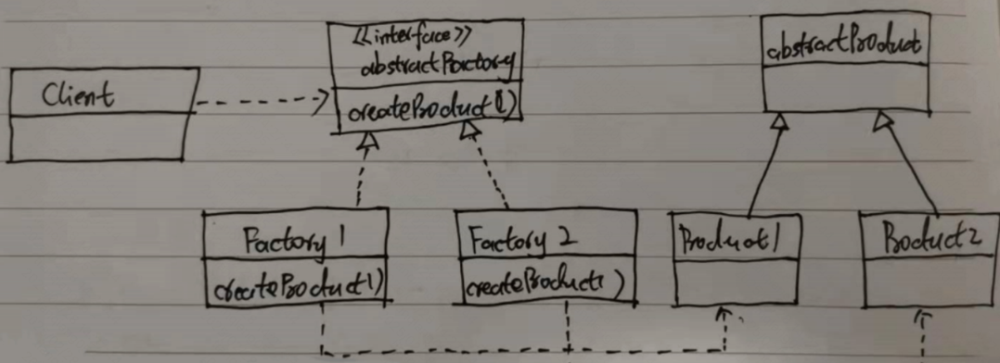

- 抽象工厂 AbstractFactory： 工厂方法模式的核心，是具体工厂角色必须实现的接口或者必须继承的父类，在 Java 中它由抽象类或者接口来实现。

- 具体工厂 Factory：被应用程序调用以创建具体产品的对象，含有和具体业务逻辑有关的代码

- 抽象产品 AbstractProduct：是具体产品继承的父类或实现的接口，在 Java 中一般有抽象类或者接口来实现。

- 具体产品 Product：具体工厂角色所创建的对象就是此角色的实例。

代码实现：

产品类：

```java
abstract class BMW {
        public BMW(){}
}
public class BMW320 extends BMW {
        public BMW320() {
                System.out.println("制造-->BMW320");
        }
}
public class BMW523 extends BMW{
        public BMW523(){
                System.out.println("制造-->BMW523");
        }
}
```

工厂类：

```java
interface FactoryBMW {
        BMW createBMW();
}

public class FactoryBMW320 implements FactoryBMW{
        @Override
        public BMW320 createBMW() {
                return new BMW320();
        }

}
public class FactoryBMW523 implements FactoryBMW {
        @Override
        public BMW523 createBMW() {
                return new BMW523();
        }
}
```

客户类：

```java
public class Customer {
        public static void main(String[] args) {
                FactoryBMW320 factoryBMW320 = new FactoryBMW320();
                BMW320 bmw320 = factoryBMW320.createBMW();
                FactoryBMW523 factoryBMW523 = new FactoryBMW523();
                BMW523 bmw523 = factoryBMW523.createBMW();
        }
}
```

##### 抽象工厂模式

在工厂方法模式中，我们使用一个工厂创建一个产品，一个具体工厂对应一个具体产品，但有时候我们需要一个工厂能够提供多个产品对象，而不是单一的对象，这个时候我们就需要使用抽象工厂模式。

在介绍抽象工厂模式前，我们先厘清两个概念：

- 产品等级结构：产品等级结构指的是产品的继承结构，例如一个空调抽象类，它有海尔空调、格力空调、美的空调等一系列的子类，那么这个空调抽象类和他的子类就构成了一个产品等级结构。

- 产品族：产品族是指由同一个工厂生产的，位于不同产品等级结构中的一组产品。比如，海尔工厂生产海尔空调、海尔冰箱，那么海尔空调则位于空调产品族中。

产品等级结构和产品族结构示意图如下

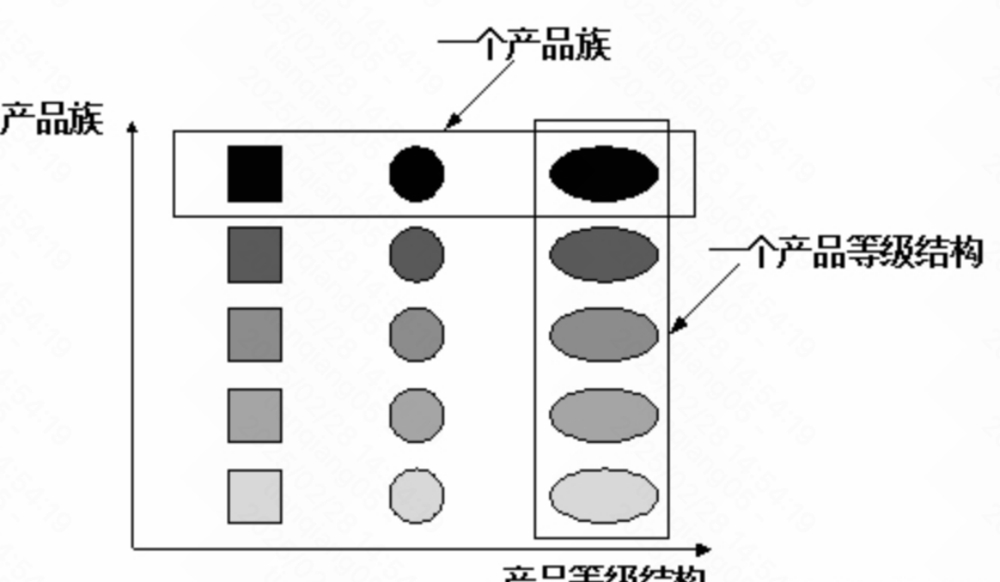

什么是抽象工厂模式：

抽象工厂模式主要用于创建相关对象的家族。当一个产品族中需要被设计在一起工作时，通过抽象工厂模式，能够保证客户端始终只使用同一个产品族中的对象；并且通过隔离具体类的生成，使得客户端不需要明确指定具体生成类；所有的具体工厂都实现了抽象工厂中定义的公共接口，因此只需要改变具体工厂的实例，就可以在某种程度上改变整个软件系统的行为。

但该模式的缺点在于添加新的行为时比较麻烦，如果需要添加一个新产品族对象时，需要更改接口及其下所有子类，这必然会带来很大的麻烦。

UML结构图：

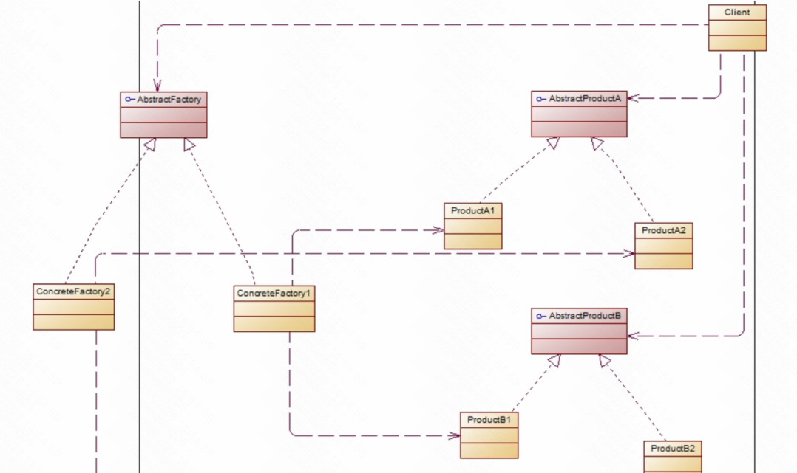

- 抽象工厂 AbstractFactory：定义了一个接口，这个接口包含了一组方法用来生产产品，所有的具体工厂都必须实现此接口。

- 具体工厂 ConcreteFactory：用于生产不同产品族，要创建一个产品，用户只需使用其中一个工厂进行获取，完全不需要实例化任何产品对象。

- 抽象产品 AbstractProduct：这是一个产品家族，每一个具体工厂都能够生产一整组产品。 具体产品 Product

代码实现：

通过抽象工厂模式，我们可以实现以下的效果：比如宝马320系列使用空调型号A和发动机型号A，而宝马230系列使用空调型号B和发动机型号B，在为320系列生产相关配件时，就无需制定配件的型号，它会自动根据车型生产对应的配件型号A。

产品类：

```java
//发动机以及型号
public interface Engine {}

public class EngineA implements Engine{

    public EngineA(){

        System.out.println("制造-->EngineA");

    }
}
public class EngineB implements Engine{

    public EngineB(){

        System.out.println("制造-->EngineB");

    }
}


//空调以及型号
public interface Aircondition {}

public class AirconditionA implements Aircondition{

    public AirconditionA(){

        System.out.println("制造-->AirconditionA");

    }
}
public class AirconditionB implements Aircondition{

    public AirconditionB(){

        System.out.println("制造-->AirconditionB");

    }
}
```

创建工厂类：

```java
//创建工厂的接口
public interface AbstractFactory {

    //制造发动机
    public Engine createEngine();
    //制造空调
    public Aircondition createAircondition();
}

//为宝马320系列生产配件
public class FactoryBMW320 implements AbstractFactory{

    @Override

    public Engine createEngine() {

        return new EngineA();

    }

    @Override

    public Aircondition createAircondition() {

        return new AirconditionA();

    }
}
//宝马523系列
public class FactoryBMW523 implements AbstractFactory {

     @Override

    public Engine createEngine() {

        return new EngineB();

    }

    @Override

    public Aircondition createAircondition() {

        return new AirconditionB();

    }
}
```

客户：

```java
public class Customer {

    public static void main(String[] args){

        //生产宝马320系列配件
        FactoryBMW320 factoryBMW320 = new FactoryBMW320();

        factoryBMW320.createEngine();
        factoryBMW320.createAircondition();

        //生产宝马523系列配件

        FactoryBMW523 factoryBMW523 = new FactoryBMW523();

        factoryBMW523.createEngine();
        factoryBMW523.createAircondition();
    }
}
```

工厂模式总结：

工厂方法模式与抽象工厂模式的区别在于：

1. 工厂方法只有一个抽象产品类和一个抽象工厂类，但可以派生出多个具体产品类和具体工厂类，每个具体工厂类只能创建一个具体产品类的实例。

2. 抽象工厂模式拥有多个抽象产品类（产品族）和一个抽象工厂类，每个抽象产品类可以派生出多个具体产品类；抽象工厂类也可以派生出多个具体工厂类，同时每个具体工厂类可以创建多个具体产品类的实例

### 后端面经与场景补充

<!-- 原PDF第507页；面经原题号 86 -->

#### spring里面用了哪些设计模式，请举一个例子讲一下设计模式用在了哪里

- 工厂模式

- 单例模式

- 代理模式

- 模板方法模式

- 观察者模式

- 适配器模式

- 装饰器模式

例子：工厂模式在 Spring 中的应用

工厂模式的核心思想是：将对象的创建过程封装起来，客户端不需要关心对象是如何创建的，只需要通过工厂获取实例即可。这有助于解耦对象的使用和创建。

Spring 中的体现：BeanFactory  和 ApplicationContext

在 Spring 中，`BeanFactory`  就是一个典型的工厂模式的实现。

- `BeanFactory`  是 Spring 容器的核心接口，它负责创建、配置和管理 Bean。

- 开发者不需要手动 `new`  一个对象，而是通过 Spring 容器（即“工厂”）来获取 Bean 实例。

```java
// 配置类
@Configuration
public class AppConfig {

    @Bean
    public UserService userService() {
        return new UserService(userRepository());
    }

    @Bean
    public UserRepository userRepository() {
        return new UserRepository();
    }
}

// 使用
public class Main {
    public static void main(String[] args) {
        // 创建工厂（容器）
        ApplicationContext context = new AnnotationConfigApplicationContext(AppConfig.class);

        // 从工厂中获取 bean，而不是直接 new
        UserService userService = context.getBean(UserService.class);

        userService.saveUser("John");
    }
}
```

- `ApplicationContext`  是 `BeanFactory`  的子接口，它就是一个高级工厂。

- 你调用 `context.getBean()`  时，Spring 内部根据配置（XML、注解或 Java Config）决定如何创建这个 Bean（是否单例、是否需要依赖注入等）。

- 你作为使用者，不需要知道 `UserService`  是如何被构造的，甚至不知道它的构造函数参数，工厂帮你处理了依赖的组装。

<a id="module-12"></a>

## 12 分布式与系统设计

### 后端面经与场景补充

<!-- 原PDF第479页；面经原题号 14 -->

#### sku和spu的概念，以及不同

SKU（库存单位）：

- SKU是库存单位的缩写，用于标识单个产品的唯一标识符。

- SKU通常用于管理库存，跟踪产品的销售情况。

- 每个SKU代表一个具体的产品，包括其所有的属性，如颜色、尺寸、款式等。

- 例如，一件红色、M码的T恤和一件蓝色、L码的T恤会有不同的SKU。

SPU（标准产品单位）：

- SPU是标准产品单位的缩写，用于标识产品的基本属性集合。

- SPU通常用于产品的分类和展示，代表产品的一个标准化的类别。

- 每个SPU代表一个产品的基本属性，不包括具体的变体。

- 例如，某品牌的T恤作为一个SPU，它可以有不同的颜色和尺寸，但这些变体都属于同一个SPU。

<!-- 原PDF第488页；面经原题号 35 -->

#### 在搜索框当中搜索访问搜索最高的搜索纪录的词条该怎么实现

前缀树

<!-- 原PDF第488页；面经原题号 39 -->

#### 你们那边的容灾方案是什么？

原文未附答案。

<!-- 原PDF第497页；面经原题号 62 -->

#### 了解限流算法有哪些

令牌桶算法（Token Bucket）

- 核心原理：

    - 系统以恒定速率（如每秒 `r`  个）向桶中添加令牌。

    - 桶的最大容量为 `N` ，当桶满时新令牌被丢弃。

    - 请求到达时，必须从桶中获取一个令牌才能被处理；若桶中无令牌，则触发限流。

- 特点：

    - 允许突发流量：桶中积累的令牌可以一次性消耗，应对短时高并发。

    - 平滑限流：长期来看请求速率被限制为令牌生成速率 `r` 。

    - 实现复杂度：需维护令牌生成逻辑和桶状态。

- 适用场景：

    - 需要允许突发流量的 API 限流（如秒杀场景）。

    - 分布式系统中对一致性要求较高的限流。

漏桶算法（Leaky Bucket）

- 核心原理：

    - 请求像水一样流入桶中，桶以固定速率（如每秒 `r`  个）向外漏出请求进行处理。

    - 若桶已满，则新请求被拒绝或排队。

- 特点：

    - 严格平滑流量：无论请求速率如何波动，处理速率始终恒定。

    - 不支持突发流量：即使桶未满，也无法一次性处理大量请求。

    - 实现复杂度：需维护漏出速率逻辑。

- 适用场景：

    - 需要严格限制请求处理速率的场景（如支付接口）。

    - 单机或对突发容忍度低的系统。

算法：

多线程打印

多线程打印

```java
public class AlternatePrinting {

    private static final Object lock = new Object();
    private static int counter = 1;
    private static final int MAX = 100;
    private static int threadTurn = 1; // 用于标识轮到哪个线程打印

    public static void main(String[] args) {
        Thread t1 = new Thread(new Printer(1), "Thread-1");
        Thread t2 = new Thread(new Printer(2), "Thread-2");
        Thread t3 = new Thread(new Printer(3), "Thread-3");

        t1.start();
        t2.start();
        t3.start();
    }

    static class Printer implements Runnable {
        private final int threadNumber;

        public Printer(int threadNumber) {
            this.threadNumber = threadNumber;
        }

        @Override
        public void run() {
            while (true) {
                synchronized (lock) {
                    while (threadTurn != threadNumber) {
                        // 等待轮到当前线程打印
                        try {
                            lock.wait();
                        } catch (InterruptedException e) {
                            Thread.currentThread().interrupt();
                        }
                    }

                    if (counter <= MAX) {
                        // 打印当前计数
                        System.out.println(Thread.currentThread().getName() +": " + counter++);
                        // 换到下一个线程
                        threadTurn = (threadTurn % 3) + 1;
                        lock.notifyAll(); // 唤醒其他线程
                    } else {
                        lock.notifyAll(); // 唤醒其他线程以退出
                        break;
                    }
                }
            }
        }
    }
}
```

<!-- 原PDF第500页；面经原题号 66 -->

#### 如何设计一个分布式的限流系统

a. 可以通过redis➕lua脚本实现具体的限流算法，类似于场景题这里写的

b. 将redis进行分片部署，部署到多个分片上，然后指定对应的key进行hash计算然后定位到某一个分片上，进行限流，这里的key可以理解为限流的纬度，比如接口限流还是业务上的限流抑或是服务的整体限流。

<!-- 原PDF第502页；面经原题号 77 -->

#### 就比如我现在是一个c端的应用，流量的qps大概是6w左右，我现在有俩集群，现在有一些请求打到了集群a当中但是a挂了，那会把所有流量都打到b当中，现在的问题是对之前的失败的请求怎么做补偿

方案一：客户端重试 + 幂等设计（推荐基础方案）

- 客户端（或网关层）在收到失败响应（如 5xx、超时）时，自动重试到集群 B。

- 前提：

    - 接口设计必须是幂等的（如通过 `requestId`  去重）。

    - 重试策略合理（如指数退避，最多 2~3 次）。

- 优点：简单、低延迟，适合大多数场景。

- 缺点：如果客户端本身也挂了，无法重试。

适用场景：大多数 C 端写请求（如下单、支付、提交表单等）

方案二：异步补偿服务（适用于强一致性要求）

- 所有写请求先写入一个消息队列（如 Kafka、RocketMQ）或持久化日志。

- 后端服务从队列中消费并处理。

- 如果集群 A 挂了，消息还在队列中，集群 B 继续消费即可。

- 对于已经发送但未确认的请求，可以通过定时扫描日志或数据库，找出“长时间未完成”的请求进行补偿。

实现方式：

1. 请求先落库或写 MQ，标记为 `pending` 。

2. 处理成功后更新为 `success` 。

3. 启动一个补偿 Job，定时扫描 `pending`  超过一定时间的请求，重新发送到集群 B。

优点：不丢请求，适合金融、订单等关键业务。

缺点：引入复杂性，延迟略高。

<!-- 原PDF第503页；面经原题号 78 -->

#### 如果a流量打到b上之后，b的流量承受不住，这种情况该怎么办？

方案一：集群设计预留“故障冗余容量”（推荐）

核心思想：每个集群的容量要能扛住全部流量。

- 把每个集群的容量设计为 ≥6w QPS（即总流量的 100%）。

- 这样即使 A 挂了，B 也能独立承载全部流量。

- 这叫 “N+1 容灾” 或 “双活全量冗余”。

优点：

- 故障转移简单、可靠。

- 不需要复杂的限流、降级逻辑。

方案二：主动限流 + 降级策略（兜底保障）

当 B 即将被打垮时，主动拒绝部分请求，保护核心功能。

1. 限流（Rate Limiting）

- 使用 Sentinel、Hystrix、Envoy Rate Limit 等工具。

- 设置 B 的最大处理能力为 3.5w QPS（留 buffer）。

- 超过阈值的请求直接拒绝（返回 429 或降级响应）。

2. 降级（Degradation）

- 非核心功能关闭，如：

    - 关闭推荐、广告、日志上报。

    - 读请求走缓存或降级数据。

    - 写请求异步化（先写 MQ，后处理）。

- 保证核心链路（如下单、支付）可用。

3. 排队 or 延迟响应

- 对非实时请求，可放入队列（如 Kafka），稍后处理。

- 返回“处理中，请稍后查询结果”。

方案三：多级流量调度 + 熔断机制

使用智能网关或 Service Mesh（如 Istio）：

- 检测到 A 故障后，不立即切全部流量，而是：

    - 先切 20%，观察 B 的负载。

    - 如果 B 压力正常，逐步增加流量（如 40% → 60% → 100%）。

- 如果 B 响应变慢或错误率上升，暂停切换或回滚。

这叫 “金丝雀切换 + 自适应负载”。

<!-- 原PDF第504页；面经原题号 79 -->

#### 比价系统优化

- 是否理解比价系统的业务本质

- 是否具备**系统设计能力**（分层、解耦、扩展性）

- 是否掌握高并发场景下的优化手段

- 是否有可落地的工程思维

✅ 假设是这样，那核心功能包括：

- 商品搜索（支持模糊匹配）

- 多平台价格采集（爬虫 or 接口）

- 价格存储与更新

- 比价展示（最低价、历史价格曲线、优惠信息等）

- 用户行为记录（点击、收藏等）

优化后的架构设计（重点！）

```text
[用户]
  ↓
[API 网关] → [鉴权、限流、日志]
  ↓
[搜索服务] ←→ [Elasticsearch]
  ↓
[比价服务] ←→ [商品缓存 Redis]
  ↓
[任务调度] → [价格采集 Worker 集群]
             ↓
        [消息队列 Kafka/RabbitMQ]
             ↓
        [数据存储 MySQL + HBase]
```

1. 分层解耦：微服务架构

- 搜索服务：处理用户搜索，调用 ES。

- 比价服务：返回商品比价结果。

- 采集服务（Worker）：专门负责爬取价格，与前端解耦。

- 任务调度：控制采集频率、优先级。

好处：各自独立部署、扩展、维护。

2. 数据采集优化：异步 + 频率控制

- 不实时爬取：用户搜索时，返回缓存数据，后台异步更新。

- 采集策略：

    - 热门商品：每 5 分钟更新一次

    - 冷门商品：每小时或每天更新

    - 大促期间：动态提高频率

- 使用代理 IP 池 + User-Agent 轮换：防封。

- 模拟登录 or 对接开放 API（如有）：提高成功率。

“反爬策略”和“采集频率分级”。

3. 缓存设计：多级缓存

缓存层用途

Redis缓存热门商品的比价结果

```text
（JSON）
```

Local Cache（Caffeine）缓存高频访问商品，减少

```text
Redis 压力
```

CDN静态资源（如商品图片）

示例：用户搜“iPhone”，先查 Redis，命中直接返回，不命中走数据库 + 异步更新。

4. 数据存储：读写分离 + 分库分表

- MySQL：存储商品元数据（名称、品牌、类目等），写多读少。

- HBase / ClickHouse：存储历史价格数据（时间序列），适合大数据量。

- 必要时对商品表 按类目或 ID 分库分表。

6. 高可用与扩展性

- 消息队列解耦：搜索触发采集任务 → 发送到 Kafka → Worker 消费。

- 限流降级：

    - 搜索接口限流（如 1000 QPS）

    - 采集服务异常时，返回缓存数据（降级）

7. 数据一致性与监控

- 一致性：用“最后更新时间”标记数据新鲜度，前端展示“数据更新于 5 分钟前”。

- 监控：

    - 采集成功率、延迟

    - 缓存命中率

    - 搜索响应时间

- 告警：采集失败、Redis 宕机等自动通知。

“对于比价系统的架构优化，我会从**性能、可用性、扩展性**三个维度来设计：

1. 分层解耦：拆分为搜索、比价、采集等微服务，提升可维护性。

2. 异步采集：用户搜索返回缓存结果，后台 Worker 异步更新价格，避免实时爬取导致延迟高。

3. 多级缓存：Redis + Local Cache 缓存热门商品，提升响应速度。

4. 搜索优化：使用 Elasticsearch 支持模糊匹配和高效检索。

5. 高可用保障：采集服务集群化 + 消息队列解耦 + 限流降级。

6. 数据存储：MySQL 存元数据，HBase 存历史价格，支持大数据量。

6. 同时，关注反爬策略、采集频率控制、监控告警等工程细节，确保系统稳定可靠。”

<!-- 原PDF第508页；面经原题号 87 -->

#### 如何实现分布式锁

a. 基于redis实现分布式锁

实现原理：

利用 Redis 的 `SET key value NX EX`  命令（或 `SETNX + EXPIRE` ），保证在多个客户端中只有一个能成功设置键值，从而获得锁。

- `NX` ：只有 key 不存在时才设置（避免覆盖别人的锁）。

- `EX` ：设置过期时间，防止死锁。

- `value` ：通常设置为唯一标识（如 UUID），用于释放锁时校验所有权。

```text
SET lock_key unique_value NX EX 10
```

b. 基于数据库实现分布式锁

实现方式：

- 在数据库中创建一张锁表，包含 `lock_name` （锁名）、`owner` （持有者）、`expire_time`  等字段。

- 使用唯一索引（如 `lock_name`  为主键或唯一键）。

- 获取锁：插入一条记录，插入成功者获得锁。

- 释放锁：删除或更新记录。

```sql
INSERT INTO locks (lock_name, owner, create_time)
VALUES ('order_lock', 'service_1', NOW())
ON DUPLICATE KEY UPDATE ... -- 或直接失败重试
```
