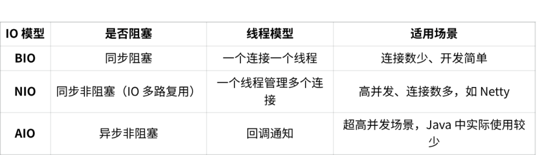

# Java基础

[返回模块目录](../README.md)

## 高频题

### Java面向对象有哪四个特性？

面向对象有四个基本特性：封装、继承、多态、抽象。

- 封装：将数据和操作数据的方法封装在对象内部，通过访问控制隐藏实现细节。

- 继承：子类继承父类的属性和方法，实现代码复用和扩展。

- 多态：同一接口或父类引用可以指向不同子类对象，运行时调用实际对象的方法。

- 抽象：提取事物的共同特征，忽略非本质细节，通过抽象类或接口描述共性。

### String、StringBuffer、StringBuilder 的区别？

三者主要区别在可变性、线程安全性和性能。

- String：不可变（immutable），底层字符数组不可修改，每次修改都会创建新的 String 对象，因此线程安全。

- StringBuffer：可变，方法使用 `synchronized`  加锁，线程安全，但同步带来一定性能开销。

- StringBuilder：可变，不加锁，线程不安全，但性能最高，适用于单线程场景。

性能：

- StringBuilder > StringBuffer > String

- String 每次修改都会创建新对象，频繁拼接字符串性能最差。

- StringBuffer 和 StringBuilder 都是在原对象上修改，不会频繁创建新对象。

使用场景：

- String：字符串内容基本不变，少量拼接。

- StringBuilder：单线程下大量字符串拼接，推荐使用。

- StringBuffer：多线程下大量字符串拼接，需要保证线程安全。

### 继承和多态分别是什么，有什么区别？

继承是指子类继承父类的属性和方法，实现代码复用和功能扩展。Java 中通过 `extends`  实现继承，子类可以新增属性和方法，也可以重写父类方法。

多态是指同一方法在不同对象上具有不同的表现形式。它依赖于继承、方法重写和父类引用指向子类对象，运行时根据对象的实际类型调用对应的方法，实现动态绑定。

区别：

- 继承是类与类之间的关系，目的是代码复用和功能扩展。

- 多态是对象的行为特性，目的是统一接口、灵活调用，提高程序扩展性。

- 继承是实现多态的基础，多态通常依赖继承（或接口）和方法重写来实现。

### Exception和 Error有什么区别？

`Exception`  和 `Error`  都继承自 Throwable，但表示的问题不同。

- Error：表示程序无法恢复的严重错误，通常由 JVM 抛出，一般不建议捕获处理，如OutOfMemoryError、StackOverflowError。

- Exception：表示程序运行过程中出现的可处理异常，可以通过 `try-catch`  或 `throws`  进行处理。

Exception 又分为两类：

- Checked Exception（受检异常）：编译器必须处理（捕获或抛出），如 `IOException` 、`SQLException` 。

- RuntimeException（运行时异常）：编译器不强制处理，通常由程序逻辑错误导致，如`NullPointerException` 、`IllegalArgumentException` 、`IndexOutOfBoundsException` 。

### == 与 equals() 有什么区别？

- == ：

    - 基本数据类型：比较的是值是否相等。

    - 引用数据类型：比较的是对象的内存地址（是否指向同一个对象）。

- equals() ：

    - 只能用于引用数据类型，用于判断两个对象是否相等。

    - Object 类默认实现与 `==`  相同，也是比较对象地址。

    - 很多类（如 String、Integer）都会重写 `equals()` ，用于比较对象的内容是否相等。

String 的特殊情况：

- `String`  重写了 `equals()` ，比较的是字符串内容。

- 字符串字面量存放在字符串常量池中，相同字面量会复用同一个对象，因此：

```java
String a = "abc";
String b = "abc";
System.out.println(a == b);      // true
```

- 使用 `new String()`  会创建新的对象，因此：

```java
String a = new String("abc");
String b = new String("abc");
System.out.println(a == b);      // false
System.out.println(a.equals(b)); // true
```

### 哈希冲突有哪些解决办法？

常见的解决哈希冲突的方法有开放定址法、再哈希法和链地址法。

1. 开放定址法：发生冲突时，在哈希表中继续寻找空闲位置存放元素。

    - 线性探测：依次向后查找空闲位置。

    - 平方探测：按照平方步长向前后查找空闲位置，减少聚集现象。

2. 再哈希法：准备多个哈希函数，发生冲突时使用其他哈希函数重新计算存储位置，直到找到空闲位置。

3. 链地址法（拉链法）：将哈希值相同的元素存放到同一个链表（JDK8 中链表长度超过阈值会转换为红黑树）中。这是 Java HashMap 采用的冲突解决方式。

### 什么是幂等性？如何实现接口幂等？

幂等性是指同一个操作在相同条件下执行一次和执行多次，最终结果一致。在分布式系统中，由于网络超时、消息重复消费、接口重试等情况，很容易导致重复请求，因此接口通常需要保证幂等性。

常见的实现方式有：

- 唯一索引（去重表）：利用数据库唯一约束保证数据只能插入一次，例如用户点赞（用户ID+文章ID）、创建账户、订单号去重等场景。

- 状态标识：通过业务状态控制流程只能执行一次，例如订单已支付后，再次调用支付接口直接返回成功，不会重复扣款。

- Token 机制：客户端请求前先获取唯一 Token，提交时携带 Token，服务端校验后立即删除，同一个 Token 只能使用一次，常用于防止重复提交，如发帖、下单等。

### 什么是泛型，以及泛型擦除？

- 泛型是 Java 在编译期提供的类型参数机制，用于提高代码的类型安全性和复用性，可以在编译阶段检查类型错误，避免频繁强制类型转换。

- 泛型擦除是指 Java 泛型采用类型擦除实现，在编译后所有泛型信息都会被擦除。编译器会将泛型T 擦除为 Object，如果有上界（如 `T extends Xxx` ），则擦除为对应的限定类型。因此，JVM 运行时并不知道泛型的具体类型。

由于类型擦除，Java 泛型属于伪泛型，这也带来了一些限制，例如不能使用泛型进行 instanceof判断、不能直接 new  泛型对象、不能创建泛型数组。类型擦除的主要目的是兼容旧版本 Java，提高向后兼容性，而无需修改 JVM。

### 抽象类和接口有什么区别？

抽象类和接口都不能被实例化，都可以用于抽象行为，但抽象类侧重于代码复用，接口侧重于规范和能力扩展。

- 定义方式不同：抽象类使用 `abstract class`  定义，通过 `extends`  继承；接口使用`interface`  定义，通过 `implements`  实现，一个类只能继承一个抽象类，但可以实现多个接口。

- 成员不同：抽象类可以有成员变量、构造方法、普通方法和抽象方法；接口不能有实例变量和构造方法，只能定义常量，JDK8 开始支持 `default`  和 `static`  方法，JDK9 开始支持`private`  方法。

- 设计目的不同：抽象类用于抽取多个子类的公共属性和方法，实现代码复用；接口用于定义行为规范，实现多态和解耦。

使用场景：

- 当多个类存在共同属性和实现，需要复用代码时，使用抽象类。

- 当需要定义一组统一的行为规范，或者一个类需要具备多种能力时，使用接口。

### Java 中重载（Overloading）和重写（Overriding）有什么区别？

重载和重写都是 Java 实现多态的方式，但重载是编译时多态，重写是运行时多态。

- 发生位置不同：重载发生在同一个类中；重写发生在父子类之间，需要存在继承或接口实现关系。

- 方法签名不同：重载要求方法名相同，但参数列表必须不同（参数类型、数量或顺序）；重写要求方法名、参数列表完全相同。

- 返回值要求不同：重载对返回值没有要求；重写返回值必须相同，或者是父类返回值的子类型（协变返回）。

- 访问权限不同：重载没有限制；重写时子类方法的访问权限不能比父类更严格。

- 异常要求不同：重载没有限制；重写不能抛出比父类更宽泛的受检异常。

- 方法限制不同：重载可以作用于普通方法、静态方法和构造方法；重写不能重写 `static` 、`final`  和 `private`  方法，其中 `static`  方法只能隐藏（Method Hiding），不能重写。

- 绑定时机不同：重载在编译期确定调用哪个方法，属于编译时多态；重写在运行期根据对象的实际类型决定调用哪个方法，属于运行时多态。

### String 为什么设计成不可变？体现在哪里？如何实现？

String 被设计成不可变对象，主要是为了提高缓存效率、保证安全性和线程安全。

- 提高缓存效率：由于 String 不可变，相同内容的字符串可以安全地存放在字符串常量池中复用，减少对象创建，节省内存，提高性能。同时，String 作为 HashMap 的 Key 时，`hashCode`  可以缓存，不会因为内容改变导致哈希值失效。

- 保证安全性：String 常用于保存类名、文件路径、URL、数据库连接信息、Token 等敏感数据。不可变可以防止对象内容在使用过程中被篡改，提高系统安全性。

- 天然线程安全：多个线程可以共享同一个 String 对象，无需加锁。因为任何修改都会创建新的对象，不会影响其他线程正在使用的数据。

String 的不可变性体现在：

- String 对象创建后，其内容不能被修改。

- 所有修改字符串的方法（如 `concat()` 、`replace()` 、`substring()`  等）都不会修改原对象，而是返回一个新的 String 对象。

String 的不可变是如何实现的？

- 底层存储字符串的数据使用 private final  修饰（JDK8 为 `char[]` ，JDK9+ 为`byte[]` ），数组引用不能被修改。

- String 没有提供修改底层数组的方法，对字符串的任何修改都会创建新的对象。

- String 类使用 final  修饰，不能被继承，避免子类通过重写方法破坏其不可变性。

### Java 的 IO 流体现了什么设计模式

Java IO 主要体现了装饰器模式和适配器模式。

- 装饰器模式（Decorator）：通过包装原始流对象，在不改变原有对象的基础上动态扩展功能。例如 `BufferedInputStream` 、`BufferedOutputStream` 、`BufferedReader`  等，都是在原始节点流外包装一层，为其增加缓冲功能，提高 IO 效率。

- 适配器模式（Adapter）：用于实现字节流和字符流之间的转换，使接口不兼容的类能够协同工作。例如 `InputStreamReader`  将 InputStream 适配为 Reader，`OutputStreamWriter`  将 OutputStream 适配为 Writer，实现了字节流与字符流之间的转换。

## 扩展题

### 多态的目的，解决了什么问题

在Java中，多态性是面向对象编程中的一个重要概念，其目的是为了实现代码的灵活性和可扩展性，解决了以下几个问题：

1. 实现代码重用：多态性可以让不同类的对象对相同的消息做出不同的响应，这样就可以通过统一的接口来调用不同类的方法，实现了代码的重用。

2. 提高代码的可扩展性：通过多态性，可以方便地向现有的系统中引入新的类，而无需修改现有的代码。这样就提高了系统的可扩展性，使得系统更容易适应新的需求和变化。

```java
Zoo zoo = new Zoo();
zoo.makeAnimalSpeak(new Dog()); // 输出 Dog barks，Dog继承于父类Zoo
zoo.makeAnimalSpeak(new Cat()); // 输出 Cat meows，Cat继承于父类Zoo
```

3. 简化代码的维护：多态性可以降低代码之间的耦合度，使得各个类之间的关系更加灵活，因此当需要修改或扩展系统功能时，可以尽量避免对已有代码的修改，从而简化了代码的维护。

```java
interface Animal {
    void eat();
}

class Dog implements Animal {
    public void eat() {
        System.out.println("Dog eats bones");
    }
}

class Cat implements Animal {
    public void eat() {
        System.out.println("Cat eats fish");
    }
}

class Zoo {
    public void feed(Animal a) {
        a.eat(); // 调用者无需关心具体是哪种动物，增加老虎这一动物时，只需要增加一个类继承于eat这一接口
    }
}
```

多态性使得代码更加灵活，能够更好地适应变化，同时也提高了代码的可读性和可维护性。通过多态性，可以使得程序设计更加符合面向对象的原则，使得系统更易于扩展和维护。

### Java创建对象有几种方式？

Java 常见有 5 种方式创建对象：

1. 使用 new  关键字。最常用，会调用构造方法。

```java
ObjectName obj = new ObjectName();
```

2. 使用反射创建对象。`Class#newInstance()`  已不推荐使用，更推荐通过构造器创建。

```java
ObjectName obj = ObjectName.class.getDeclaredConstructor().newInstance();
```

3. 使用 Constructor#newInstance()  创建对象。可以选择指定构造器。

```java
Constructor<ObjectName> constructor =ObjectName.class.getDeclaredConstructor();
ObjectName obj = constructor.newInstance();
```

4. 使用 clone()  复制已有对象。它不会走普通构造方法，要求类实现 `Cloneable`  并正确重写`clone()` 。

```text
ObjectName copy = source.clone();
```

5. 使用反序列化从字节流恢复对象。反序列化也不会走普通构造方法，需要类实现`Serializable` 。

```java
try (ObjectInputStream ois = new ObjectInputStream(new FileInputStream(FILE_NAME))) {
    ObjectName obj = (ObjectName) ois.readObject();
}
```

### hashCode()有什么用

`hashCode()`  的作用是获取哈希码（`int`  整数），也称为散列码。这个哈希码的作用是确定该对象在哈希表中的索引位置。

`hashCode()`  定义在 JDK 的 `Object`  类中，这就意味着 Java 中的任何类都包含有`hashCode()`  函数。另外需要注意的是：`Object`  的 `hashCode()`  方法是本地方法，也就是用C 语言或 C++ 实现的。

我们以“ `HashSet`  如何检查重复”为例子来说明为什么要有 `hashCode` ？

`hashCode()`  和 `equals()` 都是用于比较两个对象是否相等。

#### (追问)为什么 JDK 还要同时提供这两个方法呢？

这是因为在一些容器（比如 `HashMap` 、`HashSet` ）中，有了 `hashCode()`  之后，判断元素是否在对应容器中的效率会更高（参考添加元素进`HashSet` 的过程）！

我们在前面也提到了添加元素进`HashSet` 的过程，如果 `HashSet`  在对比的时候，同样的`hashCode`  有多个对象，它会继续使用 `equals()`  来判断是否真的相同。也就是说 `hashCode`帮助我们大大缩小了查找成本。

#### (追问)为什么不只提供 hashCode()  方法呢？

这是因为两个对象的`hashCode`  值相等并不代表两个对象就相等。

#### (追问)那为什么两个对象有相同的 hashCode  值，它们也不一定是相等的？

因为 `hashCode()`  所使用的哈希算法也许刚好会让多个对象传回相同的哈希值。越糟糕的哈希算法越容易碰撞，但这也与数据值域分布的特性有关（所谓哈希碰撞也就是指的是不同的对象得到相同的`hashCode`  )。

总结下来就是：

- 如果两个对象的`hashCode`  值相等，那这两个对象不一定相等（哈希碰撞）。

- 如果两个对象的`hashCode`  值相等并且`equals()` 方法也返回 `true` ，我们才认为这两个对象相等。

- 如果两个对象的`hashCode`  值不相等，我们就可以直接认为这两个对象不相等。

### 为什么重写 equals() 时必须重写 hashCode() 方法？

因为两个相等的对象的 `hashCode`  值必须是相等。也就是说如果 `equals`  方法判断两个对象是相等的，那这两个对象的 `hashCode`  值也要相等。

如果重写 `equals()`  时没有重写 `hashCode()`  方法的话就可能会导致 `equals`  方法判断是相等的两个对象，`hashCode`  值却不相等。

思考：重写 `equals()`  时没有重写 `hashCode()`  方法的话，使用 `HashMap`  可能会出现什么问题。

两个逻辑上相等的对象可能被存储在不同的位置，或者无法正确检索出已存储的对象。

总结：

- `equals`  方法判断两个对象是相等的，那这两个对象的 `hashCode`  值也要相等。

- 两个对象有相同的 `hashCode`  值，他们也不一定是相等的（哈希碰撞）。

### 介绍一下Integer的缓存

在 Java 中，`Integer`  是常用包装类型。为了提高性能和节省内存，Java 提供了`IntegerCache` ，默认缓存 `-128`  到 `127`  之间的 `Integer`  对象。

需要注意：Java 规范要求至少缓存 `-128`  到 `127` ，HotSpot 中缓存上限可以通过 JVM 参数 `-XX:AutoBoxCacheMax=<size>`  调整，但下限固定为 `-128` 。

### String类底层如何实现？String 底层数据类型是什么？

- JDK 1.8 及以前：底层使用 char[]  存储字符串。

```java
private final char[] value;
```

- JDK 1.9 及以后：底层改为 byte[]  存储，并增加 `coder`  字段标识编码（Latin1 或 UTF-16），减少内存占用，提高存储效率。

```java
private final byte[] value;
```

### String类能被继承吗？

不能。`String`  类使用 final  修饰，因此不能被继承。

```java
public final class String
```

### String有长度限制吗？

有，但编译期和运行期不同：

- 编译期：字符串常量存储在 Class 文件的常量池中，采用 `CONSTANT_Utf8_info`  结构，长度最大为 65535。

- 运行期：String 底层数组长度由 `int`  表示，理论最大长度为 2³¹-1，但实际受 JVM 堆内存大小限制，通常达不到理论最大值。

### String s=“a”+“b” 会创建几个对象？

- 在Java中，字符串拼接操作 `"a" + "b"`  在编译时会被优化为 `"ab"` 。这是因为 `"a"`  和`"b"`  都是常量，编译器可以在编译时直接计算出结果。

- 因此，`"a" + "b"`  实际上会被优化为一个字符串字面量 `"ab"` ，而不会在运行时创建新的对象。

最终结果:

- 如果 `"ab"`  之前不存在于字符串常量池中，那么会创建一个新的字符串对象 `"ab"` 。

- 如果 `"ab"`  已经存在于字符串常量池中，则直接引用已有的对象，不会创建新的对象。

### String s = new String("abc") 创建了几个对象，s是表示什么，创建的对象分别存放在哪里

会创建 1 或 2 个字符串对象。

- 字符串常量池中不存在 "abc"：会创建 2 个 字符串对象。一个在字符串常量池中，由 `ldc`  指令触发创建。一个在堆中，由 `new String()`  创建，并使用常量池中的 "abc" 进行初始化。

- 字符串常量池中已存在 "abc"：会创建 1 个 字符串对象。该对象在堆中，由 `new String()`  创建，并使用常量池中的 "abc" 进行初始化。

### 什么是字符串常量池？

字符串常量池（String Constant Pool）是 JVM 在堆内存中维护的一块专门存储字符串常量的区域，用于复用相同内容的字符串，减少对象创建，提高内存利用率和性能。

当使用字符串字面量创建字符串时，JVM 会先到字符串常量池中查找是否已存在相同内容的字符串：

- 如果存在，直接返回该对象的引用。

- 如果不存在，则创建新的字符串对象放入常量池，并返回其引用。

例如：

```java
String s1 = "Hello";
String s2 = "Hello";

System.out.println(s1 == s2); // true
```

由于 `"Hello"`  已存在于字符串常量池中，`s1`  和 `s2`  指向的是同一个对象。

使用 `new String()`  会在堆中创建新的对象，不会直接复用常量池中的对象：

```java
String s1 = "Hello";
String s2 = new String("Hello");

System.out.println(s1 == s2); // false
```

如果调用 `intern()`  方法，JVM 会返回字符串常量池中的对象引用：

```java
String s1 = "Hello";
String s2 = new String("Hello").intern();

System.out.println(s1 == s2); // true
```

作用：

- 复用相同字符串，减少内存占用。

- 减少字符串对象创建，提高程序性能。

- 是 String 不可变特性和 `intern()`  方法实现的基础。

### Java的IO模型(AIO、BIO、NIO)

Java 常见的 IO 模型有 BIO（同步阻塞）、NIO（同步非阻塞/IO 多路复用） 和 AIO（异步非阻塞），它们主要区别在于线程是否阻塞以及数据准备完成后的处理方式。

- BIO（Blocking I/O，同步阻塞）：每个客户端连接对应一个线程，线程发起 `read`  后会一直阻塞，直到数据读取完成。模型简单、编程方便，但连接数较多时需要大量线程，资源消耗大，不适合高并发场景。

- NIO（Non-blocking I/O，同步非阻塞）：基于 IO 多路复用（Selector） 实现，一个线程可以管理多个连接。线程先通过 `Selector` （底层依赖 `select` 、`epoll`  等系统调用）监听多个Channel，当某个连接就绪时，再进行读写操作。虽然 `read`  时仍然是同步的，但避免了大量线程阻塞等待，因此非常适合高并发、连接数多的场景，如 Netty、聊天服务器等。

- AIO（Asynchronous I/O，异步非阻塞）：JDK7 引入，也称 NIO.2。应用发起 IO 请求后立即返回，不会阻塞线程，等数据准备和拷贝完成后，由操作系统通过事件回调通知应用处理结果。真正实现了异步处理，理论上并发能力最高，但由于底层操作系统支持有限，实际生产中应用较少。



总结：

- BIO：一个连接一个线程，简单但性能低。

- NIO：一个线程管理多个连接，通过 Selector 实现 IO 多路复用，是目前 Java 高并发网络编程的主流方案。

- AIO：异步回调，由操作系统通知结果，理论性能最好，但实际应用不如 NIO 广泛。

### 子类重写父类的方法，返回值能不能不一样

在Java中，子类重写父类的方法时，返回类型必须与父类方法的返回类型相同，或者是其返回类型的子类型

编译器会直接报错，通常会出现类似以下的错误信息：

```text
method does not override or implement a method from a supertype
```

或者：

```java
return type is incompatible with [父类名].[方法名]
```

### 静态方法可以调用非静态属性吗

在Java中，静态方法不能直接调用非静态属性（实例变量）。原因和具体规则如下：

核心原因

1. 生命周期不同步

    - 静态方法在类加载时就初始化（不需要对象实例）

    - 非静态属性在对象实例化时才分配内存（需要`new` 关键字创建对象）

2. 访问权限冲突静态方法属于类级别，而非静态属性属于对象级别。直接访问会导致错误
