# JVM

[返回模块目录](../README.md)

## 高频题

### JVM内存模型

#### 讲一下JVM

JVM 是 Java 平台的核心组成部分，它是一个运行 Java 字节码的虚拟机。

Java 源代码会先通过 `javac`  编译成 `.class`  字节码文件，然后由 JVM 加载并执行。

JVM 主要提供了以下能力：

1. 跨平台能力： Java 程序编译成字节码后，不直接依赖具体操作系统，由不同平台的 JVM 去解释或编译执行。

2. 类加载： JVM 负责把 class 字节码加载到内存中。

3. 内存管理： JVM 管理运行时数据区，比如堆、方法区、虚拟机栈等。

4. 垃圾回收： JVM 自动回收无用对象，减轻程序员手动管理内存的负担。

5. 执行引擎： JVM 通过解释器和 JIT 编译器执行字节码。

回答这个问题时可以按照：类加载、内存结构、垃圾回收、执行引擎、调优这几个方向展开。

JVM的内存结构/运行时数据区了解吗？

JVM 运行时数据区主要分为：程序计数器、虚拟机栈、本地方法栈、堆、方法区。

线程私有的区域：

1. 程序计数器。

2. Java 虚拟机栈。

3. 本地方法栈。

线程共享的区域：

1. Java 堆。

2. 方法区。

另外还有直接内存，直接内存不属于 JVM 运行时数据区的一部分，但是在 NIO 中经常会用到，也可能导致 OOM。

#### 程序计数器有什么作用？

程序计数器是线程私有的。

它记录当前线程正在执行的字节码指令地址。

因为 Java 多线程是通过线程切换轮流执行的，一个线程被切换出去后，再切换回来时，需要知道接着执行哪条指令，所以每个线程都需要一个独立的程序计数器。

程序计数器是 JVM 运行时数据区中唯一一个不会发生 OOM 的区域。

#### Java虚拟机栈有什么作用？

Java 虚拟机栈也是线程私有的。

每个线程运行时都会有自己的虚拟机栈。

每一次方法调用都会创建一个栈帧，方法执行完成后栈帧出栈。

栈帧中主要存储：

1. 局部变量表。

2. 操作数栈。

3. 动态链接。

4. 方法返回地址。

方法内的局部变量，包括基本类型变量和对象引用，一般都存放在栈帧的局部变量表中。

如果方法递归太深，可能会导致 `StackOverflowError` 。

如果线程创建过多，导致无法为新线程分配栈空间，可能会导致 `OutOfMemoryError` 。

#### 本地方法栈有什么作用？

本地方法栈也是线程私有的。

它主要为 JVM 调用 native 方法服务。

native 方法不是用 Java 实现的，通常是 C/C++ 实现的。Java 有时需要通过 native 方法调用操作系统底层能力。

本地方法栈和虚拟机栈类似，也可能出现 `StackOverflowError`  或 `OutOfMemoryError` 。

#### Java堆有什么作用？

Java 堆是线程共享的区域，也是垃圾回收的主要区域。

堆中主要存放对象实例和数组。

一般我们说的 GC，大多数情况下就是针对堆进行垃圾回收。

从逻辑上看，堆通常可以分为年轻代和老年代。

年轻代又可以分为 Eden 区和两个 Survivor 区。

大多数对象会先在 Eden 区分配，经过 Young GC 后仍然存活的对象，会进入 Survivor 区，年龄达到一定阈值后进入老年代。

#### 方法区有什么作用？

方法区是线程共享的区域。

它主要存储类信息、运行时常量池、静态变量、即时编译后的代码等数据。

方法区是 JVM 规范中的概念，不同 JDK 版本有不同实现：

1. JDK7 及之前，方法区主要通过永久代实现。

2. JDK8 以后，方法区主要通过元空间实现。

#### 元空间和方法区有什么区别？

方法区是 JVM 规范中的一块逻辑区域。

元空间是 JDK8 以后对方法区的一种实现。

区别：

1. 方法区是规范，元空间是实现。

2. JDK7 方法区的实现是永久代，永久代使用的是 JVM 堆内存。

3. JDK8 以后方法区的实现是元空间，元空间使用的是本地内存。

为什么要改成元空间？

因为方法区中存放类元信息，随着动态代理、反射、CGLIB、热部署等技术使用越来越多，类元信息大小变得不太好预估。

永久代大小固定，容易出现 `PermGen space` 。

元空间使用本地内存，空间相对更灵活，减少了方法区对堆 GC 的影响。

#### 变量存在堆还是栈的条件？方法内局部变量存放位置。

1. 方法内的局部变量一般存放在虚拟机栈的栈帧中。

2. 基本类型局部变量，值直接存放在栈帧的局部变量表中。

3. 对象引用变量，引用本身存放在栈中，真正的对象通常存放在堆中。

4. 对象实例、数组通常存放在堆中。

5. 类信息、静态变量、常量池等和类相关的数据放在方法区中，JDK8 以后方法区实现为元空间。

### 对象创建与垃圾回收

#### 对象的创建过程

对象创建过程大致分为以下几步：

1. 类加载检查

虚拟机遇到 `new`  指令时，会先检查这个类是否已经被加载、解析、初始化过。

如果没有，就先执行类加载过程。

2. 分配内存

类加载检查通过后，JVM 会为对象分配内存。

内存分配方式主要有两种：

a. 指针碰撞： 如果堆内存是规整的，只需要移动指针即可完成分配。

b. 空闲列表： 如果堆内存不规整，JVM 需要维护一张可用内存列表，从中找到合适的内存块进行分配。

3. 初始化零值

JVM 会把分配到的内存空间初始化为零值。

这样对象的实例字段即使没有手动赋值，也能有默认值。

4. 设置对象头

JVM 会设置对象头信息。

对象头中会存储对象所属类的信息、对象哈希码、GC 分代年龄、锁状态等内容。

5. 执行 init 方法

最后执行构造方法，也就是 `<init>`  方法。

执行完构造方法后，一个真正可用的对象才算创建完成。

#### 创建对象一定分配在堆里吗？

不一定。

正常情况下，对象一般分配在堆中。

但是 JVM 会进行逃逸分析。

如果 JVM 判断一个对象没有逃逸出当前方法，也就是只在方法内部使用，不会被其他方法或线程访问，那么它可能会被优化为栈上分配。

这样对象会随着方法调用结束而销毁，不需要进入堆，也就减少了 GC 压力。

另外，在线程创建对象时，如果本线程的 TLAB 区域还有空间，也会优先在 TLAB 中分配。

TLAB 是 Eden 区中每个线程私有的一小块分配区域，用来减少多线程分配对象时的锁竞争，提高对象分配效率。

#### 一个对象什么时候会进入老年代？

对象进入老年代主要有以下几种情况：

1. 年龄阈值达标： 对象在新生代经历多次 GC 后仍然存活，年龄达到阈值，就会晋升到老年代。默认最大年龄常见说法是 15。

2. 大对象直接进入老年代： 一些大对象，比如大数组，可能直接分配到老年代，避免在新生代频繁复制。

3. 动态年龄判断： Survivor 区中相同年龄对象大小总和超过 Survivor 空间的一半，那么年龄大于等于该年龄的对象会直接进入老年代。

4. 空间分配担保： Young GC 后如果 Survivor 放不下存活对象，对象也可能直接进入老年代。

#### 什么是垃圾回收？

垃圾回收就是 JVM 自动识别不再使用的对象，并释放它们占用的内存。

Java 不需要程序员手动释放对象内存，主要依赖 GC 来管理堆内存。

GC 主要解决两个问题：

1. 怎么判断对象是不是垃圾。

2. 怎么把垃圾对象占用的内存回收掉。

#### 怎么样去识别垃圾？

主要回答可达性分析。

早期有引用计数法，也就是给对象维护一个引用计数器，被引用一次计数加一，引用失效计数减一，计数为 0 就认为可以回收。

但是引用计数法解决不了循环引用问题。

所以现在 JVM 主流使用可达性分析算法。

可达性分析的思路：

从一系列 GC Roots 对象作为起点，沿着引用链向下搜索。

如果一个对象能够从 GC Roots 直接或间接到达，就说明这个对象仍然存活。

如果一个对象到 GC Roots 没有任何引用链相连，就说明它是不可达对象，可以被回收。

#### 哪些对象可以作为GC Roots？

常见可以作为 GC Roots 的对象有：

1. 虚拟机栈中引用的对象，比如方法参数、局部变量引用的对象。

2. 本地方法栈中 JNI 引用的对象。

3. 方法区中类静态属性引用的对象。

4. 方法区中常量引用的对象。

5. 被同步锁 `synchronized`  持有的对象。

6. JVM 内部引用的对象，比如系统类加载器、基本数据类型对应的 Class 对象等。

#### 为什么要用分代收集呢？

因为不同对象的生命周期不同。

大多数对象都是朝生夕死的，创建后很快就可以被回收。

少部分对象存活时间很长。

所以 JVM 把堆分成年轻代和老年代，针对不同区域使用不同的回收策略。

年轻代中对象存活率低，每次 GC 会有大量对象死亡，所以适合使用复制算法。

老年代中对象存活率高，如果使用复制算法成本比较大，所以一般使用标记-清除或标记-整理算法。

分代收集的核心思想就是：根据对象生命周期不同，分区管理，使用不同的垃圾回收算法。

#### 垃圾回收算法有哪些？

常见垃圾回收算法有三种：标记清除、标记整理、复制算法。

标记清除算法

先标记出需要回收的对象，然后清除这些对象。

优点是速度相对快。

缺点是会产生内存碎片。

标记整理算法

先标记出存活对象，然后把存活对象向一端移动，最后清理边界外的内存。

优点是不会产生内存碎片。

缺点是需要移动对象，成本比较高。

复制算法

把内存分成两块，每次只使用其中一块。GC 时把存活对象复制到另一块，然后清空原来的区域。

优点是效率高，也不会产生内存碎片。

缺点是需要额外空间，内存利用率较低。

年轻代通常使用复制算法，老年代通常使用标记清除或标记整理算法。

#### 请你介绍一下Java的GC垃圾回收

可以按照这几个点回答：

1. 首先，什么是垃圾。JVM 主要通过可达性分析判断对象是否还存活。

2. 然后，垃圾回收算法主要有标记清除、标记整理、复制算法。

3. 接着，JVM 会进行分代回收，把堆分成年轻代和老年代。年轻代对象生命周期短，通常使用复制算法；老年代对象存活时间长，通常使用标记清除或标记整理算法。

4. 最后，具体垃圾回收器有 CMS、G1、ZGC 等。CMS 追求低停顿，G1 支持可预测暂停时间，ZGC追求超低延迟。

回答时可以从“判断垃圾、回收算法、分代回收、垃圾回收器、调优”这条线展开。

#### 可以详细介绍一下CMS吗？

CMS 是针对老年代的垃圾回收器，目标是响应时间优先，减少 STW 时间。

CMS 使用的是标记清除算法。

CMS 回收过程：

1. 初始标记： 需要 STW，只标记 GC Roots 能直接关联到的对象，速度比较快。

2. 并发标记： 和用户线程并发执行，从初始标记的对象开始遍历整个对象图。

3. 重新标记： 需要 STW，修正并发标记期间因为用户线程继续运行导致的标记变动。

4. 并发清理： 和用户线程并发执行，清理不可达对象。

CMS 为什么 STW 时间短？

因为并发标记和并发清理阶段，垃圾回收线程可以和用户线程一起执行。

CMS 的缺点：

1. 使用标记清除算法，会产生内存碎片。

2. 并发阶段用户线程还在运行，会产生浮动垃圾。

3. 如果浮动垃圾过多或老年代空间不足，可能导致并发失败，触发 Full GC。

4. Full GC 时可能退化为 Serial Old，导致较长时间 STW。

#### 可以详细介绍一下G1吗？

G1 是一个面向整堆的垃圾回收器。

它把整个堆划分为多个大小相等的 Region。

这些 Region 可以动态地作为 Eden、Survivor、Old、Humongous 区使用。

G1 的核心特点是可以设置暂停时间目标，例如通过 `-XX:MaxGCPauseMillis`  设置一次 GC 暂停时间尽量不超过某个值。

G1 为什么能控制暂停时间？

因为 G1 会统计每个 Region 的垃圾回收价值，优先回收垃圾最多、收益最高的 Region。

这样它不一定每次都回收整个堆，而是在有限时间内尽可能回收更多垃圾。

G1 回收过程：

1. 初始标记： 需要 STW，标记 GC Roots 直接关联对象。

2. 并发标记： 和用户线程并发执行，遍历对象图。

3. 最终标记： 需要 STW，处理并发标记期间变化的引用关系。

4. 筛选回收/混合回收： 选择部分 Region 进行回收，把存活对象复制到新的 Region，然后清空旧Region。

G1 适合大内存、多核、需要可预测暂停时间的系统。

#### 什么是STW？

STW 全称是 Stop The World。

意思是 JVM 在进行某些操作时，会暂停所有用户线程，只让 JVM 相关线程执行。

GC 中很多阶段都可能发生 STW。

STW 会影响接口响应时间，所以低延迟系统会特别关注 GC 暂停时间。

例如某个请求本来只需要 10ms，但是执行过程中发生了一次 50ms 的 Young GC，那么这次请求整体耗时就可能变成 60ms。

### 类加载

#### 讲讲JVM的类加载过程

类加载过程可以分为：加载、链接、初始化。

其中链接又可以分为：验证、准备、解析。

所以完整过程一般说成：

加载、验证、准备、解析、初始化。

1. 加载： 通过类的全限定名获取二进制字节流，把字节码加载到内存中，并在堆中生成一个`Class`  对象作为访问入口。

2. 验证： 校验字节码是否合法，防止恶意或错误字节码破坏 JVM。

3. 准备： 为类变量分配内存，并设置默认初始值。比如 `static int a = 10` ，准备阶段 a 是0，真正赋值为 10 在初始化阶段。

4. 解析： 把常量池中的符号引用替换为直接引用。

5. 初始化： 执行类构造器 `<clinit>()`  方法，完成静态变量赋值和静态代码块执行。

#### 了解类加载器吗？类加载器的类型有哪些？

类加载器的作用是通过类的全限定名获取该类的二进制字节流，并把类加载到 JVM 中。

常见类加载器：

1. 启动类加载器 Bootstrap ClassLoader： 用来加载 Java 核心类库，由 C/C++ 实现，Java 程序中无法直接引用。

2. 扩展类加载器 Extension ClassLoader： 用来加载 Java 扩展库。

3. 应用程序类加载器 Application ClassLoader： 用来加载 classpath 下的类，也是我们平时应用代码默认使用的类加载器。

4. 自定义类加载器： 通过继承 `ClassLoader`  实现，可以自定义类加载规则。

#### 讲讲双亲委派模型

双亲委派指的是：当一个类加载器收到类加载请求时，它不会先自己加载，而是先把请求委派给父类加载器。

每一层类加载器都会这样向上委派，最终请求会传到启动类加载器。

只有当父类加载器无法加载这个类时，子类加载器才会尝试自己加载。

执行流程：

1. 先判断类是否已经加载过，加载过就直接返回。

2. 如果没加载过，先委派给父类加载器。

3. 父类加载器加载失败后，子类加载器调用自己的 `findClass()`  尝试加载。

4. 如果仍然加载失败，就抛出 `ClassNotFoundException` 。

需要注意的是，类加载器之间的父子关系不是继承关系，而是组合关系。

#### 双亲委派机制好处（或作用）

1. 避免类重复加载： 父类加载器已经加载过的类，子类加载器不需要重复加载。

2. 保证核心类安全： 比如 `java.lang.String`  由启动类加载器加载，用户自定义同名类不能随便替换核心类。

3. 保证类的唯一性： JVM 判断两个类是否相同，不仅看类的全限定名，还要看加载它们的类加载器是否相同。

如果同一个 class 文件被不同类加载器加载，JVM 也会认为它们是不同的类。

#### OOM发生的区域

OOM 可能发生在多个区域。

1. Java堆

最常见。

典型错误：

```text
java.lang.OutOfMemoryError: Java heap space
```

常见原因：

a. 堆空间设置过小。

b. 突然创建大量对象。

c. 内存泄漏，比如静态集合一直添加对象不清理。

d. 缓存没有设置上限。

2. 虚拟机栈

递归太深可能导致：

```text
StackOverflowError
```

线程过多、无法创建新的线程栈时，可能导致 OOM。

3. 方法区/元空间

JDK7 之前可能出现：

```text
OutOfMemoryError: PermGen space
```

JDK8 以后可能出现：

```text
OutOfMemoryError: Metaspace
```

常见原因是动态生成大量类，或者类加载器没有正确卸载。

4. 直接内存

NIO、Netty 等场景中大量使用直接内存，如果直接内存不足，也可能 OOM。

#### 栈溢出会对其他进程造成影响吗？

一般不会影响其他进程。

因为进程之间的地址空间是隔离的，一个进程的栈溢出不会直接破坏另一个进程的内存。

但是如果问的是线程崩溃会不会导致进程崩溃，则需要具体看情况。

Java 中普通线程抛出未捕获异常，通常只会导致该线程结束，不一定导致整个 JVM 进程退出。

但是如果是 JVM 自身崩溃、native 代码崩溃、调用 `Runtime.getRuntime().halt()`  等情况，就可能导致整个进程退出。

## 扩展题

### JVM内存模型

#### 为什么区分堆和栈？

堆和栈是 JVM 中两个不同的区域。

堆主要用来存储对象实例，是线程共享的，由垃圾回收器管理。

栈是线程私有的，主要用于方法调用、局部变量、方法返回等。

区分堆和栈的好处：

1. 存储内容不同，可以分开管理： 堆上的对象由 GC 管理，栈上的栈帧随着方法调用自动入栈出栈。

2. 减少互相影响： 堆内存溢出和栈溢出是不同问题，方便隔离和定位。

3. 数据隔离： 栈是线程私有的，适合保存局部变量；堆是线程共享的，适合保存对象实例。

4. 提升性能： 栈上分配和释放成本低，堆上分配和回收更复杂，分开后可以针对不同区域优化。

#### 直接内存是什么？

直接内存不是 JVM 运行时数据区的一部分，而是操作系统内存。

Java 中常见于 NIO 操作，例如 `DirectByteBuffer` 。

直接内存的特点：

1. 不在 Java 堆中。

2. 可以减少 Java 堆和 native 内存之间的数据拷贝。

3. 分配和回收成本较高。

4. 如果使用不当，也可能导致 OOM。

Netty 这类网络框架中经常会用直接内存来提升 IO 性能。

#### TLAB是什么？

TLAB 全称是 Thread Local Allocation Buffer。

它是 JVM 在 Eden 区中给每个线程划分的一小块私有空间。

为什么需要 TLAB？

多线程同时创建对象时，如果都在堆上的同一块区域分配内存，就需要加锁保证不会重复分配。

加锁会降低对象分配速度。

引入 TLAB 后，每个线程优先在自己的 TLAB 中分配对象，不需要和其他线程竞争，从而提高对象分配效率。

需要注意：

TLAB 只保证对象分配过程更高效，不代表对象本身是线程安全的。

#### 逃逸分析是什么？

逃逸分析是 JVM 的一种优化技术。

它会分析对象的动态作用域，判断对象是否会逃逸出当前方法或当前线程。

常见情况：

1. 未逃逸： 对象只在方法内部使用。

2. 方法逃逸： 对象作为返回值返回，或者作为参数传给其他方法。

3. 线程逃逸： 对象可能被其他线程访问，比如赋值给静态变量、实例变量等。

如果对象没有逃逸，JVM 可能会进行栈上分配、标量替换、锁消除等优化，从而减少堆分配和 GC 压力。

### 类加载与卸载

#### 对象分配内存的方式有哪些？

对象分配内存主要有两种方式：指针碰撞和空闲列表。

指针碰撞

如果堆内存是规整的，用过的内存在一边，空闲内存在另一边，中间有一个指针。

分配对象时，只需要移动这个指针即可。

这种方式分配速度快。

适用于带压缩整理能力、堆内存规整的垃圾收集器。

空闲列表

如果堆内存不规整，JVM 需要维护一个列表，记录哪些内存块是空闲的。

分配对象时，从空闲列表中找一块足够大的空间分配给对象。

CMS 使用标记清除算法，容易产生碎片，所以更适合空闲列表这种方式。

#### 类的生命周期是什么？

类的生命周期包括：加载、链接、初始化、使用、卸载。

其中链接又分为：验证、准备、解析。

完整过程：

1. 加载。

2. 验证。

3. 准备。

4. 解析。

5. 初始化。

6. 使用。

7. 卸载。

#### 类加载过程详细说一下

加载

通过类的全限定名获取字节码文件，把字节码读入内存。

JVM 会在方法区生成类的运行时数据结构，并在堆中创建一个 `java.lang.Class`  对象作为访问入口。

验证

验证字节码是否符合 JVM 规范，防止恶意字节码破坏虚拟机。

例如文件格式验证、元数据验证、字节码验证、符号引用验证等。

准备

为类变量分配内存并设置默认零值。

例如：

```java
static int value = 42;
```

在准备阶段，`value`  是 0，不是 42。

真正赋值为 42 是初始化阶段。

如果是 `static final int VALUE = 42`  这类编译期常量，准备阶段可能直接赋值为 42。

解析

把常量池中的符号引用替换为直接引用。

比如把类、字段、方法的符号名称，替换成可以直接定位到内存结构的引用。

初始化

执行类构造器 `<clinit>()`  方法。

这个方法由编译器自动生成，主要执行静态变量赋值和静态代码块。

JVM 会保证 `<clinit>()`  的线程安全，多线程环境下一个类只会被初始化一次。

#### 哪些情况会触发类初始化？

常见主动使用会触发类初始化：

1. 使用 `new`  创建对象。

2. 读取或设置类的静态字段，编译期常量除外。

3. 调用类的静态方法。

4. 使用反射调用 `Class.forName()` 。

5. 初始化一个类的子类时，会先初始化父类。

6. JVM 启动时包含 `main()`  方法的主类会被初始化。

不会触发子类初始化的常见情况：

1. 通过子类引用父类静态字段，只会初始化父类。

2. 创建某个类的数组，不会触发该类初始化。

3. 访问编译期常量，不会触发类初始化。

#### 类什么时候会被卸载？

类卸载需要同时满足以下条件：

1. 该类所有实例对象都已经被回收。

2. 该类对应的 `Class`  对象没有被任何地方引用。

3. 加载该类的 `ClassLoader`  已经被回收。

所以普通应用中的类一般不容易卸载。

类卸载更多出现在自定义类加载器、热部署、插件化这类场景。

如果自定义类加载器被缓存住，可能导致类无法卸载，从而引发元空间内存泄漏。

#### ClassNotFoundException和NoClassDefFoundError区别

`ClassNotFoundException`  是检查型异常。

通常发生在动态加载类时找不到，比如 `Class.forName()`  传入了错误的类名，或者类路径中没有对应 class。

`NoClassDefFoundError`  是 Error。

通常表示编译期这个类存在，但是运行时找不到，比如 jar 包缺失、类文件被删除、类加载失败等。

简单说：

1. `ClassNotFoundException`  偏主动加载找不到。

2. `NoClassDefFoundError`  偏运行时原本应该存在的类找不到。

#### 怎么破坏双亲委派？

双亲委派的核心逻辑在 `ClassLoader`  的 `loadClass()`  方法中。

默认逻辑是：

1. 先检查类是否已经被加载过。

2. 没有加载过就委派给父类加载器。

3. 父类加载失败后，再调用自己的 `findClass()` 。

如果要破坏双亲委派，可以自定义类加载器并重写 `loadClass()`  方法，让它不按照先委派父加载器的规则执行。

只重写 `findClass()`  通常不算破坏双亲委派，因为 `loadClass()`  仍然会先走父加载器。

#### Tomcat为什么要破坏双亲委派？

因为一个 Tomcat 可以部署多个 Web 应用。

不同 Web 应用可能依赖同一个类库的不同版本。

如果完全按照双亲委派，父加载器加载过某个全限定名的类后，子应用就不能再加载自己版本的同名类了。

这样会导致不同应用之间类库版本冲突。

Tomcat 的做法是：

1. 每个 Web 应用有自己的 `WebappClassLoader` 。

2. Web 应用自己的类优先由自己的类加载器加载，实现应用之间类隔离。

3. 公共类库可以由共享类加载器加载，多个应用共享，避免重复加载。

需要注意：

即使两个类全限定名一样，只要加载它们的类加载器不同，JVM 就认为它们是不同的类。

### 垃圾回收

#### 三色标记法是什么？

三色标记法是垃圾回收中进行对象遍历和标记的一种算法。

它是可达性分析的实现手段之一。

三种颜色：

1. 白色： 对象还没有被标记过。标记结束后仍然是白色，说明对象不可达，可以回收。

2. 灰色： 对象已经被标记过，但是它引用的对象还没有全部扫描完。

3. 黑色： 对象已经被标记过，并且它引用的对象也都扫描完成。

大致流程：

1. 初始标记阶段，遍历 GC Roots，把根对象和直接引用对象标记为灰色，这个阶段通常需要 STW。

2. 并发标记阶段，从灰色对象开始扫描，把它引用的白色对象变成灰色，自己扫描完成后变成黑色。

3. 重新标记阶段，处理并发标记期间用户线程修改引用关系造成的变化，这个阶段通常也需要 STW。

三色标记的价值是允许并发标记，减少 STW 时间。

#### 三色标记的漏标问题是什么？

并发标记时，用户线程还在运行，对象之间的引用关系可能发生变化。

如果满足以下两个条件，就可能出现漏标：

1. 黑色对象新增了对白色对象的引用。

2. 灰色对象到这个白色对象的引用路径被切断。

这样这个白色对象明明还被黑色对象引用着，但因为黑色对象已经扫描完成，不会再扫描它，最终白色对象可能被误判为垃圾。

解决思路：

1. CMS 使用增量更新。并发标记期间，如果黑色对象新增对白色对象的引用，就记录下来，重新标记阶段再处理。

2. G1 使用原始快照。并发标记期间，如果删除了灰色对象到白色对象的引用，就记录下来，最终标记阶段再处理。

#### 三色标记的多标问题是什么？

多标指的是对象本来已经可以回收，但是在并发标记过程中被标记成了存活。

例如某个对象原本被引用，所以已经标成黑色；后来用户线程删除了它的引用，但它已经被标成存活了。

这种对象叫浮动垃圾。

浮动垃圾一般不需要特别处理，本次 GC 不回收，等下一次 GC 再回收即可。

#### 强引用、软引用、弱引用、虚引用有什么区别？

强引用

最常见的引用。

只要强引用还存在，对象就不会被 GC 回收。

软引用

内存充足时不会回收，内存不足时可能被回收。

常用于缓存场景。

弱引用

只要发生 GC，不管内存是否充足，弱引用关联的对象都会被回收。

`ThreadLocalMap`  中的 key 就是弱引用。

虚引用

最弱的一种引用。

无法通过虚引用获取对象，主要用于跟踪对象被回收的状态，通常需要配合引用队列使用。

### JVM调优

#### JVM为什么需要调优？

大多数情况下，默认 JVM 参数已经能满足普通应用，不需要随便调优。

但是在低延迟、高并发、大内存场景下，GC 的次数和耗时会直接影响接口响应。

例如某个接口正常处理只需要 10ms，但是执行过程中发生 Young GC，GC 暂停 50ms，那么这次请求就可能变成 60ms。

所以 JVM 调优的目标通常是：

1. 减少 GC 次数。

2. 降低 GC 停顿时间。

3. 避免 Full GC。

4. 避免 OOM。

5. 让内存分配和回收更符合业务流量特点。

#### JVM可以调哪些参数？

常见可以调整：

1. 堆内存初始大小和最大大小，例如 `-Xms` 、`-Xmx` 。

2. 年轻代大小，例如 `-Xmn` 。

3. 年轻代和老年代比例。

4. Eden 和 Survivor 比例，例如默认常见是 8:1:1。

5. 元空间大小，例如 `-XX:MetaspaceSize` 、`-XX:MaxMetaspaceSize` 。

6. 垃圾回收器，比如 CMS、G1、ZGC。

7. G1 的暂停时间目标，例如 `-XX:MaxGCPauseMillis` 。

调优时不要只看参数，要结合 GC 日志、监控指标和业务延迟表现一起分析。

#### Eden区大小会怎么影响程序？

Eden 区太小，会导致对象很快把 Eden 占满，从而频繁触发 Young GC。

Young GC 是全程 STW 的，频繁 Young GC 会影响接口响应时间。

Eden 区太大，Young GC 的频率会降低，但是单次 Young GC 可能耗时更久。

所以 Eden 区大小要结合对象创建速度、对象存活率和业务延迟要求调整。

#### Survivor区大小会怎么影响程序？

Young GC 后，存活对象会被复制到 Survivor 区。

如果 Survivor 区太小，存活对象放不下，就会提前晋升到老年代。

不该晋升的对象过早进入老年代，会增加老年代压力，最终可能导致 Old GC 或 Full GC。

如果 Survivor 区太大，由于两个 Survivor 区同一时间通常只有一个可用，也会浪费一定内存。

所以 Survivor 区也需要根据对象存活情况调整。

#### Old GC和Full GC有什么区别？

Old GC 通常指针对老年代的垃圾回收。

Full GC 通常指对整个堆进行回收，可能包括年轻代、老年代、方法区/元空间等。

在 CMS 中，Old GC 是 CMS 针对老年代的回收。

如果 CMS 回收失败、老年代碎片严重、元空间不足等，可能触发 Full GC。

Full GC 通常 STW 时间更长，对线上服务影响更大。

#### 你有调优过JVM吗？

如果没有实际主导过调优，可以回答自己深入了解过调优思路和案例，或者辅助排查过相关问题。

回答思路：

1. 首先说明默认 JVM 参数大多数场景不需要调整。

2. 然后说明线上需要建立监控，例如 GC 次数、GC 耗时、Full GC 次数、堆使用率、老年代使用率、元空间使用率等。

3. 当发现 GC 次数过多、耗时过长、Full GC 频繁、接口耗时抖动时，再结合 GC 日志和堆 dump 分析。

4. 最后结合具体案例说明怎么调整。

#### JVM调优案例：CMS内存碎片导致FullGC

服务环境：ParNew + CMS + JDK8。

问题现象：

C 端核心业务对接口耗时要求比较高，高峰期发生 Full GC，Full GC 甚至达到 1s，导致部分请求超时。

原因分析：

CMS 老年代使用的是标记清除算法。

标记清除不会整理内存，长期运行后老年代会产生内存碎片。

虽然老年代总剩余空间可能足够，但是没有连续空间分配大对象，最终触发 Full GC。

优化策略：

在业务低峰期显式触发 Full GC，让 CMS 退化到 Serial Old，用标记整理算法整理老年代碎片。

这样可以降低业务高峰期发生 Full GC 的概率。

需要注意：

线上是否主动调用 `System.gc()`  要非常谨慎，一般需要结合业务低峰期、JVM 参数和稳定性要求，不是通用做法。

#### JVM调优案例：年轻代过小导致YoungGC和OldGC频繁

服务环境：ParNew + CMS + JDK8。

问题现象：

Young GC 和 Old GC 都比较频繁，例如 YGC 每分钟很多次，Old GC 几分钟一次。

原因分析：

服务为了低延迟，把年轻代设置得比较小。

年轻代太小会导致 Young GC 频繁。

Young GC 后存活对象也更容易提前晋升到老年代，从而导致 Old GC 也频繁。

优化策略：

适当扩大年轻代内存。

优化效果：

单次 YGC 耗时可能略微增加，但是 YGC 频率明显下降，Old GC 频率也会下降。

原因是 Young GC 的主要成本在复制存活对象，大部分对象本来就会死亡，所以年轻代扩大不代表单次 YGC 耗时等比例增加。

#### JVM调优案例：G1暂停时间目标设置过小

服务环境：G1 + JDK8。

问题现象：

服务 Young GC 频繁。

原因分析：

`-XX:MaxGCPauseMillis`  设置得太小。

G1 为了尽量满足很小的暂停时间目标，可能会自动降低年轻代 Region 数量。

年轻代变小后，就更容易频繁发生 Young GC。

优化策略：

1. 适当调大 `-XX:MaxGCPauseMillis` 。

2. 或者将年轻代 Region 大小设置为更合适的固定值。

#### 如何选择垃圾回收器？

选择垃圾回收器主要看机器配置、JDK 版本、堆大小、业务更关注吞吐量还是停顿时间。

常见选择：

1. 单核机器、小内存应用，可以考虑 Serial GC。

2. 批处理、后台任务，更关注吞吐量，可以考虑 Parallel GC。

3. 低延迟应用，JDK8 中可以考虑 CMS。

4. 大内存、多核、希望可预测暂停时间，可以考虑 G1。

5. 超大堆、极低延迟，较新 JDK 可以考虑 ZGC 或 Shenandoah。

一般来说，G1、ZGC 更适合较大的堆内存，比如 4G、8G、16G 以上效果更明显，但也要结合 JDK 版本和业务场景。

### 其它

#### Java是编译型语言还是解释型语言？

不能简单地把 Java 归为纯编译型或纯解释型。

Java 同时有编译和解释的过程。

1. 首先，Java 源代码会通过 `javac`  编译成 `.class`  字节码文件。

2. 字节码不是机器码，不能被操作系统直接执行，需要 JVM 解释执行。

3. JVM 运行过程中，如果发现某些方法或代码块执行非常频繁，会认为它们是热点代码。

4. JIT 编译器会把热点代码编译成本地机器码，后续可以直接执行机器码，提高性能。

所以 Java 可以认为既有编译执行，也有解释执行。

普通代码先解释执行，热点代码通过 JIT 编译后执行。

#### JIT编译器是什么？

JIT 全称是 Just-In-Time，也就是即时编译器。

它是 JVM 中的一部分。

JIT 的作用是：在 Java 程序运行时，把热点字节码编译成本地机器码，从而提高执行效率。

执行过程：

1. Java 类被加载到 JVM 中，以字节码形式存在。

2. JVM 先通过解释器解释执行字节码。

3. JVM 通过统计信息发现热点代码。

4. JIT 把热点代码编译成本地机器码并缓存起来。

5. 后续再执行这段代码时，直接执行机器码，不再重复解释。

JIT 常见优化：

1. 方法内联。

2. 循环优化。

3. 死代码消除。

4. 常量折叠。

5. 逃逸分析。

缺点：

1. 首次执行热点代码前，仍然需要解释执行，启动阶段可能较慢。

2. 编译后的机器码需要占用额外内存。

#### 内存泄漏的排查思路？

内存泄漏指的是对象因为引用没有释放，导致无法被 GC 回收。

堆内存泄漏最终可能导致：

```text
OutOfMemoryError: Java heap space
```

排查步骤：

1. 先看监控，确认堆使用率是否持续上升，Full GC 后是否仍然降不下来。

2. 获取堆内存快照 dump。

3. 使用 VisualVM、MAT 等工具分析 dump 文件。

4. 查看哪些对象占用内存最多。

5. 分析这些对象的 GC Roots 引用链，找到是谁一直引用着它们。

6. 根据引用链定位代码问题，比如静态集合、缓存未清理、监听器未注销、ThreadLocal 未 remove等。

获取 dump 的方式：

如果程序还在运行，可以使用：

```bash
jmap -dump:format=b,file=heap.hprof PID
```

也可以配置 JVM 参数，在 OOM 时自动生成 dump：

```text
-XX:+HeapDumpOnOutOfMemoryError
-XX:HeapDumpPath=/home/app/dumps
```

#### 常见JVM线上排查命令有哪些？

常见命令：

1. `jps` ：查看 Java 进程。

2. `jstat` ：查看 JVM GC、类加载、内存等统计信息。

3. `jmap` ：查看堆信息，生成堆 dump。

4. `jstack` ：查看线程栈，排查死锁、线程阻塞、CPU 飙高等问题。

5. `jcmd` ：综合诊断命令，可以查看 VM 参数、生成 dump、执行诊断操作。

CPU 飙高常见排查流程：

1. `top`  找到 CPU 高的 Java 进程 PID。

2. `top -Hp PID`  找到 CPU 高的线程 ID。

3. 把线程 ID 转成 16 进制。

4. 使用 `jstack PID | grep 16`进制线程`ID`  找到对应线程栈。

5. 根据堆栈定位具体代码。

#### ThreadLocal为什么可能导致内存泄漏？

`ThreadLocalMap`  中的 key 是 `ThreadLocal`  的弱引用，value 是强引用。

如果 `ThreadLocal`  没有外部强引用，GC 时 key 会被回收，变成 `null` 。

但是 value 仍然被 `ThreadLocalMap`  强引用着。

如果线程长期不结束，比如线程池中的线程一直复用，那么这个 value 可能一直无法释放，造成内存泄漏。

解决方法：

使用完 `ThreadLocal`  后，一定要调用 `remove()` 。

#### JVM扩展中容易混淆的点

1. 方法区是规范，永久代和元空间是实现。

2. JDK8 以后元空间在本地内存中，不在堆中。

3. 对象通常分配在堆，但逃逸分析后可能栈上分配。

4. TLAB 优化的是对象分配，不保证对象线程安全。

5. Young GC 通常会 STW。

6. CMS 低停顿，但会产生内存碎片和浮动垃圾。

7. G1 不是简单按年轻代、老年代整体回收，而是基于 Region 选择回收收益高的区域。

8. `ClassNotFoundException`  是异常，`NoClassDefFoundError`  是错误。

9. 只重写 `findClass()`  通常不算破坏双亲委派，破坏双亲委派一般要重写 `loadClass()` 。

10. Full GC 不只是老年代 GC，通常影响范围更大，停顿也更明显。

## 后端面经与场景补充

<!-- 原PDF第484页；面经原题号 23 -->

### 组内的gc排查思路

原文未附答案。

<!-- 原PDF第484页；面经原题号 24 -->

### gc发生很正常，这里为什么想着减少full gc的次数

原文未附答案。

<!-- 原PDF第488页；面经原题号 36 -->

### 线上排查gc的思路是什么？

这里讲的是简历部分

<!-- 原PDF第488页；面经原题号 37 -->

### 还熟悉别的垃圾回收器么

讲了下g1，包括g1会不会有碎片问题，优点在哪里

<!-- 原PDF第488页；面经原题号 38 -->

### 在full gc的时候和用户线程是串行执行的还是并行？

串行

<!-- 原PDF第493页；面经原题号 53 -->

### java的gc是怎么做的

原文未附答案。

## GC 问题排查案例

### gc问题排查真实场景

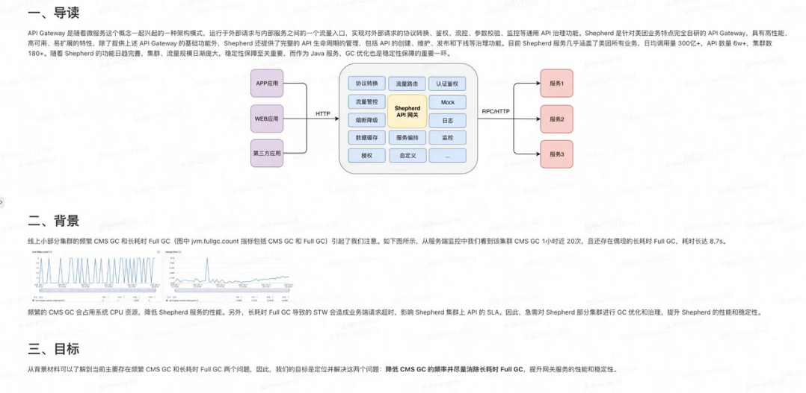

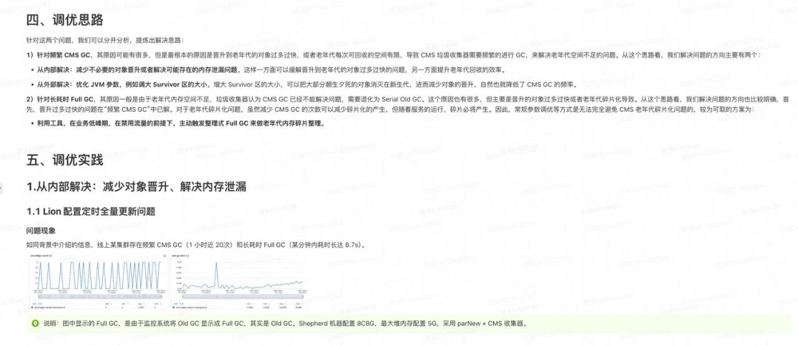

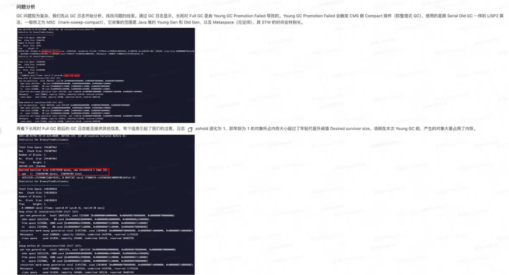

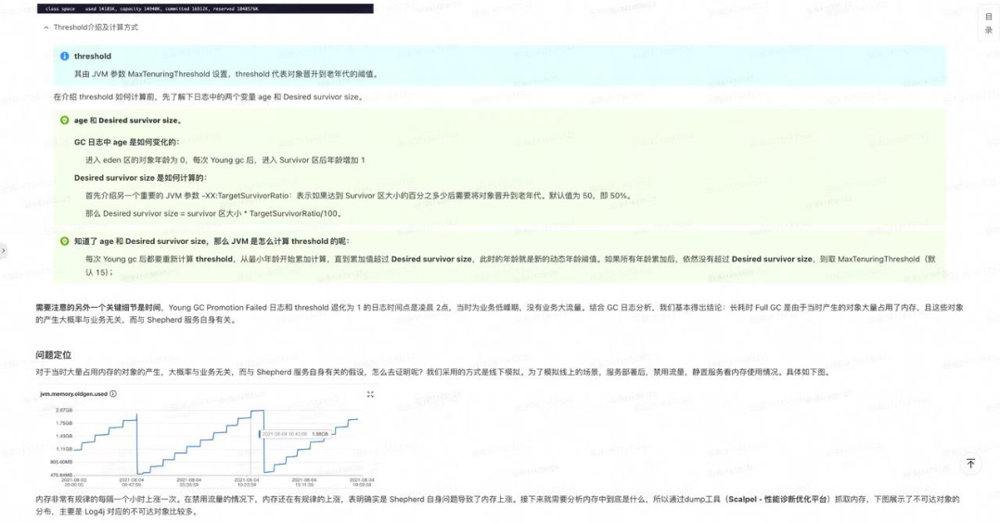

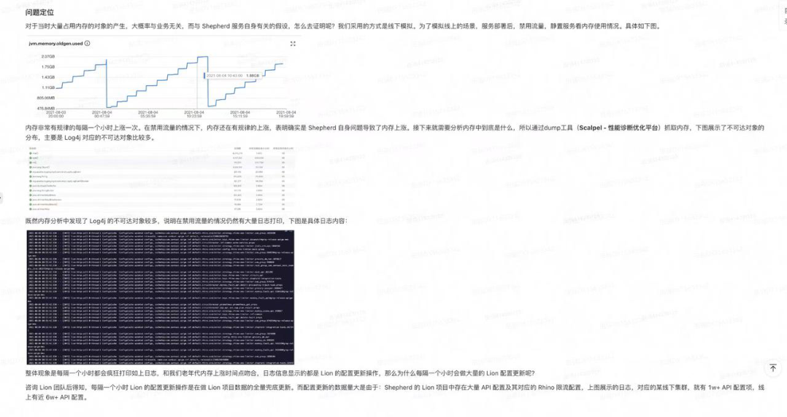

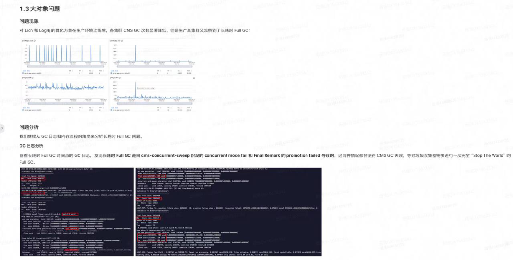

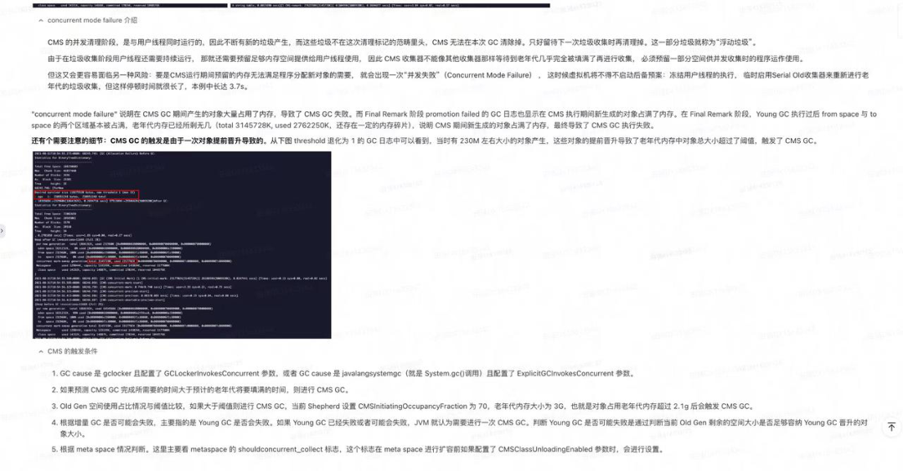

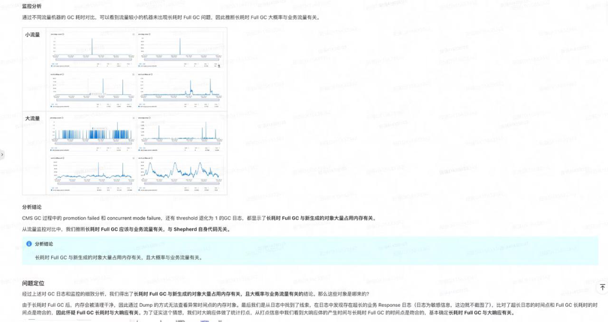

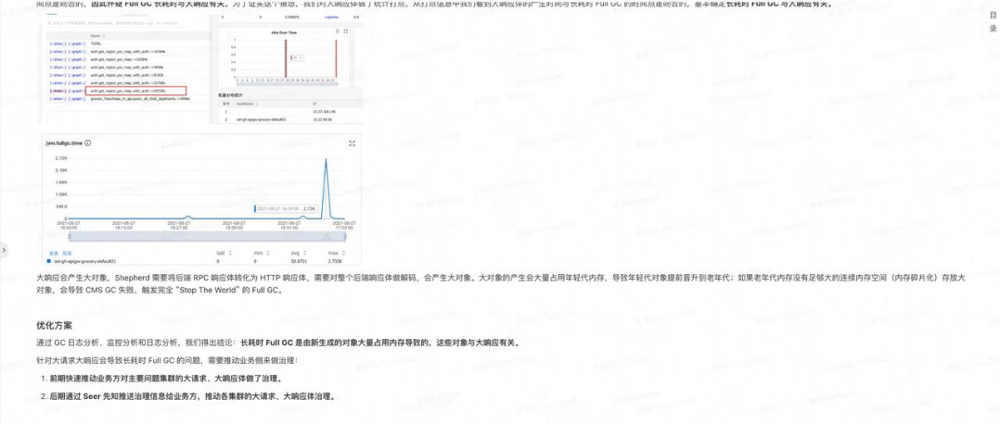

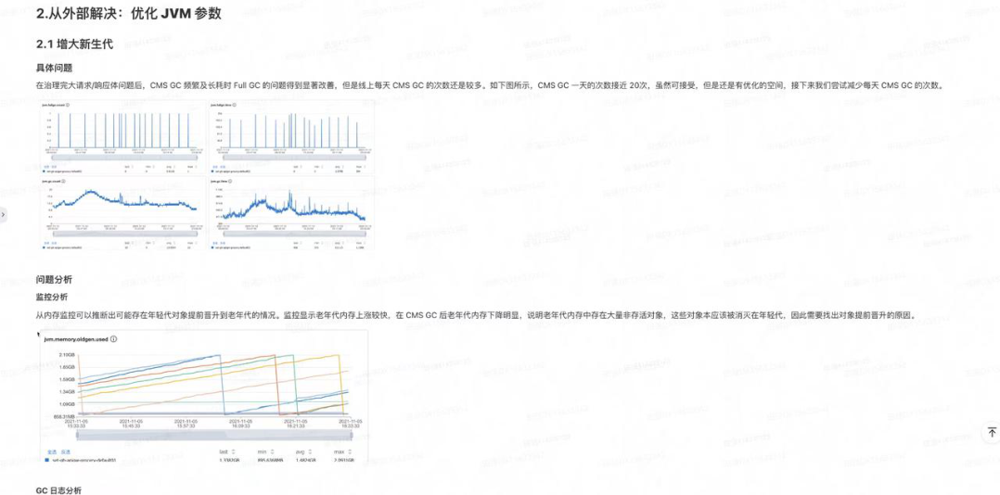

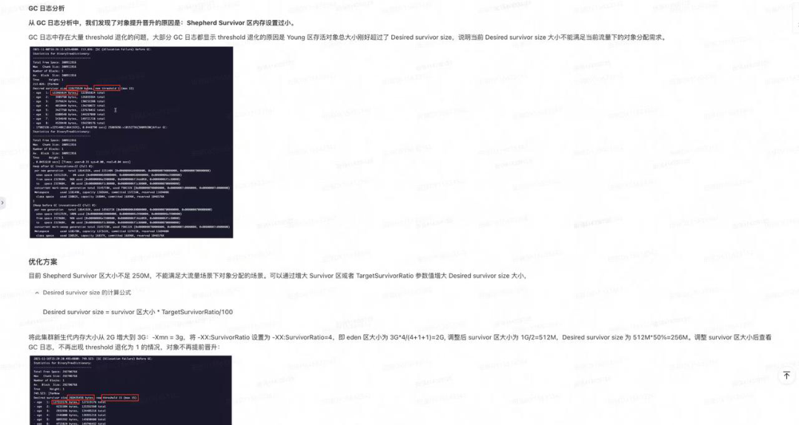

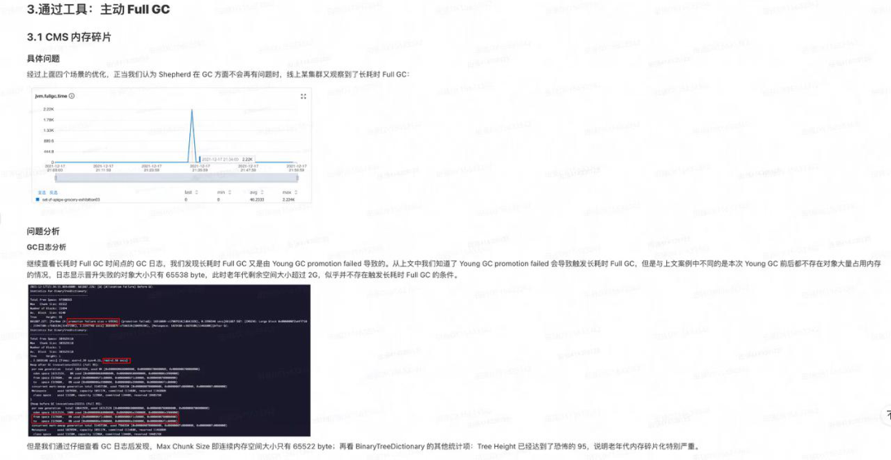

```java
我现在的配置是：/usr/local/java8/bin/java -server -Dfile.encoding=UTF-8 -Dsun.jnu.encoding=UTF-8 -Djava.io.tmpdir=/tmp -Djava.net.preferIPv6Addresses=false -Xmx13g -Xms13g -Xmn7g -XX:SurvivorRatio=8-XX:MetaspaceSize=640m -XX:MaxMetaspaceSize=640m -XX:+HeapDumpOnOutOfMemoryError -XX:ReservedCodeCacheSize=240m -XX:InitialCodeCacheSize=240m -XX:+PrintGCDetails -XX:+PrintHeapAtGC -
XX:+PrintTenuringDistribution -XX:+UseConcMarkSweepGC -XX:+PrintGCTimeStamps -XX:+PrintGCDateStamps -XX:CMSFullGCsBeforeCompaction=0 -XX:+UseCMSCompactAtFullCollection -XX:CMSInitiatingOccupancyFraction=80 -Xloggc:/opt/meituan/logs/tsp_rocks_scene_feed-server/tsp_rocks_scene_feed-server.gc.log -XX:ErrorFile=/opt/meituan/logs/tsp_rocks_scene_feed-server/tsp_rocks_scene_feed-server.vmerr.log -XX:HeapDumpPath=/opt/meituan/logs/tsp_rocks_scene_feed-server/tsp_rocks_scene_feed-server.heaperr.log -Dspring.profiles.active=production -Dapp.key=com.sankuai.bizintegration.homeapi -Djetty.appkey=com.sankuai.bizintegration.homeapi -Dserver.name=tsp_rocks_scene_feed-server org.springframework.boot.loader.JarLauncher 。
触发fullgcGC情况，下述指标情况：
jvm.fullgc.count：1
jvm.fullgc.time：703
jvm.memory.oldgen.used：3GB
jvm.memory.oldgen.used.percent：49.98%
jvm.younggc.count：5
jvm.thread.count：583
补充信息：
1、fullgc后，jvm.memory.oldgen.used为750MB。
2、单机日常100 qps
3、现在服务为JDK8
4、这个服务为核心接口，接口的返回body大小近200KB。
5、现在机器的配置是，16核/16G/100G。
GC日志：
{Heap before GC invocations=5950 (full 2):
 par new generation   total 6606080K, used 6089912K [0x0000000498800000,0x0000000658800000, 0x0000000658800000)
  eden space 5872128K, 100% used [0x0000000498800000, 0x00000005fee80000,0x00000005fee80000)
  from space 733952K,  29% used [0x000000062bb40000, 0x0000000638fee210,0x0000000658800000)
  to   space 733952K,   0% used [0x00000005fee80000, 0x00000005fee80000,0x000000062bb40000)
 concurrent mark-sweep generation total 6291456K, used 1032702K[0x0000000658800000, 0x00000007d8800000, 0x00000007d8800000)
 Metaspace       used 411703K, capacity 423010K, committed 427520K, reserved 1433600K
  class space    used 41982K, capacity 43517K, committed 44288K, reserved 1048576K
2025-06-20T17:38:54.177+0800: 72959.917: [GC (Allocation Failure) 2025-06-20T17:38:54.177+0800: 72959.918: [ParNew
Desired survivor size 375783424 bytes, new threshold 15 (max 15)
- age   1:   43963408 bytes,   43963408 total
- age   2:   15112440 bytes,   59075848 total
- age   3:   23772688 bytes,   82848536 total
- age   4:   12057984 bytes,   94906520 total
- age   5:   18789272 bytes,  113695792 total
- age   6:   11534416 bytes,  125230208 total
- age   7:      41384 bytes,  125271592 total
- age   8:     930880 bytes,  126202472 total
- age   9:    2604288 bytes,  128806760 total
- age  10:    3347528 bytes,  132154288 total
- age  11:      10696 bytes,  132164984 total
- age  12:      28976 bytes,  132193960 total
- age  13:    1040864 bytes,  133234824 total
- age  14:     949928 bytes,  134184752 total
- age  15:      20200 bytes,  134204952 total
: 6089912K->183053K(6606080K), 0.0195327 secs] 7122614K->1215760K(12897536K),0.0198449 secs] [Times: user=0.23 sys=0.01, real=0.02 secs]
Heap after GC invocations=5951 (full 2):
 par new generation   total 6606080K, used 183053K [0x0000000498800000,0x0000000658800000, 0x0000000658800000)
  eden space 5872128K,   0% used [0x0000000498800000, 0x0000000498800000,0x00000005fee80000)
  from space 733952K,  24% used [0x00000005fee80000, 0x000000060a1435c8,0x000000062bb40000)
  to   space 733952K,   0% used [0x000000062bb40000, 0x000000062bb40000,0x0000000658800000)
 concurrent mark-sweep generation total 6291456K, used 1032707K[0x0000000658800000, 0x00000007d8800000, 0x00000007d8800000)
 Metaspace       used 411703K, capacity 423010K, committed 427520K, reserved 1433600K
  class space    used 41982K, capacity 43517K, committed 44288K, reserved 1048576K
}
```
