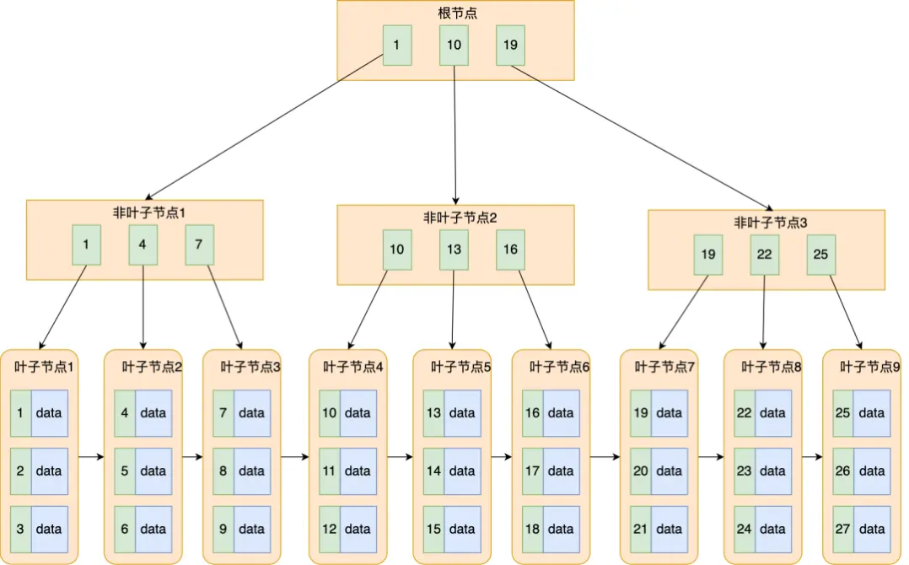
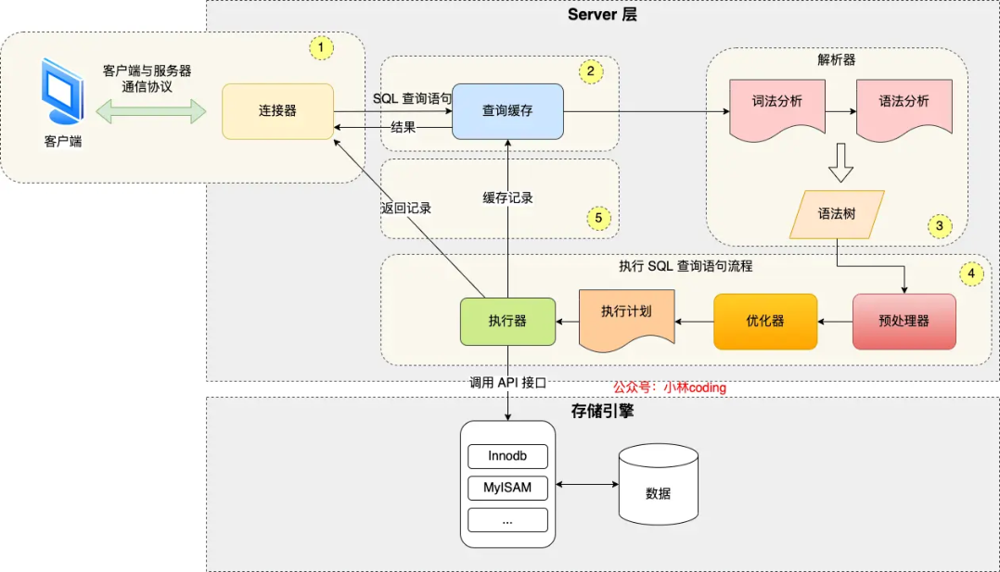
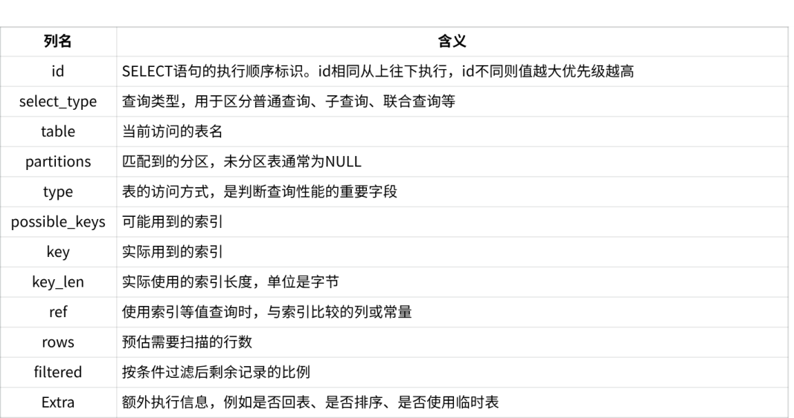
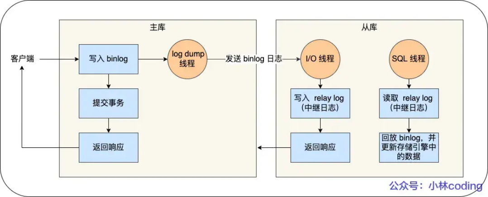
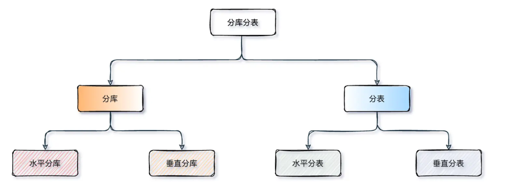
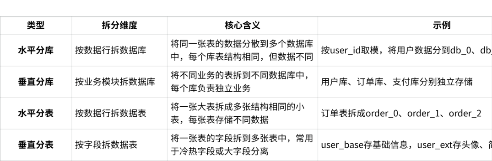
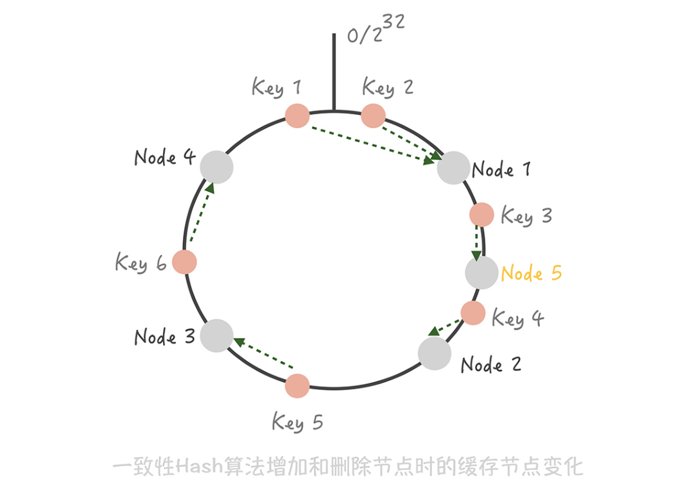

# MySQL

[返回模块目录](../README.md) · [打开完整总文档](../Java后端八股.md)

## 高频题

### 事务

#### 什么是事务

事务是数据库中不可分割的最小执行单元，由一组操作组成，这组操作要么全部成功，要么全部失败，不允许只执行其中一部分。

例如转账场景中，扣款和加款必须作为同一个事务完成，不能分离执行。

#### 事务的四大特性和实现原理

事务的四大特性通常称为ACID，分别是原子性、一致性、隔离性和持久性。前三者更多是实现手段，最终目标是保证一致性。

1. 原子性（Atomicity，A）：事务是不可分割的最小执行单元，事务中的多个操作要么全部成功，要么全部失败，不能只执行其中一部分。

    - 主要依赖`Undo Log` 实现。事务执行过程中，数据库会记录修改前的数据状态。如果事务失败或主动回滚，就通过`Undo Log` 将数据恢复到事务执行前的状态。

2. 持久性（Durability，D）：事务一旦提交，对数据的修改就必须永久生效，即使数据库宕机，恢复后数据也不能丢失。

    - 实现原理：主要依赖`Redo Log` 实现。事务提交前，数据库会把修改记录写入`Redo Log` ，宕机恢复时再根据`Redo Log` 重做已提交事务的修改，保证提交后的数据不会丢失。

3. 隔离性（Isolation，I）：多个事务并发执行时，彼此之间不能互相干扰，一个事务不能随意读取到其他事务未提交的中间状态。

    - 主要依赖`MVCC` 和锁机制实现。`MVCC` 通过多版本数据控制事务之间的读写可见性，锁机制用于控制并发操作冲突，尤其是写写冲突。

4. 一致性（Consistency，C）：事务执行前后，数据必须满足业务规则和完整性约束。例如转账场景中，无论事务成功还是失败，账户总金额都应该保持正确。

    - 一致性不是单独由某一个机制直接实现，而是由原子性、隔离性和持久性共同保证。只有事务能正确回滚、并发互不干扰、提交后数据不丢失，最终才能保证数据一致。

#### 并发事务会出现什么问题

并发事务问题是指多个事务同时执行时，由于事务之间相互影响，可能导致读取到不一致或不正确的数据。为了解决这些问题，数据库引入了事务隔离级别，通过控制不同事务之间的数据可见性，降低并发执行带来的异常。

并发事务常见问题主要有三类：

1. 脏读：一个事务读取到了另一个事务尚未提交的数据。如果后者发生回滚，前者读到的就是无效数据。

2. 不可重复读：一个事务内多次读取同一条记录，但由于其他事务提交了修改，导致前后两次读到的数据不一致。重点是同一行数据内容发生变化。

3. 幻读：一个事务内多次执行相同范围查询，但由于其他事务插入或删除了符合条件的数据，导致前后两次查询结果的行数不一致。重点是结果集行数发生变化。

#### 事务隔离级别和实现原理

事务隔离级别用于解决并发事务带来的脏读、不可重复读和幻读问题。本质是通过控制事务之间的数据可见性，在一致性和并发性能之间做权衡。隔离级别越高，数据一致性越强，并发性能越低。

1. 读未提交（Read Uncommitted，RU）：一个事务还没有提交时，它对数据的修改就可以被其他事务看到。

    - 基本不做隔离控制，因此实现成本最低，但会出现脏读、不可重复读和幻读问题。

2. 读已提交（Read Committed，RC）：一个事务提交之后，它对数据的修改才能被其他事务看到。

    - 主要依赖`MVCC` 实现。每次读取都会生成新的Read View，因此只能读到其他事务已经提交的数据，但同一事务内多次读取可能结果不同，所以可能出现不可重复读和幻读。

3. 可重复读（Repeatable Read，RR）：一个事务内多次读取同一条记录，读到的数据内容保持一致。它是MySQL InnoDB的默认隔离级别。

    - 主要依赖`MVCC` 实现。事务第一次读取时生成Read View，后续读取复用同一个Read View，因此可以保证同一事务内读取结果一致。按SQL标准仍可能出现幻读，但MySQL InnoDB通过`Next-Key Lock` 和间隙锁降低或避免幻读问题。

4. 串行化（Serializable）：事务按串行方式执行，读写之间会互相阻塞，可以最大程度保证数据一致性。

    - 主要依赖加锁实现。读操作加读锁，写操作加写锁，发生读写冲突时后访问的事务必须等待前一个事务完成，因此脏读、不可重复读和幻读都不会出现。

##### (追问)RR和RC的区别

RR和RC都是InnoDB中基于`MVCC` 实现的事务隔离级别，核心区别体现在快照读、锁机制和Binlog支持三个方面。RC更强调读取已提交数据，并发性能更好，但可能出现不可重复读；RR强调同一事务内读取结果一致，是MySQL InnoDB的默认隔离级别，并通过锁机制进一步减少幻读问题。

1. 快照读

    - RC每次查询生成新的ReadView：在读已提交隔离级别下，事务中的每次快照读都会重新创建`ReadView` ，因此同一个事务中后一次查询可能读到其他事务刚提交的数据，所以可能出现不可重复读。

    - RR只在第一次查询生成ReadView：在可重复读隔离级别下，事务第一次快照读时创建`ReadView` ，后续查询复用同一个`ReadView` ，因此同一事务内多次读取同一数据结果保持一致，解决了不可重复读问题。

    - 核心区别：RC和RR的本质差异在于`ReadView` 生成时机不同，RC是每次查询生成，RR是事务内首次查询生成并复用。

2. 锁机制

    - Record Lock：记录锁，锁住具体的索引记录。

    - Gap Lock：间隙锁，锁住索引记录之间的间隙。

    - Next-Key Lock：临键锁，是`Record Lock` 和`Gap Lock` 的组合，同时锁住索引记录和记录之间的间隙，范围通常是左开右闭。

    - RC只使用Record Lock：在RC隔离级别下，通常只会对索引记录加`Record Lock` ，不会使用`Gap Lock` 和`Next-Key Lock` ，因此无法很好阻止其他事务插入符合范围条件的新数据。

    - RR支持Gap Lock和Next-Key Lock：在RR隔离级别下，为了减少或解决幻读问题，除了`Record Lock` ，还会使用`Gap Lock` 和`Next-Key Lock` ，从而限制范围内的新数据插入。

3. 主从同步

    - Binlog格式：MySQL的`Binlog` 主要有`statement` 、`row` 和`mixed` 三种格式。

    - RC要求Row格式：RC隔离级别下，只支持或更推荐使用`row` 格式的`Binlog` ，因为RC下读到的数据可能随提交变化，使用SQL原文同步容易导致主从结果不一致。

    - RR支持三种格式：RR隔离级别下可以支持`statement` 、`row` 和`mixed` 三种`Binlog` 格式，兼容性更强。

#### 为什么互联网公司选择使用RC作为隔离模式

互联网公司更常选择RC，核心原因是提升并发能力、减少锁冲突和降低死锁概率。互联网业务通常读写并发很高，相比RR更强的一致性约束，RC在很多业务场景下已经够用，同时能换来更好的数据库吞吐量。

1. 提升并发能力

    - RC隔离级别下，加锁时通常只对需要修改的记录加`Record Lock` ，不需要额外添加`GapLock` 和`Next-Key Lock` 。

    - RR隔离级别为了减少幻读问题，会引入`Gap Lock` 和`Next-Key Lock` ，锁住记录之间的间隙，导致锁范围更大。

    - 锁范围越大，事务之间越容易互相阻塞，并发性能越差。因此在高并发互联网场景中，RC通常比RR更容易获得更高吞吐量。

2. 减少死锁概率

    - RR由于会使用`Gap Lock` 和`Next-Key Lock` ，锁的粒度更大，事务之间发生等待的概率更高。

    - 当多个事务分别持有不同资源，又互相等待对方释放资源时，就会产生死锁。

    - RC锁范围更小，锁冲突更少，因此死锁概率相对更低。

3. 业务上通常可以接受

    - 很多互联网业务更关注高并发、低延迟和高吞吐，对一致性要求可以通过业务逻辑、乐观锁、唯一索引、幂等设计等方式补充。

    - 因此在一致性要求不是极端严格的场景下，选择RC可以在保证基本正确性的同时，获得更好的性能表现。

### MVCC

#### 什么是MVCC

MVCC是多版本并发控制，核心思想是为同一条数据维护多个版本，让读操作读取符合当前事务可见性的版本，从而减少读写冲突，避免读操作被写操作阻塞。

MVCC的典型应用是MySQL InnoDB，它通过MVCC实现读已提交和可重复读隔离级别。

#### MVCC的实现原理

MVCC的实现依赖隐藏字段、Undo Log版本链和ReadView读视图。整体逻辑是：更新数据时生成新版本并保留旧版本，查询数据时通过ReadView判断版本是否可见。如果最新版本不可见，就沿着`roll_pointer` 从`Undo Log` 版本链中查找历史版本。

1. 版本链生成

InnoDB会在每行记录中维护两个关键隐藏字段：

- `trx_id` ：记录最后一次修改该行数据的事务ID

- `roll_pointer` ：指向该行数据的上一个历史版本

每次事务修改数据时，都会生成一个新的数据版本，并把旧版本写入`Undo Log` 。多个历史版本通过`roll_pointer` 连接起来，形成一条版本链。

2. ReadView创建

事务执行查询时，会创建一个`ReadView` ，用于判断当前事务可以看到哪些数据版本。

`ReadView` 主要包含四个字段：

- `m_ids` ：当前活跃事务ID列表，活跃事务指已经开始但还未提交或回滚的事务

- `min_trx_id` ：当前活跃事务中的最小事务ID

- `max_trx_id` ：下一个即将分配的事务ID

- `creator_trx_id` ：创建该`ReadView` 的当前事务ID

3. 版本可见性判断

InnoDB会先通过查询语句定位到最新版本的数据行，再根据该版本的`trx_id` 和`ReadView` 判断是否可见。

- `trx_id = creator_trx_id` ：说明当前事务正在访问自己修改过的数据，该版本可见

- `trx_id < min_trx_id` ：说明生成该版本的事务在`ReadView` 创建前已经提交，该版本可见

- `trx_id >= max_trx_id` ：说明生成该版本的事务在`ReadView` 创建后才开启，该版本不可见，需要通过`roll_pointer` 读取历史版本

- `min_trx_id <= trx_id < max_trx_id` ：说明该版本处于活跃事务范围内，需要继续判断`trx_id` 是否在`m_ids` 中

    - 如果在`m_ids` 中，说明生成该版本的事务在`ReadView` 创建时还未提交，该版本不可见，需要沿版本链继续查找

    - 如果不在`m_ids` 中，说明生成该版本的事务在`ReadView` 创建时已经提交，该版本可见

4. 隔离级别差异

读已提交和可重复读的核心区别在于ReadView生成时机不同。

- 读已提交：每次查询都会生成新的`ReadView` ，所以同一事务内可能读到其他事务新提交的数据，可能出现不可重复读

- 可重复读：事务第一次查询时生成`ReadView` ，后续查询复用同一个`ReadView` ，所以同一事务内多次读取结果保持一致

#### 为什么快照读（MVCC）无法完全防止幻读？

快照读（MVCC）通过读取事务开始时的数据快照，能够解决脏读和不可重复读，但它只能保证已存在记录的一致性，无法限制其他事务插入满足查询条件的新记录，因此 MVCC 本身无法完全解决幻读。

- 快照读读取的是历史版本：事务启动后会生成 Read View，普通 `SELECT`  都基于该快照读取数据，因此多次查询相同数据能够保持一致，不会出现不可重复读。

- 快照读不会加锁：由于不加锁，其他事务仍然可以插入满足查询条件的新记录，MVCC 无法阻止这些插入操作。

- 当前读读取的是最新数据：`UPDATE` 、`DELETE` 、`SELECT ... FOR UPDATE` 、`SELECT... LOCK IN SHARE MODE`  都属于当前读，会读取最新已提交的数据。如果其他事务已经插入了新的记录，这些操作就能够读取甚至修改这些新记录。

例如：

```sql
-- 事务A
START TRANSACTION;

SELECT * FROM t WHERE id > 5;   -- 快照读，只看到旧数据

-- 事务B
INSERT INTO t VALUES(11,...);
COMMIT;

-- 事务A
UPDATE t SET x = 1 WHERE id > 5;
```

`UPDATE`  属于当前读，因此会更新到 `id=11`  这条新插入的数据。

之后事务 A 再执行普通 `SELECT`  时，由于事务自身修改的数据始终可见，就会发现结果中多出了一条 `id=11` ，这就是面试中常说的"幻读"场景。

为什么 InnoDB 的 RR 又说解决了幻读？

这是很多人容易混淆的地方。

- MVCC（快照读）：保证一致性读，但不能阻止其他事务插入新数据。

- Next-Key Lock（当前读）：通过记录锁 + 间隙锁锁住查询范围，阻止其他事务插入满足条件的新记录。

因此，真正解决幻读的是 Next-Key Lock，而不是 MVCC。InnoDB 的 RR 隔离级别实际上是依靠"MVCC + Next-Key Lock"共同实现对幻读的防护。

### 索引

#### B+树索引

##### 什么是B+树

B+树是一种多路平衡查找树，常用于数据库索引结构。B+树的非叶子节点只存索引，不存真实数据；叶子节点存储完整数据或数据指针；所有叶子节点通过链表连接。

B+树既能通过多路分叉降低树高、减少磁盘I/O，又能通过叶子节点链表高效支持范围查询。



补充说明：

InnoDB每次磁盘I/O的基本单位是页，默认大小为16KB。在B+树索引中，每个节点通常对应一个页，因此一次查询需要访问多少层节点，就大致对应多少次磁盘I/O。

##### 为什么InnoDB使用B+树作为索引的数据结构

InnoDB使用B+树作为索引结构，核心原因是B+树既能降低树高、减少磁盘I/O，又能高效支持范围查询。

1. 哈希表：哈希表适合等值查询，时间复杂度接近`O(1)` ，但哈希值是无序的，不适合范围查询。遇到`>` 、`<` 、`between` 这类范围条件时，通常无法快速定位连续数据，只能退化为扫描。

2. 二叉树：二叉树每个节点最多只有两个子节点，数据量大时树的层级会很高。由于树高越高，查询时需要访问的磁盘页越多，因此二叉树会带来较多磁盘I/O，不适合作为InnoDB索引结构。

3. B树：B树是多叉平衡查找树，层级比二叉树更低。但B树的非叶子节点既存储索引数据，也存储记录数据。由于记录数据通常比索引数据大很多，而一个节点大小固定为一页16KB，所以单个节点能存放的索引项变少，分支因子变小，树高相对增加，查询时磁盘I/O也会变多。

4. B+树：B+树也是多叉平衡查找树，但非叶子节点只存储索引数据，所有记录数据都存储在叶子节点。这样非叶子节点可以容纳更多索引项，分支因子更大，树的高度更低，查询时磁盘I/O次数更少。同时，B+树的叶子节点之间通过双向链表连接，范围查询时只需要定位到起点，再沿链表顺序扫描即可，因此非常适合InnoDB索引。

##### B树和B+树的区别是什么

B树和B+树都是多路平衡查找树，区别主要在于数据存储位置、分支因子、范围查询能力和查询稳定性。

1. 数据存储不同：B树的所有节点都会存储索引和记录数据。B+树的非叶子节点只存索引，真实记录数据或数据指针只存储在叶子节点。

2. 分支因子不同：B树的非叶子节点存了记录数据，占用空间更大，所以一个节点能容纳的索引更少，分支因子较低。B+树非叶子节点只存索引，一个节点能容纳更多索引，分支因子更高，树的高度更低。

3. 范围查询能力不同：B树的叶子节点之间没有天然链表结构，范围查询效率较低。B+树的所有叶子节点通过双向链表连接，定位到范围起点后可以顺序扫描，范围查询更高效。

4. 查询稳定性不同：B树的数据可能在非叶子节点就被找到，不同数据查询路径长度可能不同。B+树的数据一定在叶子节点获取，每次查询都会走到叶子节点，查询路径更稳定。

InnoDB选择B+树，核心原因是B+树的非叶子节点只存索引，树更矮，磁盘I/O更少，并且叶子节点链表天然适合范围查询。

#### 什么是聚簇索引和非聚簇索引

聚簇索引和非聚簇索引是数据库中两种不同的数据组织方式，核心区别在于索引和数据是否存储在一起。在InnoDB中，主键索引就是聚簇索引，非主键索引就是非聚簇索引，也叫二级索引。

1. 聚簇索引

聚簇索引是将索引和数据存储在一起的索引结构。在InnoDB中，聚簇索引通常就是主键索引，它的非叶子节点存储索引值，叶子节点存储整行记录。也就是说，通过主键索引查到叶子节点后，就可以直接拿到完整数据，不需要再回表。

一个表只能有一个聚簇索引，因为表中的数据只能按照一种顺序组织存储。InnoDB默认使用主键作为聚簇索引；如果没有主键，会选择第一个非空唯一索引；如果两者都没有，会自动生成隐藏的`DB_ROW_ID` 作为聚簇索引。

2. 非聚簇索引

非聚簇索引是将索引和数据分开存储的索引结构。在InnoDB中，非聚簇索引就是非主键索引，也叫二级索引。它的非叶子节点存储索引值，叶子节点存储索引值和对应的主键值，而不是整行数据。

一个表可以有多个非聚簇索引。通过非聚簇索引查询时，会先在二级索引树中找到对应的主键值，再根据主键值回到聚簇索引树中查询整行记录，这个过程就是回表查询。

#### 数据库查询什么情况下会回表？

回表是 InnoDB 中使用二级索引查询时，由于二级索引叶子节点只保存"索引列 + 主键值"，如果需要获取其他字段，就需要根据主键再次到聚簇索引查询完整数据，这个过程称为回表。

- 查询字段未被索引覆盖：当查询的字段不在当前二级索引中时，需要先通过二级索引找到主键，再到聚簇索引获取完整数据。

```sql
CREATE INDEX idx_name ON employees(name);

SELECT salary
FROM employees
WHERE name = '张三';
```

`idx_name`  中只有 `name`  和主键，没有 `salary` ，因此需要回表获取 `salary` 。

- 使用二级索引查询 SELECT * ：虽然查询条件命中了二级索引，但由于需要返回整行数据，仍然需要回表。

```sql
SELECT *
FROM employees
WHERE name = '张三';
```

二级索引无法保存所有字段，因此需要根据主键回表查询。

- 覆盖索引不会回表：如果查询的所有字段都已经包含在二级索引中，可以直接返回结果，不需要访问聚簇索引。

```sql
CREATE INDEX idx_name_age ON employees(name, age);

SELECT name, age
FROM employees
WHERE name = '张三';
```

由于 `name` 、`age`  都在索引中，因此不会回表。

#### 什么是索引覆盖

索引覆盖是指查询所需的字段都能直接从二级索引树中获取，不需要再回到聚集索引树查询整行数据，因此可以避免回表查询。

例如：

```sql
select id, name from t_user where name = 'Tom';
```

如果`name` 是二级索引，二级索引叶子节点中存储的是`name` 和主键值`id` 。这条SQL只需要查询`id` 和`name` ，都能从`name` 索引树中拿到，不需要再回到主键索引树查询整行记录。

#### 索引失效有哪些情况

索引失效指SQL语句中虽然字段建立了索引，但由于写法不符合索引使用规则，优化器无法利用索引快速定位数据，最终可能退化为全表扫描。常见原因包括对索引列做函数或表达式计算、发生隐式类型转换、like 左模糊、联合索引不满足最左前缀法则，以及OR 条件中存在未索引字段。

1. 对索引列使用函数

如果在索引列上使用函数，MySQL无法直接使用B+树中原始字段值进行查找，可能导致索引失效。

```sql
select * from t_user where length(name) = 6;
```

如果`name` 字段有索引，这种写法也可能无法使用索引。因为索引中存储的是`name` 原始值，而不是`length(name)` 的计算结果。

2. 对索引列进行表达式计算

如果在索引列上做计算，MySQL需要逐行计算表达式结果，无法直接通过索引定位数据。

```sql
select * from t_user where id + 1 = 10;
```

更推荐改成下面这种写法：

```sql
select * from t_user where id = 9;
```

核心原则是不要让索引列参与计算，要把计算放到常量一侧。

3. 发生隐式类型转换

如果索引字段类型和查询条件类型不一致，MySQL可能会对索引列做隐式转换，导致索引失效。

```sql
select * from t_user where phone = 1300000001;
```

如果`phone` 是字符串类型，MySQL会把字符串转成数字再比较，相当于：

```sql
select * from t_user where cast(phone as signed int) = 1300000001;
```

这等价于对索引列使用函数，可能导致索引失效。正确写法是保持类型一致：

```sql
select * from t_user where phone = '1300000001';
```

4. like 以通配符开头

B+树索引依赖从左到右的有序匹配，如果`like` 以`%` 开头，无法确定查询前缀，索引可能失效。

```sql
select * from t_user where name like '%ming';
```

可以使用索引的写法是右模糊匹配：

```sql
select * from t_user where name like 'ming%';
```

因为`ming%` 有明确前缀，MySQL可以利用索引进行范围查找。

5. 联合索引不满足最左前缀法则

联合索引必须从最左列开始连续匹配。假设建立联合索引：

```sql
create index idx_abc on t_user(a, b, c);
```

可以使用联合索引的情况：

```sql
select * from t_user where a = 1;
select * from t_user where a = 1 and b = 2 and c = 3;
select * from t_user where b = 2 and a = 1;
select * from t_user where c = 3 and b = 2 and a = 1;
select * from t_user where a = 1 and c = 3;
```

`where` 条件中的书写顺序不重要，优化器会调整条件顺序。关键是查询条件中必须包含联合索引最左侧字段`a` 。

不满足最左前缀法则的情况：

```sql
select * from t_user where b = 2;
select * from t_user where c = 3;
select * from t_user where b = 2 and c = 3;
```

这些写法缺少最左侧字段`a` ，无法从联合索引树的最左列开始定位数据，因此联合索引无法被有效使用。

6. 联合索引中范围查询后的列可能失效

联合索引中如果某一列使用范围查询，那么它右侧的索引列通常无法继续用于精确匹配。

```sql
create index idx_abc on t_user(a, b, c);

select * from t_user where a = 1 and b > 2 and c = 3;
```

这里`a` 可以使用索引，`b` 可以使用索引做范围查找，但`c` 通常无法继续利用联合索引做精确定位。原因是范围查询会破坏后续字段的有序匹配能力。

7. OR 条件使用不当

`OR` 两边的条件如果一边有索引，另一边没有索引，优化器可能放弃索引，直接走全表扫描。

```sql
select * from t_user where id = 1 or age = 18;
```

如果`id` 有索引，但`age` 没有索引，整体查询仍可能无法有效使用索引。因为只要`age = 18` 需要全表扫描，整体结果就可能退化为全表扫描。

#### 最左前缀法则

最左前缀法则是指使用联合索引时，查询条件必须从联合索引的最左列开始连续匹配，才能有效使用索引。

例如有一个联合索引：

```sql
create index idx_abc on t_user(a, b, c);
```

这个索引是按照`a -> b -> c` 的顺序建立的，所以查询必须先匹配`a` 。

```sql
select * from t_user where a = 1;
select * from t_user where a = 1 and b = 2;
select * from t_user where a = 1 and b = 2 and c = 3;
```

这些SQL都能使用联合索引，因为都从最左边的`a` 开始匹配。

如果查询条件缺少`a` ：

```sql
select * from t_user where b = 2;
select * from t_user where c = 3;
select * from t_user where b = 2 and c = 3;
```

这些SQL就无法有效使用`idx_abc` ，因为联合索引树是先按`a` 排序，再按`b` 排序，最后按`c` 排序。缺少最左边的`a` ，数据库无法直接根据`b` 或`c` 在这棵索引树中定位数据。

##### (追问)最左前缀法则的原理是什么

最左前缀法则存在的原因是联合索引的底层B+树是按照索引字段的定义顺序排序的。例如联合索引`(a,b,c)` ，索引树会先按`a` 排序，在`a` 相同的情况下再按`b` 排序，最后再按`c` 排序。因此只有先确定最左侧字段`a` ，后面的`b` 、`c` 才是有序可查的。如果查询条件缺少`a` ，数据库无法直接根据`b` 或`c` 在索引树中定位数据，所以联合索引会失效。

### 日志

MySQL常见日志主要包括`Redo Log` 、`Undo Log` 和`Binlog` 。从架构上看，MySQL分为Server层和存储引擎层，不同日志所属层级不同，作用也不同。

- Redo Log：属于存储引擎层，是InnoDB特有的日志，主要用于保证事务的持久性。

- Undo Log：属于存储引擎层，也是InnoDB特有的日志，主要用于事务回滚和MVCC。

- Binlog：属于Server层，所有存储引擎都可以使用，主要用于主从复制和数据恢复。

#### 很多冗余索引有什么缺点？

索引能够提高查询效率，但并不是越多越好。过多或冗余的索引会增加写入成本、占用存储空间，并影响优化器选择执行计划。

- 降低写性能：执行 `INSERT` 、`UPDATE` 、`DELETE`  时，不仅需要修改数据，还需要同步维护所有相关索引。索引越多，需要更新的 B+Tree 越多，写入性能越差。

- 占用更多存储空间：每个索引都会维护一棵 B+Tree，需要额外存储索引键、主键值以及页结构。冗余索引会增加磁盘占用，同时也会增加备份、恢复和缓存的成本。

- 增加优化器开销：SQL 执行前，优化器需要在多个索引中选择最优执行计划。索引过多会增加优化成本，甚至可能因为统计信息等原因选择非最优索引，导致查询性能下降。

- 增加维护成本：索引越多，重建索引、统计信息更新、数据迁移等维护操作耗时越长，也增加了数据库管理成本。

例如：

```text
INDEX idx_name(name)
INDEX idx_name_age(name, age)
```

如果业务几乎不会单独按照 `name`  查询，那么 `idx_name`  就属于冗余索引，因为联合索引`(name, age)`  已经可以利用最左前缀原则支持 `name`  的查询。

#### Redo Log

`Redo Log` 是InnoDB存储引擎用于保证事务持久性的日志，核心思想是`WAL` ，即先写日志，再写数据页。事务提交时，InnoDB先把数据页的物理修改记录到`Redo Log` 并刷盘，数据页本身可以先缓存在内存中，之后再异步刷盘。这样既减少了直接刷数据页带来的随机I/O开销，又能在数据库崩溃后通过`Redo Log` 恢复已提交的数据。

`Redo Log` 的核心机制如下：

- 解决持久性与性能的矛盾：如果每次修改都直接把数据页写入磁盘，会产生大量随机I/O，成本很高。如果只把脏页暂存在内存中并延迟刷盘，数据库崩溃时又可能丢失已提交事务的数据。因此InnoDB通过`Redo Log` 先记录修改，兼顾写入性能和事务持久性。

- 采用WAL机制：`WAL` 表示`Write-Ahead Logging` ，即事务提交前先把修改写入`Redo Log`磁盘文件，再由后台线程将脏页异步刷盘。`Redo Log` 记录的是数据页的物理修改，例如某个页的某个偏移位置被改成什么值。

- 顺序I/O提升性能：直接刷数据页通常是随机I/O，而写`Redo Log` 是顺序I/O。`Redo Log` 文件大小固定，并采用循环写入方式，不断覆盖最早的内容，因此写入效率比随机刷数据页更高。

- 崩溃恢复数据：如果事务提交后`Redo Log` 已经刷盘，但对应的数据页还没刷盘，此时数据库崩溃，重启后InnoDB可以根据`Redo Log` 重放修改，把已提交事务的数据恢复出来。

例如执行：

```sql
UPDATE accounts SET balance = balance - 100 WHERE id = 1;
```

InnoDB会先找到`id=1` 所在的数据页，在内存中把`balance` 从`500` 改为`400` ，然后生成一条`Redo Log` ，记录页号、偏移位置和修改后的值。事务提交时，`Redo Log` 先刷盘，数据页可以暂时不刷盘。如果此时数据库崩溃，重启后会通过`Redo Log` 重新应用这次修改，保证已提交事务的数据不丢失。

#### Undo Log

`Undo Log` 是InnoDB用于保证事务原子性并支持`MVCC` 的日志。它记录的是数据修改的反向操作，也就是逻辑日志。当事务需要回滚时，InnoDB可以根据`Undo Log` 撤销已经执行的修改；当事务并发读取时，InnoDB也可以通过`Undo Log` 形成的版本链读取历史版本数据。

`Undo Log` 的核心作用如下：

- 保证事务原子性：事务中的操作要么全部成功，要么全部失败。`Undo Log` 会记录每次修改对应的反向操作，如果事务执行失败或主动回滚，就根据这些反向操作把数据恢复到事务开始前的状态。例如某个字段从`100` 改成`200` ，`Undo Log` 会记录将`200` 恢复为`100` 的操作，从而撤销本次修改。

- 支持MVCC版本链：每次修改数据行时，InnoDB都会生成一条`Undo Log` 记录，保存旧版本数据，并通过`roll_pointer` 指向更早的历史版本。多个历史版本通过`roll_pointer` 串联起来，形成版本链。每个版本还会关联`trx_id` ，用于标识生成该版本的事务。

- 支持一致性读：事务读取数据时，InnoDB会根据当前事务的`ReadView` 和数据版本的`trx_id`判断该版本是否可见。如果最新版本不可见，就沿着`roll_pointer` 到`Undo Log` 版本链中查找上一个历史版本，直到找到当前事务可见的数据版本。这样就能在不加锁的情况下实现并发读写。

#### BinLog

`Binlog` 是MySQL Server层的二进制日志，用于记录数据库的表结构变更和表数据修改，例如`create` 、`alter` 、`insert` 、`update` 、`delete` 等操作。它不会记录`select` 和`show` 这类只读操作。`Binlog` 主要用于数据备份、灾难恢复和主从同步，通常在事务提交时写入。

`Binlog` 支持三种格式：

1. Statement格式：记录的是SQL语句原文。

    - 优点：日志内容少，文件体积小，写入和同步成本较低。

    - 缺点：可能导致主从数据不一致。例如使用`now()` 、`uuid()` 等函数时，主库和从库执行同一条SQL可能得到不同结果。

2. Row格式：记录的是每一行数据的具体变化，而不是SQL原文。

    - 记录内容：`insert` 会记录新插入行的字段值，`update` 会记录更新前后的字段值，`delete` 会记录删除前的字段值。

    - 优点：能更好保证主从同步的数据一致性，避免Statement格式中由于函数、触发器等导致的不确定问题。

    - 缺点：记录内容更多，尤其是批量修改或批量插入时，会产生较大的日志文件，增加磁盘I/O和主从同步的网络开销。

3. Mixed格式：由MySQL根据SQL情况在Statement和Row之间自动选择。

    - 默认策略：一般优先使用Statement格式记录SQL语句。

    - 特殊场景：遇到可能导致主从不一致的SQL时，自动切换为Row格式记录数据变化。

    - 特点：在性能和一致性之间做折中，既减少日志体积，又尽量避免主从数据不一致。

### 执行SQL的过程与顺序

#### 执行SQL查询语句的过程是什么

- 连接器：建立连接、管理连接、校验用户身份；

- 查询缓存：查询语句如果命中查询缓存则直接返回，否则继续往下执行。MySQL 8.0 已删除该模块；

- 解析SQL：通过解析器对 SQL 查询语句进行词法分析、语法分析，然后构建语法树，方便后续模块读取表名、字段、语句类型；

- 执行SQL：执行 SQL 共有三个阶段：

    - 预处理阶段：检查表或字段是否存在；将 select * 中的 * 符号扩展为表上的所有列。

    - 优化阶段：基于查询成本的考虑，选择查询成本最小的执行计划；

    - 执行阶段：根据执行计划执行 SQL 查询语句，从存储引擎读取记录，返回给客户端；



#### 执行一条 UPDATE 语句的流程是什么？

以 `UPDATE student SET age=19 WHERE name='`张三`';`  为例，一条更新语句会经过连接器→解析器→优化器→执行器→存储引擎，在真正修改数据时还会涉及 Redo Log 和 Binlog。

- 查询目标数据：执行器根据 SQL 查找满足条件的记录。若没有合适索引，会进行全表扫描；由于是更新语句，不会使用查询缓存（MySQL 8.0 已移除查询缓存）。

- 修改内存数据：找到记录后，执行器调用 InnoDB 引擎接口修改数据页。数据首先更新到 Buffer Pool，并记录 Redo Log，此时 Redo Log 处于 prepare 状态。

- 写入 Binlog：执行器收到引擎返回后，将本次更新操作写入 Binlog，用于主从复制和数据恢复。

- 提交事务：Binlog 写入成功后，通知 InnoDB 将 Redo Log 从 prepare 状态变为 commit 状态，这就是 两阶段提交（Two-Phase Commit）。

- 返回结果：事务提交成功，客户端收到更新成功的响应；数据页之后会由后台线程异步刷盘。

#### 执行SQL查询关键字的执行顺序

例如一条典型SQL：

```sql
SELECT d.name, COUNT(*) AS emp_count
FROM employee e
JOIN department d ON e.department_id = d.id
WHERE e.salary > 10000
GROUP BY d.name
HAVING COUNT(*) > 5
ORDER BY emp_count DESC
LIMIT 10;
```

逻辑执行顺序如下：

1. FROM：确定查询的数据来源，例如先找到`employee` 表。

2. ON：处理表连接条件，例如判断`e.department_id = d.id` 是否成立。

3. JOIN：根据连接条件合并`employee` 和`department` 两张表的数据。

4. WHERE：对连接后的行数据进行过滤，例如只保留`salary > 10000` 的员工记录。

5. GROUP BY：按照指定字段进行分组，例如按部门名称`d.name` 分组。

6. HAVING：对分组后的结果进行过滤，例如只保留员工数量大于`5` 的部门。

7. SELECT：选择最终要返回的字段，例如部门名称和员工数量。

8. DISTINCT：如果有`DISTINCT` ，则对结果去重。

9. ORDER BY：对结果进行排序，例如按照`emp_count` 倒序排列。

10. LIMIT：限制最终返回的行数，例如只返回前`10` 条。

PS：这只是逻辑执行顺序，实际物理执行过程可能会被数据库优化器根据索引、统计信息和查询成本进行调整。

### SQL语句细节

#### Union 和 Union All 有什么区别？

UNION和UNION ALL都用于合并多个查询结果，核心区别在于是否去重。UNION会对合并后的结果去重，UNION ALL会保留所有数据，包括重复记录。

- 去重机制：Union 会对结果集进行去重；Union All 不会去重，直接返回所有结果，包括重复数据。

- 执行效率：Union 需要进行排序或 Hash 去重，因此性能相对较低；Union All 不需要去重，执行效率更高。

- 使用场景：当需要去除重复数据时使用 Union；如果能够确定结果不存在重复，或允许重复数据，优先使用 Union All，以获得更好的性能。

例如：

```sql
SELECT name FROM student
UNION
SELECT name FROM teacher;
```

返回合并后的唯一结果。

```sql
SELECT name FROM student
UNION ALL
SELECT name FROM teacher;
```

返回所有结果，即使存在重复数据也会保留。

#### BETWEEN 是开区间还是闭区间

闭区间

#### LEFT JOIN 和 RIGHT JOIN 有什么区别？

LEFT JOIN 和 RIGHT JOIN 都属于外连接，区别在于保留哪张表的全部数据。

- LEFT JOIN（左连接）：以左表为主，返回左表的所有记录，以及右表中满足关联条件的记录。如果右表没有匹配的数据，则右表对应字段返回 `NULL` 。

```sql
SELECT *
FROM A
LEFT JOIN B
ON A.id = B.id;
```

- 返回 A 表所有数据，没有匹配的 B 表数据用 `NULL`  填充。

- RIGHT JOIN（右连接）：以右表为主，返回右表的所有记录，以及左表中满足关联条件的记录。如果左表没有匹配的数据，则左表对应字段返回 `NULL` 。

```sql
SELECT *
FROM A
RIGHT JOIN B
ON A.id = B.id;
```

- 返回 B 表所有数据，没有匹配的 A 表数据用 `NULL`  填充。

- 两者可以相互转换：将左右两张表交换位置，`LEFT JOIN`  和 `RIGHT JOIN`  可以实现相同的查询效果，因此实际开发中通常优先使用 LEFT JOIN，SQL 可读性更高，也更符合大多数人的编写习惯。

### 深度分页

#### 什么是深分页问题？

深分页是指使用 LIMIT offset, size  查询时，offset  非常大的场景。由于 MySQL 需要先扫描并跳过前面的大量数据，再返回目标数据，因此随着 offset  增大，查询性能会明显下降。

例如：

```sql
SELECT *
FROM users
ORDER BY id
LIMIT 1000000, 20;
```

MySQL 实际需要扫描约 1000020 条记录，只返回最后 20 条，因此性能较差。

#### 为什么深分页查询很慢？

深分页慢的根本原因是 MySQL 无法直接定位到第 offset 条数据，只能先扫描并丢弃前面的记录。

- 即使使用了索引，仍然需要遍历前 `offset`  条索引记录。

- 如果查询字段不能被索引覆盖，还会产生大量回表操作。

- `offset`  越大，扫描的数据越多，性能越差。

#### 深分页有哪些优化方案？

常见的优化方案有游标分页、延迟关联和覆盖索引。

- 游标分页（Keyset Pagination）：记录上一页最后一条记录的主键或排序字段，下一页直接从该位置继续查询，避免扫描大量无效数据。

```sql
SELECT *
FROM users
WHERE id > 1000000
ORDER BY id
LIMIT 20;
```

适用于按主键或唯一有序字段分页，是性能最好的方案。

- 延迟关联（Deferred Join）：先利用索引分页查询主键，再根据主键回表获取完整数据，减少回表次数。

```sql
SELECT u.*
FROM users u
JOIN (
    SELECT id
    FROM users
    ORDER BY create_time
    LIMIT 1000000,20
) t
ON u.id = t.id;
```

适用于查询字段较多、无法使用覆盖索引的场景。

- 覆盖索引：如果查询字段全部包含在索引中，可以直接从索引返回数据，避免回表，提高深分页性能。

#### 为什么游标分页比 LIMIT OFFSET 更快？

游标分页利用索引直接定位到上一页最后一条记录，从该位置继续扫描，而不需要扫描并丢弃前面的大量数据，因此时间复杂度接近 O(limit)，性能远高于 OFFSET 分页。

#### 游标分页有什么缺点？

游标分页不能随机跳页，只能按照上一页、下一页顺序翻页，因此更适用于滚动加载、无限下拉等场景。如果业务需要直接跳转到指定页码，则通常仍需要使用 OFFSET 分页。

### SQL优化

#### SQL的Explain命令解析

`EXPLAIN` 用于查看SQL的执行计划，也就是一条SQL经过MySQL优化器处理后，最终准备如何执行。优化SQL时，通常先看`EXPLAIN` 结果，判断查询顺序、索引使用情况、扫描行数和额外执行开销。

`EXPLAIN` 结果通常包含12列：



其中比较关键的字段主要是`select_type` 、`type` 和`Extra` ：

1. select_type `select_type` 表示查询类型，主要用于区分普通查询、子查询和联合查询。

- `SIMPLE` ：简单查询，不包含`UNION` 或子查询

- `PRIMARY` ：复杂查询中的最外层`SELECT`

- `SUBQUERY` ：子查询中的第一个`SELECT`

- `UNION` ：`UNION` 语句中后面的`SELECT`

- `DERIVED` ：`FROM` 中的子查询，也就是派生表

- `UNION RESULT` ：`UNION` 查询的结果

2. type

`type` 表示访问表的方式，是判断SQL性能最重要的字段之一。常见类型从好到差大致为：

```text
system > const > eq_ref > ref > range > index > ALL
```

- `system` ：表中只有一行数据，访问成本最低

- `const` ：通过主键或唯一索引命中最多一行，只查询一次

- `eq_ref` ：连表查询时，被驱动表通过主键或唯一索引匹配，每次只返回一行

- `ref` ：使用普通索引等值查询，可能匹配多行

- `range` ：使用索引进行范围查询，例如`>` 、`<` 、`between`

- `index` ：扫描整棵索引树，比全表扫描略好

- `ALL` ：全表扫描，性能最差，通常需要重点优化

3. Extra

`Extra` 表示额外执行信息，用来判断SQL是否存在额外开销。

- `Using index` ：使用覆盖索引，不需要回表，性能较好

- `Using where` ：使用`WHERE` 条件过滤数据

- `Using index condition` ：使用索引条件下推，在存储引擎层提前过滤数据

- `Using filesort` ：无法利用索引完成排序，需要额外排序，性能较差

- `Using temporary` ：需要临时表保存中间结果，常见于`GROUP BY` 和`ORDER BY`

- `Using join buffer` ：连接时被驱动表没有有效使用索引，需要借助`join buffer`

看执行计划时，重点关注`type` 是否为`ALL` 、`key` 是否为`NULL` 、`rows` 是否过大，以及`Extra` 中是否出现`Using filesort` 或`Using temporary` 。

#### 慢SQL主要是哪些原因，如何定位

慢SQL是指执行时间超过预期或超过慢查询阈值的SQL。

慢SQL常见原因：

- 数据量太大：表数据过多，查询扫描范围大，导致执行时间变长。

- 并发量太大：大量请求同时访问数据库，产生锁等待、连接等待或资源竞争。

- 索引没有使用或使用不当：字段没有建索引，索引失效，联合索引不符合最左前缀法则，都会导致查询变慢。

- SQL语句书写不当：例如`select *` 、深分页、复杂子查询、`like` 左模糊、对索引列使用函数或表达式。

- 表结构设计不当：字段类型不合理，表过宽，冗余字段过多，冷热数据没有拆分。

- 业务设计不合理：单次查询范围过大，频繁统计大表，接口直接查询明细全量数据。

- 数据库配置或硬件不足：数据库实例性能不足，CPU、内存、磁盘I/O或连接数成为瓶颈。

如何定位慢SQL：

- 开启慢查询日志：通过慢查询日志记录执行时间超过阈值的SQL，例如超过`long_query_time`的语句。

- 分析执行计划：对慢SQL执行`EXPLAIN` ，重点看`type` 、`key` 、`rows` 和`Extra` ，判断是否全表扫描、索引未命中、扫描行数过大，或出现`Using filesort` 、`Using temporary` 。

- 结合业务场景排查：确认慢SQL是在数据量增长后变慢，还是在高并发时变慢，或者是某次代码改动后出现。

#### 如何优化慢SQL

慢SQL优化要先定位原因，再对症处理。

1. 索引优化

主要优化索引没有使用或使用不当导致的慢SQL，例如字段未建索引、索引失效、联合索引顺序不合理、排序分组无法利用索引等问题。

- 控制单表索引数量，一般建议不超过`5` 个。索引过多会降低写入效率，也会增加优化器选择执行计划的成本。

- 联合索引要遵循最左前缀法则，尽量把区分度高、使用频率高的列放在左侧。

- 对`where` 、`order by` 、`group by` 中高频使用的字段建立合适索引，必要时合并成联合索引。

```sql
SELECT age, city, name
FROM user
WHERE age = 20 AND city = 'Beijing'
ORDER BY name;
```

对这种SQL，建立`(age, city, name)` 联合索引通常比单独建立`(age, city)` 和`(name)` 效果更好，因为可以同时支持过滤和排序，减少额外排序开销。

2. SQL语句优化

主要优化SQL写法不当导致的慢SQL，例如`select *` 、深分页、复杂子查询、`like` 左模糊、对索引列使用函数或表达式等问题。

- 避免使用`select *` ，只查询需要的字段，减少解析成本、网络传输和回表开销。

- 多表`join` 时，尽量使用小表驱动大表，减少匹配次数。

- 合并多表数据时，如果业务允许重复，使用`union all` 代替`union` ，避免额外去重开销。

- 避免索引失效写法，例如对索引列使用函数、表达式计算、隐式类型转换和`like '%xxx'` 左模糊查询。

3. 表结构优化

主要优化表结构设计不当导致的慢SQL，例如字段类型不合理、表过宽、大字段影响主表查询、冷热数据没有拆分等问题。

- 经常一起查询的字段可以放在同一张表中，减少多表联查。

- 可以适当反范式设计，保留必要冗余字段，避免高频`join` 。

- 优先选择满足业务需求的最小数据类型，减少存储和索引空间。

- 避免在主表中存储`TEXT` 、`BLOB` 等大字段，文件或图片建议只存地址，大字段可以拆到扩展表。

- 没有特殊需求时，字段尽量定义为`NOT NULL` ，减少额外存储和计算处理。

- 不要用字符串存储日期，优先使用`DATETIME` 、`TIMESTAMP` 或数值型时间戳。

- 单表字段不要过多，冷热字段差异明显时可以冷热分离。

4. 业务优化

主要优化业务设计不合理导致的慢SQL，例如单次查询范围过大、频繁实时统计大表、接口直接查询全量明细数据等问题。

- 避免不合理的深分页需求，例如查询第`1000` 页，可以改为游标分页或限制最大翻页深度。

- 报表类数据不要每次实时计算，`T+1` 数据可以在业务低峰期提前计算并落表。

- 接口查询要限制数据范围，避免一次性加载大量数据。

5. 架构优化

主要优化数据量太大、并发量太高、数据库实例性能不足导致的慢SQL，例如单表数据过多、热点数据访问频繁、连接等待、磁盘I/O瓶颈等问题。

- 使用读写分离，将读操作和写操作分散到不同数据库实例，提高并发处理能力。

- 使用`Redis` 等缓存中间件缓存热点数据，减少数据库访问压力。

- 数据量过大时可以考虑分库分表，降低单表数据量和索引维护成本，但要权衡复杂度。

- 高并发和大数据量场景可以考虑分布式数据库，例如`TiDB` 。

- 数据库实例性能不足时，可以提升CPU、内存、磁盘I/O和连接数配置。

#### 如果SQL已经优化到极致了，偶尔还是很慢，一般是什么原因？

如果 SQL 本身已经优化完成，但仍然偶发性变慢，通常不是 SQL 语句的问题，而是数据库运行环境、资源竞争或执行计划变化导致的。

- 锁等待：事务未及时提交，导致行锁、间隙锁或表锁竞争，SQL 需要等待锁释放后才能继续执行。

- 资源竞争：业务高峰期并发请求增加，CPU、内存、磁盘 I/O 或连接池资源不足，导致 SQL 响应时间变长。

- 磁盘 I/O 抖动：磁盘刷盘、Checkpoint、大量日志写入或底层存储性能波动，都可能导致查询偶尔变慢。

- 执行计划变化：由于统计信息变化、数据量增长或索引选择发生变化，优化器可能选择了效率较低的执行计划。

- 数据分布变化：出现数据倾斜或热点数据，导致某些 SQL 实际扫描的数据量远大于平时。

- 网络延迟：数据库与应用服务器之间网络偶发抖动，导致请求响应时间增加。

- 后台任务影响：数据库执行统计信息收集、索引维护、备份、主从同步、Checkpoint 等后台任务时，可能占用系统资源，影响 SQL 执行性能。

## 扩展题

### MySQL引擎

#### MySQL 常见的存储引擎有哪些？各有什么特点？

MySQL 常见的存储引擎有 InnoDB、MyISAM 和 Memory，其中 InnoDB 是 MySQL 默认的存储引擎，也是生产环境最常用的。

- InnoDB：支持事务、MVCC、行级锁、外键，具有崩溃恢复能力，数据安全性高，适合高并发的增删改查场景。但相比 MyISAM，占用更多的磁盘空间，写入开销也更大。

- MyISAM：不支持事务和外键，采用表级锁，查询速度快，适合以 SELECT、INSERT 为主、对事务一致性要求不高的场景。但并发写性能较差，异常宕机后数据恢复能力较弱。

- Memory：数据存储在内存中，读写速度非常快，默认使用 Hash 索引。但服务器重启后数据会全部丢失，仅表结构保留，因此适合作为临时表、缓存表等场景。

总结：

- InnoDB：支持事务、行锁、外键，生产环境首选。

- MyISAM：查询速度快，不支持事务，适合读多写少。

- Memory：数据存内存，速度最快，但数据不持久化。

#### InnoDB 和 MyISAM 有什么区别？

InnoDB 和 MyISAM 都是 MySQL 的存储引擎，但 InnoDB 更适合高并发事务场景，也是 MySQL 默认的存储引擎；MyISAM 更适合读多写少的场景。

- 事务支持：InnoDB 支持事务，提供 ACID 特性，支持提交、回滚；MyISAM 不支持事务。

- 锁机制：InnoDB 支持行级锁，并发性能高；MyISAM 只支持表级锁，写操作会锁住整张表。

- 外键支持：InnoDB 支持外键，能够保证数据完整性；MyISAM 不支持外键。

- MVCC：InnoDB 支持 MVCC（多版本并发控制），提高并发读写能力；MyISAM 不支持。

- 索引实现：两者都使用 B+Tree，但实现方式不同。InnoDB 的聚簇索引将数据和主键索引存储在一起，主键索引叶子节点直接存储整行数据；MyISAM 的索引和数据分离，索引叶子节点存储的是数据文件地址。

- 崩溃恢复：InnoDB 支持 Redo Log 等机制，具备崩溃恢复能力；MyISAM 不支持，异常宕机可能导致数据损坏。

- 性能特点：MyISAM 查询速度通常更快，但写入并发能力较弱；InnoDB 在高并发、事务处理场景下整体性能更优，也是生产环境的首选。

#### InnoDB 的表数据是如何存储的？

InnoDB 以页为基本存储单位，默认每页 16KB，多个页组成区，多个区组成段。表中的数据和索引主要通过 B+Tree 组织，同时内部还会使用自适应 Hash 索引优化部分等值查询。

- 聚簇索引：InnoDB 的表数据存储在主键索引的 B+Tree 中，叶子节点保存完整的行数据，因此InnoDB 中“表数据本身就是聚簇索引”。

- 主键选择：如果表中存在主键，使用主键构建聚簇索引；如果没有主键，会选择第一个非空唯一索引；如果两者都没有，InnoDB 会生成一个隐藏的 6 字节 Row ID 作为聚簇索引。

- 二级索引：普通索引、唯一索引等都属于二级索引。二级索引的叶子节点保存“索引字段值 + 主键值”，查询完整数据时通常需要先获得主键，再到聚簇索引中查询，这个过程称为回表。

- 覆盖索引：如果查询字段全部包含在二级索引中，可以直接从二级索引返回结果，不需要回表。

- B+Tree 索引：InnoDB 的主键索引、普通索引、唯一索引默认都使用 B+Tree。它适合等值查询、范围查询、排序和最左前缀匹配。

- Hash 索引：InnoDB 不支持用户手动创建普通 Hash 索引，但内部存在自适应 Hash 索引（Adaptive Hash Index）。当某些 B+Tree 索引页被频繁进行等值查询时，InnoDB 会自动为热点数据建立 Hash 索引，以减少 B+Tree 查找次数。

- 自适应 Hash 索引限制：它只适合等值查询，不支持范围查询和排序，并且由 InnoDB 自动创建和维护，用户不能直接指定某个字段建立 Hash 索引。

- 全文索引：InnoDB 支持 Full-Text Index，主要用于文本内容的全文检索。

- 空间索引：InnoDB 支持 Spatial Index，底层使用 R-Tree，主要用于地理空间数据查询。

- 物理文件存储：开启独立表空间后，每张 InnoDB 表通常对应一个 `.ibd`  文件，里面保存表的数据和索引；表结构信息由 MySQL 数据字典统一管理。

#### InnoDB 的自增 ID 是怎么实现的？为什么删除数据后不会复用 ID？

InnoDB 的自增 ID 是通过 AUTO_INCREMENT 计数器实现的。当插入新记录时，InnoDB 会自动生成一个比当前计数器更大的值作为主键，并更新计数器，保证每条记录拥有唯一的自增 ID。

- 生成过程：插入数据时，InnoDB 获取当前 AUTO_INCREMENT 计数器的值，将其分配给新记录，然后将计数器递增，再完成数据写入。

- 计数器维护：MySQL 8.0 之前，自增计数器主要保存在内存中，数据库重启后会根据表中的最大自增值重新初始化；MySQL 8.0 开始，自增计数器会持久化到数据字典中，重启后不会回退。

- 并发控制：InnoDB 通过 Auto-Increment Lock（自增锁）或轻量级锁机制保证并发插入时不会产生重复的自增 ID，不同插入模式下锁的粒度也有所不同。

为什么删除一行数据后，不会继续复用该 ID？

- 保证唯一性：AUTO_INCREMENT 的设计目标是保证生成的 ID 唯一，而不是保证连续。删除记录后继续复用 ID，可能导致主键冲突或业务歧义。

- 避免并发问题：如果回收已删除的 ID，需要维护空闲 ID 列表，并发插入时需要竞争这些 ID，会增加同步开销和实现复杂度。

- 提高插入性能：自增计数器始终递增，只需要维护一个最大值即可，无需扫描或管理已删除的 ID，插入效率更高。

- 保证数据一致性：很多业务系统、缓存、日志、消息、主从复制都会引用主键。如果删除后复用ID，可能导致历史数据与新数据混淆，影响数据一致性和可追溯性。

### MySQL数据类型

#### MySQL 有哪些数据类型？

MySQL 的数据类型主要分为数值类型、字符串类型、日期时间类型和其他类型四大类，不同类型适用于不同的数据存储场景。

- 数值类型：用于存储整数和浮点数。

    - 整数：`TINYINT` 、`SMALLINT` 、`MEDIUMINT` 、`INT` 、`BIGINT`

    - 浮点数：`FLOAT` 、`DOUBLE`

    - 定点数：`DECIMAL` ，适用于金额等需要高精度计算的场景。

- 字符串类型：用于存储字符和文本数据。

    - 定长字符串：`CHAR`

    - 变长字符串：`VARCHAR`

    - 文本类型：`TEXT` 、`MEDIUMTEXT` 、`LONGTEXT`

    - 二进制类型：`BLOB` 、`MEDIUMBLOB` 、`LONGBLOB`

- 日期时间类型：用于存储日期和时间。

    - `DATE` ：日期（年月日）

    - `TIME` ：时间（时分秒）

    - `DATETIME` ：日期和时间，与时区无关

    - `TIMESTAMP` ：时间戳，与时区相关，可自动更新

    - `YEAR` ：年份

- 其他类型：

    - `ENUM` ：枚举类型，只能取预定义值中的一个。

    - `SET` ：集合类型，可以同时取多个预定义值。

    - `JSON` ：用于存储 JSON 格式数据，支持 JSON 函数和索引（MySQL 5.7+）。

#### VARCHAR 和 TEXT 有什么区别？

VARCHAR 和 TEXT 都用于存储可变长度字符串，但两者在存储方式、长度限制、索引方式和使用场景上有所不同。

- 存储方式：VARCHAR 的数据通常与其他字段一起存储在数据页中，长度使用 1 或 2 个字节记录（长度 ≤255 字节使用 1 字节，否则使用 2 字节）；TEXT 属于大对象（LOB）类型，当数据较大时，InnoDB 会将实际内容存储到溢出页（Overflow Page），数据页中保留部分内容和指针，因此访问开销通常更大。

- 长度限制：VARCHAR 最大长度为 65535 字节，但实际可用长度受**字符集、行大小（65KB）**等限制；TEXT 最大可存储 65535 字节，此外还有 MEDIUMTEXT（16MB） 和 LONGTEXT（4GB）等类型。

- 索引支持：VARCHAR 可以建立完整索引；TEXT 可以建立索引，但必须指定前缀长度，不能直接建立完整索引。

- 使用场景：VARCHAR 适合存储姓名、手机号、邮箱、地址等长度可预估的字符串；TEXT 适合存储文章内容、评论、日志等较大的文本数据。

- 性能差异：VARCHAR 一般读写性能更好；TEXT 在数据较大时可能涉及溢出页访问，性能相对较低，因此字段长度可预估时优先使用 VARCHAR，仅在需要存储长文本时使用 TEXT。

#### VARCHAR(100) 中的100指的是什么？汉字占多少字节？

VARCHAR(100)  中的 100  表示最多可以存储 100 个字符，而不是 100 个字节。实际占用多少字节取决于字符集。

- 100 表示字符数：无论存储英文、数字还是汉字，`VARCHAR(100)`  最多只能存放 100 个字符。

- 实际存储空间由字符集决定：

    - `ascii` ：1 个字符占 1 字节。

    - `gbk` ：一个汉字通常占 2 字节。

    - `utf8` （MySQL 的 utf8）：一个汉字通常占 3 字节。

    - `utf8mb4` ：一个汉字通常占 3 字节，部分 Emoji、特殊字符占 4 字节。

- VARCHAR 还有长度字节：VARCHAR 会额外使用 1 或 2 个字节保存字符串长度。当存储长度≤255 字节时使用 1 字节，否则使用 2 字节。

例如：

```text
VARCHAR(100)
```

如果字符集为 `utf8mb4` ：

- 存储 100 个英文字符，大约占 100 + 1 = 101 字节。

- 存储 100 个普通汉字，大约占 300 + 2 = 302 字节（300 字节数据 + 2 字节长度信息，因为已超过255 字节）。

### 索引下推

索引下推（ICP）是 MySQL 的一种查询优化技术，它将部分查询条件下推到存储引擎层，在扫描索引时就完成部分过滤，从而减少回表次数，提高查询性能。

- 未使用索引下推：存储引擎根据索引找到满足索引条件的记录后，会立即回表读取完整数据，再由Server 层判断其他查询条件是否满足。如果命中的记录较多，会产生大量无效回表。

- 使用索引下推：对于索引中能够判断的条件，存储引擎会在扫描索引时直接进行过滤，只有满足条件的记录才会回表，因此能够减少磁盘 I/O 和回表次数，提高查询效率。

例如，有联合索引：

```text
(a, b)
```

执行：

```sql
SELECT *
FROM t
WHERE a = 1 AND b > 5;
```

执行过程：

- 存储引擎先利用索引定位 `a = 1`  的记录。

- 由于 `b`  也在联合索引中，可以直接在索引中判断 `b > 5`  是否成立。

- 只有同时满足 `a = 1`  和 `b > 5`  的记录才会回表读取完整数据。

如果没有索引下推，则会先找到所有 `a = 1`  的记录，并全部回表，再由 Server 层过滤 `b > 5` ，产生更多无效回表。

### 主从复制

#### 主从复制的流程是什么

MySQL主从复制是指将主库上的`DDL` 和`DML` 操作记录到`Binlog` 中，再同步到从库并重新执行，使从库数据和主库数据保持一致。它的本质是主库写Binlog，从库拉取Binlog并重放执行。



主从复制的主要流程如下：

1. 从库启动复制线程：从库开启主从复制后，会创建两个核心线程，分别是`I/O`线程和`SQL`线程。`I/O`线程负责从主库拉取日志，`SQL`线程负责在从库重放日志。

2. 建立主从连接：从库的`I/O`线程会尝试连接主库。主库会创建对应的`binlog dump`线程，专门负责和从库的`I/O`线程交互。

3. 确认同步位置：从库的`I/O`线程会告诉主库的`binlog dump`线程，自己要从哪个`Binlog` 文件、哪个位置开始同步。

4. 主库写入Binlog：主库执行数据变更时，会将`DDL` 和`DML` 操作记录到自己的`Binlog` 中。不同`Binlog` 格式下，记录内容可能是SQL原文，也可能是行数据变化。

5. 从库拉取Binlog：主库的`binlog dump`线程检测到`Binlog` 变化后，会从指定位置读取日志内容。从库的`I/O`线程以拉取方式获取这些日志，因此从库可以自行管理同步进度和延迟。

6. 写入Relay Log：从库的`I/O`线程拿到主库日志后，不会直接执行，而是先写入本地的中继日志`Relay Log` 中。

7. SQL线程重放日志：从库的`SQL`线程会不断读取`Relay Log` ，解析其中的操作并在从库执行，从而把主库的变更同步到从库表中。

#### 主从复制的方式有哪些

MySQL主从复制常见方式包括异步复制、全同步复制和半同步复制。三者的核心区别在于：主库提交事务后，是否需要等待从库确认，以及等待多少从库确认。

1. 异步复制：这是MySQL默认的复制方式。主库执行完事务后，会立即向客户端返回成功，不关心从库是否已经接收或执行该事务。它的优点是性能最好，延迟最低。缺点是主库宕机时，如果Binlog还没同步到从库，从库提升为主库后可能丢失这部分数据。

2. 全同步复制：主库执行完事务后，需要等待所有从库都完成复制，才向客户端返回成功。它的优点是数据安全性最高，主从数据一致性更强。缺点是性能很差，尤其是从库数量较多或网络较慢时，事务提交延迟会明显增加。

3. 半同步复制：介于异步复制和全同步复制之间。主库执行完事务后，不会立刻返回客户端，也不会等待所有从库完成复制，而是等待至少一个从库确认接收到日志后，再返回成功。它在性能和数据安全之间做了折中，能降低主库宕机导致数据丢失的风险。

#### MySQL的两阶段提交策略

MySQL两阶段提交主要是为了解决主从复制场景下的数据一致性问题。因为主库事务提交时会同时涉及InnoDB层的`Redo Log` 和Server层的`Binlog` ，其中`Redo Log` 用于崩溃恢复，`Binlog` 用于主从复制和数据恢复。如果两者不一致，就可能导致主库恢复后的数据和从库通过`Binlog` 同步的数据不一致。

两阶段提交的流程如下：

1. Prepare阶段：InnoDB先写入`Redo Log` ，并将`Redo Log` 标记为`prepare` 状态。此时事务的修改已经具备崩溃恢复能力，但事务还没有真正提交。

2. 写Binlog阶段：Server层将事务对应的操作写入`Binlog` 。`Binlog` 写入成功后，说明这次事务可以用于主从复制。

3. Commit阶段：InnoDB再将`Redo Log` 从`prepare` 状态改为`commit` 状态，事务正式提交完成。

两阶段提交的核心作用是保证Redo Log和Binlog的一致性。

- 如果写`Binlog` 前宕机，恢复时发现`Redo Log` 是`prepare` 状态但没有对应`Binlog` ，事务会回滚

- 如果写`Binlog` 后、`Redo Log` 提交前宕机，恢复时发现`Binlog` 已经存在，就会继续提交事务，从而保证主库数据和主从复制日志一致。

#### 为什么 MySQL 主从复制只能保证最终一致性？

MySQL 默认采用异步复制，流程是：主库提交事务并返回成功 → 写入 Binlog → 从库异步拉取并重放Binlog。

因此在主库提交成功后，到从库完成同步之间存在延迟：

- 查询主库能够读到最新数据。

- 查询从库可能仍然读到旧数据。

所以，MySQL 默认只能保证最终一致性（Eventual Consistency），而不是强一致性。如果需要更高的一致性，可以采用半同步复制、MGR 等方案，但会牺牲一定的性能或可用性。

### CAP

#### 什么是CAP理论？

CAP 理论指出，在分布式系统中，一致性（Consistency）、可用性（Availability）、分区容错性（Partition Tolerance）三者不能同时满足，最多只能同时满足两项。

- Consistency：所有节点读到的数据保持一致。

- Availability：所有请求都能得到响应，但不保证数据一定是最新的。

- Partition Tolerance：发生网络分区后，系统仍能继续运行。

由于网络分区不可避免，因此分布式系统必须保证 P，实际只能在 CP 和 AP 之间进行取舍。

#### MySQL 属于 CP 还是 AP？

MySQL 更偏向于 CP。

- MySQL 在主从复制、MGR 等高可用架构中，更优先保证数据一致性。

- 当发生网络分区时，为避免数据不一致，可能拒绝部分请求或限制写入，从而牺牲部分可用性。

- 因此 MySQL 更符合 CP（Consistency + Partition Tolerance） 的特点。

### 分库分表

#### 什么是分库分表

分库分表是针对高并发、数据量大场景的数据库优化方案，本质是数据分片。它按照某个维度，将原本存放在单个数据库或单张表中的数据拆分到多个数据库或多张表中，从而降低单库、单表的压力，提升系统的查询性能和写入能力。

分库分表主要可以分为四类：





#### 什么情况下需要分库分表

是否需要分库分表，主要看两个指标：并发量是否超过单库承载能力，以及单表数据量是否已经影响查询和存储性能。分库解决的是数据库实例压力问题，分表解决的是单表数据量问题。


以InnoDB主键索引B+树为例，非叶子节点只存储主键ID和指针。假设主键ID是`bigint` 类型，占`8`字节，指针占`6` 字节，那么一个索引项大约是`14` 字节。InnoDB一页默认是`16KB` ，所以一个非叶子节点大约可以存储：

```text
16KB / 14B ≈ 1170
```

也就是说，一个非叶子节点大约可以指向`1170` 个子节点。B+树的数据记录都存储在叶子节点，假设一行数据大小是`1KB` ，那么一个叶子节点大约可以存储：

```text
16KB / 1KB = 16行
```

因此，一个三层B+树大约可以存储：

```text
1170 * 1170 * 16 ≈ 2190万行
```

当单表数据超过这个数量级后，B+树可能从三层变成四层，查询时磁盘I/O次数增加，查询性能会下降，此时就需要考虑分表。

而分库主要是从并发的角度，是针对并发量太大：数据库连接不足、实例负载过高

#### 如何选择分片键

分片键是分库分表时用于决定数据存储位置的字段，会结合分片算法将数据路由到对应的库或表中。选择分片键的核心是结合业务场景和数据分布，既要让高频查询能够直接定位到目标分片，又要避免数据集中到少数分片造成数据倾斜。

选择分片键主要看以下两点：

- 高频查询：分片键应尽量出现在业务最高频的查询条件中。这样查询时可以根据分片键直接定位到某个库或某张表，避免扫描所有分片。

- 数据均匀：分片键的值应尽量离散，保证数据能均匀分布到不同库表中，避免某些分片数据量特别大，造成热点和性能瓶颈。

以外卖订单表为例，候选分片键通常有商家`ID` 、用户`ID` 和订单`ID` 。需要结合业务场景和数据分布判断：

- 选择商家ID：不适合作为订单分片键。一方面，头部连锁商家订单量很大，可能把大量订单集中到同一个库或表中，造成数据倾斜。另一方面，最高频场景通常是用户查询自己的外卖订单，如果按商家ID分片，同一个用户的订单可能分散在多个库表中，需要跨分片查询，性能较差。

- 选择订单ID：数据分布通常比较均匀，但不适合订单列表查询。因为用户查询订单列表时通常按用户`ID` 查询，而不是按单个订单`ID` 查询。如果按订单ID分片，同一个用户的订单仍然可能分散到多个库表中，查询时需要扫描多个分片。

- 选择用户ID：更适合作为外卖订单的分片键。用户订单天然按用户维度查询，同一个用户的订单会被分到同一个库或表中，用户查看订单列表时可以直接定位分片。同时，单个用户产生极端海量订单的概率较低，整体数据分布更均匀。

所以在外卖订单场景中，如果最高频查询是用户查看自己的订单列表，通常更适合选择用户`ID` 作为分片键。

#### 有哪些分片算法

分片键确定后，需要通过分片算法决定数据落到哪个库或哪张表。常见方式有`Hash`取模分片、一致性`Hash`分片和范围分片。Hash取模实现简单，但扩容迁移成本高；一致性Hash适合节点动态增减；范围分片适合按时间、ID区间等有明确范围特征的数据拆分。

- Hash取模分片

Hash取模分片的思路是：先对分片键计算Hash值，再对库数量和表数量取模，从而得到目标库和目标表。

例如按`user_id` 分片，有`8` 个库，每个库`128` 张表：

```text
hash = hash(user_id)

db_index = hash % 8
table_index = hash % 128
```

查询时也使用相同规则定位数据：

```sql
select * from order_x where user_id = 10001;
```

系统会先计算`user_id` 的Hash值，再定位到具体的库和表，只查目标分片，避免扫描所有库表。

Hash取模分片的优点是实现简单、数据分布较均匀。缺点是扩容成本高，例如库数量从`8` 扩到`16`后，取模规则发生变化，大量数据的目标库表都会改变，需要进行大规模数据迁移。

- 一致性Hash分片

一致性Hash主要解决Hash取模扩容时数据大规模迁移的问题。它把整个Hash空间看成一个环，库或表作为节点分布在环上，数据根据分片键计算Hash值后，也落到这个环上，然后顺时针找到第一个节点作为存储位置。

例如如`Key 1` 和`Key 2` 会落到`Node 1` ，`Key 3` 和`Key 4` 会落到`Node 2` ，`Key 5` 会落到`Node 3` ，`Key 6` 会落到`Node 4` 。



当节点发生变化时，一致性Hash只会影响局部数据。例如在`Node 1` 和`Node 2` 之间新增`Node 5`后，原本落到`Node 2` 的`Key 3` 会改为落到`Node 5` ，其他Key基本不变。如果删除`Node 3` ，也只会影响原本落到`Node 3` 的`Key 5` 。因此，一致性Hash可以减少扩容或缩容时的数据迁移量。


- 范围分片

范围分片是按照分片键的取值范围进行拆分，例如按时间范围、ID区间或金额区间划分数据。

```text
user_id 1 ~ 1000000       -> user_0
user_id 1000001 ~ 2000000 -> user_1
user_id 2000001 ~ 3000000 -> user_2
```

或者按时间拆分订单表：

```text
2024年订单 -> order_2024
2025年订单 -> order_2025
2026年订单 -> order_2026
```

范围分片的优点是规则直观，范围查询效率高，例如按时间查询历史订单时可以直接定位到对应分片。缺点是容易出现数据倾斜和热点问题，比如最新月份的数据访问量最大，可能导致某个分片压力过高。

### MySQL为什么说单表建议不要超过2000万数据？

MySQL 并没有 2000 万数据的限制，这个数字来源于 InnoDB B+Tree 的容量估算。一般情况下，B+Tree 高度为 3 层即可支撑约 2000 万条数据，因此查询通常只需要 3 次磁盘 I/O，性能仍然较高。

- InnoDB 的最小存储单位是页（Page），默认大小为 16KB。聚簇索引采用 B+Tree 组织数据，叶子节点存储完整数据，非叶子节点存储主键值 + 子节点指针。

- 假设一条记录大小为 1KB，则一个叶子节点可以存放：

```text
16KB ÷ 1KB = 16 条记录
```

- 计算非叶子节点的分支数：

- 假设主键为 `BIGINT` （8 字节），子节点指针为 6 字节，则每个索引项大小约为：

```text
8 + 6 = 14 字节
```

- 一个非叶子节点最多可存放：

```text
16KB ÷ 14B ≈ 1170 个索引项
```

- 计算 B+Tree 容量：

- 高度为 2：

```text
1170 × 16 ≈ 1.87 万条
```

- 高度为 3：

```text
1170 × 1170 × 16 ≈ 2190 万条
```

- 因此，一棵 3 层 B+Tree 大约可以存储 2000 万条记录。

- 为什么建议控制在 2000 万左右？

- 当数据继续增长时，B+Tree 高度可能增加到 4 层。查询时需要访问更多索引页，磁盘 I/O 次数增加，查询性能会下降。因此工程实践中通常建议单表数据量控制在 千万级，超过后可考虑分库分表、分区表或冷热数据拆分。

需要注意的是，"2000 万"并不是 MySQL 的硬性限制，而是基于 B+Tree 高度为 3 的经验估算值。实际能够存储的数据量与记录大小、页大小、主键长度等因素有关。

## 后端面经与场景补充

<!-- 原PDF第477页；面经原题号 7 -->

### Mysql索引相关的，比如给你a,b,c,d四个字段，a是唯一索引，cd是联合索引，然后问sql走没走索引，问了好几种情况

a. 现在有一个数据库表，有a,b,c,d四个字段，a是唯一索引，b没有索引，cd是c到d的联合索引。那我现在有一个select*from 表 where a=5 and c>9 这个会走索引么，走的是什么类型的索引

- 在这个查询中，`SELECT * FROM` 表 `WHERE a=5 AND c>9` ，查询条件涉及到字段`a`  和 `c` 。

- 字段 a ：由于 `a`  是唯一索引，查询条件 `a=5`  可以使用这个唯一索引。这意味着数据库会首先使用 `a`  的唯一索引来快速定位记录。

- 字段 c ：虽然 `c`  和 `d`  是联合索引，但在这个查询中，条件只涉及 `c` ，而没有涉及`d` 。对于联合索引，只有在查询条件中包含了联合索引的最左前缀（即 `c`  和 `d` ）时，才能有效利用这个联合索引。因此，`c>9`  这个条件不会单独使用 `cd`  联合索引。

综上所述，这个查询会使用 `a`  的唯一索引来查找记录，而不会使用 `cd`  的联合索引。

当遇到范围查询（如 > , < , BETWEEN ）时，对于联合索引该列之后的索引列将无法用于索引查找（即“中断”）

b. 如果是`SELECT * FROM` 表 `WHERE b=9` 这种呢

- 由于字段 `b`  没有索引，因此这个查询不会使用任何索引。数据库需要进行全表扫描来查找满足条件的记录。全表扫描意味着数据库会检查表中的每一行，以找到符合条件的记录。

c. 如果是 `SELECT * FROM` 表 `WHERE a=1 AND d=5 AND c>9` 呢

在这个查询中，`SELECT * FROM` 表 `WHERE a=1 AND d=5 AND c>9` ，查询条件涉及到字段 `a` 、`c`  和 `d` 。

i. 字段 a ：由于 `a`  是唯一索引，查询条件 `a=1`  可以使用这个唯一索引。数据库会首先使用 `a`  的唯一索引来快速定位记录。

ii. 字段 c  和 d ：虽然 `c`  和 `d`  是联合索引，但在使用联合索引时，必须从联合索引的最左前缀开始使用。在这个查询中，条件 `c>9`  和 `d=5`  并没有按照 `cd`  联合索引的顺序（即`c`  然后 `d` ）来使用，因此不能有效利用 `cd`  联合索引。

综上所述，这个查询会使用 `a`  的唯一索引来查找记录，而不会使用 `cd`  的联合索引

d. `SELECT * FROM` 表 `WHERE a=1 AND c>9 AND d=5`

在这个查询中，`SELECT * FROM` 表 `WHERE a=1 AND c>9 AND d=5` ，查询条件涉及到字段 `a` 、`c`  和 `d` 。

i. 字段 a ：由于 `a`  是唯一索引，查询条件 `a=1`  可以使用这个唯一索引。数据库会首先使用 `a`  的唯一索引来快速定位记录。

ii. 字段 c  和 d ：对于 `cd`  联合索引，查询条件 `c>9`  和 `d=5`     范围查询 `c>9` 会中断联合索引的最左匹配原则，导致 `d` 无法走索引

<!-- 原PDF第484页；面经原题号 26 -->

### mysql为什么要用B+树，和红黑树比着有什么好处？

原文未附答案。

<!-- 原PDF第484页；面经原题号 27 -->

### B+树的扇出很大是好事还是坏事

原文未附答案。

<!-- 原PDF第491页；面经原题号 45 -->

### 在默认的隔离级别下（rr），mysql为什么不能解决幻读

🌟注意⚠️⚠️，这里有个点我之前没有注意：

在RR隔离级别下，普通的SELECT查询使用快照读（即读取事务开始时的数据快照）。但是，对于UPDATE、DELETE以及加锁的SELECT（如SELECT ... FOR UPDATE/SHARE），InnoDB会使用当前读（Current Read），即读取最新的已提交数据，并且会对涉及的行加锁。

快照读是数据库在 可重复读（`Repeatable Read`） 隔离级别下的默认行为：

1. 读取历史版本：事务启动时创建数据快照，后续所有读操作均基于该快照（而非实时数据）。

2. 避免脏读/不可重复读：

    - 不会读取其他事务未提交的数据（防脏读）。

    - 对已存在行的多次读取结果一致（防不可重复读）。

3. 不锁定数据：快照读本身不加锁，允许其他事务并发修改数据。

场景示例：

-- 事务A（可重复读隔离级别）

START TRANSACTION;-- 第一次查询（快照读）：返回 id>5 的所有行（假设10行）SELECT * FROM table WHERE id > 5;

-- 此时事务B插入新数据并提交：INSERT INTO table (id, ...) VALUES (11, ...);  -- 新增id=11（满足 id>5）

-- 事务A第二次查询（快照读）：仍返回10行（基于快照）SELECT * FROM table WHERE id > 5;

-- 事务A尝试更新：UPDATE table SET x=5 WHERE id > 5;  -- 会更新到id=11的新行！

-- 事务A第三次查询（快照读）：发现多出一行（id=11）！SELECT * FROM table WHERE id > 5;  -- 返回11行（幻读出现）

关键原因：

1. 快照读不感知新插入的行：

    - 快照读基于事务开始时的数据版本，无法看到其他事务后续插入的新行。

    - 因此前两次`SELECT` 结果一致（似乎无幻读）。

2. 更新操作破坏快照隔离：

    - 当执行`UPDATE/DELETE` 时，数据库会使用当前读（Current Read） 而非快照读：

        - 读取最新数据（包括其他事务已提交的新行）。

        - 对涉及的行加锁（如行锁、间隙锁）。

    - 上例中，`UPDATE` 会更新到事务B插入的`id=11` 的新行，并将其纳入当前事务的修改范围。

3. 后续查询看到“幻影行”：

    - 事务自身修改的数据（即使最初不在快照中）会对其可见。

    - 第三次`SELECT` 时，`id=11` 因被当前事务更新过，突然出现在结果集中 → 幻读发生。

<!-- 原PDF第492页；面经原题号 46 -->

### Binlog redolog, undolog的区别

原文未附答案。

<!-- 原PDF第493页；面经原题号 50 -->

### 如何避免mysql的并发问题

加锁

<!-- 原PDF第493页；面经原题号 51 -->

### mysql有哪几种事务隔离级别

原文未附答案。

<!-- 原PDF第493页；面经原题号 52 -->

### 哪种会引起幻读

原文未附答案。

<!-- 原PDF第499页；面经原题号 63 -->

### mysql的索引用的是什么数据结构，为什么要用B+树

原文未附答案。

<!-- 原PDF第500页；面经原题号 70 -->

### mysql的回表的概念

回表是指在使用非聚簇索引（也称二级索引或辅助索引）进行查询时，如果查询的字段不完全包含在该索引中，存储引擎需要根据二级索引中存储的主键值，再次到聚簇索引（主键索引）中查找完整行数据的过程。

为什么回表会影响性能？

- 额外的I/O操作： 回表意味着一次查询可能需要访问两次索引（先二级索引，再聚簇索引），增加了磁盘I/O或内存访问的次数。

- 随机访问： 二级索引中找到的主键值可能是分散的，导致回表时对聚簇索引的访问是随机的，而不是顺序的，这通常比顺序访问慢。

<!-- 原PDF第501页；面经原题号 73 -->

### 联合索引(a,b,c)如果a全是一个值，select *  from t where b=1andc=1能走索引吗?

有一个联合索引 `(a, b, c)` ，其中字段 `a`  的值全部相同（比如都是 `'X'` ），然后执行如下查询：

```sql
SELECT * FROM t WHERE b = 1 AND c = 1;
```

问：这个查询能走索引吗？

能走索引，但取决于优化器是否选择使用该索引。

🔍 详细解释：

- 联合索引的结构（B+ Tree）

联合索引 `(a, b, c)`  的 B+ 树是按以下顺序组织的：

- 先按 `a`  排序

- `a`  相同的情况下，按 `b`  排序

- `a`  和 `b`  都相同的情况下，按 `c`  排序

- a 全是相同值意味着什么？

如果表中所有记录的 `a`  字段值都相同（比如 `a = 'X'` ），那么：

- 在索引中，所有记录的 a 值都一样，相当于“第一排序维度”失效。

- 实际上，索引的排序效果就退化为按 `(b, c)`  排序。

🔥 所以，索引 `(a, b, c)`  在 `a`  值全相同的情况下，逻辑上等价于 `(b, c)`  索引。

- 查询 WHERE b = 1 AND c = 1  能走索引吗？

可以走索引！

因为：

- 虽然没有用到最左的 `a`  进行过滤，但由于 `a`  的值是固定的（全相同），MySQL 优化器在执行查询时，会自动将 `a = 'X'`  作为一个隐含条件。

- 优化器可以利用索引 `(a, b, c)`  快速定位到 `b = 1 AND c = 1`  的记录，因为索引中 `b`和 `c`  是有序的。

<!-- 原PDF第506页；面经原题号 85 -->

### 现在有一个查询sql要查询某一行数据发现执行很慢，比较耗时有哪些原因造成的

a. 未命中索引

- 现象：你以为是查主键，但实际上没走索引。

- 原因举例：

    - `WHERE`  条件字段没有索引。

    - 字段类型不匹配，如 `id`  是 `VARCHAR` ，但写成 `WHERE id = 123` （数字），触发隐式类型转换。

    - 对字段使用函数，如 `WHERE YEAR(create_time) = 2024` ，索引失效。

    - 复合索引未遵循最左前缀原则。

b. 数据未在内存中（冷查询）

- 现象：第一次查询慢，第二次很快。

- 原因：

    - InnoDB 使用 `Buffer Pool`  缓存数据页。

    - 如果目标数据页不在内存中，需要从磁盘读取（I/O 延迟），可能耗时几十毫秒。

- 特点：

    - 不是 SQL 问题，是硬件/缓存问题。

    - 重启数据库后首次查询常出现。

c. 表数据量极大 + 无有效索引

- 现象：表有千万级数据，`SELECT * FROM huge_table WHERE name = 'Alice'`很慢。

- 原因：

    - `name`  字段无索引，或索引选择性差（如大量重复值）。

    - 即使只返回一行，数据库也要扫描几百万行才能找到。

- 结果：看似“查一行”，实为“大海捞针”。

d. 系统资源瓶颈

- CPU 高：数据库负载重，SQL 解析、执行变慢。

- 磁盘 I/O 慢：数据页无法快速从磁盘加载。

- 内存不足：Buffer Pool 小，缓存命中率低。

<!-- 原PDF第511页；面经原题号 94 -->

### 现在有一张表t，要同时频繁访问a,b 或者 b,c我该如何建立索引

原文未附答案。

<!-- 原PDF第511页；面经原题号 95 -->

### Mysql索引相关的，比如给你a,b,c,d四个字段，a是唯一索引，cd是联合索引，然后问sql走没走索引，问了好几种情况

a. 现在有一个数据库表，有a,b,c,d四个字段，a是唯一索引，b没有索引，cd是c到d的联合索引。那我现在有一个select*from 表 where a=5 and c>9 这个会走索引么，走的是什么类型的索引

- 在这个查询中，`SELECT * FROM` 表 `WHERE a=5 AND c>9` ，查询条件涉及到字段`a`  和 `c` 。

- 字段 a ：由于 `a`  是唯一索引，查询条件 `a=5`  可以使用这个唯一索引。这意味着数据库会首先使用 `a`  的唯一索引来快速定位记录。

- 字段 c ：虽然 `c`  和 `d`  是联合索引，但在这个查询中，条件只涉及 `c` ，而没有涉及`d` 。对于联合索引，只有在查询条件中包含了联合索引的最左前缀（即 `c`  和 `d` ）时，才能有效利用这个联合索引。因此，`c>9`  这个条件不会单独使用 `cd`  联合索引。

综上所述，这个查询会使用 `a`  的唯一索引来查找记录，而不会使用 `cd`  的联合索引。

当遇到范围查询（如 > , < , BETWEEN ）时，对于联合索引该列之后的索引列将无法用于索引查找（即“中断”）

b. 如果是`SELECT * FROM` 表 `WHERE b=9` 这种呢

- 由于字段 `b`  没有索引，因此这个查询不会使用任何索引。数据库需要进行全表扫描来查找满足条件的记录。全表扫描意味着数据库会检查表中的每一行，以找到符合条件的记录。

c. 如果是 `SELECT * FROM` 表 `WHERE a=1 AND d=5 AND c>9` 呢

在这个查询中，`SELECT * FROM` 表 `WHERE a=1 AND d=5 AND c>9` ，查询条件涉及到字段 `a` 、`c`  和 `d` 。

i. 字段 a ：由于 `a`  是唯一索引，查询条件 `a=1`  可以使用这个唯一索引。数据库会首先使用 `a`  的唯一索引来快速定位记录。

ii. 字段 c  和 d ：虽然 `c`  和 `d`  是联合索引，但在使用联合索引时，必须从联合索引的最左前缀开始使用。在这个查询中，条件 `c>9`  和 `d=5`  并没有按照 `cd`  联合索引的顺序（即`c`  然后 `d` ）来使用，因此不能有效利用 `cd`  联合索引。

综上所述，这个查询会使用 `a`  的唯一索引来查找记录，而不会使用 `cd`  的联合索引

d. `SELECT * FROM` 表 `WHERE a=1 AND c>9 AND d=5`

在这个查询中，`SELECT * FROM` 表 `WHERE a=1 AND c>9 AND d=5` ，查询条件涉及到字段 `a` 、`c`  和 `d` 。

i. 字段 a ：由于 `a`  是唯一索引，查询条件 `a=1`  可以使用这个唯一索引。数据库会首先使用 `a`  的唯一索引来快速定位记录。

ii. 字段 c  和 d ：对于 `cd`  联合索引，查询条件 `c>9`  和 `d=5`     范围查询 `c>9` 会中断联合索引的最左匹配原则，导致 `d` 无法走索引
