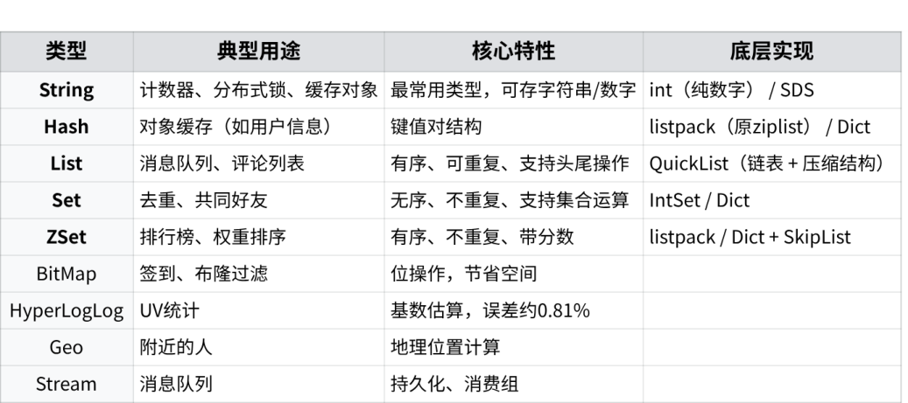
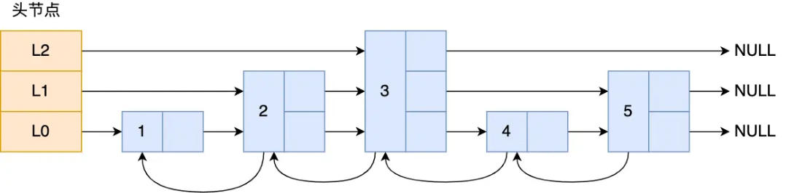
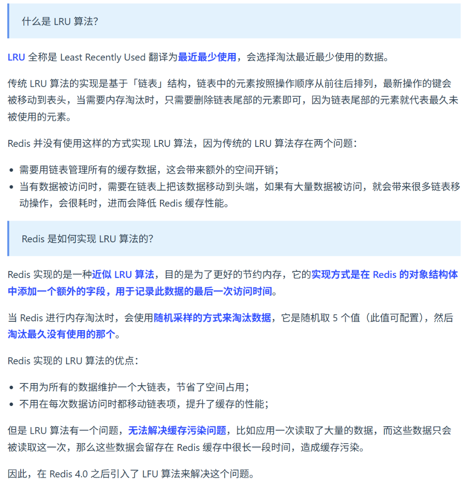
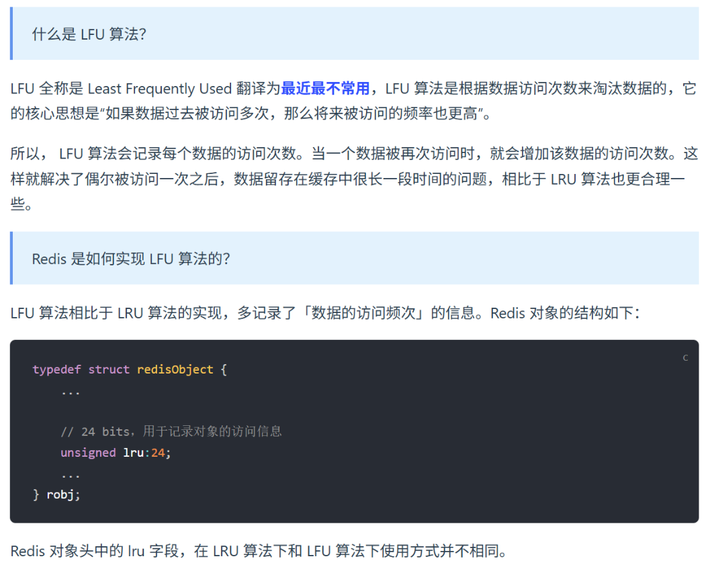
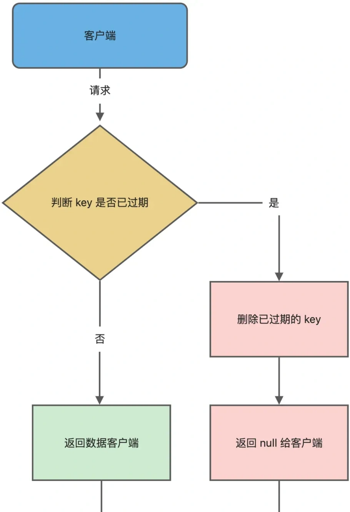
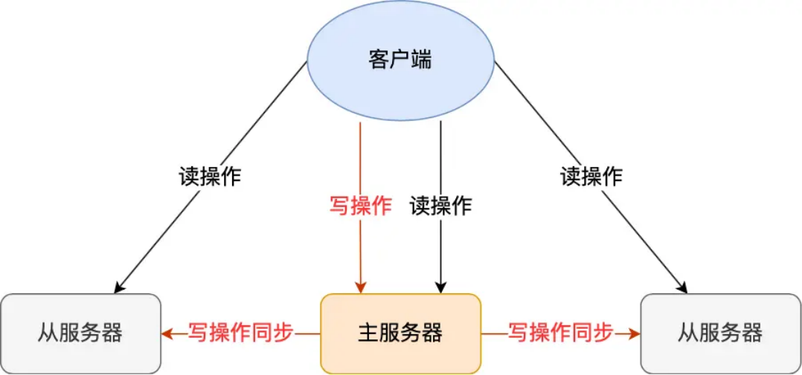
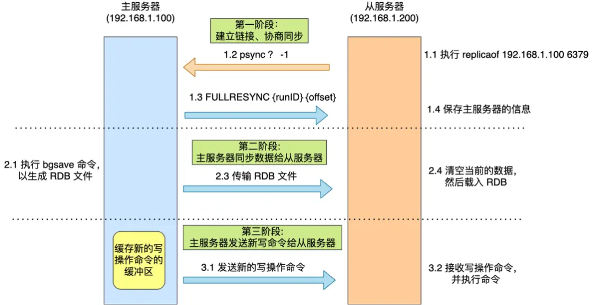
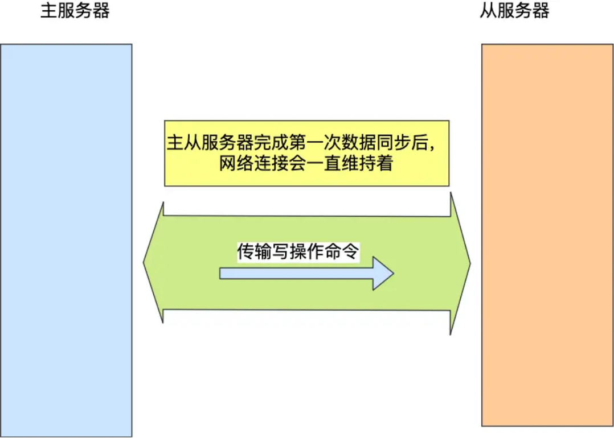
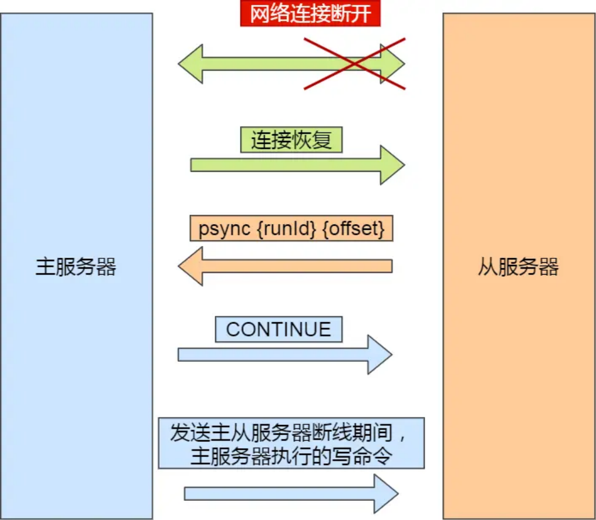
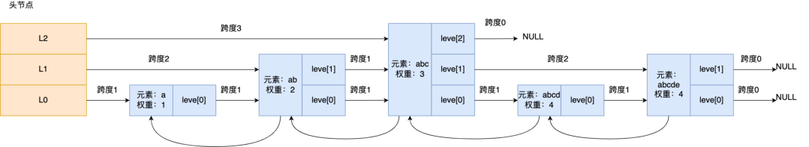

# Redis

[返回模块目录](../README.md) · [打开完整总文档](../Java后端八股.md)

## 高频题

### 数据类型

#### Redis有哪些数据类型

Redis九大数据类型，常用的有五种(String、Hash、List、Set、Zset)，最常问的数据类型是ZSet。



1. SDS

Redis字符串底层不是C字符串，而是SDS（简单动态字符串）

本质是一个带长度信息的结构体

2. ZipList、Listpack、Dict哈希表

- ZipList

一种连续内存空间的双端链表，因存储格式而节省空间，但由于连续内存

如果元素太多，内存不容易分配，效率低，所以当元素过多时，都会转为另外一种数据结构

且 ZipList 压缩列表存在连锁更新的问题

- Listpack(Redis 7.0)

连续内存结构，和ZipList压缩列表几乎一样，但解决了连锁更新的问题，所以是新设计出来取代ZipList压缩列表的

所有元素连续存储，节省内存，适合：元素少、字段短

- Dict哈希表

Dict 哈希表底层由两张哈希表（数组 + 链表实现）组成。

其中一张用于存储当前数据，另一张通常为空，在哈希表扩容或收缩（rehash）时使用。

当发生扩容或收缩时，需要对 key 的位置重新计算，这个过程称为 rehash。

在 rehash 过程中，如果有请求到来：

- 新增操作：直接写入 `ht[1]` （新哈希表）

- 查询、修改、删除操作：会在 `ht[1]` （新表）和 `ht[0]` （旧表）中依次查找并执行

3. Quicklist

节点之间通过双向链表连接，每个节点是一个压缩列表

4. ⭐SkipList(跳表，ZSet核心)

如果有序集合的元素个数小于128个，并且每个元素的值小于64字节时，Redis会使用压缩列表作为Zset类型的底层数据结构，

否则：利用Dict + SkipList，存储两份数据，Dict 和 SkipList 各一份

为什么要存储两份数据？因为这是它的特性需求

- 利用Dict去键值查询：根据元素查分数

- 利用SkipList范围查询 (快速跳过大量无关节点，定位范围的起始点)：

    - 获取指定分数区间的元素

    - 获取排名在指定区间的元素

Redis 7.0 引入了 listpack  取代 ZipList 压缩列表

SkipList 跳表 是一种多层链表

- 元素按照 score 分数升序排列存储

- 每个节点可能包含多个指针，不同层级的指针具有不同的跨度；普通链表遍历效率低，是因为指针跨度为 1

- 在进行范围查找时，可以利用高层指针快速跳过大量无关节点，迅速定位到目标区间的起始位置

- 通过牺牲少量内存空间（存储多层指针），换取更高效的查找性能（时间复杂度接近 O(log n)，类似于树的复杂度）



#### 跳表节点的查询过程

跳表（Skip List）查询时，会从最高层开始查找，如果当前节点的值小于目标值，就向右移动；如果大于等于目标值，就向下一层移动，直到最底层找到目标节点或确认不存在。跳表利用"多级索引"减少了查找次数，平均时间复杂度为 O(logN)。

例如，有如下跳表：

```text
Level 2：HEAD ───────────────► 30 ─────────────► NULL

Level 1：HEAD ─────► 10 ─────► 30 ─────► 50 ───► NULL

Level 0：HEAD ─► 10 ─► 20 ─► 30 ─► 40 ─► 50 ─► NULL
```

现在查找 40：

385. 从最高层（Level 2）开始，`HEAD` → `30` ，由于 30 < 40，继续向右移动。

386. Level 2 中 30 后面已经没有节点，因此下降到 Level 1。

387. 在 Level 1，当前位置仍然是 30，右边是 50，由于 50 > 40，不能继续向右，于是下降到Level 0。

388. 在 Level 0，当前位置还是 30，右边是 40，由于 40 == 目标值，查找成功。

查找路径如下：

```text
Level 2：
HEAD ─────────► 30
               │
               ▼
Level 1：
              30 ─────► 50
               │
               ▼
Level 0：
              30 ─────► 40  ✓
```

整个过程中，不需要像链表一样从头遍历，而是利用高层索引快速跳过大量节点，因此查询效率接近二分查找，平均时间复杂度为 O(logN)。

#### 为什么ZSet不用B+树而选用跳表

因为B+树是为了减少磁盘I/O读取的次数而设计的，而Redis的I/O是基于纯内存操作，读写非常快，反而显得B+树很笨重很复杂，这是主要原因。

其他原因

- 维护难度：跳表本质是多层链表，结构简单、代码量小，维护成本低；而 B+ 树涉及节点分裂与合并，实现复杂、维护成本高。

- 读写性能：B+ 树插入可能触发页分裂，导致大量数据移动和结构调整，产生性能抖动；跳表操作具有局部性，只需修改相邻节点指针，并通过随机生成层高，无需全局调整。因此在保证接近O(log n) 查询效率的同时，写入性能更稳定。

#### 用户的会话Session用什么数据类型

用户的`Session` 最适合用Redis的String类型存储。

因为一个`Session` 本质上是一份用户状态数据，通常可以序列化成`JSON` 字符串后直接存入Redis，并设置过期时间，和Session天然的有效期机制匹配。

1. 存储方式简单：将用户Session对象序列化后作为一个整体存储。

```text
SETEX session:user:1001 1800 '{"userId":1001,"username":"Tom","role":"admin"}'
```

2. 天然支持过期：Session通常有有效期，可以直接用`EXPIRE` 或`SETEX` 设置`TTL` ，到期后自动删除。

3. 读取效率高：查询Session时一般是按`sessionId` 或`userId` 整体读取，不需要频繁修改其中某个字段，String结构最直接。

如果Session内部字段需要频繁单独修改，比如只更新登录时间、权限字段，也可以考虑`Hash` 。但一般场景下，String存JSON是最常用、最简单的方案。

#### Redis的Set是否有序、是否可重复？

Set 是 Redis 提供的无序集合，元素唯一，不允许重复。

- 无序：Set 中元素没有固定顺序，每次遍历结果可能不同。

- 不可重复：相同元素只能存在一份，重复添加不会报错，也不会新增数据。

- 底层实现：底层采用 哈希表（HashTable） 或 整数集合（IntSet） 存储，因此查找、插入、删除的时间复杂度通常为 O(1)。

- 应用场景：标签去重、用户关注、共同好友、抽奖名单、集合交并差运算等。

### 分布式锁

#### Redis如何实现分布式锁

Redis实现分布式锁主要有两种方式：基于SET NX EX 手动实现和基于Redisson 实现。

1. 基于SET NX EX 实现

使用`SET key value NX EX seconds` 加锁：

```text
SET lock:order:1001 requestId NX EX 30
```

`NX` 表示只有Key不存在时才能写入，`EX 30` 表示锁`30` 秒后自动过期，`requestId` 用于标识当前锁的持有者。

释放锁时不能直接`DEL` ，否则可能误删其他线程重新获取的锁。正确方式是先判断`requestId` 是否一致，再删除锁，一般用Lua脚本保证原子性：

```lua
if redis.call("get", KEYS[1]) == ARGV[1] then
    return redis.call("del", KEYS[1])
else
    return 0
end
```

`SET NX EX` 的问题主要有三点：

- 锁可能提前释放：如果业务执行时间超过`TTL` ，锁会自动过期，其他线程可能重新获取锁，导致多个线程并行业务逻辑。

- 不可重入：同一个线程再次获取同一把锁时，因为锁Key已经存在，会加锁失败。

- TTL不好设置：业务执行耗时不确定，`TTL` 设置太短会提前释放，设置太长又会降低锁释放效率。

2. 基于Redisson 实现

`Redisson` 封装了Redis分布式锁，使用更简单：

```text
RLock lock = redissonClient.getLock("lock:order:1001");

try {
    lock.lock();
    // 执行业务逻辑
} finally {
    lock.unlock();
}
```

`Redisson` 支持可重入锁、自动续期和安全释放锁。它通过看门狗机制自动延长锁过期时间，避免业务还没执行完锁就过期。生产环境更推荐使用`Redisson` ，减少手写锁带来的误删锁、锁过期和不可重入等问题。

- 可重入原理

`Redisson` 的锁不是简单存一个字符串，而是使用`Hash` 结构存储锁信息。Key表示锁名称，Hash中的field表示当前持有锁的线程标识，value表示重入次数。

```text
lock:order:1001
{
    threadId: 1
}
```

当同一个线程第一次加锁成功时，`Redisson` 会写入线程标识，并将重入次数设为`1` 。如果同一个线程再次加锁，会判断线程标识相同，然后将重入次数加`1` ，因此可以重复获取同一把锁。

解锁时不会立即删除锁，而是先把重入次数减`1` 。只有当重入次数减到`0` 时，才会真正删除锁Key。这样就实现了和Java中`ReentrantLock` 类似的可重入能力。

- 看门狗续期原理

`Redisson` 默认加锁时，如果没有手动指定锁过期时间，会给锁设置一个默认过期时间，通常是`30`秒。同时会启动一个看门狗机制，定期检查当前线程是否还持有锁。

如果业务还没有执行完，并且锁仍然属于当前线程，看门狗会自动延长锁的过期时间，一般每隔过期时间的三分之一进行一次续期，例如默认`30` 秒过期，则大约每`10` 秒续期一次。

这样可以避免业务执行时间超过`TTL` 导致锁提前释放，从而防止其他线程在当前业务未完成时拿到锁。

#### Redison分布式锁存在什么问题

`Redisson` 分布式锁的主要问题是主从同步延迟可能导致锁失效。

如果Redis采用主从架构，客户端在主节点加锁成功后，锁数据还没来得及同步到从节点，此时主节点宕机，从节点被提升为新主节点。由于新主节点上没有这把锁，其他线程就可能再次加锁成功，导致多个线程同时进入临界区，破坏分布式锁的互斥性。

解决方案：

- MultiLock联锁方案：向多个Redis主节点同时加锁，要求所有主节点都加锁成功才算获取锁成功。只要有一个节点加锁失败，就认为加锁失败，并释放已经加上的锁。它的一致性更强，但可用性和性能会下降。

- RedLock红锁方案：向多个互相独立的Redis主节点加锁，要求超过半数节点加锁成功才算获取锁成功，例如`5` 个主节点中至少`3` 个成功。若未达到半数成功，就释放已经获取的锁。它在一致性和可用性之间做折中。

所以，`Redisson` 单节点锁或普通主从锁不能完全避免主从切换带来的锁丢失问题。对一致性要求高的场景，需要考虑`MultiLock` 或`RedLock` ，但它们会带来更高的复杂度和性能开销。

### 持久化策略

配置：在 Redis 的默认配置文件（redis.conf）中，RDB 是 默认开启 的，而 AOF（Append-Only File）需要手动配置开启。

#### RDB异步持久化的原理(执行命令)

`RDB` 是Redis的数据快照持久化机制，全称是`Redis Database Backup File` 。它会在某个时间点把Redis内存中的数据生成一份快照文件写入磁盘，当Redis实例故障重启后，可以通过读取`RDB`文件恢复数据。

触发命令

可以在`redis.conf` 中配置自动触发条件，例如：

```text
save 900 1         #900秒内至少1个key被修改，触发bgsave生成RDB文件
save 300 10        #300秒内至少10个key被修改，触发bgsave生成RDB文件
save 60 10000      #60秒内至少10000个key被修改，触发bgsave生成RDB文件
```

除此之外，也可以通过命令主动触发`RDB` 持久化。

- `save` ：由Redis主进程执行持久化，会阻塞所有客户端命令，线上不推荐使用。

- `bgsave` ：由Redis主进程`fork` 出子进程，子进程负责生成`RDB` 文件，主进程继续处理请求，是常用方式。

执行原理

`RDB` 异步持久化的底层原理主要是`bgsave`

1. fork子进程：执行`bgsave` 时，Redis主进程会先`fork` 出一个子进程。这个阶段会短暂阻塞主进程，因为需要复制页表给子进程。`fork` 完成后，子进程和主进程共享同一份内存数据。

2. 子进程写RDB文件：子进程读取共享内存中的数据，并将当前快照写入磁盘生成`RDB` 文件。这个过程由子进程完成，所以不会阻塞主进程处理客户端请求。

3. Copy-On-Write机制：为了避免子进程生成快照时和主进程写数据冲突，Redis依赖操作系统的`Copy-On-Write` 机制。刚`fork` 后，主子进程共享内存页，并标记为只读。当主进程需要修改某个数据页时，操作系统会先复制该页，让主进程在新副本上修改，子进程仍然读取旧数据生成快照。

`bgsave` 基本不会长时间阻塞Redis主线程，真正阻塞的是开始时的`fork` 阶段。

#### RDB有什么优缺点

优点

- 恢复速度快：`RDB` 保存的是某一时刻的完整数据快照，Redis重启时可以直接加载快照文件恢复数据，速度比较快。

- 文件体积小：`RDB` 文件是压缩后的二进制快照文件，相比日志形式的持久化文件更紧凑，更适合备份和传输。

缺点

- 可能丢失数据：`RDB` 是周期性持久化，两次快照之间写入的数据如果还没来得及保存，Redis就宕机，这部分数据会丢失。快照间隔太长会增加丢失风险，间隔太短又会带来较大性能开销。

- 生成成本较高：执行`bgsave` 时需要`fork` 子进程，`fork` 阶段会复制页表并短暂阻塞主进程。子进程写出`RDB` 文件也比较耗时，在数据量大时会带来CPU、内存和磁盘I/O压力。

#### AOF持久化的原理和刷盘策略

`AOF` 全称是`Append Only File` ，是一种追加日志式持久化机制。它会把Redis执行过的每一条写命令记录到`AOF` 文件中，Redis重启时再按顺序重新执行这些写命令，从而恢复数据。因此，`AOF`文件可以理解为Redis的写命令日志文件。

AOF 持久化的核心流程是：Redis先执行写命令并修改内存数据，然后将该写命令追加到`AOF` 缓冲区，最后按照配置的刷盘策略把缓冲区内容写入磁盘文件。

`AOF` 支持三种刷盘策略：

1. always：每执行一条写命令都同步刷盘。数据安全性最高，宕机时最多丢失极少数据，但每次写操作都要落盘，对性能影响最大。

2. everysec：每秒刷盘一次。写命令执行后先进入`AOF` 缓冲区，再由后台线程每秒将数据写入`AOF` 文件。它是Redis默认策略，在性能和数据安全之间做折中，最多可能丢失1秒数据。

3. no：由操作系统决定何时刷盘。Redis只负责把写命令写入`AOF` 缓冲区，具体落盘时机交给操作系统控制。性能最好，但宕机时可能丢失较多数据。

#### AOF命令重写的动机

`AOF` 文件重写的动机是压缩AOF文件体积，避免命令日志无限增长。因为`AOF` 记录的是写命令，同一个`key` 可能被多次修改，但恢复数据时通常只有最终状态有意义，所以可以通过重写生成一份更精简的`AOF` 文件。

例如同一个`key` 被多次修改：

```text
SET name a
SET name b
SET name c  # 最后把name设置为c，前面的修改都没有意义了
```

因此重写后只需要保留最终结果：

```text
SET name c
```

`AOF` 重写通常通过`bgrewriteaof` 触发。它会根据当前内存中的数据状态，重新生成一份最小化的命令集合，使新`AOF` 文件可以恢复出和当前数据库一致的数据。需要注意的是，重写过程会消耗CPU、内存和磁盘I/O资源。

`bgrewriteaof` 可以通过配置自动触发，主要看两个阈值：

1. 文件增长百分比：当当前`AOF` 文件相比上次重写后的文件增长超过指定比例时，触发重写。

2. 文件最小体积：只有当`AOF` 文件达到一定大小后，才允许触发重写，避免文件很小时频繁重写。

#### AOF有什么优缺点

优点

数据安全性更高，例如everysec策略，只会丢失1秒以内的数据

缺点：

- 宕机后恢复速度慢，因为AOF文件记录的是命令，需要依次执行

- 文件体积大，需要进行AOF文件重写，此时会占用大量资源

#### 混合持久化(RDB+AOF)

混合持久化是Redis4.0之后引入的持久化方式，本质上是以`AOF` 为基础，把`RDB` 恢复快和`AOF` 数据更完整的优点结合起来。它既能提升Redis重启恢复速度，又能降低大量数据丢失的风险。

开启混合持久化后，在`AOF` 重写时会生成一种特殊结构的新`AOF` 文件：

```text
[RDB数据块][AOF命令流]
```

- RDB数据块：重写开始时，Redis会先把当前内存中的全量数据以`RDB` 格式写入新`AOF` 文件开头。这样Redis重启时可以像加载`RDB` 一样快速恢复大部分数据。

- AOF命令流：在`RDB` 数据块之后，Redis会把重写期间产生的增量写命令以`AOF` 格式追加到文件末尾。这样可以保留重写过程中的最新变更，降低数据丢失风险。

混合持久化的优点是恢复速度比纯AOF快，数据安全性比纯RDB高。缺点是文件格式发生变化，老版本Redis可能无法识别，因此混合持久化不具备向下兼容性。

### 内存淘汰策略

#### 有哪些内存淘汰策略

Redis内存淘汰策略是在内存达到`maxmemory` 限制后，用来决定删除哪些Key的规则。Redis常见有8种内存淘汰策略，可以分为三类：只淘汰设置了TTL的Key、从所有Key中淘汰，以及不淘汰直接报错。

1. 只针对设置了TTL的Key淘汰

LRU和LFU的原理和实现参考小林Coding





这类策略只会从设置了过期时间的Key中选择淘汰对象，没有设置TTL的Key不会被删除。

- `volatile-lru` ：从设置了过期时间的Key中，淘汰最久未使用的Key。 (高频手撕)

- `volatile-lfu` ：从设置了过期时间的Key中，淘汰访问频率最低的Key。

- `volatile-random` ：从设置了过期时间的Key中，随机选择Key删除。

- `volatile-ttl` ：从设置了过期时间的Key中，优先删除剩余过期时间最短的Key。

2. 针对所有Key淘汰

这类策略会从所有Key中选择淘汰对象，不管Key是否设置了过期时间。

- `allkeys-lru` ：从所有Key中，淘汰最久未使用的Key。

- `allkeys-lfu` ：从所有Key中，淘汰访问频率最低的Key。

- `allkeys-random` ：从所有Key中，随机选择Key删除。

3. 不淘汰策略

    - `noeviction` ：不会淘汰任何Key。当内存达到上限后，新的写入请求会直接返回错误，读请求仍可正常执行。

#### 内存淘汰策略如何选择

Redis内存淘汰策略的选择，核心看数据是否都可以被淘汰，以及是否存在必须长期保留的数据。缓存场景优先保证服务可用，关键数据场景优先保证重要Key不被删除。

1. 纯缓存场景

如果Redis主要作为缓存使用，理论上所有数据都可以被淘汰，优先选择`allkeys-lru` 或`allkeys-lfu` 。

- `allkeys-lru` ：适合访问具有明显冷热特征的数据，优先淘汰最久未使用的Key。

- `allkeys-lfu` ：适合长期热点比较稳定的场景，优先淘汰访问频率最低的Key。

这样可以避免内存写满后无法写入，保证缓存服务持续可用。

2. 存在长期保存数据的场景

如果Redis中有一部分Key没有设置过期时间，并且这些Key需要长期保存，可以选择`volatile-lru` 或`volatile-lfu` 。

这类策略只会淘汰设置了TTL的Key，不会删除未设置过期时间的关键数据。

3. 严格数据保护场景

如果业务不允许Redis自动删除任何数据，可以选择`noeviction` 。

这种策略在内存达到上限后不会淘汰Key，而是直接拒绝新的写请求。使用时必须配合监控、告警和扩容机制，否则容易影响业务写入。

#### Redis的过期数据淘汰策略

1. 惰性删除：只会在取出/查询 key 的时候才对数据进行过期检查。这种方式对 CPU 最友好，但是可能会造成太多过期 key 没有被删除。

2. 定期删除：周期性地随机从设置了过期时间的 key 中抽查一批，然后逐个检查这些 key 是否过期，过期就删除 key。相比于惰性删除，定期删除对内存更友好，对 CPU 不太友好。

3. 延迟队列：把设置过期时间的 key 放到一个延迟队列里，到期之后就删除 key。这种方式可以保证每个过期 key 都能被删除，但维护延迟队列太麻烦，队列本身也要占用资源。

4. 定时删除：每个设置了过期时间的 key 都会在设置的时间到达时立即被删除。这种方法可以确保内存中不会有过期的键，但是它对 CPU 的压力最大，因为它需要为每个键都设置一个定时器。




Redis 采用的是定期删除+惰性/懒汉式删除结合的策略，这也是大部分缓存框架的选择。定期删除对内存更加友好，惰性删除对 CPU 更加友好。两者各有千秋，结合起来使用既能兼顾 CPU 友好，又能兼顾内存友好。

### 缓存击穿/穿透/雪崩

#### 缓存击穿

缓存击穿通常发生在高并发访问热点Key的场景下。当某个热点数据在缓存中过期的一瞬间，大量请求同时访问该Key，缓存无法命中，请求会直接打到数据库，导致数据库瞬时压力过大，严重时可能被打垮。

解决方案：

1. 互斥锁

思路：只允许一个线程查询数据库并重建缓存，其他线程等待，避免大量请求同时访问数据库。

具体实现：

- 线程查询Redis，发现热点Key不存在。

- 尝试获取分布式锁，获取成功的线程去查询数据库。

- 查询到数据后，将数据写回Redis，再释放锁。

- 其他线程获取锁失败后先等待，锁释放后再次查询Redis，也就是`double check` 。

- 如果此时缓存已经被重建，就直接从Redis读取数据，不再访问数据库。

这种方案可以保证数据库只被少量请求访问，但缺点是其他线程需要等待，接口响应时间可能变长。

2. 永不过期 + 逻辑过期

思路：缓存Key本身不设置`TTL` ，而是在Value中额外保存一个逻辑过期时间，例如`expireTime` 。请求命中缓存后，先判断逻辑过期时间是否过期。

具体流程：

- 如果`expireTime` 未过期，直接返回缓存数据。

- 如果`expireTime` 已过期，当前线程先返回旧数据。

- 同时开启异步线程尝试获取互斥锁。

- 获取锁成功后，异步线程查询数据库并重建缓存。

- 重建完成后更新缓存中的数据和新的`expireTime` 。

这种方案不会让请求阻塞，适合热点数据场景。缺点是短时间内可能返回旧数据，对实时性要求高的业务需要谨慎使用。

#### 缓存穿透

缓存穿透指请求查询的数据在Redis和数据库中都不存在，导致每次请求都无法命中缓存，最终全部打到数据库。它的关键在于透过去了，缓存层没有拦住请求，数据库又查不到数据，因此缓存永远不会自然建立。

解决方案：

1. 缓存空值

思路：当Redis未命中，并且数据库也查询不到数据时，仍然把这个空结果写入Redis，并设置较短`TTL` 。

例如查询`userId=999999` 不存在，可以缓存一个空值：

```text
SETEX user:999999 60 ""
```

后续相同请求再来时，可以直接命中这个空值，不再访问数据库。该方案实现简单，但可能占用额外缓存空间，因此空值的`TTL` 一般不宜设置太长。

2. 布隆过滤器

思路：在请求访问Redis之前，先通过布隆过滤器判断这个Key是否可能存在。如果布隆过滤器判断一定不存在，就直接拦截请求，不再访问Redis和数据库。

实现原理：数据写入时，通过多个哈希函数对Key计算，得到多个位置，并把对应二进制位设置为`1` 。查询时，也用同样的哈希函数计算多个位置。如果这些位置不全是`1` ，说明数据一定不存在；如果全部是`1` ，说明数据可能存在，再继续查询Redis或数据库。

布隆过滤器的特点是：可以判断一定不存在，但不能保证一定存在。因为不同Key可能映射到相同位置，所以会存在一定误判率，但可以有效拦截大量非法请求，适合防止恶意请求打穿缓存。

#### 缓存雪崩

缓存雪崩指大量Key在同一时间过期，或者Redis缓存服务宕机，导致大量请求无法命中缓存，瞬间全部打到数据库，使数据库压力骤增。

解决方案：

1. 避免大量Key同时过期

思路：不要给大量缓存设置完全相同的过期时间，可以在基础过期时间上加随机值，让Key分散过期。

例如：

```java
int ttl = 3600 + random.nextInt(600);
redis.set(key, value, ttl);
```

这样可以避免大量Key在同一时间失效，降低数据库瞬时压力。

2. 提高Redis可用性

思路：避免Redis单点故障导致缓存整体不可用。可以使用Redis主从、哨兵或集群模式，提高缓存服务可用性。

当某个节点故障时，可以通过故障转移或集群分片继续提供服务，减少请求直接打到数据库的风险。

### 热Key问题

定义：热Key是指在短时间内被大量请求高频访问的Key。

影响：

- 导致某个Redis实例负载突然升高，出现CPU、网络带宽或连接数瓶颈，严重时可能导致Redis响应变慢甚至不可用。

- 如果热Key刚好过期，还可能引发缓存击穿，大量请求直接打到数据库。

热Key的解决方案：

a. 本地缓存

在应用层增加本地缓存，例如Java中的`Caffeine` 。高频访问的数据优先从本地内存读取，减少对Redis的访问压力。需要注意本地缓存也要设置过期时间，避免数据长期不更新导致不一致。

b. Key分片

将一个热Key拆成多个子Key，例如`hot_key_1` 、`hot_key_2` 、`hot_key_3` ，让请求分散访问不同Key。

如果Redis是集群模式，子Key可以分散到不同Redis实例上，避免单个节点被打满。

c. 读写分离

通过主从架构把读请求分发到多个从节点，主节点主要负责写入，从节点承担读流量。

这种方式适合读多写少的热Key场景，可以提升整体读取能力。

d. 监控和预防

热Key要依赖监控及时发现，例如通过Redis监控工具、慢日志、访问统计或代理层统计识别高频Key。

对于活动配置、首页数据、热门商品等明显可能成为热Key的数据，可以提前做本地缓存、分片或预热，避免问题发生后再处理。

### 大Key问题

#### 什么是大Key

大Key是指Value体积过大的Key，例如`String` 类型超过`2MB` ，或者`Hash` 、`List` 等集合类型元素超过`5000` 个。

影响：

- 阻塞主线程：Redis命令执行主要是单线程，大Key的读取、写入、遍历或删除都可能耗时较长，导致主线程阻塞，影响其他请求响应。

- 资源消耗过高：大Key会占用更多内存和网络带宽。若使用`RDB` 持久化，生成快照时可能造成内存峰值升高，严重时可能引发`OOM` 。

解决方案：

a. 数据拆分：将一个大Key拆分成多个小Key。例如把一个超大的`Hash` 拆成多个`Hash` ，按业务ID、时间范围或分片编号进行拆分，降低单个Key的体积和操作成本。

b. 异步删除：删除大Key时不要使用`DEL` ，可以使用`UNLINK` 。`DEL` 会在主线程中同步删除，容易阻塞Redis；`UNLINK` 会把删除任务交给后台线程异步处理，减少对主线程的影响。

c. 监控与预防：通过Redis工具、扫描脚本或监控系统定期发现大Key。系统设计阶段要避免把过多数据塞进一个Key中，对集合类型设置合理上限，必要时提前拆分。

### Redis主从架构

#### 为什么Redis需要多节点架构

1. 突破内存容量限制：Redis数据主要存储在内存中，单节点内存容量有限。当业务数据量持续增长时，单节点无法承载全部数据，需要通过多节点分片存储，扩大整体容量。

2. 提高系统可用性：单节点Redis存在宕机风险，一旦实例故障，缓存服务就会不可用。多节点架构可以通过主从、哨兵或集群实现故障转移，提高服务可用性。

3. 缓解网络带宽瓶颈：大量客户端同时访问单个Redis节点时，网络带宽可能成为瓶颈。多节点可以分散请求流量，降低单个节点的网络压力。

4. 提升并发处理能力：高并发场景下，单节点需要承受大量连接和请求，可能出现连接数过多、请求排队和响应变慢等问题。多节点可以分摊客户端连接和读写请求，提升整体吞吐能力。

#### 为什么要分主从和读写分离？

Redis的读写分离是指主服务器可以进行写操作，而从服务器一般是只读，当主服务器有写操作时，接受从主服务器同步的写命令，然后执行。



Redis常见业务场景是读多写少，Redis做主从和读写分离，是为了提升读性能、提高可用性，并降低多节点数据一致性的复杂度。

1. 性能优化

主从架构下，主节点主要处理写请求，从节点主要处理读请求。这样可以把读流量分摊到多个从节点上，避免单个Redis节点承受过多请求。

对于读多写少的场景，多个从节点可以共同承担读压力，主节点只负责写入和同步数据，整体吞吐能力更高。同时，写操作可能触发持久化或带来阻塞，如果读写都集中在一个节点上，写操作可能影响读请求的响应效率。

2. 数据一致性和同步更简单

主从架构中，写操作只发生在主节点，主节点再把数据同步给从节点。这样数据流向是单向的，模型更简单。

如果所有节点都允许读写，就需要解决多节点之间的数据冲突、同步顺序和一致性问题，复杂度会大幅增加。主从模式通过主写从读，降低了多节点数据一致性维护成本。

#### 主从同步的原理

##### 全量同步(第一次同步)



全量同步流程：

1. slave请求同步：从节点向主节点发起数据同步请求，并携带自己的`replid` 和`offset` 。主节点根据这两个信息判断是全量同步还是增量同步。

2. master返回版本信息：如果主节点判断这是第一次同步，会返回自己的`replid` 和`offset` ，从节点保存这些版本信息。`replid` 用于标识数据集，`offset` 用于标识复制进度。

3. master生成RDB文件：主节点执行`bgsave` 生成`RDB` 快照。在生成快照期间，主节点不会停止处理写请求，而是把新的写命令记录到`repl_baklog` 内存缓冲区中。

4. slave加载RDB文件：主节点将生成的`RDB` 文件发送给从节点。从节点收到后会清空本地旧数据，并加载这份`RDB` 快照。

5. master发送增量命令：从节点加载完`RDB` 后，主节点再把`repl_baklog` 中缓存的写命令发送给从节点。从节点执行这些命令后，数据就和主节点保持一致。

主节点判断是否第一次同步，主要依赖两个信息：

- Replication ID：简称`replid` ，用于标识当前数据集。每个主节点都有自己的`replid` ，从节点会继承主节点的`replid` 。如果从节点上报的`replid` 和主节点一致，说明它们属于同一个数据集，可以尝试增量同步；如果不一致，说明不是同一份数据集，通常需要全量同步。

- offset：表示复制偏移量，会随着主节点写入`repl_baklog` 的数据不断增加。从节点完成同步后也会记录自己的`offset` 。如果从节点的`offset` 小于主节点，说明从节点数据落后，需要补齐缺失命令。

从节点同步时必须向主节点声明自己的`replid` 和`offset` 。`replid` 主要判断是否属于同一份数据集，决定能不能增量同步；`offset` 主要判断同步进度，决定需要从`repl_baklog` 中补哪些数据。

主从服务器在完成第一次同步后，双方就会维护一个TCP长连接。



后续服务器就可以通过这个连接将写命令传播给从服务器，然后从服务器执行该命令，从而保持主从的数据库状态相同。

##### 增量同步

如果主从之间连接断开了，无法进行同步，这就会导致主从数据的不一致性，导致读到旧数据。

当断开后又恢复网络连接后，服务器就会采用增量复制的方式继续同步

增量同步流程



背景知识：

主服务器怎么知道要将哪些增量数据同步给从服务器，主要是维护一个`repl_backlog_buffer`和`replication offset` 。

- `repl_backlog_buffer` 是主节点维护的一个环形复制缓冲区，用于在主从短暂断连后保存主节点新增的写命令。从节点重新连接时，主节点可以根据从节点上报的复制进度，从这个缓冲区中找到缺失的数据，进行增量同步。

- `replication offset` 是主从复制的偏移量，用于标记复制进度。主节点用`master_repl_offset` 记录自己已经写到哪个位置，从节点用`slave_repl_offset` 记录自己已经同步到哪个位置。正常情况下，从节点的`slave_repl_offset` 会不断追赶主节点的`master_repl_offset` 。

1. slave请求同步：从节点向主节点发起同步请求，并携带自己的`rplid` 和`offset` ，

2. master判断可增量同步，主节点发现从节点的`replid` 和自己一致，说明两者属于同一份数据集，不是第一次同步，于是返回`continue` ，表示可以继续增量同步。

3. master发送缺失命令：主节点根据从节点的`offset` ，从`repl_baklog` 中找到从节点缺失的写命令，并发送给从节点，slave从节点收到这些增量命令后按顺序执行，使自身数据追上主节点。注意：

`repl_baklog` 是主节点内存中的环形缓冲区，大小有限。写满后会覆盖旧数据。如果从节点断连时间太长，导致它还没有同步的数据已经被覆盖，主节点就无法根据`offset` 补齐缺失命令，此时只能重新进行全量同步。

## 扩展题

### Redis使用的业务场景

1. 缓存

DB缓存，减轻DB服务器压力

提高系统响应

2. 分布式锁

如今都是分布式的环境下java自带的单体锁已经不适用的。在 Redis 2.6.12 版本开始，string的set命令增加了一些参数：

- `EX` ：设置键的过期时间（单位为秒）

- `PX` ：设置键的过期时间（单位为毫秒）

- `XX`  ：只在键已经存在时，才对键进行设置操作。

- `NX`  ：只在键不存在时，才对键进行设置操作。 `SET key value NX`  效果等同于 `SETNXkey value`  。

3. 全局ID

int类型，incrby，利用原子性

`incrby userid 1000`

分库分表的场景，一次性拿一段

4. 计数器

int类型，incr方法

例如：文章的阅读量、微博点赞数、允许一定的延迟，先写入Redis再定时同步到数据库

计数功能应该是最适合 Redis 的使用场景之一了，因为它高频率读写的特征可以完全发挥 Redis 作为内存数据库的高效。在 Redis 的数据结构中，`string` 、`hash` 和`sorted set` 都提供了`incr`方法用于原子性的自增操作，下面举例说明一下它们各自的使用场景：

- 如果应用需要显示每天的注册用户数，便可以使用string作为计数器，设定一个名为REGISTERED_COUNT_TODAY的 key，并在初始化时给它设置一个到凌晨 0 点的过期时间，每当用户注册成功后便使用incr命令使该 key 增长 1，同时当每天凌晨 0 点后，这个计数器都会因为 key过期使值清零。

- 每条微博都有点赞数、评论数、转发数和浏览数四条属性，这时用hash进行计数会更好，将该计数器的 key 设为weibo:weibo_id，hash的 field 为like_number、comment_number、forward_number和view_number，在对应操作后通过hincrby使hash 中的 field 自增。

- 如果应用有一个发帖排行榜的功能，便选择sorted set吧，将集合的 key 设为POST_RANK。当用户发帖后，使用zincrby将该用户 id 的 score 增长 1。sorted set会重新进行排序，用户所在排行榜的位置也就会得到实时的更新。

5. 限流

int类型，incr方法.   以访问者的ip和其他信息作为key，访问一次增加一次计数，超过次数则返回false

6. 排行榜

使用`sorted set` (有序set)和一个计算热度的算法便可以轻松打造一个热度排行榜，`zrevrangebyscore` 可以得到以分数倒序排列的序列，`zrank` 可以得到一个成员在该排行榜的位置（是分数正序排列时的位置，如果要获取倒序排列时的位置需要用`zcard` - `zrank` ）。

### Redis为什么那么快

Redis速度快主要有以下几个原因：

1. 基于内存存储(主要原因)：Redis的数据主要存储在内存中，内存访问速度远高于磁盘访问速度，这是Redis快的最主要原因。

2. 单线程执行命令：Redis执行命令时采用单线程模型，避免了多线程带来的线程切换、上下文切换和锁竞争问题，使执行过程更加高效。

3. I/O多路复用：Redis虽然命令执行是单线程，但网络I/O采用多路复用模型，可以让一个线程同时监听和处理多个客户端连接，提高并发处理能力。

4. 高效数据结构：Redis内置了多种高效数据结构，例如字符串、哈希表、列表、集合和有序集合，并针对不同场景做了底层优化，能够以较低时间复杂度完成读写操作。

### Redis线程设置

#### Redis是单线程还是多线程

Redis不能简单说成单线程或多线程，要看讨论的是哪一部分。如果指核心命令处理，也就是数据读写操作，Redis是单线程的。如果指整个Redis系统，包括网络I/O、异步删除、持久化和集群等能力，Redis是多线程参与的。

Redis的线程模型可以按版本理解：

1. 核心命令处理是单线程

Redis执行命令、读写内存数据这一部分仍然是单线程。这样可以避免多线程带来的锁竞争、线程切换和并发安全问题，使核心执行逻辑更简单、更高效。

2. Redis4.0引入后台多线程

Redis4.0开始支持用后台线程处理一些耗时任务，例如`UNLINK` 异步删除大Key，避免`DEL` 大Key阻塞主线程。类似的后台任务还包括`bgsave` 、`bgrewriteaof` 等持久化相关操作。此时Redis的网络模型整体仍然以单线程为主，依靠I/O多路复用支撑高并发连接。

3. Redis6.0引入网络I/O多线程

Redis6.0在网络模型中引入多线程，主要用于处理网络数据的读写和协议解析，提高多核CPU利用率和网络并发能力。但需要注意，命令执行本身仍然由主线程串行完成，不是多个线程同时修改Redis数据。

总结来说：Redis核心命令执行是单线程，后台任务和网络I/O可以是多线程。这样既保留了单线程命令执行的简单高效，又能利用多线程提升耗时任务和网络处理能力。

#### Redis为什么使用单线程执行命令

Redis使用单线程执行命令，核心是因为它的主要性能瓶颈不在CPU计算，而在内存访问和网络I/O。单线程模型可以让命令执行过程更简单、更稳定，同时避免多线程带来的锁竞争和上下文切换开销。

1. 避免锁竞争

Redis的数据结构都存储在内存中，如果多线程同时执行命令，就需要对共享数据加锁，保证并发安全。加锁会增加实现复杂度，也会带来性能损耗。单线程串行执行命令，可以天然避免并发修改问题。

2. 减少线程切换开销

多线程执行时，CPU需要频繁进行线程切换和上下文切换。Redis命令通常执行很快，如果引入大量线程切换，反而可能降低性能。单线程可以减少调度开销。

3. 内存操作本身很快

Redis主要基于内存读写，单次命令执行速度非常快。对于大多数简单命令，单线程已经可以达到很高吞吐量。

4. 配合I/O多路复用

Redis虽然命令执行是单线程，但网络层使用I/O多路复用，可以让一个线程同时处理多个客户端连接。这样既能支撑高并发连接，又不需要在命令执行层引入多线程复杂度。

### Redis 怎么保证高并发和高可用？

Redis 的高并发主要依赖内存访问、高效数据结构、单线程命令执行和 I/O 多路复用；高可用主要依赖持久化、主从复制、Sentinel 和 Redis Cluster。

高并发：

内存访问：Redis 的数据主要存储在内存中，读写不需要频繁访问磁盘，因此响应速度快，适合高并发访问。

I/O 多路复用：Redis 使用 epoll 等 I/O 多路复用机制，一个线程可以同时监听大量网络连接，减少线程创建和上下文切换开销。

单线程执行：Redis 的核心命令主要由单线程顺序执行，避免了多线程竞争、加锁和上下文切换的开销。需要注意的是，Redis 6.0 之后引入了多线程网络 I/O，但命令执行仍以单线程为主。

高效数据结构：Redis 针对不同场景提供 String、Hash、List、Set、Sorted Set 等数据结构，底层使用哈希表、跳表、压缩列表等结构，使大部分操作具有较低的时间复杂度。

高可用

持久化机制：Redis 提供 RDB 和 AOF。RDB 通过快照保存数据，恢复速度快；AOF 记录写命令，数据安全性更高。两者可以结合使用，降低宕机后的数据丢失风险。

主从复制：主节点负责写操作，从节点同步主节点数据，可以实现数据冗余和读写分离，提高读请求吞吐量。但主从复制通常是异步的，故障时可能丢失少量未同步数据。

Sentinel：Sentinel 负责监控主从节点。当主节点故障时，会通过选举将一个从节点提升为新的主节点，并通知客户端更新访问地址，实现自动故障转移。

Redis Cluster：Cluster 通过 16384 个 Hash Slot 将数据分布到多个主节点，实现水平扩容。每个主节点可以配置从节点，当主节点故障时，从节点可以自动接管，从而同时提供数据分片和高可用能力。

### 哨兵机制

#### 什么是 Sentinel？

Sentinel（哨兵）是 Redis 官方提供的高可用解决方案，主要用于监控 Redis 主从节点的运行状态，并在主节点发生故障时自动完成故障转移，从而保证 Redis 服务能够持续对外提供服务。需要注意的是，Sentinel 并不负责数据存储，它本身是一个独立运行的进程。

Sentinel 主要具有四个功能：

- 监控（Monitoring）：Sentinel 会周期性地向 Master 和 Slave 发送 `PING`  命令，持续监控各节点是否正常工作，并实时获取主从节点的状态信息。

- 通知（Notification）：当 Redis 节点发生故障或主从关系发生变化时，Sentinel 可以通过 API 或脚本通知管理员和客户端。

- 自动故障转移（Failover）：当 Master 被判定为故障后，Sentinel 会从所有 Slave 中选举一个新的 Master，并让其他 Slave 重新复制新的 Master，整个过程无需人工干预。

- 配置中心（Configuration Provider）：客户端可以通过 Sentinel 获取当前 Master 的地址。当发生主从切换后，Sentinel 会向客户端返回新的 Master 地址，避免客户端仍然连接已经失效的节点。

#### Sentinel 如何判断 Master 宕机？

Sentinel 采用主观下线（SDOWN）和客观下线（ODOWN）两阶段机制判断主节点是否故障。

- 主观下线（SDOWN）：单个 Sentinel 在一定时间内无法与 Master 通信，就认为该节点主观下线。

- 客观下线（ODOWN）：多个 Sentinel 达成一致后，确认 Master 已故障，进入客观下线状态，并开始故障转移。

#### Sentinel 如何完成故障转移？

当 Sentinel 判定 Master 已经客观下线（ODOWN）后，会自动发起故障转移流程，整个过程主要包括 Leader 选举、新 Master 选举、主从切换以及通知客户端四个步骤。

- Leader 选举：多个 Sentinel 会先通过 Raft 风格的投票机制选举出一个 Leader Sentinel，由Leader 负责后续所有故障转移操作，避免多个 Sentinel 同时进行切换。

- 选择新的 Master：Leader 会从所有 Slave 中选择最合适的节点提升为新的 Master。通常会优先考虑 `slave-priority` 、复制偏移量（Offset）、与原 Master 的断开时间等因素，保证选择的数据最完整。

- 完成主从切换：Leader 将选中的 Slave 执行 `SLAVEOF NO ONE` ，使其成为新的 Master，然后通知其他 Slave 去复制新的 Master，重新建立主从关系。

- 通知客户端：故障转移完成后，Sentinel 会更新整个集群的主从信息，并向客户端返回新的Master 地址，客户端后续的写请求都会发送到新的 Master。

整个过程通常只需要几秒钟即可完成，因此能够保证 Redis 服务具备较高的可用性。

#### Sentinel 是如何选举新的 Master 的？

当 Master 被判定为客观下线（ODOWN）后，Leader Sentinel 会从所有 Slave 中选择一个最合适的节点提升为新的 Master。选举过程并不是随机的，而是综合多个因素进行排序，以保证新 Master 的数据尽可能完整、稳定。

Sentinel 主要按照以下规则进行选择：

- 优先级（slave-priority）：Redis 可以为每个 Slave 配置 `slave-priority` ，数值越小优先级越高。如果设置为 `0` ，表示该 Slave 永远不会被选举为 Master。

- 复制偏移量（Replication Offset）：如果优先级相同，则比较复制偏移量（Offset）。Offset 越大，说明同步的数据越多，与原 Master 的数据越接近，因此优先成为新的 Master。

- 断线时间：如果 Offset 相同，则优先选择与原 Master 断开时间最短的 Slave。长时间离线的节点可能存在较多数据缺失，不适合作为新的 Master。

- 运行 ID（Run ID）：如果以上条件都相同，则按照 Redis 节点的 Run ID 进行排序，选择 Run ID较小的节点作为新的 Master。

选举完成后，Sentinel 会将该 Slave 提升为 Master，并通知其他 Slave 重新复制新的 Master，同时向客户端发布新的主节点地址，整个故障转移过程通常只需要几秒钟即可完成。

#### 什么是 Sentinel 脑裂？如何避免？

脑裂（Split Brain）是指由于网络分区等原因，Redis 集群中同时存在两个 Master，对外同时提供写服务，导致数据出现不一致的现象。

例如：

- 原 Master 因网络故障与 Sentinel 失去联系。

- Sentinel 误认为 Master 已经宕机，将某个 Slave 提升为新的 Master。

- 实际上原 Master 并没有真正宕机，只是网络隔离，它仍然继续接收客户端写请求。

- 此时集群中同时存在旧 Master和新 Master，两个节点的数据分别发生变化，这就是脑裂。

为了避免脑裂，通常采用以下措施：

- 合理配置 down-after-milliseconds ：适当增加故障判定时间，避免因网络瞬时抖动导致误判 Master 下线。

- 配置 min-replicas-to-write  和 min-replicas-max-lag ：要求 Master 必须有足够数量的 Slave 保持同步，否则拒绝写请求。这样即使发生网络分区，孤立的旧 Master 也会停止提供写服务，从而减少脑裂导致的数据丢失。

- 部署多个 Sentinel：生产环境通常部署至少 3 个 Sentinel，通过多数派投票确认 Master 是否真正故障，避免单个 Sentinel 因网络异常产生误判。

- 客户端及时切换：客户端应通过 Sentinel 获取最新的 Master 地址，而不是固定连接某一个节点，确保故障转移后能够及时切换到新的 Master。

需要注意的是，Sentinel 无法从根本上消除脑裂，只能通过多数派机制和写保护策略降低脑裂发生的概率以及减少数据不一致带来的影响。

### Redis Cluster(集群)

#### 什么是 Redis Cluster？

Redis Cluster 是 Redis 官方提供的分布式集群方案，主要通过数据分片、主从复制和自动故障转移，解决单机 Redis 在存储容量、并发能力和高可用方面的限制。

普通的 Redis 主从模式或 Sentinel 模式中，所有节点通常保存同一份完整数据，主要解决的是高可用问题，并不能突破单个 Master 的内存和写入性能上限。Redis Cluster 则会把数据分散存储在多个Master 节点上，每个 Master 只负责其中一部分数据，从而实现水平扩展。

数据分片：Redis Cluster 将整个 Key 空间划分为16384个 Hash Slot，并将这些槽分配给不同的Master。Key 根据哈希计算定位到某个槽，再通过槽找到负责该数据的 Master。

主从复制：每个 Master 可以配置一个或多个 Replica。Replica 会异步复制对应 Master 的数据，本身通常不负责处理普通写请求，主要用于数据备份和故障切换。

自动故障转移：当某个 Master 被集群判定为故障后，它的 Replica 会参与选举，其中一个 Replica 晋升为新的 Master，并接管原 Master 负责的 Hash Slot。

去中心化架构：Redis Cluster 没有统一的中心节点。各节点通过 Cluster Bus 和 Gossip 协议交换节点状态、槽位分配和故障信息，任何节点都可以接收客户端请求。

客户端路由：客户端可以连接集群中的任意节点。如果请求的 Key 不属于当前节点，节点会返回`MOVED`  或 `ASK`  重定向信息，由支持 Cluster 的客户端把请求发送到正确节点。

因此，Redis Cluster既可以通过增加 Master 节点扩大存储容量和处理能力，也可以通过为 Master 配置 Replica 实现故障转移。不过，Redis Cluster 使用异步复制，并不保证强一致性，故障切换时仍可能丢失尚未同步到 Replica 的数据。

#### Redis Cluster 为什么使用16384个槽？

Redis Cluster 将所有 Key 映射到0～16383范围内的16384个 Hash Slot中。集群真正分配和迁移的单位不是单个 Key，也不是某台固定服务器，而是 Hash Slot。

普通 Key 的槽位计算公式为：

```text
slot = CRC16(key) % 16384
```

由于16384等于2¹⁴，Redis实现中也可以通过取CRC16结果的低14位得到槽位编号。官方规范明确规定，Redis Cluster的Key空间被划分为16384个槽。

例如：

```text
Master A：负责0～5000号槽
Master B：负责5001～10000号槽
Master C：负责10001～16383号槽
```

当执行：

```text
SET user:1001 "Tom"
```

Redis会计算`user:1001` 对应的槽位，然后将请求路由到负责该槽位的Master。

之所以选择16384，而不是65536，主要是在集群规模、数据均衡和通信开销之间做平衡。

- 槽位数量足够多：16384个槽可以比较均匀地分配给不同Master。即使集群中存在数百个节点，每个节点也能负责一定数量的槽，便于实现数据均衡。

- 节点状态信息较小：Redis Cluster节点之间会通过Gossip消息交换集群状态，其中需要使用位图记录节点负责的槽。16384个位只占用2048字节；如果使用65536个槽，位图会扩大到8192字节，增加节点间通信和状态维护开销。

- 扩容迁移更灵活：增加新Master时，不需要重新计算所有Key的位置，只需要把部分槽及槽内的数据从旧节点迁移到新节点。Redis也提供了围绕槽位迁移和重新分片的相关机制。

- 没有必要设置得过大：Redis Cluster一般不会部署到上万个Master。官方规范虽然从槽位角度允许最多16384个Master，但建议的节点规模远小于这一上限，因此16384个槽已经足够满足实际的数据分布需求。

此外，Redis Cluster还支持Hash Tag。Key中如果包含`{}` ，Redis只使用花括号内的内容计算槽位。例如：

```text
user:{1001}:name
user:{1001}:order
```

两个Key都会根据`1001` 计算槽位，因此能够被放到同一个Hash Slot中，方便执行多Key命令、事务或Lua脚本。

#### Redis Cluster 如何实现高可用？

Redis Cluster 主要通过主从复制、故障检测、自动故障转移和客户端路由更新四个机制实现高可用。当某个 Master 故障时，对应的 Replica 能够自动晋升为新的 Master，继续对外提供服务，从而保证集群的可用性。

- 主从复制：每个 Master 都会配置一个或多个 Replica，Replica 会异步复制 Master 的数据，平时作为数据备份，当 Master 故障时可以接替其工作。

- 故障检测：Cluster 节点之间通过 Gossip 协议交换节点状态，并定期发送 `PING` 、`PONG`  消息检测彼此是否存活。当多数 Master 都认为某个 Master 已经故障时，就会触发故障转移。

- 自动故障转移：故障 Master 的 Replica 会发起选举，获得多数 Master 投票后，其中一个 Replica晋升为新的 Master，并接管原 Master 负责的全部 Hash Slot，其他节点也会同步最新的集群拓扑。

- 客户端路由更新：客户端通常会缓存 Hash Slot 与节点的映射关系。当故障转移完成后，如果客户端访问了旧节点，Redis 会返回 `MOVED`  重定向信息，客户端据此更新路由，将请求发送到新的Master。

需要注意的是，Redis Cluster 的主从复制采用异步方式，因此故障切换时仍可能丢失少量尚未同步到Replica 的数据，所以它提供的是高可用和最终一致性，而不是严格的强一致性。

#### Redis Cluster 有哪些限制？

Redis Cluster通过Hash Slot实现数据分片，因此涉及多个Key的操作会受到槽位限制。同时，由于主从复制采用异步方式，它也不能保证严格的强一致性。

- 多Key操作受限：`MGET` 、`MSET` 等涉及多个Key的命令，要求所有Key位于同一个Hash Slot，否则会出现`CROSSSLOT` 错误。可以通过Hash Tag让相关Key分配到同一个槽。

- 事务受限：Redis Cluster支持事务，但事务中涉及的Key必须位于同一个槽，不支持跨节点的分布式事务。

- Lua脚本受限：Lua脚本可以执行，但脚本访问的多个Key必须属于同一个Hash Slot，不能跨节点操作数据。

- 存在数据丢失风险：Redis Cluster采用异步主从复制，Master宕机时，尚未同步到Replica的数据可能在故障转移后丢失，因此不能保证强一致性。

- 运维复杂度较高：扩容和缩容时需要迁移Hash Slot和对应数据，客户端也必须支持`MOVED` 、`ASK` 重定向以及集群拓扑更新。

因此，Redis Cluster适合需要高并发、数据分片和水平扩展的场景，但对于跨Key事务、强一致性要求较高的业务，需要在业务层进行额外设计。

### 限流算法

#### 有哪几种限流算法

限流算法经典的有四种，分别是：固定窗口、滑动窗口、漏桶、令牌桶

参考资料：

动画学Redis分布式限流算法

Javaguide限流算法详解

- 固定窗口：将时间划分为固定窗口，在每个窗口内统计请求次数。实现简单，但窗口边界可能出现瞬时流量突刺。

- 滑动窗口：将固定窗口拆成更小的时间片，统计最近一段时间内的请求数。比固定窗口更平滑，但实现更复杂。

- 漏桶算法：请求先进入队列，再按固定速率流出。可以稳定处理速率，但对突发流量不友好。

- 令牌桶算法：系统按固定速率生成令牌，请求拿到令牌才能通过。可以限制平均速率，也能允许一定突发流量，是实际项目中常用方案。

#### Redis如何实现限流算法？

Redis实现限流可以分为单机限流和分布式限流。

- 单机限流适合单体应用，常用本地限流组件完成。

- 分布式限流适合多实例服务，需要借助Redis集中维护限流状态，通常配合`Lua` 脚本保证原子性。

1. 单机限流

单机限流只对当前应用实例生效，适合单体服务或不要求全局限流的场景。Java中常用`GuavaRateLimiter` ，它基于令牌桶算法实现。

示例代码：

```java
import com.google.common.util.concurrent.RateLimiter;

public class LocalRateLimitDemo {
    private static final RateLimiter limiter = RateLimiter.create(5.0);

    public static boolean allowRequest() {
        return limiter.tryAcquire();
    }
}
```

这里表示每秒生成`5` 个令牌，请求只有获取到令牌才允许通过。

2. 分布式限流

    - Lua实现

分布式限流适合多个服务实例共同对外提供服务的场景。由于单机限流只能限制单个实例，无法控制全局QPS，因此需要用Redis集中记录请求次数或令牌状态。基于Redis实现时建议使用Lua 脚本，因为`Lua` 可以减少多次网络交互，并且脚本在Redis中按单条命令原子执行，避免并发下计数不一致。

固定窗口限流示例：

```lua
local key = KEYS[1]
local limit = tonumber(ARGV[1])
local window = tonumber(ARGV[2])

local current = redis.call("INCR", key)

if current == 1 then
    redis.call("EXPIRE", key, window)
end

if current > limit then
    return 0
else
    return 1
end
```

调用含义：

```text
KEYS[1] = rate_limit:user:1001
ARGV[1] = 100
ARGV[2] = 60
```

表示用户`1001` 在`60` 秒内最多允许访问`100` 次。

- Redisson实现

如果不想自己写`Lua` 脚本，可以使用`Redisson` 的`RRateLimiter` 。它底层基于`Lua` 和令牌桶算法实现，支持全局限流和单客户端限流。`RRateLimiter` 可以通过`RateType.OVERALL`实现全局限流。

示例代码：

```java
RRateLimiter rateLimiter =redissonClient.getRateLimiter("api:order:limiter");

rateLimiter.trySetRate(
    RateType.OVERALL,
    100,
    1,
    RateIntervalUnit.SECONDS
);

boolean allowed = rateLimiter.tryAcquire();

if (!allowed) {
    throw new RuntimeException("请求过于频繁");
}
```

这里表示接口整体每秒最多允许`100` 个请求通过。

Redis实现限流的原理(以滑动窗口限流为例)

Redis实现滑动窗口限流，通常使用`ZSet` 。核心思路是把每次请求的时间戳作为分数写入`ZSet` ，每次请求到来时，只统计当前时间窗口内的请求数量。如果数量超过阈值，就拒绝请求，否则放行并记录本次请求。

调用时一般需要传递限流Key、当前时间戳、窗口大小、限流阈值和请求唯一ID。

`key` ：限流Key，例如`rate:user:1001` 、`rate:ip:192.168.1.1` 、`rate:api:/order/create`

`now` ：当前时间戳，通常用毫秒级时间戳

`window` ：滑动窗口大小，例如`60000` 表示`60` 秒

`limit` ：窗口内允许的最大请求次数

`requestId` ：本次请求的唯一标识，避免同一时间戳下成员重复

限流的维度取决于限流`Key` 的设计，可以按用户、IP、接口等维度限流。例如按用户限流可以使用`rate:user:1001` ，按IP限流可以使用`rate:ip:192.168.1.1` ，按接口限流可以使用`rate:api:/order/create` 。

滑动窗口限流流程如下：

a. 删除窗口外的数据：每次请求进来时，先删除`ZSet` 中过期的请求记录，只保留当前时间窗口内的数据。

```text
ZREMRANGEBYSCORE rate:user:1001 0 当前时间戳 - 窗口大小
```

b. 统计窗口内请求数：查询当前`ZSet` 中剩余元素数量，也就是当前窗口内已经发生的请求次数。

```text
ZCARD rate:user:1001
```

c. 判断是否超过阈值：如果当前请求数已经达到限流阈值，则拒绝请求。如果没有达到阈值，就放行。

d. 记录本次请求：放行后，把当前请求写入`ZSet` ，分数使用当前时间戳，成员值可以使用时间戳加随机数，避免重复。

```text
ZADD rate:user:1001 当前时间戳 请求唯一ID
```

e. 设置过期时间：给限流`Key` 设置过期时间，避免长期占用内存。

```text
EXPIRE rate:user:1001 窗口大小
```

实际使用时，这几个操作需要通过Lua 脚本一次性执行，保证原子性，避免并发请求下出现统计和写入不一致的问题。

```lua
local key = KEYS[1]
local now = tonumber(ARGV[1])
local window = tonumber(ARGV[2])
local limit = tonumber(ARGV[3])
local requestId = ARGV[4]

redis.call("ZREMRANGEBYSCORE", key, 0, now - window)

local count = redis.call("ZCARD", key)

if count >= limit then
    return 0
end

redis.call("ZADD", key, now, requestId)
redis.call("EXPIRE", key, math.ceil(window / 1000))

return 1
```

## 后端面经与场景补充

<!-- 原PDF第476页；面经原题号 6 -->

### zset插入数据的过程

查找一个跳表节点的过程时，跳表会从头节点的最高层开始，逐一遍历每一层。在遍历某一层的跳表节点时，会用跳表节点中的 SDS 类型的元素和元素的权重来进行判断，共有两个判断条件：

- 如果当前节点的权重「小于」要查找的权重时，跳表就会访问该层上的下一个节点。

- 如果当前节点的权重「等于」要查找的权重时，并且当前节点的 SDS 类型数据「小于」要查找的数据时，跳表就会访问该层上的下一个节点。

如果上面两个条件都不满足，或者下一个节点为空时，跳表就会使用目前遍历到的节点的 level 数组里的下一层指针，然后沿着下一层指针继续查找，这就相当于跳到了下一层接着查找。

举个例子，下图有个 3 层级的跳表。



如果要查找「元素：abcd，权重：4」的节点，查找的过程是这样的：

- 先从头节点的最高层开始，L2 指向了「元素：abc，权重：3」节点，这个节点的权重比要查找节点的小，所以要访问该层上的下一个节点；

- 但是该层的下一个节点是空节点（ leve[2]指向的是空节点），于是就会跳到「元素：abc，权重：3」节点的下一层去找，也就是 leve[1];

- 「元素：abc，权重：3」节点的 leve[1] 的下一个指针指向了「元素：abcde，权重：4」的节点，然后将其和要查找的节点比较。虽然「元素：abcde，权重：4」的节点的权重和要查找的权重相同，但是当前节点的 SDS 类型数据「大于」要查找的数据，所以会继续跳到「元素：abc，权重：3」节点的下一层去找，也就是 leve[0]；

- 「元素：abc，权重：3」节点的 leve[0] 的下一个指针指向了「元素：abcd，权重：4」的节点，该节点正是要查找的节点，查询结束。

<!-- 原PDF第480页；面经原题号 17 -->

### redis做缓存，如果数据量很大，比如5亿数据，二十万的qps，该怎么设计缓存

⛱️从三个方面进行回答，读操作、写操作以及并发控制

1. 读操作策略：确保数据最新

Cache-Aside（旁路缓存）

- 流程：

    i. 读请求优先查询缓存，命中则直接返回。

    ii. 未命中时查询数据库，回填缓存后返回数据。

- 优点：简单易实现，缓存不承载数据加载逻辑。

- 风险：

    - 缓存穿透：恶意请求不存在的Key，压垮数据库。

        - 解决方案：布隆过滤器拦截非法Key，或缓存空值（TTL缩短）。

    - 缓存击穿：热点Key过期瞬间高并发请求涌入数据库。

        - 解决方案：互斥锁（Redis `SETNX` ）或永不过期+异步刷新。

Read-Through（读穿透）

- 流程：缓存内置数据加载逻辑，对应用透明。

- 优点：业务代码简洁，适合标准化查询场景。

- 缺点：灵活性较低，难以处理复杂回填逻辑。

2. 写操作策略：同步或异步更新

Write-Through（写穿透）

流程：先更新数据库，再同步更新缓存。

- 优点：强一致性，缓存与数据库实时一致。

- 缺点：写入延迟高，吞吐量受限于数据库。

Write-Behind（异步批量写）

- 流程：先更新缓存，异步批量提交数据库。

    - 通过消息队列（如Kafka）缓冲写操作，合并后批量执行。

- 优点：高吞吐，适合写入密集型场景（如点击计数）。

- 缺点：数据丢失风险（队列未持久化时宕机），需结合WAL日志。

Delete-Then-Update（延迟双删）

- 流程：

    1. 先删除缓存 → 更新数据库 → 延迟数百毫秒 → 再次删除缓存。

    2. 第二次删除应对并发读导致的脏数据回填。

- 优点：降低脏数据时间窗口。

- 缺点：依赖延迟时间估算，需结合业务调整。

3. 并发控制：解决竞态条件

分布式锁

- 场景：防止多个线程同时回填同一Key的缓存。

- 缺点：锁粒度需精细，避免性能瓶颈。

版本号控制

- 流程：

    i. 数据写入时附带版本号（如时间戳或CAS值）。

    ii. 读缓存时校验版本，若落后则触发更新。

    - 优点：无锁化，适合高并发场景。

- 实现：Redis Hash结构存储数据和版本号。

消息队列顺序消费

- 场景：确保数据库与缓存的更新顺序一致。

    - 如使用RocketMQ的顺序消息，按Key Hash到同一队列。

- 案例：订单状态变更需严格按序更新缓存。

<!-- 原PDF第481页；面经原题号 18 -->

### lfu和fifo的缓存淘汰策略适用的场景

a. LFU

LFU策略会淘汰使用频率最低的数据。适用于以下场景：

i. 访问频率稳定：数据访问频率相对稳定，某些数据被频繁访问，而其他数据很少被访问。

ii. 热点数据：存在明显的热点数据，某些数据被频繁访问，而其他数据访问频率较低。

iii. 长时间缓存：数据的访问模式不会频繁变化，适合长时间缓存热点数据。

示例场景：

- 推荐系统：推荐系统中某些热门商品或内容被频繁访问，可以使用LFU策略来缓存这些热门数据。

- 数据库查询缓存：某些查询结果被频繁访问，可以使用LFU策略来缓存这些查询结果，提高查询性能。

b. FIFO

FIFO策略会淘汰最早进入缓存的数据。适用于以下场景：

i. 访问模式不稳定：数据访问模式变化较快，无法预测哪些数据会被频繁访问。

ii. 短时间缓存：数据的生命周期较短，适合短时间缓存数据。

iii. 简单实现：需要简单易实现的缓存策略，不需要复杂的访问频率统计。

示例场景：

- 任务队列：任务队列中任务按照进入的顺序处理，可以使用FIFO策略来缓存任务。

- 日志缓存：日志数据按照时间顺序记录，可以使用FIFO策略来缓存最近的日志数据。

总结

- LFU适用于访问频率稳定、存在热点数据的场景，适合长时间缓存热点数据。

- FIFO适用于访问模式不稳定、数据生命周期较短的场景，适合短时间缓存数据。

<!-- 原PDF第484页；面经原题号 28 -->

### redis的跳表

原文未附答案。

<!-- 原PDF第493页；面经原题号 49 -->

### 实习中的问题，如果不要redis只要mysql会有什么问题

假如用MySQL实现任务领取，可能会遇到：

超卖问题：两个用户同时查询到同一任务未被领取，然后同时更新领取状态，导致同一任务被多个人领取。

- 需要加事务和行锁，但高并发下会有锁竞争和性能瓶颈。

性能瓶颈：高QPS下数据库压力大，容易造成响应慢甚至宕机。

死锁与阻塞：复杂SQL和事务下容易出现死锁，影响整体可用性。

<!-- 原PDF第500页；面经原题号 65 -->

### 在任务领取的时候不用redis只用mysql不可以吗

原文未附答案。

<!-- 原PDF第500页；面经原题号 67 -->

### redis当中跳表的数据结构，时间复杂度

原文未附答案。

<!-- 原PDF第511页；面经原题号 93 -->

### 使用redis实现全局唯一id，如果宕机了怎么办

原文未附答案。
