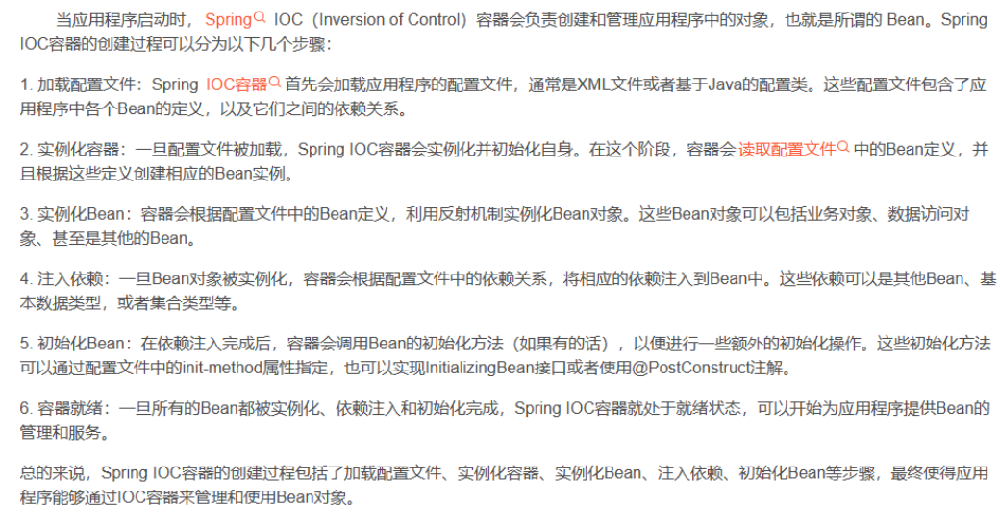

# Spring

[返回模块目录](../README.md)

## 高频题

### 解释一下IOC和AOP？

##### IOC

IOC 即控制反转。

它指的是把对象的创建权和依赖关系的管理权交给 Spring 容器。

传统开发中，业务类自己 `new`  依赖对象，对象之间耦合比较强。

使用 Spring IOC 后，对象由 Spring 容器创建和管理，业务类只需要使用容器注入进来的对象。

好处：

1. 降低类之间的耦合。

2. 对象创建和对象使用解耦。

3. Bean 默认单例，可以避免重复创建对象造成内存浪费。

4. 方便统一管理 Bean 的生命周期。

##### AOP

AOP 即面向切面编程。

它主要用于无侵入式的代码增强。

也就是把日志、权限校验、事务、接口限流、接口幂等等横切逻辑，从核心业务代码中抽取出来。

使用 AOP 后，业务方法只关注核心业务，公共逻辑通过切面统一增强。

Spring AOP 的底层主要是动态代理。

如果目标类实现了接口，默认使用 JDK 动态代理。

如果目标类没有实现接口，则使用 CGLIB 动态代理。

### IOC的好处是什么？

IOC 的核心好处是降低耦合。

没有 IOC 时，对象创建和依赖管理写死在业务代码里。

例如某个 `OrderService`  直接依赖 `AlipayProcessor` ，如果要换成微信支付，就需要修改业务代码。

使用 IOC 后，业务类依赖接口，具体实现类由 Spring 容器注入。

如果要更换实现类，只需要改配置或替换 Bean 即可，不需要改业务逻辑。

另外，Spring 容器中的 Bean 默认是单例的，可以复用对象，减少频繁创建对象的成本。

### 依赖注入是什么，注入有哪些方式？

依赖注入就是 DI，Dependency Injection。

它是 IOC 的具体实现方式。

Spring 容器负责创建 Bean，并把 Bean 依赖的对象注入进去。

常见注入方式：

1. 构造函数注入。

2. Setter 方法注入。

3. 字段注入。

4. 接口注入。

实际开发中更推荐构造函数注入。

原因是依赖关系更明确，可以保证对象创建时依赖就已经准备好，也更方便单元测试。

字段注入写起来简单，但是隐藏了依赖关系，也不利于测试。

### AOP的应用场景？实现原理？

AOP 常见应用场景：

1. 日志记录。

2. 权限校验。

3. Spring 事务。

4. 接口限流。

5. 接口幂等。

6. 统一异常处理或监控埋点。

AOP 的实现原理主要是动态代理。

Spring AOP 会为目标对象创建代理对象。

调用目标方法时，实际上是先调用代理对象的方法。

代理对象在目标方法执行前后加入增强逻辑，比如开启事务、提交事务、回滚事务、记录日志等。

Spring AOP 代理选择：

1. 如果目标对象实现了接口，使用 JDK 动态代理。

2. 如果目标对象没有实现接口，使用 CGLIB 动态代理。

### JDK动态代理和CGLIB动态代理的区别？

##### JDK动态代理

JDK 动态代理基于接口生成代理类。

要求目标类必须实现接口。

代理对象实现同样的接口，方法调用时通过 `InvocationHandler`  拦截，然后通过反射调用目标方法。

##### CGLIB动态代理

CGLIB 动态代理基于继承生成代理类。

它会在运行时生成目标类的子类，通过重写父类方法实现增强。

如果目标类或目标方法被 `final`  修饰，则不能使用 CGLIB 代理。

##### 区别

1. JDK 动态代理基于接口，CGLIB 基于继承。

2. JDK 动态代理要求目标类实现接口，CGLIB 不要求目标类实现接口。

3. CGLIB 不能代理 `final`  类或 `final`  方法。

4. Spring AOP 会根据目标对象是否实现接口选择代理方式。

### Spring事务的实现原理？

Spring 事务主要分为编程式事务和声明式事务。

##### 编程式事务

编程式事务需要手动控制事务开启、提交、回滚。

常见 API 有 `PlatformTransactionManager` 、`TransactionTemplate`  等。

优点是控制粒度更细。

缺点是代码侵入性强，业务代码里会混入事务控制逻辑。

##### 声明式事务

声明式事务主要通过 `@Transactional`  注解实现。

它底层基于 AOP。

Spring 会为加了 `@Transactional`  的 Bean 创建代理对象。

调用事务方法时，会先进入代理对象：

1. 方法执行前开启事务。

2. 方法执行成功后提交事务。

3. 方法抛出异常时根据规则回滚事务。

声明式事务的优点是对业务代码侵入小，方法中只需要写业务逻辑。

### Spring中的事务隔离级别有哪些？

Spring 事务隔离级别主要对应数据库事务隔离级别。

常见隔离级别：

1. `DEFAULT` ：使用数据库默认隔离级别。

2. `READ_UNCOMMITTED` ：读未提交，可能发生脏读、不可重复读、幻读。

3. `READ_COMMITTED` ：读已提交，可以避免脏读，但可能发生不可重复读、幻读。

4. `REPEATABLE_READ` ：可重复读，可以避免脏读、不可重复读，但仍可能存在幻读问题，具体要看数据库实现。

5. `SERIALIZABLE` ：串行化，隔离级别最高，性能最低。

MySQL InnoDB 默认隔离级别是 `REPEATABLE_READ` 。

Spring 的 `DEFAULT`  表示使用底层数据库默认隔离级别。

### Spring事务传播行为有哪些？

事务传播行为描述的是：一个事务方法调用另一个事务方法时，事务应该如何传播。

常见传播行为：

1. `REQUIRED` ：默认传播行为。如果当前有事务，就加入当前事务；如果没有事务，就新建事务。

2. `REQUIRES_NEW` ：总是新建一个事务。如果当前有事务，就把当前事务挂起。

3. `SUPPORTS` ：如果当前有事务，就加入事务；如果没有事务，就以非事务方式执行。

4. `NOT_SUPPORTED` ：以非事务方式执行。如果当前有事务，就挂起当前事务。

5. `MANDATORY` ：必须在事务中执行。如果当前没有事务，就抛异常。

6. `NEVER` ：必须以非事务方式执行。如果当前有事务，就抛异常。

7. `NESTED` ：如果当前有事务，就在嵌套事务中执行；如果没有事务，就新建事务。

最常用的是 `REQUIRED`  和 `REQUIRES_NEW` 。

### Spring事务失效的场景

`@Transactional`  是基于 AOP 动态代理实现的，所以很多事务失效都和代理有关。

常见失效场景：

1. `@Transactional`  标注在非 `public`  方法上。

2. 同一个类中方法自调用，调用没有经过代理对象。

3. 方法被 `final`  或 `static`  修饰，代理无法增强。

4. 异常被 `try-catch`  捕获，没有抛出到代理层。

5. 抛出的是检查异常，但是没有设置 `rollbackFor = Exception.class` 。

6. 数据库本身不支持事务，例如 MyISAM。

7. 多线程中使用事务，新线程拿不到原线程的事务上下文。

8. 类没有被 Spring 容器管理。

解决思路：

1. 事务方法使用 `public` 。

2. 避免同类自调用，必要时通过代理对象调用。

3. 异常要抛出，不要吞掉。

4. 明确设置 `rollbackFor = Exception.class` 。

### Spring常见注解有哪些？

##### Spring常见注解

1. `@Component` ：通用组件注解。

2. `@Controller` ：标识控制层组件。

3. `@Service` ：标识业务层组件。

4. `@Repository` ：标识持久层组件。

5. `@Autowired` ：按类型自动注入。

6. `@Qualifier` ：配合 `@Autowired`  按名称注入。

7. `@Scope` ：指定 Bean 作用域。

8. `@Configuration` ：声明配置类。

9. `@Bean` ：把方法返回值注册到 Spring 容器中。

10. `@ComponentScan` ：指定组件扫描路径。

11. `@Import` ：导入配置类或组件。

##### Spring MVC常见注解

1. `@RequestMapping` ：映射请求路径。

2. `@GetMapping` 、`@PostMapping` ：映射 GET/POST 请求。

3. `@RequestBody` ：接收请求体 JSON，并转换为 Java 对象。

4. `@ResponseBody` ：把方法返回对象转换为 JSON 响应。

5. `@RestController` ：等于 `@Controller + @ResponseBody` 。

6. `@RequestParam` ：获取请求参数。

7. `@PathVariable` ：获取路径参数。

8. `@RequestHeader` ：获取请求头。

##### SpringBoot常见注解

1. `@SpringBootApplication` ：Spring Boot 启动类核心注解。

2. `@SpringBootConfiguration` ：Spring Boot 配置类。

3. `@EnableAutoConfiguration` ：开启自动装配。

4. `@ConditionalOnClass` ：条件装配，类存在时才生效。

### Spring Bean的作用域有哪些？

理论上常见作用域主要有两种：

1. `singleton` ：单例作用域。每次从容器获取同一个 Bean，默认作用域。

2. `prototype` ：原型作用域。每次从容器获取都会创建一个新的 Bean。

Web 环境下还有：

1. `request` ：每次 HTTP 请求创建一个新的 Bean。

2. `session` ：同一个 Session 共享一个 Bean。

3. `application` ：整个 Web 应用共享一个 Bean。

使用场景：

1. 无状态 Bean，比如 Service、DAO、工具类，通常用 `singleton` 。

2. 有状态 Bean，需要隔离状态时，可以考虑 `prototype` 。

### Bean的生命周期

Spring Bean 的生命周期可以简化为：实例化、属性注入、初始化、使用、销毁。

主要过程：

1. 实例化： Spring 根据 BeanDefinition 创建 Bean 实例，可以通过构造函数或工厂方法创建。

2. 属性注入： Spring 给 Bean 注入依赖属性。

3. Aware 回调： 如果 Bean 实现了相关 Aware 接口，会回调注入容器相关对象。

4. BeanPostProcessor 前置处理： 调用 `postProcessBeforeInitialization()` 。

5. 初始化： 执行 `@PostConstruct` 、`InitializingBean.afterPropertiesSet()`  或自定义 `init-method` 。

6. BeanPostProcessor 后置处理： 调用 `postProcessAfterInitialization()` ，AOP 代理通常在这里生成。

7. 使用： Bean 初始化完成，可以被业务使用。

8. 销毁： 容器关闭时，执行 `@PreDestroy` 、`DisposableBean.destroy()`  或自定义`destroy-method` 。

简单回答可以说：实例化、属性设置、初始化、使用、销毁。

### SpringBoot自动装配原理？

Spring Boot 自动装配的核心注解是 `@EnableAutoConfiguration` 。

`@SpringBootApplication`  中包含了 `@EnableAutoConfiguration` 。

自动装配大致流程：

1. 启动类上标注 `@SpringBootApplication` 。

2. 其中的 `@EnableAutoConfiguration`  开启自动装配。

3. `@EnableAutoConfiguration`  通过 `@Import`  导入`AutoConfigurationImportSelector` 。

4. `AutoConfigurationImportSelector`  会读取 jar 包中的自动配置文件。

5. 根据文件中记录的自动配置类全限定名，加载对应配置类。

6. 自动配置类中会定义很多 Bean。

7. 这些 Bean 通常会配合条件注解，比如 `@ConditionalOnClass` 、`@ConditionalOnMissingBean`  等。

8. 条件满足时，Bean 才会被注册到 Spring 容器中。

简单说：

Spring Boot 自动装配就是根据当前项目引入的依赖和已有 Bean，自动判断哪些配置类应该生效，然后把需要的 Bean 加入 Spring 容器。

### Springboot自动装配用哪个注解？

核心注解是 `@EnableAutoConfiguration` 。

它在 `@SpringBootApplication`  里面。

`@SpringBootApplication`  主要由三个注解组合而成：

1. `@SpringBootConfiguration` 。

2. `@EnableAutoConfiguration` 。

3. `@ComponentScan` 。

所以平时启动类上只需要写 `@SpringBootApplication` 。

### Spring MVC的执行流程？

Spring MVC 执行流程：

1. 用户请求先到前端控制器 `DispatcherServlet` 。

2. `DispatcherServlet`  调用 `HandlerMapping` 。

3. `HandlerMapping`  根据请求路径找到具体处理器，返回处理器执行链，里面包含 Handler 和拦截器。

4. `DispatcherServlet`  调用 `HandlerAdapter` 。

5. `HandlerAdapter`  适配并调用具体 Handler，也就是 Controller 中的方法。

6. Controller 方法执行业务逻辑，返回结果。

7. 如果使用 `@ResponseBody`  或 `@RestController` ，会通过 `HttpMessageConverter`  把返回对象转换为 JSON 响应。

8. 最终 `DispatcherServlet`  把响应返回给客户端。

简单记：

请求 -> `DispatcherServlet`  -> `HandlerMapping`  -> `HandlerAdapter`  ->`Controller`  -> 返回响应。

### 取一个自己设置好的变量用哪个注解？

使用 `@Value` 。

例如：

```java
@Value("${server.port}")
private Integer port;
```

`@Value`  可以读取配置文件中的值，也可以注入简单常量。

如果是结构化配置，更推荐使用 `@ConfigurationProperties` 。

## 扩展题

### Spring IOC容器的创建过程

Spring IOC 容器创建过程可以从 `ApplicationContext`  的 `refresh()`  方法展开。

大致流程：

1. 创建 Spring 容器对象。

2. 准备容器环境，比如设置启动时间、环境变量等。

3. 创建或获取 `BeanFactory` 。

4. 加载 BeanDefinition，也就是解析配置类、XML、注解扫描出来的 Bean 定义信息。

5. 调用 `BeanFactoryPostProcessor` ，允许在 Bean 实例化前修改 BeanDefinition。

6. 注册 `BeanPostProcessor` ，它可以在 Bean 初始化前后进行增强。

7. 初始化消息源、事件广播器等容器基础组件。

8. 实例化非懒加载的单例 Bean。

9. 发布容器刷新完成事件。

总结：

IOC 容器创建的核心就是加载 BeanDefinition，然后根据 BeanDefinition 创建 Bean，并管理 Bean的生命周期。

### BeanFactory和ApplicationContext有什么区别？

`BeanFactory`  是 Spring 最基础的 IOC 容器接口。

它提供了 Bean 的创建、获取和管理能力。

`ApplicationContext`  是 `BeanFactory`  的子接口，功能更强。

区别：

1. `BeanFactory`  是基础容器，功能较简单。

2. `ApplicationContext`  在 `BeanFactory`  基础上增加了国际化、事件发布、资源加载、环境变量等功能。

3. `BeanFactory`  通常按需创建 Bean。

4. `ApplicationContext`  启动时默认会实例化非懒加载的单例 Bean。

实际开发中一般使用 `ApplicationContext` 。

### BeanDefinition是什么？

`BeanDefinition`  可以理解为 Bean 的定义信息。

Spring 创建 Bean 之前，会先把 XML、注解、配置类等信息解析成 `BeanDefinition` 。

`BeanDefinition`  中包含：

1. Bean 的 class 类型。

2. Bean 的作用域。

3. 是否懒加载。

4. 构造方法参数。

5. 属性依赖。

6. 初始化方法。

7. 销毁方法。

Spring 后续就是根据 `BeanDefinition`  来创建和管理 Bean。

### BeanPostProcessor是什么？

`BeanPostProcessor`  是 Bean 后置处理器。

它可以在 Bean 初始化前后对 Bean 进行扩展。

常见两个方法：

1. `postProcessBeforeInitialization()` ：初始化前执行。

2. `postProcessAfterInitialization()` ：初始化后执行。

AOP 代理对象通常就是在 `postProcessAfterInitialization()`  阶段生成的。

所以 BeanPostProcessor 是 Spring 扩展机制中非常重要的一环。

### FactoryBean和BeanFactory的区别？

`BeanFactory`  是 Spring 容器，是用来创建和管理 Bean 的工厂。

`FactoryBean`  是一个特殊的 Bean，它本身也是 Bean，但是它可以自定义创建对象的逻辑。

区别：

1. `BeanFactory`  是容器。

2. `FactoryBean`  是一个 Bean。

3. 从容器中获取普通 Bean，返回的是 Bean 本身。

4. 从容器中获取 `FactoryBean`  的名字，默认返回的是它 `getObject()`  创建出来的对象。

5. 如果想获取 `FactoryBean`  本身，需要在 Bean 名称前加 `&` 。

典型场景：

MyBatis 中的 Mapper 代理对象就可以通过 FactoryBean 思路创建。

### 循环依赖问题是什么？

循环依赖指两个或多个 Bean 之间互相依赖，形成循环引用。

例如：

1. A 依赖 B。

2. B 又依赖 A。

如果不处理，Spring 创建 A 时需要 B，创建 B 时又需要 A，就会陷入循环，导致容器启动失败。

Spring 可以解决部分循环依赖问题。

限制：

1. 必须是单例 Bean。

2. 不能全是构造函数注入。

3. 主要解决的是 setter 注入或字段注入形成的循环依赖。

### 三级缓存是什么？

Spring 解决循环依赖主要依赖三级缓存。

三级缓存：

1. 一级缓存 singletonObjects： 存放完全初始化好的单例 Bean。

2. 二级缓存 earlySingletonObjects： 存放提前暴露的早期 Bean 引用。

3. 三级缓存 singletonFactories： 存放可以创建早期 Bean 引用的 `ObjectFactory` 。

为什么需要三级缓存？

因为 Bean 的创建可以分为实例化和初始化两步。

实例化只是调用构造方法创建对象，此时对象还没有完成属性注入和初始化，可以理解为半成品对象。

Spring 会把半成品对象提前暴露出去，让其他 Bean 能先引用它，从而打破循环依赖。

三级缓存中的 `ObjectFactory`  还可以在需要时生成早期代理对象，解决 AOP 代理场景下的循环依赖问题。

### 三级缓存怎么解决循环依赖问题？

以 A 依赖 B，B 依赖 A 为例。

流程：

1. 创建 A，先实例化 A。

2. A 实例化后，还没属性注入，把 A 的 `ObjectFactory`  放入三级缓存。

3. 给 A 填充属性时发现需要 B，于是开始创建 B。

4. 创建 B，先实例化 B，并把 B 的 `ObjectFactory`  放入三级缓存。

5. 给 B 填充属性时发现需要 A。

6. 此时 Spring 从三级缓存中拿到 A 的 `ObjectFactory` ，生成 A 的早期引用，并放入二级缓存。

7. B 拿到 A 的早期引用后完成属性注入和初始化，放入一级缓存。

8. A 再拿到已经创建好的 B，完成自己的属性注入和初始化，最后放入一级缓存。

这样 A 和 B 都能完成创建。

### 为什么构造器注入不能解决循环依赖？

构造器注入要求对象创建时必须先准备好构造参数。

如果 A 的构造方法需要 B，B 的构造方法又需要 A，那么 A 和 B 都无法先实例化出来。

而 Spring 解决循环依赖的关键是：先实例化半成品对象，再提前暴露。

构造器循环依赖连半成品对象都创建不出来，所以无法通过三级缓存解决。

### @Autowired和@Resource的区别

`@Autowired`  和 `@Resource`  都可以实现依赖注入。

区别：

1. `@Autowired`  是 Spring 提供的注解。

2. `@Resource`  是 JDK/Jakarta 标准注解。

3. `@Autowired`  默认先按类型 byType 注入，如果找到多个，再按名称 byName 匹配。

4. `@Resource`  默认先按名称 byName 注入，如果找不到，再按类型 byType 匹配。

5. `@Autowired`  可以用在构造器、字段、Setter 方法上。

6. `@Resource`  一般用在字段和 Setter 方法上，不支持构造器注入。

如果同一个接口有多个实现：

1. `@Autowired`  可以配合 `@Qualifier`  指定 Bean 名称。

2. `@Resource`  可以直接通过 `name`  或 `type`  指定。

### @Component、@Controller、@Service、@Repository区别

这几个注解本质上都是把类注册成 Spring Bean。

区别主要是语义不同：

1. `@Component` ：通用组件。

2. `@Controller` ：控制层组件。

3. `@Service` ：业务层组件。

4. `@Repository` ：持久层组件。

`@Repository`  还可能和持久层异常转换有关。

实际开发中按分层语义使用即可。

### @Configuration和@Component有什么区别？

`@Configuration`  本质上也是一个组件注解，配置类也会被 Spring 注册为 Bean。

区别：

1. `@Configuration`  表示这是一个配置类。

2. 配置类中通常会使用 `@Bean`  方法注册 Bean。

3. 完整模式下，`@Configuration`  类会被 CGLIB 代理，保证同一个 `@Bean`  方法多次调用返回同一个单例 Bean。

4. 普通 `@Component`  不会对 `@Bean`  方法做这种特殊代理增强。

如果配置类中存在 `@Bean`  方法之间互相调用，一般应该使用 `@Configuration` 。

### Spring事务为什么基于ThreadLocal？

Spring 事务需要在同一个线程中保存事务上下文，例如数据库连接、事务状态等。

Spring 会把事务上下文绑定到当前线程。

底层常用 `ThreadLocal`  保存这些信息。

这样同一个线程内不同方法调用时，都可以获取到当前事务资源。

这也解释了为什么事务中开启新线程会导致事务失效。

因为 `ThreadLocal`  是线程隔离的，新线程拿不到原线程的事务上下文。

### 事务失效的原因有哪些？

`@Transactional`  定义的声明式事务在以下场景可能失效：

1. 注解加在非 `public`  方法上。

2. 同类内部方法自调用。

3. 方法被 `final`  修饰。

4. 方法被 `static`  修饰。

5. 异常被 catch 捕获，没有继续抛出。

6. 抛出检查异常，但没有配置 `rollbackFor = Exception.class` 。

7. 开启了新线程执行数据库操作。

8. Bean 没有交给 Spring 管理。

9. 数据库或存储引擎不支持事务。

10. 事务传播行为配置不符合预期。

核心原因通常是：没有走到代理对象，或者异常没有被事务拦截器感知。

### 声明式事务有什么局限？

声明式事务虽然使用方便，但也有局限。

1. 最小粒度通常是方法级别。

2. 事务边界不够直观，开发者可能忽略某个方法已经处在事务中。

3. 如果事务方法中包含 RPC 调用、消息发送、缓存更新、文件写入等不可回滚操作，可能导致数据不一致。

4. 如果事务中包含远程调用，会拉长事务时间，占用数据库连接。

5. 被代理机制限制，存在自调用、非 public 方法、异常被捕获等失效场景。

所以复杂事务场景下，可以考虑编程式事务，让事务边界更明确。

### SpringBoot的启动流程？

Spring Boot 启动入口是主类的 `main()`  方法。

核心代码：

```java
SpringApplication.run(Application.class, args);
```

启动流程：

1. 执行 `main()`  方法，调用 `SpringApplication.run()` 。

2. 加载 `spring.factories`  中配置的初始化器和监听器。

3. 创建应用程序上下文 `ApplicationContext` 。

4. 准备环境信息，例如配置文件、环境变量、启动参数等。

5. 调用 `refresh()`  刷新容器。

6. 注册并执行 `BeanFactoryPostProcessor` 。

7. 注册 `BeanPostProcessor` 。

8. 扫描并实例化 Bean。

9. 创建内嵌 Web 服务器，例如 Tomcat。

10. 发布容器刷新完成事件。

11. 启动完成后发布 `ApplicationReadyEvent` 。

简单说：

Spring Boot 启动就是创建 SpringApplication，准备环境，创建并刷新 IOC 容器，启动内嵌 Web 服务器，最后发布启动完成事件。

### Spring中用到了哪些设计模式？

Spring 中常见设计模式：

1. 单例模式： Spring IOC 容器中默认 Bean 是单例的。

2. 工厂模式： Spring IOC 容器本身就是工厂，通过 `getBean()`  获取对象。

3. 代理模式： Spring AOP 基于动态代理实现增强。

4. 责任链模式： Spring MVC 中处理器执行链和多个拦截器体现了责任链思想。

5. 模板方法模式： `JdbcTemplate` 、`RestTemplate`  等模板类封装固定流程，把变化点交给回调。

6. 观察者模式： Spring 事件发布和监听机制。

7. 适配器模式： Spring MVC 中 `HandlerAdapter`  适配不同类型的 Handler。

### Spring MVC中拦截器和过滤器的区别？

过滤器 Filter 是 Servlet 规范中的组件。

拦截器 Interceptor 是 Spring MVC 提供的组件。

区别：

1. Filter 依赖 Servlet 容器，Interceptor 依赖 Spring MVC。

2. Filter 作用范围更大，可以过滤几乎所有请求。

3. Interceptor 主要拦截进入 Controller 的请求。

4. Filter 执行时机更早，Interceptor 在 Spring MVC 找到 Handler 后执行。

5. Interceptor 可以更方便地访问 Spring 容器中的 Bean。

常见顺序：

请求先经过 Filter，再进入 `DispatcherServlet` ，然后经过 Interceptor，最后到 Controller。

### Spring MVC为什么需要HandlerAdapter？

不同 Controller 或 Handler 的调用方式可能不同。

如果 `DispatcherServlet`  直接调用具体 Handler，就会和各种 Handler 实现强耦合。

`HandlerAdapter`  的作用就是适配不同类型的 Handler。

`DispatcherServlet`  不关心具体 Handler 怎么执行，只需要找到合适的 `HandlerAdapter` ，让它去调用目标 Handler。

这体现了适配器模式。

### SpringBoot如何优雅停机？

优雅停机指应用关闭时，不是立刻强制中断，而是停止接收新请求，并等待正在处理的请求完成。

Spring Boot 2.3 开始内置了优雅停机能力。

常见配置：

```text
server:
  shutdown: graceful

spring:
  lifecycle:
    timeout-per-shutdown-phase: 2m
```

开启后，服务关闭时会先停止接收新请求，然后等待已有请求处理完成，超过指定时间后再结束。

好处：

1. 避免请求处理中断。

2. 避免数据不一致。

3. 释放资源更平滑。

### Spring6.0新特性了解吗？

Spring 6 和 Spring Boot 3 开始更强调云原生和原生镜像能力。

其中比较重要的是 AOT。

AOT 全称 Ahead Of Time，也就是提前编译。

它和 JIT 不同，JIT 是运行时即时编译，AOT 是程序运行前就做一些编译和分析。

AOT 的好处：

1. 减少运行时反射和动态处理开销。

2. 提升启动速度。

3. 降低内存占用。

4. 更适合 GraalVM Native Image。

Spring Native 或 Native Image 可以把 Spring 应用编译成原生可执行文件。

优点是启动快、内存占用低。

缺点是构建时间更长，对反射、动态代理等能力有更多限制。

### Spring扩展中容易混淆的点

1. IOC 是思想，DI 是 IOC 的具体实现方式。

2. AOP 是无侵入式增强，Spring AOP 主要基于动态代理。

3. JDK 动态代理要求目标类实现接口，CGLIB 基于继承。

4. `@Transactional`  失效多数和代理没生效或异常没抛出有关。

5. Spring 只能解决部分循环依赖，构造器循环依赖不能解决。

6. 三级缓存不仅是为了提前暴露对象，也和 AOP 早期代理对象有关。

7. `@Autowired`  默认先 byType，`@Resource`  默认先 byName。

8. `BeanFactory`  是基础容器，`ApplicationContext`  功能更完整。

9. `FactoryBean`  是 Bean，`BeanFactory`  是容器。

10. Spring Boot 自动装配不是无条件装配，而是通过条件注解按需装配。

## 后端面经与场景补充

<!-- 原PDF第489页；面经原题号 41 -->

### spring相互依赖会报错吗

Spring 框架对单例作用域且使用属性注入或Setter 注入 的 Bean 之间的循环依赖，默认情况下已经解决了，不会报错。这是 Spring 框架通过其三级缓存机制实现的。

解决思路：

Spring 框架解决单例作用域 Bean 通过 Setter 方法或字段注入造成的循环依赖，其核心在于一个精妙的 "三级缓存" 机制和 "提前暴露半成品对象" 的策略

- 允许创建不完整的对象 (半成品)： Spring 在创建 Bean 时，将其生命周期分为两个关键阶段：

    - 实例化 (Instantiation)： 调用构造器 ( `new` )，在堆内存中创建一个原始对象。此时对象内部的依赖属性 (被 `@Autowired`  标注的字段或 Setter 方法需要注入的属性) 都是 `null`或默认值。这个对象是不完整的，称为"早期引用" (Early Reference) 或 "半成品 Bean"。

    - 属性填充/注入 (Population)： 将依赖的其他 Bean 设置到这个原始对象中。

- 提前暴露半成品： Spring 在完成 Bean 的实例化后（构造器执行完），立刻将这个不完整的原始对象（早期引用）暴露出来，放入一个特殊的缓存中，供其他正在创建的 Bean 引用。

- 先有鸡还是先有蛋？ 解决： 当 Bean A 依赖 Bean B，而 Bean B 又依赖 Bean A 时：

    - Spring 开始创建 A。

    - 实例化 A（调用 A 的构造器），得到一个半成品 A。

    - 关键一步： Spring 立即将这个半成品 A 放入 "三级缓存" (通常是`singletonFactories` ，一个能生产早期引用的工厂缓存)。

    - Spring 开始给 A 的属性注入依赖。发现 A 依赖 B。

    - Spring 去容器中查找 B。发现 B 不存在，于是开始创建 B。

    - 实例化 B（调用 B 的构造器），得到一个半成品 B。

    - 同样关键： Spring 立即将这个半成品 B 放入 "三级缓存"。

    - Spring 开始给 B 的属性注入依赖。发现 B 依赖 A。

    - Spring 去容器中查找 A。此时：

        - 它不会找到完全初始化好的 A（因为 A 还在创建中）。

        - 但它会从 "三级缓存" 中找到 A 的早期引用 (那个半成品 A 对象)!

    - Spring 将这个半成品 A 注入到 B 中。此时 B 的属性注入完成，B 成为一个完整的 Bean。

    - Spring 将完成初始化的 B 放入一级缓存 ( `singletonObjects` ，存放完全可用的单例Bean)。

    - 控制权回到 A 的创建流程。现在 Spring 需要给 A 注入 B。它去容器中查找 B。

    - 这次它从一级缓存 ( `singletonObjects` ) 中找到了已经初始化好的 B！

    - Spring 将完整的 B 注入到 A 中。此时 A 的属性注入完成，A 成为一个完整的 Bean。

    - Spring 将完成初始化的 A 放入一级缓存 ( `singletonObjects` )。

<!-- 原PDF第490页；面经原题号 42 -->

### spring的ioc和aop讲一下

AOP（Aspect Oriented Programming）即面向切面编程，AOP 是 OOP（面向对象编程）的一种延续，二者互补，并不对立。

AOP 的目的是将横切关注点（如日志记录、事务管理、权限控制、接口限流、接口幂等等）从核心业务逻辑中分离出来，通过动态代理、字节码操作等技术，实现代码的复用和解耦，提高代码的可维护性和可扩展性。OOP 的目的是将业务逻辑按照对象的属性和行为进行封装，通过类、对象、继承、多态等概念，实现代码的模块化和层次化（也能实现代码的复用），提高代码的可读性和可维护性

AOP 可以将横切关注点（如日志记录、事务管理、权限控制、接口限流、接口幂等等）从 核心业务逻辑（core concerns，核心关注点） 中分离出来，实现关注点的分离。 以日志记录为例进行介绍，假如我们需要对某些方法进行统一格式的日志记录，没有使用 AOP 技术之前，我们需要挨个写日志记录的逻辑代码，全是重复的的逻辑。

使用 AOP 技术之后，我们可以将日志记录的逻辑封装成一个切面，然后通过切入点和通知来指定在哪些方法需要执行日志记录的操作。

AOP 的常见实现方式有动态代理、字节码操作等方式。Spring AOP 就是基于动态代理的，如果要代理的对象，实现了某个接口，那么 Spring AOP 会使用JDK Proxy，去创建代理对象，而对于没有实现接口的对象，就无法使用 JDK Proxy 去进行代理了，这时候 Spring AOP 会使用Cglib生成一个被代理对象的子类来作为代理

IOC



<!-- 原PDF第510页；面经原题号 89 -->

### mybatis的模板引擎

原文未附答案。
