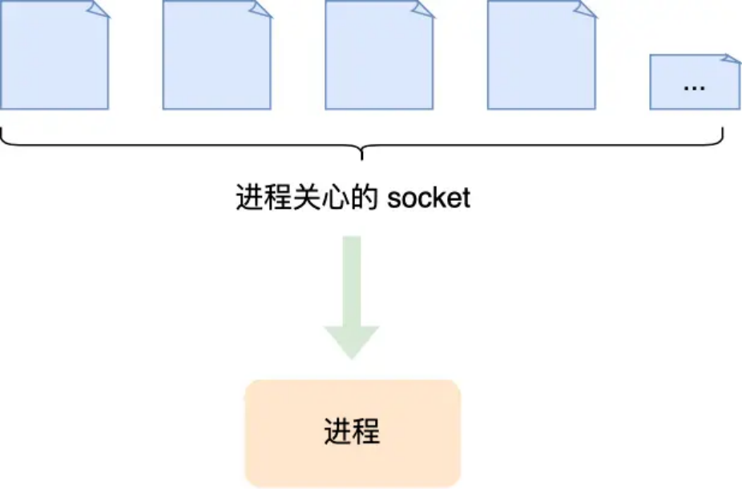
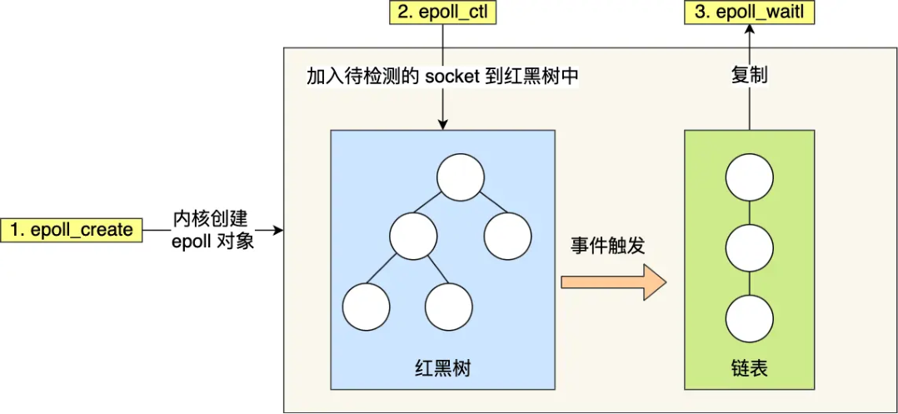

# 计算机网络

[返回模块目录](../README.md)

## 高频题

### HTTP

#### http和https的区别

HTTP 和 HTTPS 的主要区别：

1. 端口不同： HTTP 默认端口是 80，HTTPS 默认端口是 443。

2. URL 前缀不同： HTTP 是 `http://` ，HTTPS 是 `https://` 。

3. 安全性不同： HTTP 明文传输，数据容易被窃听、篡改；HTTPS 在 HTTP 和 TCP 之间加入SSL/TLS，传输内容会加密。

4. 身份认证不同： HTTP 无法验证通信双方身份；HTTPS 通过数字证书验证服务器身份。

5. 资源消耗不同： HTTPS 需要加解密和证书校验，比 HTTP 更消耗服务器资源。

6. SEO 影响： 搜索引擎通常更倾向 HTTPS 网站，因为安全性更高。

简单来说：

HTTP 是明文传输，不安全。

HTTPS = HTTP + SSL/TLS，解决了加密传输、身份认证和数据完整性问题。

#### https怎样加密？

HTTPS 同时使用了非对称加密和对称加密。

大致过程：

1. 客户端向服务器发起 HTTPS 请求。

2. 服务器返回数字证书，证书中包含服务器公钥。

3. 客户端验证证书是否合法，比如是否由可信 CA 签发、是否过期、域名是否匹配。

4. 客户端生成一个随机密钥，并用服务器公钥加密后发给服务器。

5. 服务器用自己的私钥解密，得到这个随机密钥。

6. 之后客户端和服务器使用这个密钥进行对称加密通信。

为什么要这样设计？

非对称加密安全，但是性能差。

对称加密性能好，但是密钥传输不安全。

所以 HTTPS 用非对称加密来安全交换密钥，后续数据传输使用对称加密。

#### HTTP工作在哪一层？TCP呢？

HTTP 工作在应用层。

TCP 工作在传输层。

常见协议所在层：

1. 应用层：HTTP、HTTPS、DNS、FTP、SMTP。

2. 传输层：TCP、UDP。

3. 网络层：IP、ICMP、ARP。

4. 数据链路层：以太网协议。

5. 物理层：网线、光纤、电信号等。

#### HTTP常见的状态码

1. 1xx

提示信息，表示协议处理中间状态，实际用得比较少。

2. 2xx

表示成功。

a. `200 OK` ：请求成功，最常见。

b. `204 No Content` ：请求成功，但没有响应体。

c. `206 Partial Content` ：部分内容，常用于断点续传或分块下载。

3. 3xx

表示重定向。

a. `301 Moved Permanently` ：永久重定向。

b. `302 Found` ：临时重定向。

c. `304 Not Modified` ：资源未修改，可以使用缓存。

4. 4xx

表示客户端错误。

a. `400 Bad Request` ：请求报文有错误。

b. `401 Unauthorized` ：未认证。

c. `403 Forbidden` ：服务器拒绝访问。

d. `404 Not Found` ：资源不存在。

5. 5xx

表示服务端错误。

a. `500 Internal Server Error` ：服务器内部错误。

b. `502 Bad Gateway` ：网关或代理访问后端服务失败。

c. `503 Service Unavailable` ：服务暂时不可用。

#### GET和POST区别

GET 的语义是获取资源。

POST 的语义是提交数据，让服务器根据请求体进行处理。

区别：

1. GET 参数通常放在 URL 中，POST 参数通常放在请求体中。

2. GET 是安全的，不应该修改服务器资源；POST 可能会修改服务器资源。

3. GET 是幂等的，多次请求结果应该一致；POST 通常不是幂等的。

4. GET 可以被缓存，POST 大多数实现下不缓存。

5. GET 请求长度受浏览器和服务器限制，POST 理论上更适合提交较大数据。

注意：

安全和幂等是语义上的约定，不是技术上强制。

#### 输入url到界面渲染的过程

大致流程：

1. 浏览器解析 URL，确定协议、域名、端口、资源路径。

2. 浏览器先查询缓存，如果缓存可用，可能直接使用缓存。

3. 如果需要访问服务器，浏览器通过 DNS 查询域名对应的 IP 地址。

4. 浏览器根据 IP 和端口，和服务器建立 TCP 连接。

5. 如果是 HTTPS，还需要进行 TLS 握手，完成证书校验和密钥协商。

6. 浏览器在 TCP 连接上发送 HTTP 请求报文。

7. 服务器接收请求，处理业务逻辑，返回 HTTP 响应报文。

8. 浏览器接收响应，解析 HTML。

9. 浏览器继续请求 HTML 中引用的 CSS、JS、图片等资源。

10. 浏览器构建 DOM 树、CSSOM 树，生成渲染树，进行布局和绘制。

11. 页面加载完成后，如果不再通信，可以关闭 TCP 连接，也可以保持长连接复用。

#### DNS解析流程是什么？

DNS 的作用是把域名解析成 IP 地址。

完整流程：

1. 浏览器先查浏览器缓存。

2. 浏览器缓存没有，再查操作系统缓存。

3. 本地没有命中，就请求本地 DNS 服务器。

4. 本地 DNS 服务器如果没有缓存，会向根域名服务器查询。

5. 根域名服务器返回顶级域名服务器地址，比如 `.com` 。

6. 本地 DNS 服务器再向顶级域名服务器查询。

7. 顶级域名服务器返回权威域名服务器地址。

8. 本地 DNS 服务器向权威域名服务器查询，拿到最终 IP。

9. 本地 DNS 服务器把结果返回客户端，并缓存结果。

10. 客户端也会缓存结果，后续相同域名可以直接使用。

### TCP/UDP

#### osi七层模型及其作用

OSI 七层模型：

a. 物理层： 负责比特流传输，解决 0 和 1 如何在物理介质上传输。

b. 数据链路层： 负责相邻节点之间的数据帧传输，处理 MAC 地址、封帧、差错检测等。

c. 网络层： 负责 IP 地址、路由选择、分组转发。

d. 传输层： 负责端到端通信，比如 TCP、UDP。

e. 会话层： 负责建立、管理和终止会话。

f. 表示层： 负责数据格式转换、编码、压缩、加密等。

g. 应用层： 直接面向应用程序，比如 HTTP、DNS、FTP。

实际学习和面试中，经常会把会话层、表示层、应用层合并为应用层，形成五层模型：

a. 应用层。

b. 传输层。

c. 网络层。

d. 数据链路层。

e. 物理层。

#### TCP和UDP的区别

1. 是否面向连接： TCP 面向连接，传输前需要三次握手；UDP 无连接，直接发送。

2. 是否可靠： TCP 可靠传输，保证数据不丢失、不重复、按序到达；UDP 不保证可靠性。

3. 是否有状态： TCP 需要维护连接状态；UDP 无状态。

4. 传输效率： TCP 有连接、确认、重传、拥塞控制等机制，开销较大；UDP 更轻量，效率更高。

5. 传输形式： TCP 面向字节流；UDP 面向报文。

6. 首部开销： TCP 首部 20 到 60 字节；UDP 首部 8 字节。

7. 通信方式： TCP 只支持点对点；UDP 支持一对一、一对多、多对一、多对多。

使用场景：

1. TCP：HTTP、HTTPS、FTP、SSH、邮件等需要可靠传输的场景。

2. UDP：DNS、直播、视频通话、游戏、QUIC 等更关注实时性的场景。

#### TCP 三次握手和四次挥手

1. 三次握手

建立 TCP 连接需要三次握手。

a. 第一次握手：客户端发送 SYN 报文给服务端，表示想建立连接，客户端进入 `SYN_SENT`  状态。

b. 第二次握手：服务端收到 SYN 后，回复 SYN + ACK 报文，服务端进入 `SYN_RECV`  状态。

c. 第三次握手：客户端收到 SYN + ACK 后，回复 ACK 报文，客户端和服务端都进入`ESTABLISHED`  状态。

三次握手的目的：

确认双方的发送能力和接收能力都正常。

第一次握手后，服务端确认客户端发送正常、自己接收正常。

第二次握手后，客户端确认自己发送接收正常、服务端发送接收正常。

第三次握手后，服务端确认自己发送正常、客户端接收正常。

2. 四次挥手

断开 TCP 连接需要四次挥手。

a. 第一次挥手：主动关闭方发送 FIN，表示自己不再发送数据。

b. 第二次挥手：被动关闭方收到 FIN 后，回复 ACK，表示收到关闭请求。

c. 第三次挥手：被动关闭方数据发送完后，也发送 FIN，表示自己也准备关闭。

d. 第四次挥手：主动关闭方收到 FIN 后，回复 ACK，然后进入 `TIME_WAIT`  状态，等待 2MSL后关闭。

口诀：

三次握手：SYN、SYN + ACK、ACK。

四次挥手：FIN、ACK、FIN、ACK。

#### 为什么握手是三次，不是两次？

主要有两个原因：

1. 防止历史连接。

2. 确保双方初始序列号能够可靠同步。

如果只有两次握手，服务端收到一个网络中滞留的历史 SYN 报文后，就可能直接建立连接，浪费服务端资源。

另外，两次握手时，服务端无法确认客户端是否收到了自己的 SYN + ACK，也就无法确认自己的发送能力和客户端的接收能力是否正常。

所以三次握手是为了保证双方收发能力都被确认，同时避免历史连接造成资源浪费。

#### 为什么挥手需要四次，而握手只需三次？

核心原因是 TCP 是全双工通信。

双方各自都有发送通道和接收通道。

建立连接时，服务端可以把 SYN 和 ACK 合并在一个报文中，所以三次就够。

断开连接时，主动方发送 FIN 只表示自己不再发送数据了，但还可以接收数据。

被动方收到 FIN 后，可能还有数据没发完，所以只能先回复 ACK。

等被动方数据发送完毕后，再单独发送 FIN。

所以通常需要四次挥手。

如果被动方收到 FIN 时没有数据要发送，也可能把 ACK 和 FIN 合并，四次挥手退化成三次。

#### TIME_WAIT是什么？为什么要等待2MSL？

`TIME_WAIT`  是主动关闭连接的一方在四次挥手最后进入的状态。

客户端发送最后一个 ACK 后，不会立刻关闭，而是等待 2MSL。

原因：

1. 防止最后一个 ACK 丢失。

如果最后一个 ACK 丢失，服务端会重发 FIN。

客户端在 `TIME_WAIT`  状态下还能收到重发的 FIN，并重新发送 ACK。

2. 让旧连接中的历史报文在网络中自然消失。

等待 2MSL 后，可以避免旧连接的延迟报文影响新连接。

MSL 是 Maximum Segment Lifetime，表示报文在网络中的最大生存时间。

2MSL 可以理解为一个报文发送和一个回复所需的最大时间。

#### 服务器上很多TIME_WAIT是什么意思？会带来什么后果？怎么解决？

大量 `TIME_WAIT`  通常出现在高并发短连接场景。

原因：

1. 短连接频繁建立和关闭。

2. 服务器主动关闭连接。

3. 高并发下连接数量太多。

后果：

1. 占用端口资源。

2. 占用一定 fd、内存和 CPU。

3. 极端情况下端口耗尽，无法建立新连接。

解决方案：

1. 改短连接为长连接，减少连接频繁关闭。

2. 使用 HTTP/1.1 Keep-Alive 或 HTTP/2。

3. 尽量让客户端主动关闭连接，把 `TIME_WAIT`  分散到客户端。

4. 合理调整系统内核参数，例如开启端口复用等。

#### TCP保证可靠性的原理

TCP 可靠性主要由以下机制保证：

1. 三次握手和四次挥手： 保证连接可靠建立和释放。

2. 序列号机制： 每个字节都有序列号，接收方可以按序重组数据。

3. 确认应答机制： 接收方收到数据后返回 ACK。

4. 超时重传： 数据包丢失或 ACK 丢失时，发送方超时后重传。

5. 快速重传： 连续收到重复 ACK 时，不等超时，直接重传丢失数据。

6. 流量控制： 根据接收方接收窗口控制发送速率，避免接收方缓冲区溢出。

7. 拥塞控制： 根据网络拥塞情况控制发送速率，避免把网络打爆。

#### TCP的流量控制是由发送方和接收方哪一方来控制的，同问TCP的拥塞控制

流量控制和拥塞控制最终都是由发送方控制发送速率。

1. 流量控制

流量控制关注的是接收方能不能接收得过来。

接收方会通过 TCP 头部的接收窗口字段告诉发送方：自己还能接收多少数据。

发送方根据接收窗口大小调整发送速率，避免接收方缓冲区溢出。

2. 拥塞控制

拥塞控制关注的是网络能不能承受当前发送速度。

发送方根据网络拥塞情况动态调整拥塞窗口。

常见算法：

a. 慢启动。

b. 拥塞避免。

c. 快速重传。

d. 快速恢复。

#### 介绍一下慢启动（拥塞控制算法）

慢启动是 TCP 拥塞控制的一部分。

刚开始建立连接时，发送方不会一上来就发送大量数据，而是从较小的拥塞窗口开始。

每经过一个 RTT，如果没有发生拥塞，拥塞窗口会指数增长。

当拥塞窗口达到慢启动阈值后，就进入拥塞避免阶段。

拥塞避免阶段不再指数增长，而是线性增长。

如果发生丢包：

1. 如果是超时重传，说明网络拥塞比较严重，会把拥塞窗口降到 1，重新慢启动。

2. 如果收到 3 个重复 ACK，会触发快速重传和快速恢复，拥塞窗口通常减半，然后线性增长。

#### TCP粘包问题详解和解决方案

TCP 是面向字节流的协议，没有消息边界。

所以应用层发送的多条消息，接收方可能一次读到多条，也可能一条消息被拆成多次读到。

这就是粘包和拆包问题。

产生原因：

a. TCP 本身只保证字节流顺序，不知道上层消息边界。

b. 发送端可能把多个小包放到缓冲区合并发送。

c. 接收端可能一次从缓冲区读取多个包。

d. 数据包太大时，也可能被拆成多个包。

解决方案：

a. 固定消息长度。

b. 使用特殊分隔符，例如换行符。

c. 消息头中携带消息长度，接收方先读长度，再按长度读消息体。

d. 使用标准应用层协议，例如 HTTP、WebSocket、Protobuf 等。

注意：

UDP 是面向数据报的，有消息边界，一般没有 TCP 这种粘包拆包问题。

#### 有哪些协议是基于TCP的？

常见基于 TCP 的协议：

1. HTTP。

2. HTTPS。

3. FTP。

4. SMTP。

5. POP3。

6. IMAP。

7. SSH。

这些协议通常需要可靠传输，所以选择 TCP。

#### TCP和UDP可以使用同一个端口吗？

可以。

因为端口是否冲突，不只看端口号，还要看协议类型。

一个网络连接或监听通常由 IP、端口、协议共同确定。

TCP 80 和 UDP 80 是不同的协议空间，所以可以同时存在。

典型例子是 DNS。

DNS 通常使用 UDP 53 端口进行查询，但响应数据过大或需要可靠传输时，也可能使用 TCP 53 端口。

## 扩展题

### HTTP

#### HTTP是什么？

HTTP 是超文本传输协议。

它是应用层协议，主要用于客户端和服务端之间传输超文本数据。

HTTP 是请求-响应模型。

客户端发送 HTTP 请求，服务端处理后返回 HTTP 响应。

HTTP 本身是无状态的。

也就是说，协议本身不会保存客户端和服务端之间的历史状态。

如果需要保存登录状态，通常需要 Cookie、Session、Token 等机制。

#### HTTP/1.0、HTTP/1.1、HTTP/2、HTTP/3演进

1. HTTP/1.0

HTTP/1.0 默认短连接。

每次请求都要建立 TCP 连接，请求完成后关闭连接。

缺点是频繁建立和关闭连接，开销大。

2. HTTP/1.1

HTTP/1.1 默认支持长连接，也就是 Keep-Alive。

多个请求可以复用同一个 TCP 连接。

同时支持管道化请求，但响应仍然需要按顺序返回，所以仍然有队头阻塞问题。

3. HTTP/2

HTTP/2 基于 TCP。

主要优化：

a. 二进制帧。

b. 头部压缩，使用 HPACK。

c. 多路复用，一个 TCP 连接上可以并发多个 Stream。

d. 服务器推送。

HTTP/2 解决了 HTTP 应用层队头阻塞。

但是因为它仍然基于 TCP，如果 TCP 层发生丢包，所有 Stream 都会被阻塞，所以仍然有 TCP 层队头阻塞。

4. HTTP/3

HTTP/3 基于 QUIC，QUIC 基于 UDP。

主要优化：

a. 减少队头阻塞。

b. 连接建立更快，可以 1-RTT，甚至会话恢复时 0-RTT。

c. 支持连接迁移。

d. 集成 TLS 加密。

#### Http1.1和2.0的区别

HTTP/2 相比 HTTP/1.1 主要有以下改进：

1. 多路复用： HTTP/2 在同一个 TCP 连接上可以同时传输多个请求和响应，不同请求通过 Stream 区分。

2. 二进制帧： HTTP/1.1 使用文本格式，HTTP/2 使用二进制帧，解析更高效。

3. 头部压缩： HTTP/2 使用 HPACK 压缩头部，减少重复 Header 传输。

4. 服务器推送： 服务端可以主动推送客户端可能需要的资源。

HTTP/1.1 虽然支持长连接，但同一个连接上的请求和响应仍有顺序限制。

如果前面的请求响应慢，后面的请求可能被阻塞。

HTTP/2 通过多路复用改善了这个问题。

#### HTTP/2有什么缺陷？

HTTP/2 解决了 HTTP 应用层队头阻塞，但没有解决 TCP 层队头阻塞。

HTTP/2 多个 Stream 复用同一个 TCP 连接。

TCP 是可靠字节流，要求数据按序交付。

如果某个 TCP 包丢失，后面已经到达的数据也不能交给应用层，必须等丢失的包重传回来。

这样一个包丢失，就会阻塞这个 TCP 连接上的所有 HTTP/2 Stream。

所以 HTTP/2 的队头阻塞发生在 TCP 层。

#### HTTP/3做了哪些优化？

HTTP/3 把底层传输从 TCP 换成了基于 UDP 的 QUIC。

QUIC 主要特点：

1. 无队头阻塞： QUIC 中不同 Stream 相互独立，某个流丢包只影响该流，不影响其他流。

2. 连接建立更快： QUIC 集成 TLS 1.3，新连接通常 1-RTT，恢复连接可以 0-RTT。

3. 连接迁移： QUIC 用连接 ID 标识连接，不依赖 TCP 四元组。网络从 Wi-Fi 切到 4G，只要连接 ID 不变，就可以继续复用连接。

4. 应用层实现可靠传输： QUIC 基于 UDP，但自己实现了重传、拥塞控制、流量控制等能力。简单说：

QUIC 是基于 UDP 的伪 TCP + TLS + HTTP/2 多路复用协议。

#### QUIC为什么基于UDP？

QUIC 基于 UDP 的原因：

1. UDP 在操作系统内核中实现简单，不像 TCP 那样被固定协议栈限制。

2. 在 UDP 之上，QUIC 可以在应用层实现可靠传输、拥塞控制、流量控制和多路复用。

3. 协议升级更灵活，不需要等待操作系统内核升级。

4. 可以绕开 TCP 队头阻塞问题。

但是 QUIC 也有问题。

因为很多网络设备只认识 TCP/UDP，不认识 QUIC。

部分网络设备可能会限制或丢弃 UDP 包，影响 QUIC 的普及。

#### HTTPS完整握手过程

HTTPS 加密过程可以分为以下阶段：

1. 客户端发起 HTTPS 请求，发送支持的 TLS 版本、支持的加密算法、客户端随机数。

2. 服务端返回选择的 TLS 版本、加密算法、服务端随机数和数字证书。

3. 客户端校验证书，检查证书是否由可信 CA 签发、是否过期、域名是否匹配。

4. 客户端生成预主密钥，并使用服务器证书中的公钥加密后发送给服务端。

5. 服务端使用自己的私钥解密，得到预主密钥。

6. 双方基于客户端随机数、服务端随机数、预主密钥生成会话密钥。

7. 后续通信使用会话密钥进行对称加密。

注意：

非对称加密主要用于安全交换密钥。

对称加密主要用于后续大量数据传输。

#### HTTP是无状态的，怎么保持登录状态？

HTTP 本身无状态。

保持登录状态通常有几种方式：

1. Cookie + Session。

2. Token。

3. JWT。

Cookie + Session：

服务端保存 Session，客户端保存 SessionId。

Token：

服务端签发 Token，客户端请求时携带 Token，服务端校验。

JWT：

Token 中包含用户信息和签名，服务端可以通过签名校验是否被篡改。

#### Cookie、Session、Token区别

1. Cookie

Cookie 是浏览器保存的一小段数据。

服务端可以通过响应头 `Set-Cookie`  让浏览器保存 Cookie。

后续请求同域名时，浏览器会自动带上 Cookie。

Cookie 常用于保存会话标识。

2. Session

Session 是服务端保存的会话数据。

服务端会为用户生成一个 SessionId，并通过 Cookie 返回给浏览器。

浏览器后续请求带上 SessionId，服务端根据 SessionId 找到对应 Session 数据。

缺点是服务端需要保存状态，分布式场景下需要解决 Session 共享问题。

3. Token

Token 通常是服务端签发的一段令牌，客户端保存后，每次请求放在 Header 中。

服务端验证 Token 合法性。

JWT 是常见 Token 形式。

Token 更适合前后端分离和分布式系统。

#### WebSocket是什么？

WebSocket 是一种全双工通信协议。

它允许客户端和服务端在一条连接上进行双向实时通信。

HTTP 通常是请求-响应模型，客户端请求一次，服务端响应一次。

WebSocket 建立连接后，服务端也可以主动向客户端推送消息。

使用场景：

1. 即时聊天。

2. 在线游戏。

3. 实时行情。

4. 消息通知。

5. 协同编辑。

WebSocket 连接建立时会先通过 HTTP 发起升级请求，然后切换为 WebSocket 协议。

### TCP/UDP

#### TCP拥塞控制详细说一下

TCP 拥塞控制主要有四个阶段：慢启动、拥塞避免、快速重传、快速恢复。

1. 慢启动

初始拥塞窗口比较小。

每经过一个 RTT，如果没有丢包，拥塞窗口指数增长。

2. 拥塞避免

当拥塞窗口达到慢启动阈值后，进入拥塞避免阶段。

此时拥塞窗口不再指数增长，而是线性增长。

3. 快速重传

如果发送方连续收到三个重复 ACK，说明有数据包可能丢失。

发送方不等超时，直接重传丢失的数据包。

4. 快速恢复

发生快速重传后，说明网络可能只是轻微拥塞。

此时一般把拥塞窗口减半，然后进入线性增长，而不是直接回到 1。

如果是超时重传，则说明拥塞更严重，会把拥塞窗口降到 1，重新慢启动。

#### TCP流量控制和拥塞控制区别

流量控制关注的是接收方。

它防止发送方发送太快，导致接收方缓冲区溢出。

实现方式是接收窗口 `rwnd` 。

拥塞控制关注的是网络。

它防止发送方发送太快，导致网络拥塞、丢包、延迟升高。

实现方式是拥塞窗口 `cwnd` 。

发送方实际可发送的数据量通常受两者共同限制：

```text
发送窗口 = min(rwnd, cwnd)
```

#### TCP为什么是面向字节流的？

TCP 不关心应用层消息边界。

应用层写入的数据会被 TCP 当成一串连续的字节流处理。

TCP 只负责可靠、有序地把这些字节交给对端。

所以接收方读到的数据，可能是一条应用消息的一部分，也可能是多条应用消息合并后的结果。

这就是粘包和拆包问题的根源。

如果应用层需要消息边界，就必须自己设计协议。

#### TCP Nagle算法

Nagle 算法用于减少网络中小包数量。

它的思想是：

如果有未确认的数据包，后续小数据先放在缓冲区里，不立刻发送。

等收到 ACK，或者积累到足够多的数据后，再一起发送。

好处：

减少小包数量，提高网络利用率。

缺点：

可能增加延迟。

对于低延迟场景，比如实时通信、游戏、RPC，有时会关闭 Nagle 算法，也就是设置`TCP_NODELAY` 。

#### 四次挥手会退化成三次吗？

会。

常见两种情况：

1. 双方同时关闭连接。

双方几乎同时发送 FIN。

收到对方 FIN 后，双方直接回复 ACK，交互次数可能少于标准四次。

2. 被动关闭方没有数据要发送。

被动关闭方收到 FIN 后，如果没有待发送数据，可以把 ACK 和自己的 FIN 合并成一个 FIN + ACK 报文。

这样四次挥手就变成：

FIN -> FIN + ACK -> ACK。

#### CLOSE_WAIT过多是什么原因？

`CLOSE_WAIT`  出现在被动关闭连接的一方。

当服务端收到客户端 FIN 后，会回复 ACK，然后进入 `CLOSE_WAIT` 。

正常情况下，应用程序应该调用 close 关闭连接，随后发送 FIN。

如果服务器上出现大量 `CLOSE_WAIT` ，通常说明应用程序没有及时关闭 socket。

常见原因：

1. 代码没有正确关闭连接。

2. 连接池资源没有释放。

3. 业务线程阻塞，导致迟迟无法 close。

4. 程序异常导致关闭逻辑没有执行。

解决思路：

检查代码中连接关闭逻辑，确保在 `finally`  中释放连接。

#### ARP协议是什么？

ARP 全称 Address Resolution Protocol，地址解析协议。

它的作用是把 IP 地址解析成 MAC 地址。

在局域网中发送数据时，最终需要知道下一跳设备的 MAC 地址。

流程：

1. 主机知道目标 IP，但不知道目标 MAC。

2. 主机在局域网中广播 ARP 请求，询问谁拥有这个 IP。

3. 目标主机收到后，返回自己的 MAC 地址。

4. 发送方把 IP 和 MAC 的映射缓存起来，后续直接使用。

#### IP报文和MAC帧分别解决什么问题？

IP 解决的是跨网络的寻址和路由问题。

也就是数据应该发到哪个目标 IP，以及经过哪些路由器转发。

MAC 解决的是局域网内相邻节点之间的传输问题。

也就是数据在当前链路上应该交给哪个网卡。

简单说：

IP 负责远程定位。

MAC 负责下一跳传输。

#### Socket是什么？

Socket 可以理解为网络通信的端点。

它通常由 IP、端口、协议组成。

两个进程如果想通过网络通信，就可以通过 Socket 建立连接或发送数据。

常见 Socket 通信方式：

1. 基于 TCP 的 Socket。

2. 基于 UDP 的 Socket。

3. 本地进程间通信 Socket。

在 Java 中，可以使用 `Socket` 、`ServerSocket` 、`DatagramSocket`  等类进行网络编程。

#### select、poll、epoll有什么区别？

select、poll、epoll 都是 IO 多路复用机制。

1. select

select 使用固定大小的位图保存文件描述符集合。

每次调用都需要把 fd 集合从用户态拷贝到内核态。

内核需要遍历 fd 集合查找就绪事件。

缺点是 fd 数量有限，且每次都要遍历。

2. poll

poll 使用链表或数组结构保存 fd，没有 select 固定大小限制。

但是 poll 仍然需要每次把 fd 集合拷贝到内核，并遍历查找就绪事件。

3. epoll

epoll 在内核中维护红黑树保存关注的 fd。

同时维护就绪事件链表。

新增、删除、修改 fd 通过 `epoll_ctl()` 。

等待事件通过 `epoll_wait()` 。

当有事件发生时，内核把就绪 fd 放入就绪链表，用户态直接获取就绪事件，不需要每次遍历全部 fd。

所以 epoll 更适合高并发连接场景，是解决 C10K 问题的重要机制。

#### epoll的LT和ET模式区别

LT 是水平触发。

只要 fd 上还有数据没读完，`epoll_wait()`  就会一直通知。

优点是编程简单，不容易漏事件。

ET 是边缘触发。

只有 fd 状态发生变化时才通知一次。

如果收到通知后没有一次性把数据读完，后续可能不会再次通知。

所以 ET 模式下通常需要配合非阻塞 IO，并循环读到 `EAGAIN` 。

ET 性能更高，但编程复杂度更高。

#### CDN是什么？

CDN 全称是 Content Delivery Network，内容分发网络。

它把静态资源分发到离用户更近的边缘节点。

用户访问资源时，会就近访问 CDN 节点，而不是直接访问源站。

好处：

1. 降低访问延迟。

2. 减轻源站压力。

3. 提升静态资源下载速度。

4. 提高可用性。

常见适合 CDN 的资源：

图片、视频、CSS、JS、安装包等静态资源。

### 网络扩展中容易混淆的点

1. HTTP 是应用层协议，TCP 是传输层协议。

2. HTTPS 不是新协议，本质是 HTTP + SSL/TLS。

3. HTTPS 数据传输主要用对称加密，非对称加密主要用于交换密钥。

4. TCP 是面向字节流，UDP 是面向报文。

5. TCP 粘包不是 TCP 的缺陷，而是应用层没有处理消息边界。

6. 流量控制看接收方能力，拥塞控制看网络拥塞情况。

7. 主动关闭连接的一方进入 TIME_WAIT。

8. CLOSE_WAIT 多通常是应用程序没有正确关闭连接。

9. HTTP/2 解决了 HTTP 层队头阻塞，但仍有 TCP 层队头阻塞。

10. HTTP/3 基于 QUIC，QUIC 基于 UDP，但自己实现了可靠传输。

## 后端面经与场景补充

<!-- 原PDF第474页；面经原题号 5 -->

### io多路复用的边界问题



一个进程虽然任一时刻只能处理一个请求，但是处理每个请求的事件时，耗时控制在 1 毫秒以内，这样 1 秒内就可以处理上千个请求，把时间拉长来看，多个请求复用了一个进程，这就是多路复用，这种思想很类似一个 CPU 并发多个进程，所以也叫做时分多路复用。

我们熟悉的 select/poll/epoll 内核提供给用户态的多路复用系统调用，进程可以通过一个系统调用函数从内核中获取多个事件。

select/poll/epoll 是如何获取网络事件的呢？在获取事件时，先把所有连接（文件描述符）传给内核，再由内核返回产生了事件的连接，然后在用户态中再处理这些连接对应的请求即可。

select/poll

select 实现多路复用的方式是，将已连接的 Socket 都放到一个文件描述符集合, 然后调用 select 函数将文件描述符集合拷贝到内核里，让内核来检查是否有网络事件产生，检查的方式很粗暴，就是通过遍历文件描述符集合的方式，当检查到有事件产生后，将此 Socket 标记为可读或可写， 接着再把整个文件描述符集合拷贝回用户态里，然后用户态还需要再通过遍历的方法找到可读或可写的 Socket，然后再对其处理。

所以，对于 select 这种方式，需要进行 2 次「遍历」文件描述符集合，一次是在内核态里，一个次是在用户态里 ，而且还会发生 2 次「拷贝」文件描述符集合，先从用户空间传入内核空间，由内核修改后，再传出到用户空间中。

select 使用固定长度的 BitsMap，表示文件描述符集合，而且所支持的文件描述符的个数是有限制的，在 Linux 系统中，由内核中的 FD_SETSIZE 限制， 默认最大值为 `1024` ，只能监听 0~1023 的文件描述符。

poll 不再用 BitsMap 来存储所关注的文件描述符，取而代之用动态数组，以链表形式来组织，突破了select 的文件描述符个数限制，当然还会受到系统文件描述符限制。

但是 poll 和 select 并没有太大的本质区别，都是使用「线性结构」存储进程关注的 Socket 集合，因此都需要遍历文件描述符集合来找到可读或可写的 Socket，时间复杂度为 O(n)，而且也需要在用户态与内核态之间拷贝文件描述符集合，这种方式随着并发数上来，性能的损耗会呈指数级增长。

Epoll

epoll 通过两个方面，很好解决了 select/poll 的问题。

第一点，epoll 在内核里使用红黑树来跟踪进程所有待检测的文件描述字，把需要监控的 socket 通过`epoll_ctl()`  函数加入内核中的红黑树里，红黑树是个高效的数据结构，增删改一般时间复杂度是 `O(logn)` 。而 select/poll 内核里没有类似 epoll 红黑树这种保存所有待检测的 socket 的数据结构，所以 select/poll 每次操作时都传入整个 socket 集合给内核，而 epoll 因为在内核维护了红黑树，可以保存所有待检测的 socket ，所以只需要传入一个待检测的 socket，减少了内核和用户空间大量的数据拷贝和内存分配。

第二点， epoll 使用事件驱动的机制，内核里维护了一个链表来记录就绪事件，当某个 socket 有事件发生时，通过回调函数内核会将其加入到这个就绪事件列表中，当用户调用 `epoll_wait()`  函数时，只会返回有事件发生的文件描述符的个数，不需要像 select/poll 那样轮询扫描整个 socket 集合，大大提高了检测的效率。

从下图可以看到 epoll 相关的接口作用：



epoll 的方式即使监听的 Socket 数量越多的时候，效率不会大幅度降低，能够同时监听的 Socket 的数目也非常的多了，上限就为系统定义的进程打开的最大文件描述符个数。因而，epoll 被称为解决C10K 问题的利器。

边缘触发和水平触发（换个问法，io多路复用的边界条件）

epoll 支持两种事件触发模式，分别是边缘触发（edge-triggered，ET）和水平触发（level-triggered，LT）。

- 使用边缘触发模式时，当被监控的 Socket 描述符上有可读事件发生时，服务器端只会从epoll_wait 中苏醒一次，即使进程没有调用 read 函数从内核读取数据，也依然只苏醒一次，因此我们程序要保证一次性将内核缓冲区的数据读取完；

- 使用水平触发模式时，当被监控的 Socket 上有可读事件发生时，服务器端不断地从 epoll_wait 中苏醒，直到内核缓冲区数据被 read 函数读完才结束，目的是告诉我们有数据需要读取；

举个例子，你的快递被放到了一个快递箱里，如果快递箱只会通过短信通知你一次，即使你一直没有去取，它也不会再发送第二条短信提醒你，这个方式就是边缘触发；如果快递箱发现你的快递没有被取出，它就会不停地发短信通知你，直到你取出了快递，它才消停，这个就是水平触发的方式。

这就是两者的区别，水平触发的意思是只要满足事件的条件，比如内核中有数据需要读，就一直不断地把这个事件传递给用户；而边缘触发的意思是只有第一次满足条件的时候才触发，之后就不会再传递同样的事件了。

如果使用水平触发模式，当内核通知文件描述符可读写时，接下来还可以继续去检测它的状态，看它是否依然可读或可写。所以在收到通知后，没必要一次执行尽可能多的读写操作。

如果使用边缘触发模式，I/O 事件发生时只会通知一次，而且我们不知道到底能读写多少数据，所以在收到通知后应尽可能地读写数据，以免错失读写的机会。因此，我们会循环从文件描述符读写数据，那么如果文件描述符是阻塞的，没有数据可读写时，进程会阻塞在读写函数那里，程序就没办法继续往下执行。所以，边缘触发模式一般和非阻塞 I/O 搭配使用，程序会一直执行 I/O 操作，直到系统调用（如 `read`  和 `write` ）返回错误，错误类型为 `EAGAIN`  或 `EWOULDBLOCK` 。

一般来说，边缘触发的效率比水平触发的效率要高，因为边缘触发可以减少 epoll_wait 的系统调用次数，系统调用也是有一定的开销的的，毕竟也存在上下文的切换。

select/poll 只有水平触发模式，epoll 默认的触发模式是水平触发，但是可以根据应用场景设置为边缘触发模式。

<!-- 原PDF第484页；面经原题号 29 -->

### tcp为什么是三次握手，四次挥手

原文未附答案。

<!-- 原PDF第484页；面经原题号 30 -->

### 我现在把三次改为两次会有什么问题

a. 连接可靠性降低：三次握手的第三次确认是确保双方都接收到对方的连接请求和确认。如果取消这个步骤，可能会导致双方对连接状态的不同步，从而影响连接的可靠性。

b. 防止旧连接请求：三次握手有助于防止旧的重复连接请求干扰新的连接。如果改为两次握手，可能无法有效区分旧的连接请求，从而导致数据错乱或连接错误。

i. SYN请求：客户端发送一个SYN（同步序列号）请求，表示希望建立连接，并包含一个初始序列号。

ii. SYN-ACK响应：服务器收到SYN请求后，发送一个SYN-ACK（同步序列号-确认序列号）响应，表示接受连接请求，并包含自己的初始序列号和对客户端SYN的确认。

iii. ACK确认：客户端收到SYN-ACK响应后，发送一个ACK（确认序列号）确认，表示已收到服务器的SYN-ACK响应，并确认序列号。

如果网络中存在旧的SYN请求，这些请求可能会被服务器误认为是新的连接请求，导致服务器发送SYN-ACK响应。这时，客户端可能无法正确区分新的SYN-ACK响应和旧的SYN-ACK响应，导致连接状态混乱。

c. 安全性问题：三次握手有助于抵御某些类型的网络攻击，如SYN洪水攻击。减少握手次数可能会使系统更容易受到攻击。

- SYN洪水攻击是一种拒绝服务攻击（DoS攻击）的变种。在这种攻击中，攻击者发送大量的SYN请求，但不完成后续的握手过程（即不发送ACK确认），企图耗尽服务器的资源。

- 在正常的三次握手过程中，服务器在收到SYN请求之后，会分配资源以保持连接的状态，同时发送一个SYN-ACK响应等待客户端的ACK确认。

- 由于攻击者不发送ACK确认，服务器会保持这些半开放状态的连接一段时间，直到超时，耗尽资源并影响其他合法用户的连接请求。

<!-- 原PDF第484页；面经原题号 31 -->

### io多路复用模型讲一下，如果我现在有一台服务器比如60000个端口最多建立多少个tcp连接？

a. IP地址和端口组合：

- TCP连接标识是由源IP地址、源端口、目的IP地址和目的端口组合成的四元组。因此，一个服务器上的一个单一目的端口可以与多个不同的源IP地址和源端口组合形成多个唯一的TCP连接。

b. 源端口：

- 客户端发起连接时，会使用一个临时端口作为源端口。通常，这些端口在1到65535的范围内。

- 实际上，客户端端口的使用范围从1024到65535（除去保留的0到1023端口）。

c. 资源限制：

- 除了端口限制，服务器本身的资源，如内存和处理能力，也会影响其能处理的并发连接数量。

- 操作系统的配置和网络堆栈的限制也影响最大并发连接数。

假设服务器能够处理的资源和操作系统配置没有限制，理论上单个端口可以通过不同的源IP和源端口组合建立数百万个连接。例如：如果有很多不同的客户端IP地址和每个客户端可以使用多个源端口，那么，理论上服务器可以支持的同时连接数是这些组合的乘积。

<!-- 原PDF第488页；面经原题号 40 -->

### 在http链接当中，如果现在线上没有流量了怎么排查

原文未附答案。

<!-- 原PDF第493页；面经原题号 54 -->

### 边缘触发和水平触发的区别

epoll 支持两种事件触发模式，分别是边缘触发（edge-triggered，ET）和水平触发（level-triggered，LT）。

- 使用边缘触发模式时，当被监控的 Socket 描述符上有可读事件发生时，服务器端只会从epoll_wait 中苏醒一次，即使进程没有调用 read 函数从内核读取数据，也依然只苏醒一次，因此我们程序要保证一次性将内核缓冲区的数据读取完；

- 使用水平触发模式时，当被监控的 Socket 上有可读事件发生时，服务器端不断地从epoll_wait 中苏醒，直到内核缓冲区数据被 read 函数读完才结束，目的是告诉我们有数据需要读取；

<!-- 原PDF第493页；面经原题号 55 -->

### 还熟悉别的io多路复用比较先进的模型么

原文未附答案。

<!-- 原PDF第493页；面经原题号 56 -->

### 当一个tcp端口的某一个服务正常结束的时候为什么在短时间内另一个服务想用tcp监听这个端口是不可以监听的

当一个TCP端口上的服务正常结束后，短时间内另一个服务如果尝试绑定（监听）同一个端口，会发现端口“暂时不可用”，通常会收到“Address already in use”（地址已被占用）的错误。这是因为TCP协议的TIME_WAIT状态导致的。

<!-- 原PDF第493页；面经原题号 57 -->

### linux内核当中有哪些命令可以立马复用对应的端口

在 Linux 系统中，“立马复用端口”其实是通过设置 socket 选项来实现的，不是通过普通的 shell命令直接完成。主要涉及到以下两个 socket 选项：

SO_REUSEADDR

- 作用：允许在端口处于 TIME_WAIT 状态时，新的进程可以立即绑定并复用该端口。

- 使用场景：服务重启时，避免因 TIME_WAIT 导致“Address already in use”错误。

- 设置方法（在代码中）：

```text
1int yes = 1;2setsockopt(sock, SOL_SOCKET, SO_REUSEADDR, &yes, sizeof(yes));3
```

SO_REUSEPORT（Linux 3.9及以上内核支持）

- 作用：允许多个进程/线程同时监听同一个端口，实现负载均衡和高可用。

- 使用场景：多进程服务器（如 Nginx、Redis cluster）并发监听同一端口。

- 设置方法（在代码中）：

```text
1c 2int yes = 1;3setsockopt(sock, SOL_SOCKET, SO_REUSEPORT, &yes, sizeof(yes));
```

<!-- 原PDF第496页；面经原题号 60 -->

### 发1MB的文件大小给客户端要一次性发完并且要用尽可能少的io次数并且时间要快这种用tcp还是udp

TCP 与 UDP 的基本区别

- TCP

    - 面向连接，可靠传输（丢包重传、顺序保证、无重复）

    - 支持流式传输，可以一次`send` 写入大块数据，底层自动分片、重组

    - 会有一定的握手/挥手、流控、拥塞控制等开销

- UDP

    - 面向无连接，不保证可靠性（可能丢包、乱序、重复）

    - 每次`sendto` 最大只能发一个UDP包（通常最大64KB，实际受MTU限制，通常不超过1500字节）

    - 程序需要自己处理分片、重组、丢包重传等机制

1）一次性发完、IO次数少

- TCP：可以一次`send`  1MB，操作系统底层会自动分片并通过多次底层IO（不可见）发送，应用层只需一次系统调用。

- UDP：理论上单个UDP包最大64KB，实际受限于网络MTU（一般不超过1500字节）。1MB需要分成很多小包，应用层要做多次`sendto` ，IO次数多。

2）时间要快

- TCP：虽然有握手、流控，但一次`send` 大文件时，通常速度更快且可靠。

- UDP：单包发很快，但大文件需要拆包多次，且丢包重传会拖慢整体速度。

3）可靠性

- TCP：天然可靠，保证数据完整到达且顺序正确。

- UDP：不保证可靠性，丢包、乱序都可能发生，1MB大文件基本不适合用UDP裸发。应该选择TCP。

- 只需一次`send` 调用，操作系统自动分片，客户端可以一次性完整、可靠地收到1MB文件。

- UDP不适用于大文件的可靠、高效传输，除非你自己实现复杂的分片、重传、校验等机制（这实际上就是TCP的功能）。

<!-- 原PDF第496页；面经原题号 61 -->

### nginx使用多进程模型，会监听同一个端口，多进程监听同一个端口的时候数据包是怎么分配的，不同的进程会分配到同一个数据包么

Nginx 采用主进程+多个工作进程（worker）的多进程模型。所有 worker 进程都监听同一个端口（比如 80 或 443），以实现高并发和负载均衡。

所有 worker 进程都会继承主进程创建并绑定好的监听 socket（文件描述符）。

在 Linux 下，常见的做法是主进程先`bind()` 端口，然后 fork 出 worker，worker 继承监听socket。

现代 Linux（3.9+）还可以通过 `SO_REUSEPORT`  让每个进程自己 bind 同一个端口（Nginx

1. 9.1+ 支持）。

数据包的分配机制

不使用 SO_REUSEPORT（传统模式）

- 所有 worker 进程共享同一个监听 socket。

- 当有新的连接到达时，内核只会把同一个连接请求交给其中一个 worker 进程，不会多个进程同时处理同一个连接。

- 内核采用“惊群（thundering herd）”唤醒机制：所有进程都被唤醒尝试`accept()` ，但只有一个进程能成功，其余进程`accept()` 返回失败（EAGAIN），再继续等待。

- 同一个数据包（连接）绝不会被多个进程同时处理。

使用 SO_REUSEPORT（现代高性能模式）

- 每个 worker 进程都有独立的监听 socket，但都绑定同一个端口。

- 内核会根据负载等策略（如轮询、哈希等）将新连接分配给某一个 worker 进程的 socket。

- 同一个连接只会被一个进程处理，不会被多个进程重复处理。

总结

- 多进程监听同一个端口时，单个数据包/连接只会被分配给一个进程，不会被多个进程同时处理。

- 传统模式下，所有进程共享一个监听 socket，靠内核同步保证不会重复处理。

- SO_REUSEPORT 模式下，内核直接负责分配，效率更高，避免“惊群”问题。

<!-- 原PDF第500页；面经原题号 71 -->

### TCP当中服务端出现大量的close wait状态怎么解决

大量 CLOSE_WAIT  的根本原因是：服务端程序在收到客户端的关闭请求（FIN）后，未能及时调用close()  关闭套接字。

解决方法：

解决的核心是找到并修复服务端代码中未能正确关闭连接的地方。

- 检查代码逻辑，确保资源释放：

    - 查找 `accept()`  对应的 `close()` ： 确保每一个通过 `accept()`  创建的客户端连接套接字（socket），在处理完请求或发生异常后，都必须被 `close()` 。

    - 检查异常处理路径： 这是最常见的问题所在。当处理请求过程中发生异常（如网络错误、数据库超时、空指针、业务逻辑异常等）时，代码可能会跳过正常的 `close()`  调用。确保在`try-catch-finally`  块的 `finally`  部分，或者使用 `try-with-resources`（Java）等自动资源管理机制，来保证 `close()`  一定会被执行。

    - 检查循环和长连接处理： 如果服务端需要维持长连接或在一个循环中处理多个请求，要确保在连接真正需要关闭时（比如收到特定的结束消息、超时、心跳失败等），会明确地调用`close()` 。

    - 检查线程安全： 如果连接由多个线程共享或处理，要确保关闭操作是线程安全的，并且不会被遗漏。

- 引入连接超时机制：

    - 空闲超时 (Idle Timeout)： 为连接设置一个最大空闲时间。如果在该时间内没有数据传输，服务端主动关闭连接。这可以防止因客户端异常退出而未发送 `FIN` ，或者服务端忘记关闭的“僵尸”连接长时间占用资源。

    - 读/写超时 (Read/Write Timeout)： 在 `read()`  或 `write()`  操作上设置超时。如果长时间没有读到数据或写操作阻塞，可以认为连接异常，主动关闭。

    - 总生命周期超时： 限制一个连接从建立到关闭的最长时间。

- 使用连接池或管理器：

    - 使用成熟的连接池框架（如数据库连接池、HTTP连接池）或自己实现连接管理器，可以集中管理连接的创建、使用和销毁，更容易保证连接的正确回收。

<!-- 原PDF第501页；面经原题号 72 -->

### 在TCP四次挥手的过程当中timewait的值是多少

`TIME_WAIT`  状态的持续时间是 2MSL。一个MSL通常为30秒或60秒。

<!-- 原PDF第511页；面经原题号 91 -->

### 什么是零拷贝

原文参考：[什么是零拷贝](https://xiaolincoding.com/os/8_network_system/zero_copy.html)
