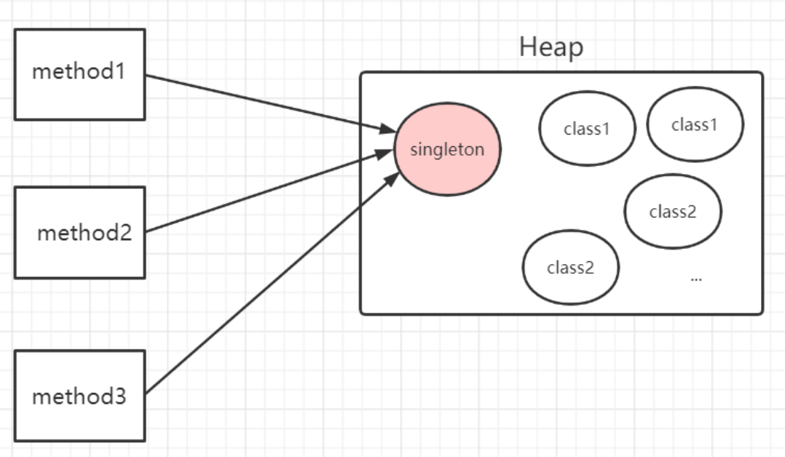
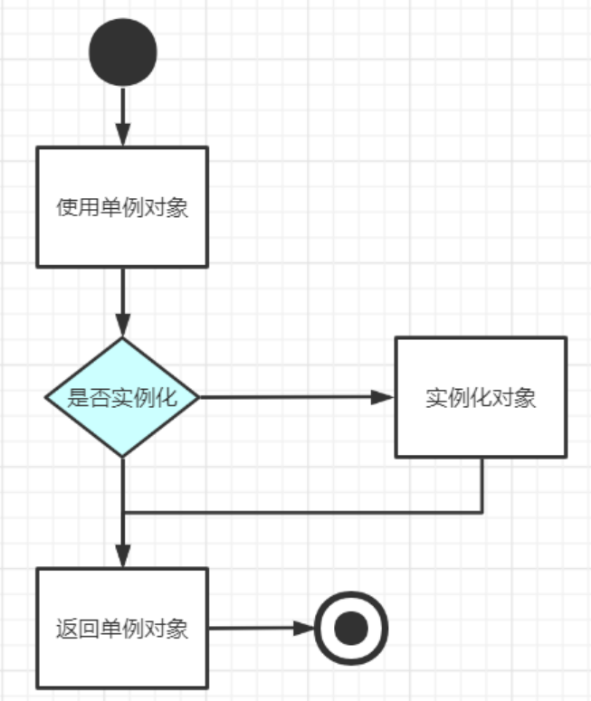
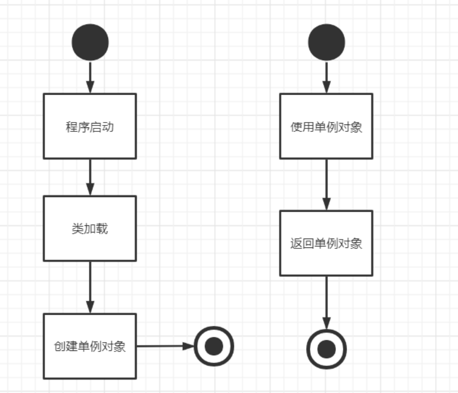
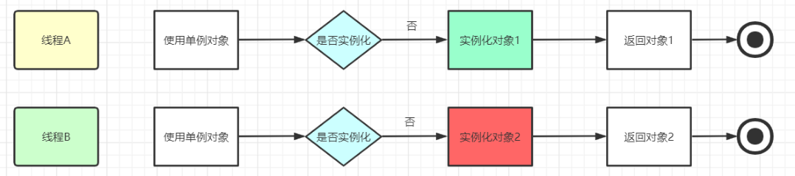
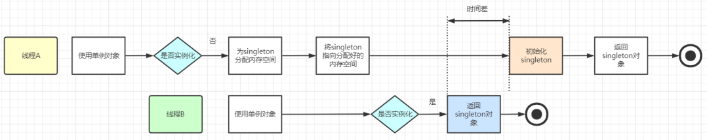
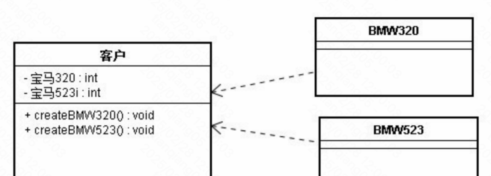
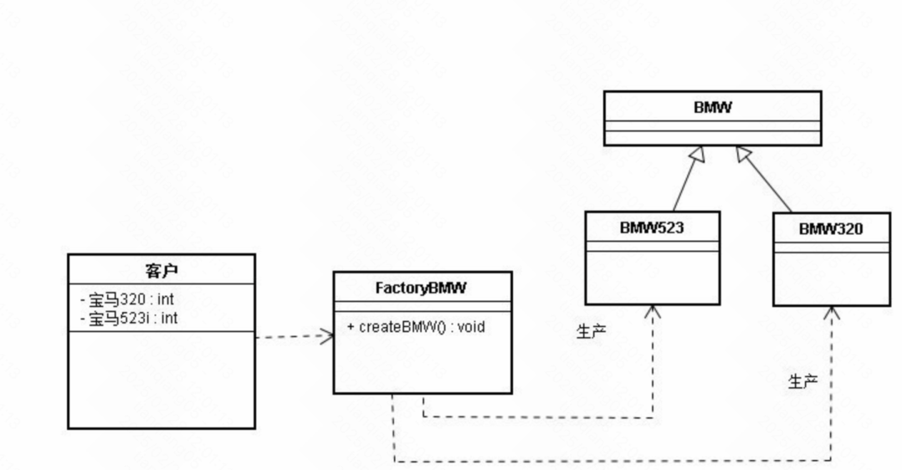
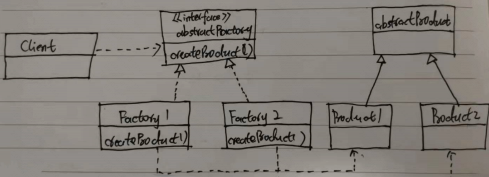
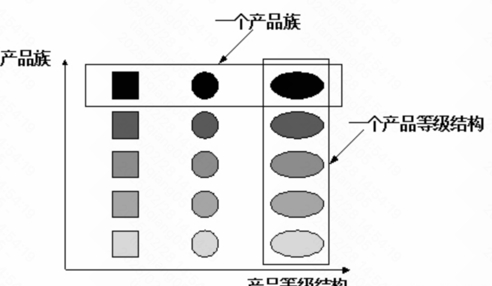
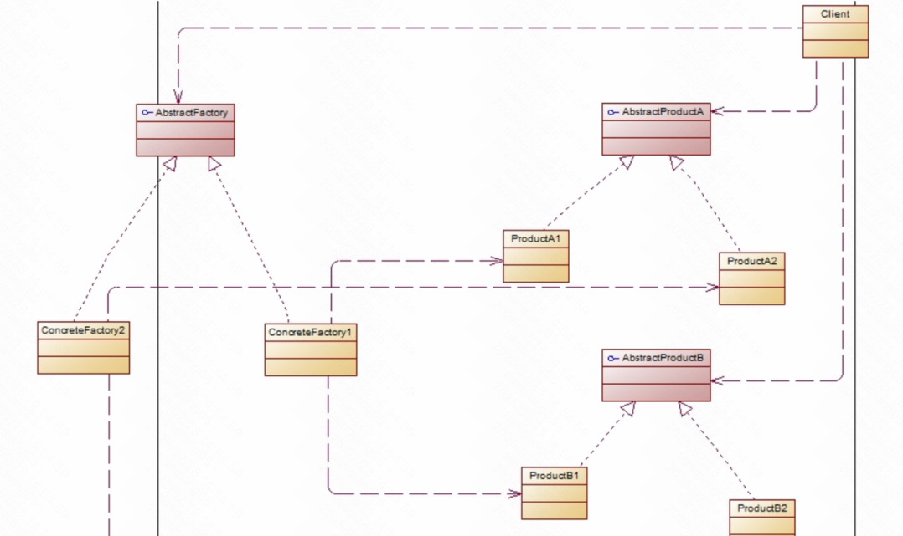

# 设计模式

[返回模块目录](../README.md)

## 基础与常见问题

### 单例模式

#### 什么是单例模式

单例模式是指在内存中只会创建且仅创建一次对象的设计模式。在程序中多次使用同一个对象且作用相同时，为了防止频繁地创建对象使得内存飙升，单例模式可以让程序仅在内存中创建一个对象，让所有需要调用的地方都共享这一单例对象。



#### 单例模式的类型

单例模式有两种类型：

- 懒汉式：在真正需要使用对象时才去创建该单例类对象

- 饿汉式：在类加载时已经创建好该单例对象，等待被程序使用

懒汉式创建单例对象

懒汉式创建对象的方法是在程序使用对象前，先判断该对象是否已经实例化（判空），若已实例化直接返回该类对象。，否则则先执行实例化操作。



对应代码：

```java
public class Singleton {
    private static Singleton singleton;
    private Singleton(){}
    public static Singleton getInstance() {
        if (singleton == null) {
            singleton = new Singleton();
        }
        return singleton;
    }
}
```

饿汉式创建单例对象

饿汉式在类加载时已经创建好该对象，在程序调用时直接返回该单例对象即可，即我们在编码时就已经指明了要马上创建这个对象，不需要等到被调用时再去创建。

关于类加载，涉及到JVM的内容，我们目前可以简单认为在程序启动时，这个单例对象就已经创建好了



```java
public class Singleton{

    private static final Singleton singleton = new Singleton();
    private Singleton(){}
    public static Singleton getInstance() {
        return singleton;
    }
}
```

注意上面的代码在第3行已经实例化好了一个Singleton对象在内存中，不会有多个Singleton对象实例存在

类在加载时会在堆内存中创建一个Singleton对象，当类被卸载时，Singleton对象也随之消亡了。

#### 懒汉式如何保证只创建一个对象

我们再来回顾懒汉式的核心方法

```java
public static Singleton getInstance() {
```

```java
    if (singleton == null) {
        singleton = new Singleton();
    }
    return singleton;
}
```

这个方法其实是存在问题的，试想一下，如果两个线程同时判断singleton为空，那么它们都会去实例化一个Singleton对象，这就变成双例了。所以，我们要解决的是线程安全问题。



最容易想到的解决方法就是在方法上加锁，或者是对类对象加锁，程序就会变成下面这个样子

```java
public static synchronized Singleton getInstance() {
    if (singleton == null) {
        singleton = new Singleton();
    }
    return singleton;
}
// 或者
public static Singleton getInstance() {
    synchronized(Singleton.class) {

        if (singleton == null) {
            singleton = new Singleton();
        }
    }
    return singleton;
}
```

这样就规避了两个线程同时创建`Singleton` 对象的风险，但是引来另外一个问题：每次去获取对象都需要先获取锁，并发性能非常地差，极端情况下，可能会出现卡顿现象。

接下来要做的就是**优化性能，目标是：**如果没有实例化对象则加锁创建，如果已经实例化了，则不需要加锁，直接获取实例

所以直接在方法上加锁的方式就被废掉了，因为这种方式无论如何都需要先获取锁

```java
public static Singleton getInstance() {
    if (singleton == null) {  // 线程A和线程B同时看到singleton = null，如果不为null，则直接返回singleton
        synchronized(Singleton.class) { // 线程A或线程B获得该锁进行初始化
            if (singleton == null) { // 其中一个线程进入该分支，另外一个线程则不会进入该分支
                singleton = new Singleton();
            }
        }
    }
    return singleton;
}
```

上面的代码已经完美地解决了并发安全+性能低效问题：

- 第2行代码，如果singleton不为空，则直接返回对象，不需要获取锁；而如果多个线程发现singleton为空，则进入分支；

- 第3行代码，多个线程尝试争抢同一个锁，只有一个线程争抢成功，第一个获取到锁的线程会再次判断singleton是否为空，因为singleton有可能已经被之前的线程实例化

- 其它之后获取到锁的线程在执行到第4行校验代码，发现singleton已经不为空了，则不会再new一个对象，直接返回对象即可

- 之后所有进入该方法的线程都不会去获取锁，在第一次判断singleton对象时已经不为空了

因为需要两次判空，且对类对象加锁，该懒汉式写法也被称为：Double Check（双重校验） + Lock（加锁）

完整的代码如下所示：

```java
public class Singleton {
    private static Singleton singleton;
    private Singleton(){}
    public static Singleton getInstance() {
        if (singleton == null) {  // 线程A和线程B同时看到singleton = null，如果不为null，则直接返回singleton
            synchronized(Singleton.class) { // 线程A或线程B获得该锁进行初始化
                if (singleton == null) { // 其中一个线程进入该分支，另外一个线程则不会进入该分支
                    singleton = new Singleton();
                }
            }
        }
        return singleton;
    }
}
```

上面这段代码已经近似完美了，但是还存在最后一个问题：指令重排

#### 使用volatile防止指令重排

创建一个对象，在JVM中会经过三步：

1. 为singleton分配内存空间

2. 初始化singleton对象

3. 将singleton指向分配好的内存空间

指令重排序是指：JVM在保证最终结果正确的情况下，可以不按照程序编码的顺序执行语句，尽可能提高程序的性能

在这三步中，第2、3步有可能会发生指令重排现象，创建对象的顺序变为1-3-2，会导致多个线程获取对象时，有可能线程A创建对象的过程中，执行了1、3步骤，线程B判断singleton已经不为空，获取到未初始化的singleton对象，就会报NPE异常。文字较为晦涩，可以看流程图：



使用volatile关键字可以**防止指令重排序，**其原理较为复杂，可以这样理解：使用volatile关键字修饰的变量，可以保证其指令执行的顺序与程序指明的顺序一致，不会发生顺序变换，这样在多线程环境下就不会发生NPE异常了。

volatile还有第二个作用：使用volatile关键字修饰的变量，可以保证其内存可见性，即每一时刻线程读取到该变量的值都是内存中最新的那个值，线程每次操作该变量都需要先读取该变量。

最终的代码如下所示：

```java
public class Singleton {

    private static volatile Singleton singleton;
    private Singleton(){}
    public static Singleton getInstance() {
        if (singleton == null) {  // 线程A和线程B同时看到singleton = null，如果不为null，则直接返回singleton
            synchronized(Singleton.class) { // 线程A或线程B获得该锁进行初始化
                if (singleton == null) { // 其中一个线程进入该分支，另外一个线程则不会进入该分支
                    singleton = new Singleton();
                }
            }
        }
        return singleton;
    }
}
```

#### 破坏懒汉式单例与饿汉式单例

无论是完美的懒汉式还是饿汉式，终究敌不过反射和序列化，它们俩都可以把单例对象破坏掉（产生多个对象）。

- 演示利用反射破坏单例模式

```java
public static void main(String[] args) {
    // 获取类的显式构造器
    Constructor<Singleton> construct =Singleton.class.getDeclaredConstructor();
    // 可访问私有构造器
    construct.setAccessible(true);
    // 利用反射构造新对象
    Singleton obj1 = construct.newInstance();
    // 通过正常方式获取单例对象
    Singleton obj2 = Singleton.getInstance();
    System.out.println(obj1 == obj2); // false
}
```

- 利用序列化与反序列化破坏单例模式

```java
public static void main(String[] args) {
    // 创建输出流
    ObjectOutputStream oos = new ObjectOutputStream(new FileOutputStream("Singleton.file"));
    // 将单例对象写到文件中
    oos.writeObject(Singleton.getInstance());
    // 从文件中读取单例对象
    File file = new File("Singleton.file");
    ObjectInputStream ois =  new ObjectInputStream(new FileInputStream(file));
    Singleton newInstance = (Singleton) ois.readObject();
    // 判断是否是同一个对象
    System.out.println(newInstance == Singleton.getInstance()); // false
}
```

#### 总结

1. 单例模式常见的写法有两种：懒汉式、饿汉式

2. 懒汉式：在需要用到对象时才实例化对象，正确的实现方式是：Double Check + Lock，解决了并发安全和性能低下问题

3. 饿汉式：在类加载时已经创建好该单例对象，在获取单例对象时直接返回对象即可，不会存在并发安全和性能问题。

4. 在开发中如果对内存要求非常高，那么使用懒汉式写法，可以在特定时候才创建该对象；

5. 如果对内存要求不高使用饿汉式写法，因为简单不易出错，且没有任何并发安全和性能问题

6. 为了防止多线程环境下，因为指令重排序导致变量报NPE，需要在单例对象上添加volatile关键字防止指令重排序

7. 最优雅的实现方式是使用枚举，其代码精简，没有线程安全问题，且 Enum 类内部防止反射和反序列化时破坏单例。

#### 扩展问题

- 为什么使用private修饰构造器？

构造器被声明为`private` 的核心目的是禁止外部通过`new` 关键字直接创建实例。单例模式的核心约束是全局唯一实例，若构造器公开，任何类都可以随意实例化，破坏单例性。通过私有化构造器，强制所有实例创建必须通过`getInstance()` 方法集中控制，从而保证唯一性。

- 除了private，还有哪些修饰符？

1. public：允许任何类实例化，破坏单例，不可用。

2. protected：允许子类或同包类实例化，同样破坏单例。

3. 默认（包级私有）：允许同包内实例化，也不满足需求。因此，只有`private` 能实现严格单例。

- 为什么getInstance()方法要写成static的？不写成static的会怎样？

`static` 方法属于类级别，而非实例级别。单例模式要求在实例不存在时创建对象，若`getInstance()` 非静态，则调用该方法必须先有实例（`newSingleton().getInstance()` ），导致逻辑矛盾——即必须通过实例方法获取实例，而实例尚未存在。因此，必须通过静态方法直接通过类名访问，绕过实例依赖。

- synchronized关键字为什么修饰方法？还能怎么用？有什么区别？

1. 为何使用`synchronized` 块而非方法？代码中的`synchronized` 锁定的是`Singleton.class` 对象，而非整个方法。这种细粒度锁的优点是：

    - 性能优化：仅当第一次创建实例时同步，后续调用直接返回实例，避免每次调用都加锁。

    - 锁范围控制：同步块仅包裹实例化逻辑，减少锁竞争范围。若直接修饰方法（`public static synchronized SingletongetInstance()` ），则所有线程访问该方法时都会串行化，即使实例已存在，导致不必要的性能损耗。

### 工厂模式详解

在面向对象编程中，创建对象实例最常用的方式就是通过 new 操作符构造一个对象实例，但在某些情况下，new 操作符直接生成对象会存在一些问题。举例来说，对象的创建需要一系列的步骤：可能需要计算或取得对象的初始位置、选择生成哪个子对象实例、或在生成之前必须先生成一些辅助对象。在这些情况，新对象的建立就是一个 “过程”，而不仅仅是一个操作，就像一部大机器中的一个齿轮传动。

针对上面这种情况，我们如何轻松方便地构造对象实例，而不必关心构造对象实例的细节和复杂过程？解决方案就是使用一个工厂类来创建对象。

#### 什么是工厂模式

工厂模式将目的将创建对象的具体过程屏蔽隔离起来，从而达到更高的灵活性，工厂模式可以分为三类：

- 简单工厂模式（Simple Factory）

- 工厂方法模式（Factory Method）

- 抽象工厂模式（Abstract Factory）

这三种模式从上到下逐步抽象，并且更具一般性。《设计模式》一书中将工厂模式分为两类：工厂方法模式与抽象工厂模式。将简单工厂模式看为工厂方法模式的一种特例，两者归为一类。 我们先从以下案例对工厂模式做个初步的了解

1. 在没有工厂的时代，如果客户需要一款宝马车，那么就需要客户去创建一款宝马车，然后拿来用。

2. 简单工厂模式：后来出现了工厂，用户不再需要去创建宝马车，由工厂进行创建，想要什么车，直接通过工厂创建就可以了。

3. 工厂方法模式：为了满足客户，宝马车系列越来越多，一个工厂无法创建所有的宝马系列，于是又单独分出来多个具体的工厂，每个具体工厂创建一种系列，即具体工厂类只能创建一个具体产品。但是宝马工厂还是个抽象，你需要指定某个具体的工厂才能生产车出来。

4. 抽象工厂模式：随着客户要求越来越高，宝马车必须配置空调，于是这个工厂开始生产宝马车和需要的空调。最终是客户只要对宝马的销售员说：我要523i空调车，销售员就直接给他523i空调车了。而不用自己去创建523i空调车宝马车。

#### 简单工厂模式

简单工厂模式的核心是定义一个创建对象的接口，将对象的创建和本身的业务逻辑分离，降低系统的耦合度，使得两个修改起来相对容易些，当以后实现改变时，只需要修改工厂类即可。

如果不使用工厂，用户将自己创建宝马车，具体UML图和代码如下：



```java
public class BMW320 {
        public BMW320(){
                System.out.println("制造-->BMW320");
        }
}

public class BMW523 {
        public BMW523(){
                System.out.println("制造-->BMW523");
        }
}

public class Customer {
        public static void main(String[] args) {
                BMW320 bmw320 = new BMW320();
                BMW523 bmw523 = new BMW523();
        }
}
```

用户需要知道怎么创建一款车，这样子客户和车就紧密耦合在一起了，为了降低耦合，就出现了简单工厂模式，把创建宝马的操作细节都放到了工厂里，而客户直接使用工厂的创建方法，传入想要的宝马车型号就行了，而不必去知道创建的细节。

简单工厂模式的UML图:



- 工厂类角色： 该模式的核心，用来创建产品，含有一定的商业逻辑和判断逻辑

- 抽象产品角色：它一般是具体产品继承的父类或者实现的接口。

- 具体产品角色：工厂类所创建的对象就是此角色的实例。在java中由一个具体类实现。

代码实现：

产品类：

```java
abstract class BMW {
        public BMW(){}
}

public class BMW320 extends BMW {
        public BMW320() {
                System.out.println("制造-->BMW320");
        }
}
public class BMW523 extends BMW{
        public BMW523(){
                System.out.println("制造-->BMW523");
        }
}
```

工厂类：

```java
public class Factory {
        public BMW createBMW(int type) {
                switch (type) {

                case 320:
                        return new BMW320();
                case 523:
                        return new BMW523();
                default:
                        break;
                }
                return null;
        }
}
```

用户类：

```java
public class Customer {
        public static void main(String[] args) {
                Factory factory = new Factory();
                BMW bmw320 = factory.createBMW(320);
                BMW bmw523 = factory.createBMW(523);
        }
}
```

简单工厂模式的优缺点：

简单工厂模式提供专门的工厂类用于创建对象，实现了对象创建和使用的职责分离，客户端不需知道所创建的具体产品类的类名以及创建过程，只需知道具体产品类所对应的参数即可，通过引入配置文件，可以在不修改任何客户端代码的情况下更换和增加新的具体产品类，在一定程度上提高了系统的灵活性。

但缺点在于不符合“开闭原则”，每次添加新产品就需要修改工厂类。在产品类型较多时，有可能造成工厂逻辑过于复杂，不利于系统的扩展维护，并且工厂类集中了所有产品创建逻辑，一旦不能正常工作，整个系统都要受到影响。

#### 工厂方法模式

工厂方法模式将工厂抽象化，并定义一个创建对象的接口。每增加新产品，只需增加该产品以及对应的具体实现工厂类，由具体工厂类决定要实例化的产品是哪个，将对象的创建与实例化延迟到子类，这样工厂的设计就符合“开闭原则”了，扩展时不必去修改原来的代码。在使用时，用于只需知道产品对应的具体工厂，关注具体的创建过程，甚至不需要知道具体产品类的类名，当我们选择哪个具体工厂时，就已经决定了实际创建的产品是哪个了。

但缺点在于，每增加一个产品都需要增加一个具体产品类和实现工厂类，使得系统中类的个数成倍增加，在一定程度上增加了系统的复杂度，同时也增加了系统具体类的依赖。

工厂方法的 UML 结构图如下：



- 抽象工厂 AbstractFactory： 工厂方法模式的核心，是具体工厂角色必须实现的接口或者必须继承的父类，在 Java 中它由抽象类或者接口来实现。

- 具体工厂 Factory：被应用程序调用以创建具体产品的对象，含有和具体业务逻辑有关的代码

- 抽象产品 AbstractProduct：是具体产品继承的父类或实现的接口，在 Java 中一般有抽象类或者接口来实现。

- 具体产品 Product：具体工厂角色所创建的对象就是此角色的实例。

代码实现：

产品类：

```java
abstract class BMW {
        public BMW(){}
}
public class BMW320 extends BMW {
        public BMW320() {
                System.out.println("制造-->BMW320");
        }
}
public class BMW523 extends BMW{
        public BMW523(){
                System.out.println("制造-->BMW523");
        }
}
```

工厂类：

```java
interface FactoryBMW {
        BMW createBMW();
}

public class FactoryBMW320 implements FactoryBMW{
        @Override
        public BMW320 createBMW() {
                return new BMW320();
        }

}
public class FactoryBMW523 implements FactoryBMW {
        @Override
        public BMW523 createBMW() {
                return new BMW523();
        }
}
```

客户类：

```java
public class Customer {
        public static void main(String[] args) {
                FactoryBMW320 factoryBMW320 = new FactoryBMW320();
                BMW320 bmw320 = factoryBMW320.createBMW();
                FactoryBMW523 factoryBMW523 = new FactoryBMW523();
                BMW523 bmw523 = factoryBMW523.createBMW();
        }
}
```

#### 抽象工厂模式

在工厂方法模式中，我们使用一个工厂创建一个产品，一个具体工厂对应一个具体产品，但有时候我们需要一个工厂能够提供多个产品对象，而不是单一的对象，这个时候我们就需要使用抽象工厂模式。

在介绍抽象工厂模式前，我们先厘清两个概念：

- 产品等级结构：产品等级结构指的是产品的继承结构，例如一个空调抽象类，它有海尔空调、格力空调、美的空调等一系列的子类，那么这个空调抽象类和他的子类就构成了一个产品等级结构。

- 产品族：产品族是指由同一个工厂生产的，位于不同产品等级结构中的一组产品。比如，海尔工厂生产海尔空调、海尔冰箱，那么海尔空调则位于空调产品族中。

产品等级结构和产品族结构示意图如下



什么是抽象工厂模式：

抽象工厂模式主要用于创建相关对象的家族。当一个产品族中需要被设计在一起工作时，通过抽象工厂模式，能够保证客户端始终只使用同一个产品族中的对象；并且通过隔离具体类的生成，使得客户端不需要明确指定具体生成类；所有的具体工厂都实现了抽象工厂中定义的公共接口，因此只需要改变具体工厂的实例，就可以在某种程度上改变整个软件系统的行为。

但该模式的缺点在于添加新的行为时比较麻烦，如果需要添加一个新产品族对象时，需要更改接口及其下所有子类，这必然会带来很大的麻烦。

UML结构图：



- 抽象工厂 AbstractFactory：定义了一个接口，这个接口包含了一组方法用来生产产品，所有的具体工厂都必须实现此接口。

- 具体工厂 ConcreteFactory：用于生产不同产品族，要创建一个产品，用户只需使用其中一个工厂进行获取，完全不需要实例化任何产品对象。

- 抽象产品 AbstractProduct：这是一个产品家族，每一个具体工厂都能够生产一整组产品。 具体产品 Product

代码实现：

通过抽象工厂模式，我们可以实现以下的效果：比如宝马320系列使用空调型号A和发动机型号A，而宝马230系列使用空调型号B和发动机型号B，在为320系列生产相关配件时，就无需制定配件的型号，它会自动根据车型生产对应的配件型号A。

产品类：

```java
//发动机以及型号
public interface Engine {}

public class EngineA implements Engine{

    public EngineA(){

        System.out.println("制造-->EngineA");

    }
}
public class EngineB implements Engine{

    public EngineB(){

        System.out.println("制造-->EngineB");

    }
}


//空调以及型号
public interface Aircondition {}

public class AirconditionA implements Aircondition{

    public AirconditionA(){

        System.out.println("制造-->AirconditionA");

    }
}
public class AirconditionB implements Aircondition{

    public AirconditionB(){

        System.out.println("制造-->AirconditionB");

    }
}
```

创建工厂类：

```java
//创建工厂的接口
public interface AbstractFactory {

    //制造发动机
    public Engine createEngine();
    //制造空调
    public Aircondition createAircondition();
}

//为宝马320系列生产配件
public class FactoryBMW320 implements AbstractFactory{

    @Override

    public Engine createEngine() {

        return new EngineA();

    }

    @Override

    public Aircondition createAircondition() {

        return new AirconditionA();

    }
}
//宝马523系列
public class FactoryBMW523 implements AbstractFactory {

     @Override

    public Engine createEngine() {

        return new EngineB();

    }

    @Override

    public Aircondition createAircondition() {

        return new AirconditionB();

    }
}
```

客户：

```java
public class Customer {

    public static void main(String[] args){

        //生产宝马320系列配件
        FactoryBMW320 factoryBMW320 = new FactoryBMW320();

        factoryBMW320.createEngine();
        factoryBMW320.createAircondition();

        //生产宝马523系列配件

        FactoryBMW523 factoryBMW523 = new FactoryBMW523();

        factoryBMW523.createEngine();
        factoryBMW523.createAircondition();
    }
}
```

工厂模式总结：

工厂方法模式与抽象工厂模式的区别在于：

1. 工厂方法只有一个抽象产品类和一个抽象工厂类，但可以派生出多个具体产品类和具体工厂类，每个具体工厂类只能创建一个具体产品类的实例。

2. 抽象工厂模式拥有多个抽象产品类（产品族）和一个抽象工厂类，每个抽象产品类可以派生出多个具体产品类；抽象工厂类也可以派生出多个具体工厂类，同时每个具体工厂类可以创建多个具体产品类的实例

## 后端面经与场景补充

<!-- 原PDF第507页；面经原题号 86 -->

### spring里面用了哪些设计模式，请举一个例子讲一下设计模式用在了哪里

- 工厂模式

- 单例模式

- 代理模式

- 模板方法模式

- 观察者模式

- 适配器模式

- 装饰器模式

例子：工厂模式在 Spring 中的应用

工厂模式的核心思想是：将对象的创建过程封装起来，客户端不需要关心对象是如何创建的，只需要通过工厂获取实例即可。这有助于解耦对象的使用和创建。

Spring 中的体现：BeanFactory  和 ApplicationContext

在 Spring 中，`BeanFactory`  就是一个典型的工厂模式的实现。

- `BeanFactory`  是 Spring 容器的核心接口，它负责创建、配置和管理 Bean。

- 开发者不需要手动 `new`  一个对象，而是通过 Spring 容器（即“工厂”）来获取 Bean 实例。

```java
// 配置类
@Configuration
public class AppConfig {

    @Bean
    public UserService userService() {
        return new UserService(userRepository());
    }

    @Bean
    public UserRepository userRepository() {
        return new UserRepository();
    }
}

// 使用
public class Main {
    public static void main(String[] args) {
        // 创建工厂（容器）
        ApplicationContext context = new AnnotationConfigApplicationContext(AppConfig.class);

        // 从工厂中获取 bean，而不是直接 new
        UserService userService = context.getBean(UserService.class);

        userService.saveUser("John");
    }
}
```

- `ApplicationContext`  是 `BeanFactory`  的子接口，它就是一个高级工厂。

- 你调用 `context.getBean()`  时，Spring 内部根据配置（XML、注解或 Java Config）决定如何创建这个 Bean（是否单例、是否需要依赖注入等）。

- 你作为使用者，不需要知道 `UserService`  是如何被构造的，甚至不知道它的构造函数参数，工厂帮你处理了依赖的组装。
